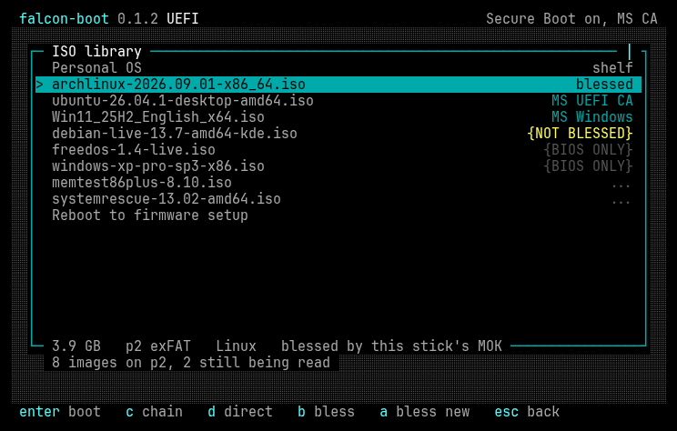
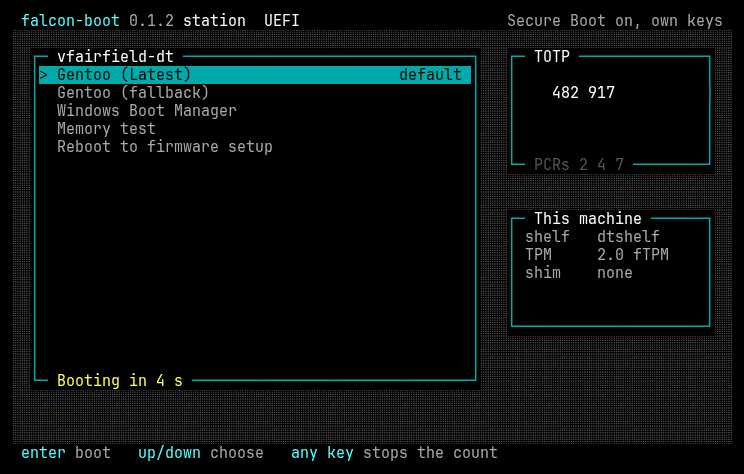
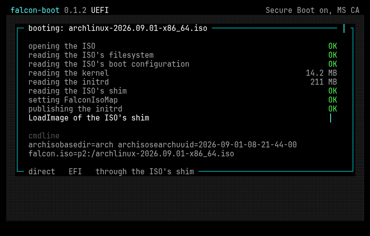
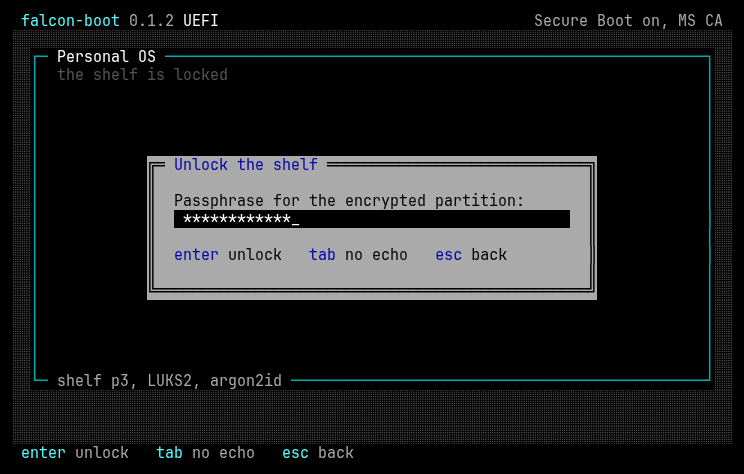
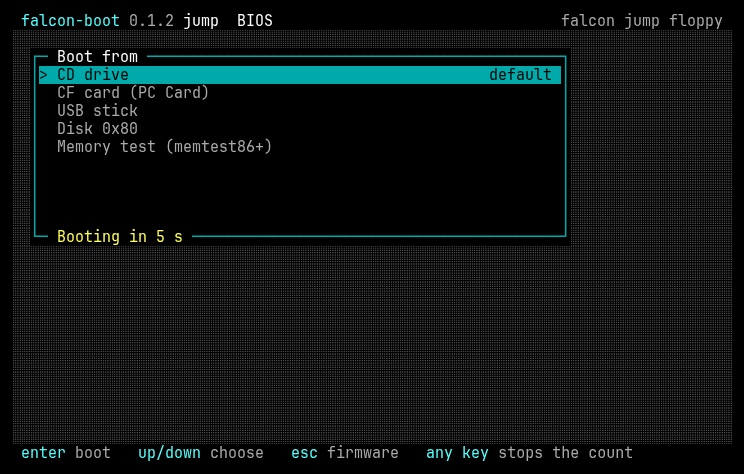

# falcon-boot

Falcon-Boot is a cross-platform USB boot loader that aims to boot as many operating systems as possible, straight from their ISOs. It currently supports hundreds of ISOs, and around 50 of the most popular operating systems make up the core corpus that gets validated on every release ([see coverage.md](docs/coverage.md)). Falcon supports BIOS (i586 and x86-64) and UEFI (AArch64 and x86-64), so it runs on most systems.

Copy `.iso` files onto the stick's exFAT partition from any computer, and they appear in the menu ready to boot: Linux, Windows install media, FreeBSD, Proxmox, TrueNAS, ESXi, rescue and imaging tools, and memtest86+.

If you want, the stick can also carry a personal OS on an encrypted partition, which you unlock with one passphrase before it boots.

Falcon also comes in a few smaller forms. You can install it on a machine's own disk as its boot loader, and Falcon-Jump is a 1.44 MB floppy that boots machines too old to boot from USB, CDs or PC Cards. Falcon-Jump's PC Card boot is still experimental; everything else it does is proven the same way as the rest of Falcon.

Falcon-Boot is written from the firmware up in C, with its own UEFI loader, its own BIOS loader, and its own filesystem, LUKS2 and Windows-image code.

It is licensed under GPL-3.0-or-later.

Just want a bootable stick? Jump to [Quick start](#quick-start).




## Quick start

On Linux, download the tarball for your machine from the [releases page](https://git.airies.net/vifair22/falcon-boot/-/releases). I don't have an installer for Windows or macOS yet. On Windows you can use WSL and pass the USB stick through, and on macOS you can use a VM.

Next, run the following commands to verify the checksum and unpack the binaries into `/usr`:

```sh
sha256sum -c --ignore-missing SHA256SUMS
tar xzf falcon-boot-X.Y.Z-<arch>.tar.gz
sudo cp -r falcon-boot-X.Y.Z/usr/. /usr/
```

`falcon-boot-mkstick` uses standard Linux tools to partition and format the stick, and `create` stops and names the first one it can't find. You'll need these on your `PATH` (the `falcon-boot-bin` package installs them for you):

- `sgdisk`, from `gdisk` on Debian and Ubuntu or `gptfdisk` on Arch.
- `mkfs.fat` from `dosfstools`, `mkfs.exfat` from `exfatprogs`, and `mkfs.ext4` from `e2fsprogs`.
- `cryptsetup` and `openssl`.
- `sbsign`, from `sbsigntool` on Debian and Ubuntu or `sbsigntools` on Arch.
- `losetup`, `mount` and `umount`, which almost every Linux system already has.

You only need `mkfs.btrfs` (from `btrfs-progs`) or `mkfs.xfs` (from `xfsprogs`) if you choose that filesystem for p3.

Then run the guided install to make a stick:

```sh
sudo falcon-boot-mkstick create
```

It asks the questions below, in this order. Press Enter to take the default shown in brackets. Nothing is written until you answer `y` at the very end, and before that it shows you a summary and the equivalent command lines.

- **Which drive?** Choose one from the list, which shows removable drives first, then type its name (for example `sdb`) to confirm. Everything on that drive will be erased. A disk that is mounted or otherwise in use is listed, but you can't choose it.
- **What goes on the stick besides the loaders and the ISO library?**
  - `1`, a personal OS (default): This adds an encrypted shelf (p3) and an encrypted root for your OS (p4). Choose this if you want to carry your own OS on the stick. p4 starts empty, and by default it gets half of the free space.
  - `2`, the shelf only: You get p3 but no p4, so your ISOs get all the remaining space. This is a good fit if you mostly boot ISOs but need unsigned ones to work under Secure Boot, because the signing appliance and its key are on the stick and you don't need another computer.
  - `3`, neither: You just get the loaders and the ISO library, with no passphrase to type. This works well if Secure Boot is off on your machines, or if you only boot media that Microsoft's keys already accept. If you need to sign something later, you'll do it from a Linux machine, so the installer asks where to keep the signing key on this one.
- **Add the AArch64 loader?** `[Y]` Say yes if the stick might be used on a 64-bit ARM UEFI machine. Saying no leaves out the loader, shim and appliance for that architecture, which saves a little space.
- **Add the BIOS loader?** `[Y]` Say yes if the stick might be used on a machine without UEFI, including old 32-bit ones. It doesn't need its own partition, so there's little reason to turn it off.
- **Which MOK?** `[1]` The MOK is the key the loader is signed with, and each machine with Secure Boot on has to enroll it once. Choose `1` to make a new one, which is what you want for your first stick. Choose `2` to reuse the key from another stick, which you'll need to provide as a PEM key and certificate. Machines that have already enrolled that key will boot this stick without enrolling again, so this is handy for a replacement or a second stick, but both sticks then share one key.
- **Which UKIs?** (only with p3) If you've already built personal OS images, enter their paths one per line and they'll be signed and put on the shelf. An empty line ends the list. If you don't have any yet, just press Enter: [docs/personal-os.md](docs/personal-os.md) explains how to add one later.
- **Change filesystems or partition sizes?** `[N]` The defaults work for most sticks. If you say yes, it asks about these:
  - The size of p1, 64M by default.
  - The filesystem on p2, exFAT by default. FAT32 can't hold a file of 4 GiB or more, which rules out most Windows ISOs.
  - The size of p3, 1G by default. Make it bigger if you plan to keep a lot of UKIs on the shelf.
  - The filesystem on p3, ext4 by default. You can also choose `fat32`, `btrfs` or `xfs`. btrfs and xfs need their `mkfs` tools installed on this machine, and xfs needs a p3 of at least 320M.
- **How big should p2 be?** `[half]` (only with a personal OS) The space left after p1 and p3 is split between the ISO library and your OS. Enter a size for p2, such as `32G`, and p4 gets the rest. Think about how many ISOs you want to carry and how large your OS will grow.
- **What passphrase?** (only with p3) The same passphrase unlocks both p3 and p4. It has to be printable ASCII, and you'll type it twice.

If you'd rather skip the questions, you can pass everything as flags:

```sh
sudo falcon-boot-mkstick create /dev/disk/by-id/usb-<your stick> --force
sudo falcon-boot-mkstick bios /dev/disk/by-id/usb-<your stick>
```

When the stick is ready, copy your ISOs onto the partition labelled `FALCON-ISO`.

With Secure Boot on, the first boot on each machine stops at shim's `Verification failed: (0x1A) Security Violation` screen. That's expected. Press Enter, press a key to start MokManager, then choose Enroll key from disk, `FALCONESP`, `falcon-boot.cer`, Continue, Yes and Reboot. Manual Section 3.1 shows every screen.

`docs/Manual.md` is the full reference. It covers the menu, every route, blessing, the personal OS, the station and `STATION.INI`, Falcon-Jump, every `falcon-boot-mkstick` command, and what to do on each failure page.

The personal OS is your own install, not part of this project. [docs/personal-os.md](docs/personal-os.md) is the guide. It explains the small set of things an OS has to provide to boot from the shelf (a signed UKI and a one-file initramfs drop-in for the passphrase handoff), walks through an Arch build with mkinitcpio, and gives the dracut equivalent for other systemd distributions. Everything else is left to your distribution's normal tooling.

## One loader, five forms

| form | what it is | runs on |
|---|---|---|
| **The stick** | A USB stick with up to four partitions: the boot partition, an exFAT ISO library, an encrypted shelf of personal OS images, and an encrypted root for that OS (Manual Section 10.1). | UEFI on x86-64 and AArch64; BIOS on i586 and later, including 32-bit machines |
| **The station** | Falcon installed on a machine's own disk as its boot loader, alongside what's already there. It gives you a boot list with a countdown, Windows Boot Manager, other firmware entries, a memory test (memtest86+, or PassMark MemTest86 on AArch64) and the personal OS. On UEFI it also shows a TOTP code that the TPM releases only while the firmware and boot chain are unchanged since enrollment, so you can compare it with your authenticator before you type your passphrase (Manual Section 7). | UEFI on x86-64 and AArch64; BIOS on i586 and later |
| **station-legacy** | The BIOS station plus Falcon-Jump's drivers, for a machine whose BIOS can't boot a CD, a USB stick or a CF card (Manual Section 7.7). | BIOS, i586 and later |
| **Falcon-Jump** | A 1.44 MB boot floppy with its own IDE CD, USB (UHCI, OHCI, EHCI) and PC Card drivers. It can boot the CD drive, a Falcon stick on USB or a CompactFlash card on machines whose BIOS can't (Manual Section 9). | BIOS, i586 and later |
| **The signing appliance** | A small Linux image on the stick that signs media with the stick's own key, so that media boots with Secure Boot on. You start it from the menu, and you don't need another computer (Manual Section 4.2). | UEFI |



## What happens when you pick an ISO

While the menu is up, Falcon looks inside every image on the stick and picks the route that suits it. Each route has a code, which you'll see on screen while it boots (Manual Section 2).

| what you picked | what Falcon does | code |
|---|---|---|
| A Linux ISO | Starts the ISO's own kernel and initrd directly. A small program appended to the initrd maps the ISO back into place for the distro to find, which means there's no loopback config and there are no per-distro scripts. | `DIR` |
| A Linux ISO, Secure Boot on | Starts the distro's own Microsoft-signed shim, which then verifies either the distro's signed kernel or its signed GRUB, with a menu that Falcon serves in place of GRUB's own. Nothing gets re-signed. | `D3A`, `D3B` |
| Any image, blessed | Boots an image you've signed with your own key: either a Linux ISO wrapped as a signed UKI, or a BSD or memtest86+ loader signed as it is. | `BLS`, `BLB` |
| Windows install media: 8.1 to 11 on UEFI, Vista to 11 on BIOS | Boots the ISO without changing it on disk. `boot.wim` is patched in memory as it's served, so Setup can find its own ISO. | `WIN` |
| Windows XP, BIOS | Edits text-mode Setup's `txtsetup.sif` in memory so that it loads Falcon's virtual CD driver, then runs Setup from a virtual CD that stays resident. | `WXP` |
| A BSD | Serves the ISO to its own loader as a memory disk. | `BSD` |
| Anything else | Chains to the ISO's own boot loader from a virtual CD. | `CHN` |
| A `.img` or an `.efi` | Serves the disk image and starts its boot loader, or starts the `.efi` itself. | `IMG`, `EFI` |
| The personal OS | Unlocks the shelf, starts the OS's UKI, and hands the passphrase to its initramfs, so the root opens without asking you a second time. | `POS` |



### Measured on real media

Every release is tested by booting 63 ISOs under six firmware states: Secure Boot off, Secure Boot on with Microsoft's keys, Secure Boot on with only your own keys, Secure Boot on with shim's validation off, BIOS, and BIOS on a 32-bit processor. A merge into `master` fails if any image that booted before no longer does.

The mainstream tier is 27 images, including Debian, Fedora, Ubuntu, Mint, openSUSE, Arch, Manjaro, CachyOS, Pop!_OS, Kali, SystemRescue, Clonezilla, GParted, and Windows 10, 11 and Server 2025. They boot every time when you press Enter on Falcon's default route, with Secure Boot off, with Secure Boot on under Microsoft's keys, and on BIOS. With Secure Boot on, the platform refuses an image Microsoft didn't sign, and that image boots once you've blessed it. The second tier, which includes Proxmox and TrueNAS, is at 100% too. `docs/coverage.md` has the full matrix, cell by cell, including what doesn't boot yet.

## Secure Boot stays on

Everything Falcon starts is verified by the platform through shim, the same way a distro's own boot loader is. Media is verified against Microsoft's keys or against a key that's yours alone. Each stick makes its own key pair, you enroll its certificate once per machine, and you sign ("bless") media with it, either on the stick's own appliance or on any Linux host. Falcon's loader only verifies: it never signs, and it holds no key. The stick's private key lives encrypted on its shelf, where only the signing appliance and the sign tool read it. `docs/DESIGN.md` Section 7 describes the model in full.

## How it compares with Ventoy

Ventoy made "copy ISOs to a stick and boot them" the normal way to carry installers, and it's the right tool for many people. Falcon takes the same idea in a different direction:

- **Secure Boot stays on, with your keys.** Distro media boots through its own signed loaders, and you sign anything else with a key that belongs to you and to one stick.
- **You can carry a personal OS alongside your ISOs.** It's encrypted with LUKS2, its UKI lives on an encrypted shelf, and you only type one passphrase between power-on and the desktop.
- **It can also be a machine's boot loader.** That's the station, which adds a TPM-sealed TOTP check before the passphrase.
- **It works on old hardware.** There's a BIOS loader for 32-bit i586 machines, support for Windows XP Setup, and a floppy for machines that can't boot from USB at all.
- **It's one codebase, written to be read.** Both loaders, the host tools and the appliance share one C library that's tested on the host, and every boot route is drawn in `docs/DESIGN.md` Section 11.






## Releases

Each release on the [releases page](https://git.airies.net/vifair22/falcon-boot/-/releases) includes:

- mkstick and the sign tool as static binaries, with every unsigned loader they install, in one tarball per host architecture (`falcon-boot-X.Y.Z-x86_64.tar.gz`, `falcon-boot-X.Y.Z-aarch64.tar.gz`). Unpacked under `/usr`, they don't need any path options.
- The BIOS station bundle.
- The Falcon-Jump floppy image.
- `SHA256SUMS` for all of the above.

Falcon-Boot is also available as a package, `falcon-boot-bin`, in the `falcon` pacman repository on dl.airies.net. Manual Section 14 explains how to check and install all of these.

## Building

You'll need docker. `make` runs every goal in the harness container (`tools/coverage/Dockerfile`), which is the same toolchain CI uses. It pulls the image from the project's registry once you've run `docker login registry.git.airies.net:443`, and builds it locally otherwise. `make install` and `make run*` act on the host after the container has built what they need, and `run*` also needs QEMU with OVMF on the host.

To build with your host's own toolchain instead, set `FALCON_NATIVE=1`. You'll then need:

- `x86_64-w64-mingw32-gcc`.
- The host gcc's 32-bit libgcc (`gcc-multilib` on Debian), for the BIOS loader and falcon-hook's 32-bit build.
- `i686-w64-mingw32-gcc`, for the 32-bit winjump.
- `cryptsetup`, `sbsign` and `mkfs.exfat`/`mkfs.ext4`, for the host tools.
- QEMU with OVMF and SeaBIOS, for the rigs.
- mtools, for the floppy.

`make check-tools` tells you what's missing.

```sh
make check-tools     # what is missing, and what each tool is for
make                 # the UEFI loader, host tools and winjump into build/bin/
make test-fixtures   # the images the image-backed tests read
make test            # every component's host tests
make coverage        # the tests, strictly, with one coverage report
make analyze         # cppcheck, gcc -fanalyzer and clang-tidy, gated
make bios            # the BIOS loader's stages
make station         # the stationary build, UEFI and BIOS
make jump            # the boot floppy, build/bin/falcon-jump.img
make run             # the test stick under QEMU/OVMF with a display window
```

The rigs (`make test-stick`, `test-core`, `test-station*`, `test-tpm-rig`, `test-jump`, `test-bios-img` and the rest) are listed in Manual Section 13. The corpus runs in the same container, through `tools/coverage/harness.sh` with no command, and that's how the measurements in `docs/coverage.md` are made.

The pipeline (`.gitlab-ci.yml`) runs every merge request through the tests (with JUnit reports), `make analyze`, the coverage gate and the build. A merge request into `master` is a release shipping, so it also runs the rigs listed in `.gitlab-ci.yml` and the corpus under every state, and it fails if any scorecard cell that passes on `master` no longer does (`tools/coverage/scorecard-diff.py`), unless `tools/coverage/scorecard-accept.tsv` lists that cell with a reason for the merge request's reviewer. `test-devlink` isn't one of those rigs, because DevLink is a separate tool outside the release.

`make install` builds `falcon-boot-mkstick` and `falcon-boot-sign` and copies them into `/usr/local/bin`, and it honors `PREFIX` and `DESTDIR`. `make uninstall` removes them.

`tools/mockup-shots.sh` redraws the screenshots above from `docs/tui-mockup.html`, which defines how the screens should look.

## Layout

```
apps/              the loaders: stick/, station/, esp-jump/, station-legacy/, jump/
falcon-core/       firmware-free libraries every other component links:
                   crypto, TPM, the exFAT, ext4, FAT, ISO9660, UDF, btrfs
                   and xfs drivers,
                   LUKS2, partition tables, the PE walker, boot predictions,
                   media logic, WIM, the manifest, the screen layout
falcon-efi/        the UEFI loader (x86-64 and AArch64 PE32+) and its QEMU/OVMF rigs
falcon-bios/       the BIOS loader (three stages into i586 protected mode),
                   jump's drivers, and the SeaBIOS rigs
falcon-cli/        host tools: falcon-boot-mkstick, falcon-boot-sign
falcon-appliance/  the on-stick signing appliance: PID 1 and its image recipe
falcon-hook/       the initrd program that maps an ISO for a Linux distro
falcon-winjump/    the WinPE program that attaches a Windows ISO for Setup
falcon-vdisk/      the WinPE virtual-CD driver for Windows older than 8
docs/              DESIGN.md, Manual.md, coverage.md (the corpus scorecard),
                   tui-mockup.html (the screens), img/ (the README's shots)
tools/             the static-analysis gate, the processor-floor check,
                   and coverage/, the harness that produces docs/coverage.md
```

Each component has `src/`, `tests/` and `tools/` as it needs them, plus a `build.mk` that the root Makefile includes, so it's all one build rather than nine.

## Licence

Falcon-Boot is licensed under GPL-3.0-or-later. The full text is in `LICENSE`.
