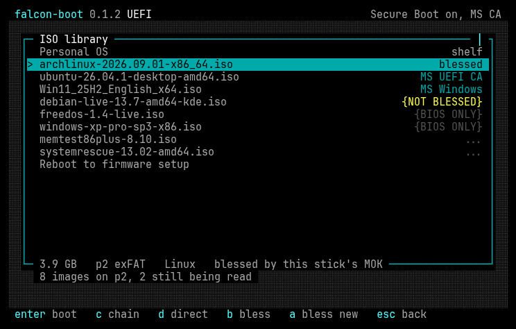
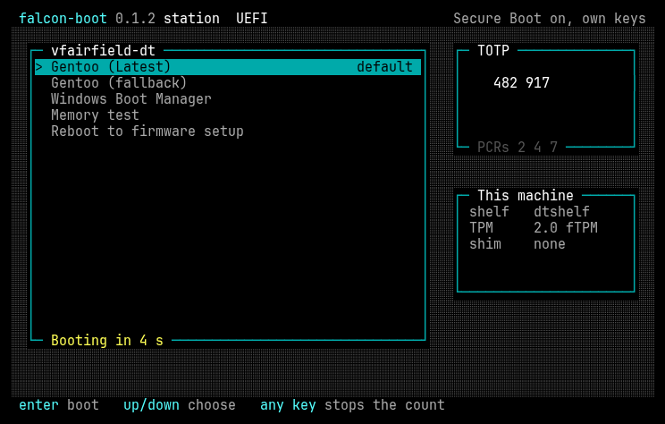
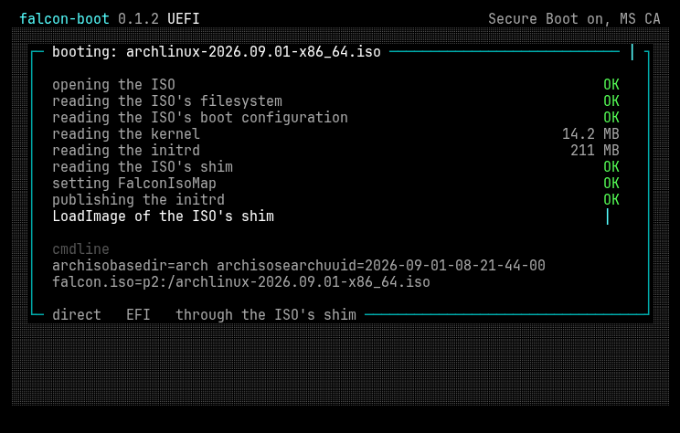
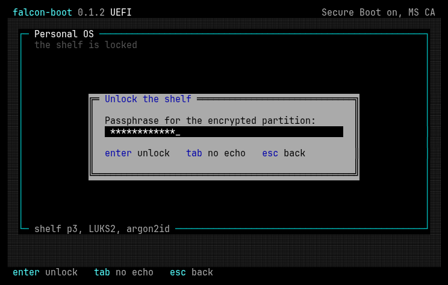
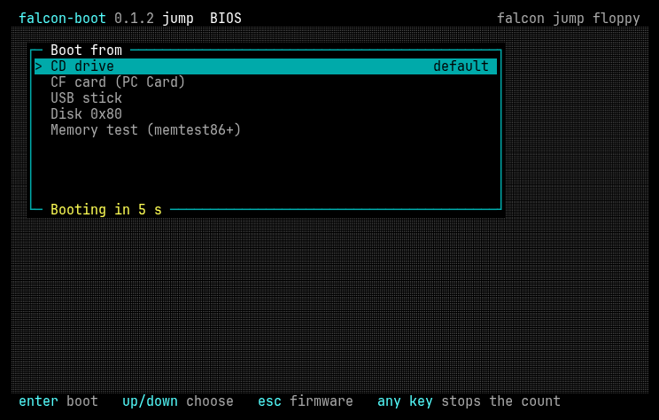

# falcon-boot

One USB stick that boots the ISOs you copy onto it, and an encrypted
operating system of your own beside them: on UEFI machines, x86-64 and
AArch64, and on BIOS PCs back to 32-bit i586 processors, with Secure Boot
on or off.



Copy `.iso` files onto the stick's exFAT partition from any computer. They
appear in the menu and boot: Linux, Windows install media, FreeBSD,
Proxmox, TrueNAS, ESXi, rescue and imaging tools, memtest86+. The same
stick carries a personal OS on an encrypted partition, unlocked by one
passphrase before it boots. The same loader can also be installed on a
machine's own disk as its boot loader, and a 1.44 MB floppy reaches the
stick from machines too old to boot USB.

falcon-boot is written from the firmware up in C: its own UEFI loader, its
own BIOS loader, its own filesystem, LUKS2 and Windows-image code. It is
GPL-3.0-or-later.

Just want a bootable stick? Jump to [Quick start](#quick-start).

## One loader, five forms

| form | what it is | runs on |
|---|---|---|
| **The stick** | A USB stick with four partitions: the boot partition, an exFAT ISO library, an encrypted shelf of personal-OS images, and an encrypted root for that OS (Manual Section 10.1). | UEFI on x86-64 and AArch64; BIOS on i586 and later, 32-bit machines included |
| **The station** | falcon installed on a machine's own disk as its boot loader, beside what is already there: a boot list with a countdown, Windows Boot Manager, other firmware entries, a memory test (memtest86+; PassMark MemTest86 on AArch64), the personal OS, and on UEFI a TOTP code released by the TPM only while the firmware and boot chain are what they were at enrollment, to compare with an authenticator before typing the passphrase (Manual Section 7). | UEFI on x86-64 and AArch64; BIOS on i586 and later |
| **station-legacy** | The BIOS station plus falcon jump's drivers, for a machine whose BIOS cannot boot a CD, a USB stick or a CF card (Manual Section 7.7). | BIOS, i586 and later |
| **falcon jump** | A 1.44 MB boot floppy with its own IDE CD, USB (UHCI, OHCI, EHCI) and PC Card drivers: it boots the CD drive, a falcon stick on USB or a CompactFlash card on machines whose BIOS cannot (Manual Section 9). | BIOS, i586 and later |
| **The signing appliance** | A small Linux image on the stick that signs media with the stick's own key, so it boots with Secure Boot on. Started from the menu; no other computer needed (Manual Section 4.2). | UEFI |



## What happens when you pick an ISO

falcon looks inside every image on the stick while the menu is up and
picks the route that suits it. Each route has a code, shown on the screen
while it boots (Manual Section 2).

| what you picked | what falcon does | code |
|---|---|---|
| A Linux ISO | Starts the ISO's own kernel and initrd directly, with a small program appended to the initrd that maps the ISO back into place for the distro to find. No loopback config, no per-distro scripts. | `DIR` |
| A Linux ISO, Secure Boot on | Starts the distro's own Microsoft-signed shim, which verifies the distro's own signed kernel, or the distro's signed GRUB with a menu falcon serves in place of its own. Nothing is re-signed. | `D3A`, `D3B` |
| Any image, blessed | Boots an image you have signed with your own key: a Linux ISO wrapped as a signed UKI, or a BSD or memtest86+ loader signed as it is. | `BLS`, `BLB` |
| Windows install media: 8.1 to 11 on UEFI, Vista to 11 on BIOS | Boots it unmodified on disk: `boot.wim` is patched in memory as it is served, so Setup finds its own ISO. | `WIN` |
| Windows XP, BIOS | Edits text-mode Setup's `txtsetup.sif` in memory to load falcon's virtual-CD driver, then runs Setup off a virtual CD that stays resident. | `WXP` |
| A BSD | Serves the ISO to its own loader as a memory disk. | `BSD` |
| Anything else | Chains the ISO's own boot loader off a virtual CD. | `CHN` |
| A `.img` or an `.efi` | Serves the disk image and starts its boot loader, or starts the `.efi` itself. | `IMG`, `EFI` |
| The personal OS | Unlocks the shelf, starts the OS's UKI, and hands the passphrase to its initramfs so the root opens without a second prompt. | `POS` |



### Measured on real media

Every release is tested by booting 63 ISOs under six firmware states:
Secure Boot off; on with Microsoft's keys; on with only your own keys; on
with shim's validation off; BIOS; and BIOS on a 32-bit processor. A merge
into `master` fails if any image that booted before no longer does.

The mainstream tier, 27 images (Debian, Fedora, Ubuntu, Mint, openSUSE,
Arch, Manjaro, CachyOS, Pop!_OS, Kali, SystemRescue, Clonezilla, GParted,
Windows 10, 11 and Server 2025, and others), boots on Enter, falcon's
default route, every time: with Secure Boot off, with Secure Boot on under
Microsoft's keys, and on BIOS. With Secure Boot on, an image Microsoft did
not sign is refused by the platform and boots once blessed. The second tier,
Proxmox and TrueNAS among them, is at 100% too. `docs/coverage.md` is the
full matrix, cell by cell, including what does not boot yet.

## Secure Boot, kept on

Everything falcon starts is verified by the platform through shim, the
same way a distro's own boot loader is. Media verifies against Microsoft's
keys, or against a key that is yours alone: each stick makes its own key
pair, you enroll its certificate once per machine, and you sign ("bless")
media with it on the stick's own appliance or on any Linux host. falcon
verifies; it never signs, and it holds no key. `docs/DESIGN.md` Section 7
is the model.

## How it compares with Ventoy

Ventoy made "copy ISOs to a stick and boot them" the normal way to carry
installers, and it is the right tool for many people. falcon takes the
same idea in a different direction:

- **Secure Boot is on, with your keys.** Distro media boots through its own
  signed loaders, and anything else is signed with a key that belongs to
  you and to one stick.
- **A personal OS travels with the ISOs.** LUKS2-encrypted, a UKI on an
  encrypted shelf, one passphrase from power-on to desktop.
- **It doubles as a machine's boot loader.** The station, with a TPM-sealed
  TOTP check before the passphrase.
- **It reaches old hardware.** A BIOS loader for 32-bit i586 machines,
  Windows XP Setup, and a floppy for machines that cannot boot USB at
  all.
- **One codebase, written to be read.** Both loaders, the host tools and
  the appliance share one C library, tested on the host, and every boot
  route is drawn in `docs/DESIGN.md` Section 11.



## Quick start

On Arch, add the signed `falcon` repository (Manual Section 14.3) and
install `falcon-boot-bin`. Elsewhere, download the tarball for your
machine from the [releases page](https://git.airies.net/vifair22/falcon-boot/-/releases),
check it against `SHA256SUMS`, and unpack it under `/`:

```sh
sha256sum -c --ignore-missing SHA256SUMS
tar xzf falcon-boot-X.Y.Z-<arch>.tar.gz
sudo cp -r falcon-boot-X.Y.Z/usr/. /usr/
```

Then make a stick, add the BIOS loader if you want it, and copy ISOs onto
the partition labelled `FALCON-ISO`:

```sh
sudo falcon-boot-mkstick create /dev/disk/by-id/usb-<your stick> --force
sudo falcon-boot-mkstick bios /dev/disk/by-id/usb-<your stick>
```

With Secure Boot on, the first boot opens MokManager: enroll
`falcon-boot.cer` from the stick's boot partition and reboot (Manual
Section 3.1). `docs/Manual.md` is the full reference: the menu, every
route, blessing, the personal OS, the station and `STATION.INI`, jump, every
`falcon-boot-mkstick` command, and what to do on each failure page.

The personal OS is your own install, not part of this project.
[docs/personal-os.md](docs/personal-os.md) is the guide: the small contract
an OS meets to boot from the shelf (a signed UKI and a one-file initramfs
drop-in for the passphrase handoff), a worked Arch build with mkinitcpio, the
dracut equivalent for other systemd distributions, and the rest left to your
distribution's normal tooling.



## Releases

Each release, on the
[releases page](https://git.airies.net/vifair22/falcon-boot/-/releases),
carries mkstick and the sign tool as static binaries with every unsigned
loader they install, one tarball per host architecture
(`falcon-boot-X.Y.Z-x86_64.tar.gz`, `falcon-boot-X.Y.Z-aarch64.tar.gz`;
unpacked under `/usr` they need no path options), the BIOS station bundle, the falcon jump floppy image, and their
`SHA256SUMS`. It is also a package, `falcon-boot-bin`, in the `falcon`
pacman repository on dl.airies.net. Manual Section 14 says how to check and
install them.

## Building

Requires docker. `make` runs every goal in the harness container
(`tools/coverage/Dockerfile`), the toolchain CI uses, pulled from the
project's registry once `docker login registry.git.airies.net:443` has been
run, and built locally otherwise. `make install` and `make run*` act on the
host after the container builds what they need; `run*` needs QEMU with OVMF
on the host.

`FALCON_NATIVE=1` builds with the host's own toolchain instead:
`x86_64-w64-mingw32-gcc`, the host gcc's 32-bit libgcc (`gcc-multilib` on
Debian) for the BIOS loader and falcon-hook's 32-bit build,
`i686-w64-mingw32-gcc` for the 32-bit winjump, `cryptsetup`, `sbsign` and
`mkfs.exfat`/`mkfs.ext4` for the host tools, QEMU with OVMF and SeaBIOS for
the rigs and mtools for the floppy. `make check-tools` names what is
missing.

```sh
make check-tools     # what is missing, and what each tool is for
make                 # the UEFI loader, host tools and winjump into build/bin/
make test-fixtures   # the images the image-backed tests read
make test            # every component's host tests
make coverage        # the tests, strictly, with one coverage report
make analyze         # cppcheck, gcc -fanalyzer and clang-tidy, gated
make bios            # the BIOS loader's stages
make station         # the stationary build, UEFI and BIOS
make jump            # the boot floppy, build/bin/falcon-jump.img
make run             # the test stick under QEMU/OVMF with a display window
```

The rigs (`make test-stick`, `test-core`, `test-station*`, `test-tpm-rig`,
`test-jump`, `test-bios-img` and the rest) are listed in the Manual's
Section 13. The corpus runs in the same container, through
`tools/coverage/harness.sh` with no command, which is how the measurements
in `docs/coverage.md` are made.

The pipeline (`.gitlab-ci.yml`) runs every merge request through the tests
(with JUnit reports), `make analyze`, the coverage gate and the build. A
merge request into `master`, which is a release branch shipping, also runs
every rig and the corpus under all six states, and fails if any scorecard
cell that passes on `master` no longer does
(`tools/coverage/scorecard-diff.py`).

`make install` copies `falcon-boot-mkstick` and `falcon-boot-sign` into
`/usr/local/bin`, building them first; `PREFIX` and `DESTDIR` apply.
`make uninstall` removes them.

`tools/mockup-shots.sh` redraws the screenshots above from
`docs/tui-mockup.html`, the screens' agreed look.

## Layout

```
apps/              the loaders: stick/, station/, esp-jump/, station-legacy/, jump/
falcon-core/       firmware-free libraries every other component links:
                   crypto, TPM, the exFAT, ext4, FAT, ISO9660, UDF, btrfs
                   and xfs drivers,
                   LUKS2, partition tables, the PE walker, boot predictions,
                   media logic, WIM, the manifest, the screen layout
falcon-efi/        the UEFI loader (x86-64 and AArch64 PE32+) and its QEMU/OVMF rigs
falcon-bios/       the BIOS loader (three stages into i586 protected mode),
                   jump's drivers, and the SeaBIOS rigs
falcon-cli/        host tools: falcon-boot-mkstick, falcon-boot-sign
falcon-appliance/  the on-stick signing appliance: PID 1 and its image recipe
falcon-hook/       the initrd program that maps an ISO for a Linux distro
falcon-winjump/    the WinPE program that attaches a Windows ISO for Setup
falcon-vdisk/      the WinPE virtual-CD driver for Windows older than 8
docs/              DESIGN.md, Manual.md, coverage.md (the corpus scorecard),
                   tui-mockup.html (the screens), img/ (the README's shots)
tools/             the static-analysis gate, the processor-floor check,
                   and coverage/, the harness that produces docs/coverage.md
```

Each component has `src/`, `tests/` and `tools/` as it needs them and a
`build.mk` the root Makefile includes; it is one build, not nine.

## Licence

GPL-3.0-or-later. The full text is in `LICENSE`.
