# falcon-boot Design

A single-purpose, auditable multi-boot loader for x86: 64-bit UEFI first,
with a BIOS loader alongside that runs on 32-bit processors as well. A distilled Ventoy: drag-and-drop ISO booting, plus a
first-class path for booting a personal LUKS-backed OS via a Unified Kernel
Image. Section 11 draws every route both loaders take.

Status: pre-1.0 MVP. This document is the source of truth for architecture and
scope. It is written to be read cold, months from now, by the person who has to
change it.


## 1. Scope

### In scope (MVP)

1. UEFI x64 firmware, and x86 BIOS through a separate, opt-in loader
   (`falcon-bios/`, item 6). The BIOS loader is i586 and runs on every
   i586 or later processor, booting 32-bit and 64-bit kernels (Section
   13.8). No IA32 UEFI (see Non-goals).
2. Drag-and-drop ISO booting from an exFAT partition, Ventoy-style: copy an
   `.iso` onto the stick from any OS, it appears in the menu, it boots. No
   host-side registration step. (When Secure Boot is ON, unsigned media that does
   not ship its own signed chain requires the optional `sign` bless step; see
   Section 7.)
3. Booting a personal OS: a Unified Kernel Image (UKI) sitting on a small
   LUKS2+ext4 partition, whose initramfs then unlocks the real root/home on a
   second LUKS2 partition and pivots into it.
4. Chaining through Fedora's shim-x64 16.1 (dual MS-signed, 2011 + 2023
   CAs; Section 4): Secure Boot upheld when
   it is on, loading freely when it is off. Section 2 has the posture,
   Section 7 the trust model and coverage matrix.
5. **Windows install media.** A stock Windows installer ISO drag-and-drops
   like any other and reaches a working Setup, in all three Secure Boot
   states. The mechanism is Section 6.3 and the trust model it needs is
   Section 7.7. What it relies on inside `boot.wim` is undocumented or
   version-dependent and can change in any Windows build.
6. **BIOS.** falcon-core is firmware-free and takes a read callback, so the
   BIOS loader supplies INT 13h where the UEFI loader supplies Block I/O
   and shares everything above it. A BIOS
   machine has no Secure Boot, so on that route nothing is verified or
   blessed and Section 7's invariants do not apply; hence opt-in: `make
   bios` builds it and `mkstick bios` installs it (Section 3.3). The loader
   runs in i586 protected mode, asks CPUID for what a newer processor adds,
   and appends a falcon-hook of the kernel's width, so one image serves
   machines with and without a 64-bit mode (Section 13.8).
   One stick serves every machine; its ISO library carries the 32-bit ISOs.
7. **The station.** Each loader built again as a machine's own boot loader,
   in place of GRUB, systemd-boot or the Windows MBR: Windows 98 to 11,
   Linux as UKIs on a shelf, memtest86+, on MBR and GPT disks, with a
   `STATION.INI`; and station-legacy, the BIOS station with falcon jump's
   CD, CF and USB routes. Chosen at compile time, so the stick's parsers are
   not in it at all. Section 13.
8. **A boot floppy, falcon jump.** A third BIOS loader, on a FAT12 floppy
   that stays in an old machine's drive: it boots the machine's disks and
   memtest86+, and the CD and USB sticks that machine's BIOS cannot boot,
   loading a driver off the floppy only for the route chosen. Section 14.

### Non-goals

- IA32 (32-bit UEFI). A 32-bit processor under a BIOS is in scope (item 1).
- ISOs that need Ventoy's runtime driver injection to boot. The injection
  plumbing is built in (Section 6), but the per-family injectors that would
  cover these are not. Windows needs no runtime injection (Section 6.3).
- Persistence overlays for live ISOs.
- A graphical/framebuffer menu with themes. The menu is text via Simple
  Text Output.

## 2. Secure Boot posture (read this first)

falcon-boot never changes what the platform allows to run. Every image the
loader launches goes through shim's verification (Section 7.6): with Secure
Boot on, only what verifies against db or the MOK boots; with it off, shim
permits everything. The loader does no signature checking of its own and
installs no security-protocol override. It reads `SecureBoot` and `SetupMode`
for UX only (Section 7.8). Section 7 is the trust model and the coverage
matrix.

The personal OS (Section 5) is signed by us end to end.

## 3. On-disk layout

GPT, four partitions:

```
p1  ESP        FAT32   ~64 MB   loader + shim + MokManager + our public cert; BIOS stage 3 in its reserved sectors
p2  ISOs       exFAT   bulk     the ISO library (drag-and-drop target) + injection assets
p3  UKI shelf  LUKS2 -> ext4    ~1 GB   personal-OS UKI + signing-appliance UKI + MOK private key (closed list: Section 5.3), argon2id keyslot at the stick's fixed cost
p4  root+home  LUKS2 -> ext4    bulk    real root and home, argon2id keyslot
```

A stick is always GPT and always has all four.
The loaders read MBR disks as well (3.2), for the station of Section 12 and
for the disks a machine already has; nothing makes an MBR stick.

Rationale per partition:

- **p1 ESP.** Standard. Contents in Section 4. FAT32 because firmware only
  guarantees FAT. Its reserved sectors also hold falcon-bios's stage 3 and
  the BIOS next-boot marker (3.3), so a stick has one BIOS layout, the same
  as a station's and jump's floppy.
- **p2 exFAT.** exFAT so large ISOs (>4 GB) fit and any modern OS
  (Windows/macOS/Linux) can drop files on it. Firmware does not read exFAT, so
  we bring our own read-only exFAT driver (Section 6).
- **p3 UKI shelf, argon2id at the stick's fixed cost.** LUKS2 here uses an
  **argon2id** keyslot, but not at the cost `cryptsetup luksFormat`
  benchmarks: that is sized for the machine running it (up to a gigabyte of
  memory), and a stick is opened by whatever machine it is plugged into,
  with falcon-core's single-threaded argon2id in either loader. mkstick
  writes one fixed, conservative cost every machine the stick boots can meet
  (32 MiB, time 4, 4 lanes; `MKS_STICK_KDF_*` in
  `falcon-cli/src/mkstick/mkstick.h`).
  The loaders unlock argon2id and pbkdf2 both, and a slot that asks for
  more memory than the machine can give is refused with a page saying how
  much it needs and how much is free. mkstick creates p3 (Section 8).
  p3 holds the personal-OS UKI, the signing-appliance UKI
  (Section 7.5), and the MOK private key, all encrypted at rest under this
  one keyslot. Roughly 1 GB. Key placement is invariant 4 (Section 7).
- **p4 root+home, argon2id.** p4 is unlocked by the *Linux* kernel inside the
  UKI's initramfs, where argon2id is fine, so it keeps the strong default. p4 is
  separate from p3 so that EFI never mounts the real root filesystem. EFI
  touches p3 only.

p3 and p4 share the same passphrase (Section 5).

**p3 encryption is the default, not a requirement.**
mkstick can create p3 plaintext (`--p3-plain`), for a UKI shelf that is
simple or firmware-readable. mkstick states the consequences at creation:

- No LUKS on p3 means **no on-stick private key**: the signing appliance
  (Section 7.5) cannot exist on that stick, and blessing is external-host
  only.
- The loader skips the passphrase prompt and the credential handoff
  (Section 5.1) is not used; the initramfs prompts for p4 itself, still a
  single prompt.
- The UKI is signed and shim verifies it off a plaintext shelf as off a
  decrypted one. What is given up is confidentiality of the UKI contents
  (embedded initramfs included) and the appliance.
- The p3 filesystem choice is orthogonal (see the fs_ops registry,
  Section 9); p3 is read by our EFI driver alone, and the initramfs
  unlocks and mounts p4 directly.

Both loaders read a plaintext shelf.

### 3.1 Identification: the identity record

Every partition falcon made carries an **identity record**, and the record,
not the partition table, says what the partition is, on GPT and MBR
disks alike.

The record's fields:

| field | size | meaning |
|---|---|---|
| magic | 4 | `FLCN` |
| version | 1 | 1 |
| role | 1 | `boot` (the FAT partition holding BIOS stage 3 and the marker: a stick's ESP, a station's partition, jump's floppy volume), `library` (p2), `shelf` (p3) |
| stage 3 | 2 | on a `boot` partition, stage 3's first sector relative to the partition's start; 0 otherwise |
| marker | 2 | on a `boot` partition, the next-boot marker's sector, relative likewise |
| reserved | 2 | zero |
| install ID | 16 | random, one per stick or station |
| CRC-32 | 4 | over the 28 bytes before it |

**One install ID per install.** `mkstick create` draws one 128-bit install
ID for a stick and writes it into every partition's record; `mkstick
station install` does the same for a station (Section 12). A loader starts
from the partition it booted from, reads that record's install ID, and
takes only partitions carrying the same ID, on whichever disk they are.
The partition it booted from is its image's `DeviceHandle`, its first
sector read through Block I/O into a buffer aligned as the device's
`IoAlign` asks. Every Block I/O read the UEFI loaders make goes through
memory below 4 GiB when the caller's buffer reaches above it
(`discover.c`, `bio_read`): a firmware that starts the loader directly,
rather than through shim, may place the image there, and with it every
static buffer. An ASUS B550's AMI NVMe driver then refuses the read with
`EFI_UNSUPPORTED` rather than bouncing it, where shim, which loads its next
stage low, had hidden it. Each boot leaves how the read went in the
volatile variable `FalconDiscoverStatus` (11.2.3). A
second stick's p2 or p3 is never mixed in, and nothing is decided by disk
order. A station whose shelf is on a second disk (its ESP on the Windows
disk, its Linux on another) is one unit the same way.

**Where the record is, by filesystem.** Each place is readable without a
passphrase and without the partition table's help:

- **FAT** (p1, a station's partition, jump's floppy): in the boot sector, at
  byte 0x1DC, 32 bytes, inside the boot-code area. Nothing executes a data
  partition's boot code and FAT has no checksum over it; stage 2 identifies
  a `boot` partition with one sector read. 0x1DC is the one offset that
  clears jump's floppy stage 1 (its code ends at 0x1DA, which the build
  checks, and its stage 2 length is the word at 0x1FC).
- **LUKS2** (p3): a token of type `falcon` in the header's JSON area,
  `{"type":"falcon","keyslots":[],"version":1,"role":"shelf","install_id":"<32 hex>"}`.
  It is read before any key is known, survives cryptsetup's own operations
  and is shown and edited by `cryptsetup token`.
- **exFAT and a plaintext ext4 shelf** (p2, p3 with `--p3-plain`): a file at
  the root, `/.falcon`, one line of text, `falcon 1 <role> <install id>`.
  exFAT's boot code is covered by its boot checksum and ext4 has no
  unowned bytes fsck leaves alone, and the loaders mount these volumes
  anyway. The same record in text.

**The partition type only narrows the search.** p2 keeps the Microsoft basic-data
type, because Windows' `partmgr` creates no volume for a GPT partition whose
type it does not recognise (in WinPE 10.0.26100 a falcon-typed p2 has no
volume and no drive letter),
and drag-and-drop from Windows and winjump inside WinPE both need that
volume. p3 keeps the falcon shelf type `9CB02E90-85F4-4AF7-9AF3-1F9D6A95FEAF`
and p4 the Linux LUKS type, because Windows offers to format a basic-data
partition it cannot read, and p3 holds the stick's only copy of its MOK
private key; their unrecognised types keep Windows off them. p1 keeps
the ESP type the firmware needs. None of these is matched as identity; the
GPT name `FALCON-ISO` is written for a person reading a
partition editor and is read by nothing.

There is no probe-everything fallback. A disk with no record is not
falcon's. The rig images carry records like any stick (Section 10).

**Everything that finds a partition uses the record.** The extent map that
falcon-hook and falcon-winjump rebuild an ISO from (Section 6.4) names p2 by
the install ID and the partition's start, not by a GPT partition GUID, so
it works on either table. The signing appliance is told its stick's install ID by the loader, in its
credential, and opens only partitions carrying it; with no install ID it
opens nothing. `mkstick status` reads the records.

### 3.2 Partition tables

`falcon-core/src/part` reads both tables and hands every consumer one
table-neutral partition record: start, length, the type as a GUID or an MBR
byte, the number, and the disk's identity (the GPT DiskGUID, or the MBR
disk signature at offset 440).

- **Which table.** LBA 0 is read first. Any 0xEE entry means GPT, and the
  MBR's other entries are ignored: Linux's rule, and the one that keeps a
  hybrid MBR a Windows-only view. Otherwise a valid MBR is read as MBR.
- **GPT.** The primary header and array; when the primary fails its CRC,
  the backup at the disk's end, said on serial.
- **MBR.** The four primary entries and the extended chain's logical
  partitions, numbered as Linux numbers them (1-4 primary, 5 on logical).
  Only a primary is ever chained (Section 12.4): DOS, Windows 9x and NT boot
  from nothing else.
- **Sector sizes.** 512 and 4096 alike, in core, under every driver (3.4).

A disk is named, wherever falcon has to name one (`STATION.INI`, a
diagnostic), by that identity: `gpt:<DiskGUID>` or `mbr:<8 hex digits>`,
plus a partition number. Never by a BIOS drive number or a firmware handle
order, both of which change when a stick is plugged in. A DOS or Windows 9x
disk often has signature 0; `mkstick station install` gives any disk the
station names a random one, as Windows NT does on its first boot, after
backing up LBA 0.

`mkstick create` refuses a disk with a valid MBR table as it refuses one
with a GPT: an MBR Windows disk is not an empty one.

### 3.3 The BIOS boot area

One layout for every BIOS install, stick, station and jump's floppy:

| where | holds |
|---|---|
| LBA 0, bytes 0-439 | stage 1; the table, signature and `0x55AA` behind it are kept |
| after LBA 0, before the first partition | stage 2: LBA 34 on GPT (after the entry array, in the `FALCON-BIOS` EF02 partition on a stick), LBA 1 on MBR. The installer writes its start and real length into stage 1 |
| the `boot` partition's reserved sectors | stage 3 (compressed, Section 11.3.2) and the next-boot marker, at the offsets its record gives |

Stage 2 finds stage 3 by reading the boot disk's table (none on a floppy: the
volume starts at LBA 0) and taking the first partition whose boot sector
carries a `boot` record naming a stage 3. A station installed for UEFI and
BIOS both has a `boot` record with no stage 3 (stage 3 sector 0) on its
ESP, which comes first on a GPT disk, and the real one on its station
partition. Stage 2 has no stage 3 LBA of its own. The marker is a sector of the `boot`
partition (Section 6.3.1).

An old MBR disk can have only 62 sectors before its first partition and
nothing free at its end, which holds stage 2 and nothing more; stage 3 goes
in the FAT partition's reserved sectors, which are outside every file, so
the filesystem never moves them.

Stage 1 reads with INT 13h extensions when AH=41h says they are there, and
by CHS otherwise (from AH=08h's geometry, as jump's floppy stage 1 does), so
a BIOS without extensions boots it too.

### 3.4 Sector sizes and BIOS reach

Every driver reads through the loaders' read callback, which takes whole
sectors. The drivers ask for 512 or 1024 bytes at a time (a LUKS2 keyslot
area, the ext4 superblock, a FAT boot sector), which on a 4096-byte-sector
disk is not a whole sector. `falcon-core/src/blk/rebl.c` is one re-blocking
layer under the callback: it passes the sector-aligned middle of a request
straight to the device read and bounces only a ragged head or tail through
a sector-sized buffer the loader owns, so every driver reads any length at
any offset on either sector size. The UEFI loader's discovery and
falcon-bios's disk reads both go through it.

Above it in the UEFI loaders, `falcon-core/src/blk/cache.c` serves every
read under 64 KiB from a 64 KiB-aligned window of the device, sixteen of
them, 1 MiB below 4 GiB, least recently used replaced; a miss reads the
whole window, cut at the device's end, in one call. Some firmware charges
per call rather than per byte (an ASUS B550's AMI USB driver takes about
70 ms for any read up to 64 KiB of a Kingston stick), and the drivers'
metadata reads are a few KiB each, so it is the call count that the windows
cut (`FalconReadInfo`, Section 5.5, counts them). Reads of 64 KiB and more,
a UKI's among them, go straight through and are not kept. A window is keyed
on the device's Block I/O and its `MediaId`, so a medium changed under the
same protocol misses, and `discover_scan` drops every window, since a
device gone since the last scan may have left its protocol's memory to
another. The loaders write no device they read, so no window is ever out
of date otherwise. A device with no medium, or with blocks that do not
divide 64 KiB, is read without windows. falcon-bios has none.

On BIOS the same holds wherever the firmware presents the disk: every
count of the BIOS layout is of the disk's own sectors (stage 1's LBA and
length, stage 2 at LBA 34, the record's stage 3 and marker sectors), so
`mkstick bios` installs onto a 4Kn stick as onto any other, with stage 2
rounded to whole 4096-byte sectors inside the same 32 KB stage 1 reads to.
Whether a BIOS offers a 4Kn disk at all is the firmware's: SeaBIOS 1.17
does through its NVMe driver (AH=48h reports 4096) and not through
virtio-blk, virtio-scsi, LSI, MegaRAID or USB mass storage, which drop the
disk, nor IDE, which QEMU refuses at 4096. The rig boots its 4Kn stick
from NVMe under both firmwares (`make test-core`). The BIOS next-boot marker
is one whole sector of the disk, 4096 bytes on a 4Kn disk, with its text in
the first 512 (Section 6.3.1).

A BIOS reaches only so much of a disk: about 8 GB by CHS, 128 GiB with
28-bit LBA. falcon-bios keeps each disk's size from AH=48h and refuses a
read past what the BIOS offers, with a sentence naming the limit; the
installers warn when a `boot` partition or a shelf would sit past 8 GB or
128 GiB, since they cannot know the machine's BIOS.

## 4. ESP contents and the Secure Boot chain

p1 holds exactly four files. Section 4.3 says why that list is closed.
A stick goes through shim by default: it boots machines whose firmware
keys are not its owner's, and shim is what their db trusts. A station
does not (12.2): it is the machine's own, its cert goes into the
machine's db, and the firmware entry names the loader.

| Path | What it is | Signatures it must carry |
|---|---|---|
| `/EFI/BOOT/BOOTX64.EFI` | Fedora shim-x64 16.1 | Microsoft UEFI CA 2011 and Microsoft UEFI CA 2023 as shipped, plus ours when appended by hand (Manual Section 11.1) |
| `/EFI/BOOT/mmx64.efi` | MokManager, shim's enrollment UI (Fedora naming) | Fedora Secure Boot CA as shipped, plus ours when appended by hand (Manual Section 11.1) |
| `/EFI/BOOT/grubx64.efi` | OUR loader (see note on next-stage name) | **ours, and nothing else** |
| `/falcon-boot.cer` | our public cert, for first-boot enrollment | not signed; it is a certificate |

"Ours" throughout means the MOK keypair whose public half is
`falcon-boot.cer` on p1 and whose private half lives encrypted on p3. There
is one such key per stick and it signs the loader, every UKI, and every
blessed wrap.

The shim is Fedora's shim-x64 16.1: it
carries both Microsoft signatures (2011 + 2023), its vendor trust is one
Fedora CA with no vendor dbx payload, and it is pinned by Koji package URL.
The SHIM_IMAGE_LOADER load path (Section 7.6) needs shim 16.0 or later.

Boot chain under Secure Boot:

1. Firmware verifies `BOOTX64.EFI` (shim) against the platform db. Passes: shim
   is MS-signed.
2. Shim installs its verification protocol and loads its next-stage binary. It
   cannot verify our loader against db, so it consults MOK. On first boot MOK is
   empty for our key, so shim launches MokManager, which prompts the user to
   enroll `falcon-boot.cer`. After enrollment and reboot, shim verifies our
   loader against MOK. Passes.
3. Our loader runs. For the ISO path it imposes no signature requirement of
   its own: it loads the payload through the shim-verified load path
   (Section 7.6), which enforces or permits by the platform's state. For the UKI path it loads only our-signed artifacts,
   which shim verifies (Section 5).

**Next-stage name.** Shim's default next-stage loader filename is compiled
into the shim binary; Fedora 16.1's is `grubx64.efi`. The install tool
(Section 8) reads the embedded default path out of the shim binary being
installed and names our loader to match, so a different shim is a data
change.


### 4.1 How each binary is signed, and why

**1. Our loader and our UKIs carry exactly one signature: ours.** A second
signature on them means `sbsign` was run twice (see 4.2).

**2. shim and MokManager keep the signatures they shipped with; ours is
appended by hand (Manual Section 11.1) for a machine whose db holds no
Microsoft CA.** The two cover different machines:

- The **vendor** signatures boot the stick on a machine whose db trusts the
  Microsoft CAs.
- **Ours** boots the stick on a machine whose db holds only its owner's
  keys and no Microsoft CA, where the firmware would refuse shim. A MOK
  does not help there, since MOK is read by shim; the cert has to be in db
  and the binary has to carry a signature by it.

Fedora's shim carries the Fedora CA in its `.vendor_cert`, the cert that
signed `mmx64.efi`, so shim can load MokManager on its own authority; ours
is appended anyway so shim's vendor cert is not the single point of failure
for the enrollment UI.

**3. Never a third party's key, and in particular never a machine's db key.**
That would make the stick's chain depend on one machine's key and carry a
signature by that machine's trusted key off-site. Sign with the stick's own
MOK key and enrol its public cert in that machine's db instead.

### 4.2 sbsign appends; it never replaces

`sbsign` adds a certificate entry and leaves every existing one in place. Run
it twice and the binary carries two identical signatures. Everything still
boots, since firmware needs only one entry to verify, so it shows only when
the signatures are listed.

`sbattach --remove` removes **one entry per call**, not the whole table, so
stripping a binary with three signatures takes three calls. Check the result:

```sh
sbverify --list BOOTX64.EFI | grep '^signature'
```

Removing one signature from the middle of the table, while keeping the
others valid, cannot be done with `sbattach` alone. Rebuild the certificate
table directly: the Authenticode digest excludes the certificate table, so
dropping an entry leaves every other signature valid. Prove it by stripping
both the original and the rebuilt binary of all signatures and comparing:
identical bytes means an identical digest, which means the surviving vendor
signatures still verify.

**`sbverify --cert` cannot be trusted on a multiply-signed binary.** It
returns success for a certificate that signed nothing in the image (a
freshly generated, unrelated certificate passes against `BOOTX64.EFI`). Use it only on a binary with exactly one
signature. To answer "is this signed by the key in db", compare certificate
fingerprints instead:

```sh
openssl x509 -in falcon-mok.crt -noout -fingerprint -sha256
```

`archusb`'s `archusb-status-collect` identifies signers by subject for this
reason.

### 4.3 The ESP is not a storage location

p1 holds the four files in the table above and nothing else: no backups,
TPM event logs, dumps, notes or ISOs.

- It is vfat with no journal, written by firmware and by every OS that
  touches the machine, and the first thing a repair tool reformats.
- A stray file such as `BOOTX64.EFI.orig` beside `BOOTX64.EFI` can be taken
  for part of the chain.
- The partition is 64 MiB on purpose. A closed list is auditable at a glance,
  and `mkstick` can assert it.

Backups, captures and working files belong on p2 or on p3 beside the key.
Fedora's shim needs no backup: it is a pinned Koji URL
(`falcon-efi/tools/shim-spike/fetch-shims.sh`).


## 5. Personal OS path: UKI on LUKS, with passphrase handoff

Goal: type the passphrase once, boot into the real encrypted OS.

Flow:

1. User selects the personal-OS entry in our menu.
2. Loader prompts for the passphrase.
3. Loader unlocks **p3** (LUKS2, argon2id or pbkdf2) using our LUKS + AES-XTS stack
   (Section 6), and reads the UKI off the ext4 inside.
4. Loader synthesizes a **virtual read-only filesystem** carrying the UKI plus
   a credential file holding the passphrase (Section 5.1), then
   `LoadImage`/`StartImage` the UKI from that filesystem. The UKI is signed by
   our key and launched through the shim-verified load path (Section 7.6).
5. The UKI's sd-stub packs the credential into the initrd; the initramfs's
   `systemd-cryptsetup` consumes it to unlock **p4** (LUKS2, argon2id) and
   pivots into the real root. Consuming it takes one small unit override in the
   initramfs (below).

p3 and p4 share the passphrase so this handoff reuses the string the user
already typed. p4 is separate only so EFI never mounts root.

- The UKI is launched **by device path off the synthetic credential
  filesystem** (falcon-efi/src/loader/credfs.c). A `SourceBuffer` load is a
  loudly-warned fallback when the credfs publish fails; it is still
  shim-verified but cannot deliver credentials.
- The credential is named **`cryptsetup.passphrase.cred`** (systemd strips
  the `.cred` suffix to form the credential name; `systemd-cryptsetup`
  hardcodes `cryptsetup.passphrase`). Content is raw passphrase bytes, no
  trailing newline, no NUL.
- **Consumption needs a drop-in.** PID 1 files every
  credential arriving from sd-stub under `/run/credentials/@encrypted/`, not
  `@system`, because the ESP is untrusted and credentials delivered through it
  are expected to be `systemd-creds` blobs. The generated unit's
  `ImportCredential=cryptsetup.*` therefore tries to **decrypt** our plaintext
  passphrase, fails, and the service dies at step `CREDENTIALS` with `EINVAL`
  (status 243) before `systemd-cryptsetup` runs, so there is no interactive
  fallback prompt either. The symptom is a bare
  `Failed to start Cryptography Setup for <name>` into emergency mode.

  The fix is on the OS side: a
  `systemd-cryptsetup@.service` drop-in that clears `ImportCredential=` and
  names the file by path, taking the plaintext route instead.

  ```
  [Service]
  ImportCredential=
  LoadCredential=cryptsetup.passphrase:/.extra/credentials/cryptsetup.passphrase.cred
  ```

  It ships as an initramfs build hook, so a rebuild after a kernel or
  systemd update keeps it: for mkinitcpio the `falcon-credential` install
  hook (the archusb repo, `install/falcon-credential`), for dracut the
  `99falcon-credential` module (the thinkpad-t430 repo,
  `gentoo/usr/lib/dracut/modules.d/99falcon-credential/`). With the drop-in
  the unlock succeeds from the credential with no prompt; without it the
  unit cannot start.

  **The same failure recurs after switch-root, and needs its own copy of the
  fix.** `/run` is one tmpfs across the pivot, so
  `/run/credentials/@encrypted/cryptsetup.passphrase` is still present when the
  real root's `systemd-cryptsetup-generator` runs, and every unit it writes from
  `/etc/crypttab` inherits the same fatal `ImportCredential=cryptsetup.*`:
  without it, p3's own `cryptefi` unit (keyfile, no credential needed) dies
  at `CREDENTIALS` before opening it, leaving `/efi` unmounted behind a
  `nofail`. The real-root half clears the import and loads nothing: every
  unit there opens with a keyfile, and a `LoadCredential=` naming a file
  absent on a boot without falcon would fail the unit.

  Both halves ship from the OS's own repository, not this one: **archusb**
  (https://git.airies.net/vifair22/archusb, Arch, mkinitcpio) and
  **thinkpad-t430** (https://git.airies.net/vifair22/thinkpad-t430, Gentoo
  with systemd, dracut).
- **UKI discovery convention:** the loader looks in `/uki/` first,
  then `/EFI/Linux/` (the Boot Loader Specification location, so a p3
  populated by `kernel-install` still boots), taking regular files with a
  case-insensitive `.efi` suffix, sorted by name; one match boots directly,
  several are offered in a post-unlock chooser. mkstick stages to `/uki/`.

### 5.1 The handoff mechanism

The passphrase is entered at runtime, so it cannot be baked into the UKI at
build time. We pass it from our pre-ExitBootServices loader to the initramfs
through **sd-stub's companion-credential pickup**:

- The UKI is built with `ukify` (Section 8), so its stub is systemd-stub. When
  sd-stub is loaded from a filesystem, it scans a `<uki>.efi.extra.d/`
  directory next to the image for `*.cred` files, packs them into a cpio, and
  merges that cpio into the initrd at `/.extra/credentials/`.
- The loader never writes real storage, so the credential is not staged on
  disk. The loader synthesizes a small **virtual read-only filesystem** in RAM
  (the same virtual-device machinery the ISO path already needs, Section 6)
  containing the UKI bytes read off p3 plus
  `<uki>.efi.extra.d/cryptsetup.passphrase.cred`, and
  calls `LoadImage` with that device path.
- `systemd-cryptsetup` consumes credentials (`cryptsetup.passphrase`), given
  a systemd-based initramfs and the `falcon-credential` drop-in Section 5
  describes. Both are build-time properties of the UKI.

Lifetime: the credential exists only in RAM (the virtual
filesystem evaporates at `ExitBootServices`; the cpio copy lives inside the
initramfs), is root-only, and stays under `/run/credentials/` across the
pivot, which is why the real root needs the drop-in too (Section 5). If
`LoadImage`/`StartImage` fails, the loader zeroes the credential buffer and
tears down the virtual filesystem before returning to the menu. If the boot
succeeds, the loader's copy is zeroed at `ExitBootServices` by a
notification the credential filesystem registers when it serves a secret,
after sd-stub has packed its own; the LUKS key schedule and p3's plaintext
caches are released once the UKI is read, before it starts. The BIOS loader
does the same from `linux_boot`'s last act, and also clears the BIOS
keyboard ring the passphrase was typed through (Section 11.3.7).

sd-stub accepts unauthenticated `.cred` files under Secure Boot ON
(credentials are data, not code), and picks them up from the synthetic
filesystem as from a real ESP. Both the firmware and shim loaders size the image via
`SetPosition(max)`/`GetPosition`, never `GetInfo`, and sd-stub enumerates
`.extra.d` through directory `Read` one `EFI_FILE_INFO` record at a time;
a synthetic filesystem implements all of that surface.


### 5.2 Wrong passphrases

Both loaders count the wrong passphrases of a boot across every prompt,
whichever shelf and however often the row is chosen again, and give
`TUI_UNLOCK_TRIES` (5). The first wrong one costs nothing, since it is
nearly always the owner's typo; after the second, third and fourth the next
attempt waits 4, 8 and 16 seconds (`tui_unlock_delay`), with the keys
pressed during the wait thrown away; the fifth powers the machine off, the passphrase
wiped first (`tui_power_off`: UEFI's EfiResetShutdown then a cold reset,
BIOS's 7.9 APM then ACPI S5, then a reset). Neither the wait nor the limit
is said. The wait runs under the page's `unlocking` step, before the
refusal is shown, where it reads as a slow key derivation (an argon2id slot
already takes a second or two), and every refusal, the fifth included, is
the same line:

    wrong passphrase.

The prompt carries no attempt count either: both numbers help only someone
guessing.

The prompt is a dialog over the route's page (`tui_secret`, 7.10): the
prompt, the field, and the status under it. Enter closes it and the page
opens an `unlocking` step; a refusal marks that step `wrong passphrase`
and opens the dialog again, empty, with `wrong passphrase.` under the
field. On the UEFI station the TOTP lines sit in the dialog under the
field, kept current as the code rolls.

It limits guesses at the keyboard of a machine that stays whole (a
station's case) to five a power cycle with half a minute of waiting among
them. It does nothing against an offline copy of the shelf, where argon2id's
cost is the defence, and the count does not survive a power cycle.

### 5.3 What the shelf holds, and what it is not

p3 is the shelf. Like p1 (Section 4.3) its contents are a closed list: it is
small, and it is what has to be right for the stick to boot.

| Path | What it is | Read by |
|---|---|---|
| `/falcon-mok.key` | the MOK private key, mode 0600 | the signing appliance, and the host `sign` tool |
| `/falcon-mok.crt` | its public half, the same certificate as p1's `falcon-boot.cer` | signing and enrollment |
| `/uki/<name>.efi` | every bootable UKI: the personal OS, its rollback, the signing appliance | the loader's shelf scan |
| `/vmlinuz-<kernel>` | one plain kernel copy per installed kernel | mkinitcpio, never the loader |
| `/lost+found` | ext4's own | the filesystem |

**The kernel copies are load-bearing.** Arch's `linux` package ships the
kernel only at `usr/lib/modules/<kver>/vmlinuz`, and mkinitcpio's pacman
script maintains a copy at whatever absolute path `ALL_kver` names, provided
no package owns that path. `ALL_kver` points at `/efi/vmlinuz-linux`, and
that is how the UKI gets rebuilt on a kernel upgrade. Delete them and the
next upgrade rebuilds nothing, silently. archusb's `install/` presets record
the reasoning.

**Only `*.efi` directly under `/uki` is visible to the loader.**
`falcon-core/src/media/shelf.c` matches on the `.efi` suffix and nothing
else. A file named `appliance-uki.efi.prev` is not a rollback:
the loader will never offer it, and it is recoverable only by unlocking p3
from another machine and renaming it. A rollback has to end in `.efi`, and
its name decides where it falls in the chooser's sort, which is plain
ordering by name: `-` is 0x2D and `.` is 0x2E, so `arch-usb-prev.efi` sorts
before `arch-usb.efi`.

**Not on the shelf:** ISO images, captures, notes, and backups of anything
that can be rebuilt (the signing appliance is built from this repository and
the UKIs are regenerated by mkinitcpio). p2 is the partition for files, and
it is 96 GiB.

### 5.4 A shelf its OS left mounted

A shelf's OS mounts it read-write (at `/efi`), and ext4 sets
incompat `recover` for as long as it is mounted that way: the journal may
hold committed blocks the filesystem proper does not. Hibernation leaves it
so every time, and the image in swap counts on the shelf staying exactly as
it left it; a power cut leaves it the same way. Reading such a volume around
the journal hands back stale metadata, and an fsck from another system
corrupts a hibernated OS's shelf when it resumes.

Every reader of a shelf reads it in that state through its journal,
replayed in memory and never written: `falcon-core/src/fs/jbd2.c`, reached
through `fs_mount_journal`. It follows the kernel's recovery
(`fs/jbd2/recovery.c`): a scan that finds where the valid log ends, the
revoke records, then the block tags. The result is a table of the newest
committed copy of each block rather than writes, and every read of the
volume goes through it. Both loaders' shelf mounts and their
discovery (a plaintext shelf's `/.falcon`) use it, and so do the appliance,
`mkstick status` and `station install` (which, run on the machine it
installs on, always meets a shelf mounted right now).

- **A torn last transaction ends the log.** A commit block that is missing,
  or fails its checksum, is where the kernel stops too, and the state at the
  last good commit is consistent. It is not an error.
- **Fast commits are not replayed.** They are ext4's own logical records
  (inodes, extent ranges, directory entries), not block copies. The state
  served is the one at the last full commit, which is consistent: a block
  freed after a full commit is released for reuse only by the next one
  (`ext4_journal_commit_callback` runs from jbd2's full-commit path alone),
  so nothing the older view names has been overwritten. Hibernation never
  leaves a live fast commit, since its sync forces a full commit; a power
  cut after an fsync can, and the booting page says so:
  `the shelf's last few seconds of changes were not read.`
- **Refused:** a transaction that committed and fails its checksum, which is
  corruption rather than a torn tail (a later transaction may already be
  partly copied home, so stopping before it would not be consistent), and a
  journal outside `jbd2.h`'s set (v1 checksums, unknown feature bits). The
  page says `the shelf's journal is damaged; run fsck on it from another
  system, then boot its OS once with noresume.`: fsck is only safe once
  nothing counts on the shelf as it was.
- **Revoke records are read whatever the journal superblock says.** jbd2
  sets `incompat revoke` in memory at the first revoke and writes it to the
  superblock later, so a crashed or hibernated journal can hold revoke
  blocks its superblock does not admit to. Skipping them serves a freed
  block's old copy after the block was reused.
- **Memory.** The table is 24 bytes a tag in the replayed transactions,
  counted by the scan, plus one block of scratch; a 64 MiB journal asks for
  at most about 400 KiB. The caller supplies it, as argon2id's memory is
  supplied (`fs_jmem`): the UEFI loader from `AllocatePages`
  (`falcon-efi/src/mem/jnlmem.c`), released once the UKI is in memory;
  falcon-bios from `JNL_REGION`, the 7 MB between stage 3's stack and jump's
  module slots (`falcon-bios/src/mem/jnlmem.c`), which the kernel and
  initrd, read through the table, are never placed in. Not the heap: it
  starts at 64 MB, which a machine the BIOS station runs on may not have,
  and it is placed as high as the initrd is. The host tools use malloc
  (`falcon-cli/src/common/jmem.c`). The scratch block held plaintext from
  the shelf, so each is wiped when it is given up. Memory that cannot be
  had is a page like 5.2's argon2id one: what it needs, what is free.

On the OS side, `/sys/power/freeze_filesystems` set to 1 makes the kernel
freeze filesystems before it hibernates, and ext4's freeze empties the
journal and clears `recover`, so the shelf is clean when the loader reads
it. It is a defence, not a requirement.

### 5.5 Boot timing

Both UEFI loaders set systemd's Boot Loader Interface timing variables
(https://systemd.io/BOOT_LOADER_INTERFACE/), so `systemd-analyze` on an OS
booted from a UKI splits its boot into firmware, loader and kernel. They are
written as systemd-boot writes them: UTF-16 with the terminator counted in
the size, attributes `BOOTSERVICE_ACCESS | RUNTIME_ACCESS` (volatile), under
the Loader GUID `4a67b082-0a4c-41cf-b6c7-440b29bb8c4f`. Falcon adds four
of its own under its own GUID, `50614485-081b-4b7c-8b54-2abeffdf2fb3`.

| Variable | Value | Set |
|---|---|---|
| `LoaderTimeInitUSec` | microseconds from processor reset to `efi_main`'s first statement | at startup |
| `LoaderInfo` | `falcon-boot <FALCON_VERSION>` (the station: `FALCON_VERSION_STATION`) | at startup |
| `LoaderFirmwareInfo` | `<FirmwareVendor> <major>.<minor>` of the system table's `FirmwareRevision`, the minor two digits at least | at startup |
| `LoaderFirmwareType` | `UEFI <major>.<minor>` of the system table's revision | at startup |
| `LoaderTimeExecUSec` | microseconds from processor reset to the UKI's `StartImage` | immediately before a UKI's `StartImage` |
| `FalconTimeWaitUSec` | microseconds spent waiting on the keyboard up to then (falcon's GUID) | beside `LoaderTimeExecUSec` |
| `FalconTimeKdfUSec` | microseconds the keyslot derivations of the unlock that led to this launch took (falcon's GUID) | beside `LoaderTimeExecUSec`, after an unlock |
| `FalconKdfInfo` | that unlock in one line (falcon's GUID; below) | beside `FalconTimeKdfUSec` |
| `FalconReadInfo` | what the firmware's reads cost, in three stretches (falcon's GUID; below) | beside `LoaderTimeExecUSec` |

A UKI is what `pos` launches (the personal OS and the signing appliance off
the stick's shelf; the station's encrypted-shelf row and its plaintext UKI
rows) and a blessed wrap (`bless_boot`). Nothing else sets an exec time:
chainloaded media, direct kernel boot, Windows, BSD, memtest86+, bare EFI
payloads, and the station's firmware entries and ESP loaders. A UKI that
returns has the exec variables, falcon's four included, deleted
(`bli_clear_exec`), so a later boot by another route does not carry them.
The two KDF variables are written only for a launch that follows an
unlock in the same `pos` attempt; a plaintext shelf's UKI and a blessed
wrap have none. Both calls are
in `loader` (`loader_time_init`, `loader_time_exec`), the variables'
formats in `loader/bli.c`.

`LoaderDevicePartUUID` is sd-stub's: it sets it from the device the UKI was
loaded from when that names a partition, which the credential filesystem
does not. The BIOS loader has no variables to set.

**The clock** is the TSC (`tsc/`), read by `efi_main`'s first statement. Its
rate is CPUID leaf 0x15's crystal times its ratio, with leaf 0x16's base
frequency standing in for a crystal 0x15 does not enumerate (Intel only, as
systemd-boot reads them); without those, the counter is counted across one
10 ms `Stall`. The rate is decided once, after the init timestamp is taken,
and kept. A rate outside 100 MHz-20 GHz is no rate, and then no time
variable is written. Microseconds are floor(ticks * 10^6 / rate), computed
without systemd-boot's overflow past about two hours of uptime. systemd-boot
writes no times under a hypervisor; falcon does, since a KVM guest's counter
starts at the guest's reset.

**The wait** is wall time blocked on input: each menu from its first paint
to the key or the countdown that ends it (the background probe and the TOTP
line included), the passphrase prompt, and every "press any key" page
(`idle_wait_key`). The wait after a wrong passphrase is not in it.
Falcon's own work is `LoaderTimeExecUSec - LoaderTimeInitUSec -
FalconTimeWaitUSec`.

**The keyslots** are timed on the same clock, on the boot processor, from
before the first `luks_unlock` to after the last, the start and release
of the other processors excluded; `FalconTimeKdfUSec` is therefore at
most falcon's own work. `FalconKdfInfo` describes the slot that opened:

    argon2id <level> <P> processors <L> lanes <M> KiB t=<T> <ms> ms <MHz> MHz
    pbkdf2 <P> processors <I> iterations <ms> ms <MHz> MHz

`<level>` is the block function (`portable`, `sse2`, `ssse3`, `avx2`),
`<P>` the processors that ran lanes, `<ms>` the time in milliseconds,
floored. `<MHz>` is the boot processor's effective clock across the
derivations, the counter's rate times dAPERF / dMPERF of `IA32_APERF`
(0xE8) and `IA32_MPERF` (0xE7) read before and after (`tsc_eff_mhz`); it
shows a firmware that runs the cores below their boosted clock. The MSRs
are read only when CPUID leaf 6 enumerates them (ECX bit 0) and no
hypervisor is present (CPUID.1:ECX bit 31), since a guest may take #GP on
them and the firmware halts on an exception it does not expect; without
them ` <MHz> MHz` is left out. The same line ends the unlock's serial line,
`falcon-pos: argon2id ran on <P> processors in <ms> ms: <info>`, which is
also written for an unlock that fails, describing the last slot tried.
falcon-bios times its keyslots by the BIOS tick and reads no MSR: its IDT
treats every exception as fatal, and it has no counter rate to scale
dAPERF / dMPERF by.

**The reads** are every `ReadBlocks` the loader makes, all of which go
through `discover/biolow.c`: the calls, failed ones included, their bytes,
and the clock's ticks across them. `FalconReadInfo` splits them at two
marks, the menu's first paint (`loader_reads_mark`, once) and the start of
the route that launches (`pos`'s `boot_shelf` and `blessed_launch`, every
attempt):

    startup <C> calls <K> KiB <ms> ms, menu <C> calls <K> KiB <ms> ms, boot <C> calls <K> KiB <ms> ms <R> MB/s

`startup` runs to the menu, `menu` is the background probe while it is up,
and `boot` is the unlock, the shelf's lookups and the UKI. `<K>` is rounded
up, `<ms>` floored, and `<R>` is the boot stretch's bytes over its time to
two places, left out when that time is 0. A firmware whose USB driver
charges a fixed cost per call or per transfer shows as a boot stretch far
under the device's speed and a `startup` whose milliseconds are high for its
bytes. The time is the firmware's alone: the loader's own work between the
calls is not in it. The BIOS loader has no variables, and the station,
whose menu is its list, takes the same two marks.

A variable the firmware will not set is left unset and the boot goes on.
Each step says what it measured and set on the first serial port
(`console/serial.c`): `falcon-bli: tsc_hz=<Hz> via=<cpuid|stall|none>
LoaderTimeInitUSec=<us>` at startup, `falcon-bli: LoaderTimeExecUSec=<us>
FalconTimeWaitUSec=<us>` at the launch, with ` FalconTimeKdfUSec=<us>` after
an unlock, then `falcon-bli: FalconReadInfo=<line>`, each with
` set=failed` when a write was refused.

## 6. ISO path: drag-and-drop mechanism

No host-side registration. The stages:

1. **Scan.** At boot, the exFAT driver enumerates `*.iso` and `*.img` on p2.
   That listing is the menu, presented **by folder** (Ventoy tree-view
   style): each menu screen shows the current directory's subfolders and
   images, entering a folder descends, ".." (or ESC) goes up, and ESC at the
   root exits to firmware. The pinned entries (personal OS) live at the root
   screen. Purely presentation: the scan, the labels, the bless lookup and
   the boot paths all operate on full p2 paths. Each row's label (family,
   signature, prediction) comes from falcon-core reading the image file on
   p2 (`media/medium.c`), with no virtual device published for it. Dropping
   a file on from any OS is the entire "add" workflow.
2. **Present as virtual media.** On selection, register an `EFI_BLOCK_IO`
   (and `EFI_DISK_IO`) device whose reads are served from the file's bytes
   by the exFAT driver. **Two media flavors, one publisher**: a `.iso` is
   typed as a CD-ROM (2048-byte blocks, El Torito parsed by firmware,
   below); a `.img` is typed as a disk (512-byte sectors), and the
   firmware's GPT/MBR partition path plus FAT driver surface its ESP - or
   bind FAT directly for a partition-table-less superfloppy image.
   Everything downstream (family/signature probing, chainload,
   verification, teardown) is identical for both. `.img` means raw bytes
   only: container formats (vhd/vdi/qcow2) are refused. The
   post-ExitBootServices media-finding problem (6.1) applies to `.img`
   exactly as to `.iso`; memtest-class images need no backing media after
   load, and PassMark memtest86's MS-signed binary boots verified under
   Secure Boot with no preparation.
3. **Let firmware parse it.** `ConnectController` (recursive) on the virtual
   device. The UEFI spec mandates El Torito boot support for CD-ROM media: the
   firmware's *partition* driver recognizes the El Torito boot catalog and
   surfaces the ISO's embedded EFI System Partition image, which the
   firmware's FAT driver then mounts. This is how the ISO's own loader is
   chainloaded. falcon-core's ISO9660 and UDF readers serve everything else
   (the survey, direct kernel boot, the Windows and BSD patches; Section
   6.4), since a Linux kernel lives in the ISO9660 tree rather than in the El
   Torito image.
4. **Chainload through the verifying `LoadImage`.** `LoadImage` the ISO's
   embedded `\EFI\BOOT\BOOTX64.EFI`, then `StartImage`, through shim
   (Section 7.6):
   - Secure Boot ON: shim verifies the payload. A distro ISO whose
     `\EFI\BOOT\BOOTX64.EFI` is its own MS-signed shim passes, and that inner
     shim verifies its kernel with its own vendor cert. An unsigned payload is
     refused; the menu entry is already marked unverified and the loader
     prints why.
   - Secure Boot OFF: shim allows the load, and any ISO boots.

**EDK2's UdfDxe is case-sensitive.** On the UDF volume a firmware UDF driver
publishes (Windows install media, Section 6.3), `\EFI\BOOT\BOOTX64.EFI`
returns NOT_FOUND while `\efi\boot\bootx64.efi` opens the same file. The FAT
driver folds case; the UDF driver compares byte for byte. Any path handed to
the firmware for UDF media matches the case recorded on the volume, and the
chainload picks its volume by the exact boot path (`select_boot_volume`). The
El Torito ESP child is FAT and is unaffected.

### 6.1 The post-ExitBootServices problem

Stages 2-4 all live in boot services. The virtual CD is a boot-services fiction:
it evaporates the instant the distro kernel calls `ExitBootServices`. A stock
distro initramfs then hunts for its squashfs on a CD-ROM that no longer
exists, and drops to an emergency shell.

**This is a Linux (and BSD) problem, not a universal one.** Windows has no
post-`ExitBootServices` media problem at the boot stage: the Windows boot
manager reads `\sources\boot.wim` off the virtual CD *while still in boot
services* and materialises WinPE as a RAM disk, and WinPE then re-enumerates
hardware with its own drivers and finds the exFAT p2 natively. The framework
below does not apply to Windows; its problem is later and narrower (Section
6.3).

Two handling strategies, and the framework carries both:

- **Native find-the-ISO (the easy families).** Many distros' stock initramfs can
  locate the ISO *file* on a normal partition given the right cmdline:
  `iso-scan/filename=` (Debian/Ubuntu casper, dracut/Fedora),
  `img_loop=` / `img_dev=` (Arch archiso), `rd.live.image` and friends. For
  these nothing is injected at boot; the cmdline comes from a per-family
  template. In the framework this is the degenerate "empty injector" case.
- **Runtime injection (the Ventoy tax).** For families whose initramfs cannot
  find a file-backed ISO, the ISO is recreated as a block device *after*
  ExitBootServices: the ISO file's extent map on p2 (the list of physical LBA
  ranges backing the contiguous or fragmented file) and falcon-hook (Section
  6.4) are appended to the initrd as a cpio segment, falcon-hook assembles a
  device-mapper target over p2 from those extents and exposes it where the
  distro expects its media, and the stock initramfs proceeds.

### 6.2 Injection framework (built in MVP, injectors filled in over time)

Injectors are data dropped into a registry, never core surgery:

- **Family detection.** Fingerprint the mounted ISO's ESP / directory layout
  (`/casper`, `/live`, `/arch`, `/LiveOS`, presence of specific bootloaders) to
  classify it into a family (`falcon-core/src/media/family.c`).
- **Per-family descriptor.** A registry entry per family carrying: the cmdline
  template, whether it needs injection or just a cmdline, and what the
  family's stock initramfs can consume: whether it includes exFAT support
  (needed to `iso-scan` a file on p2) and device-mapper support (needed by
  the extent-map hook). Kernel modules cannot be shipped (they must match the
  running kernel), so these facts gate which strategy each family can use
  and are recorded per family, never assumed.
- **Extent-map computation.** In the exFAT driver, resolve an ISO file to its
  ordered list of physical extents on p2 (`media/extmap.c`).
- **initrd cpio append.** Load the ISO's initrd into memory, concatenate the
  cpio segment (`media/cpio.c`), pass the combined image to the kernel.
  Standard early-initramfs override mechanism.
- **Assets.** The one injection payload, falcon-hook (Section 6.4), is
  embedded in the loaders as generated C arrays (`falcon-hook/build.mk`) and
  is updated with them. The reserved directory `p2:/falcon/` holds the
  blessed artifacts (Section 8.1) and `windows.cfg` (Section 6.4).

The registry carries native-cmdline templates for Debian/Ubuntu, Fedora,
Arch, SystemRescue and Gentoo; memtest needs no ISO backing at all. Gentoo's
live media (dracut) finds its root by the ISO's volume label, which carries
the release date, so its template uses a third placeholder, `%LABEL%`: the
bless tool reads the label from the ISO's primary volume descriptor and
refuses one with anything outside `[A-Za-z0-9._-]` rather than escaping it
into a signed cmdline. The runtime-injection payload for the hard families
is falcon-hook (Section 6.4).

### 6.3 Windows install media

Required capability, per Section 1.

What fails on a stock Windows ISO booted from the virtual CD (Section 6.1) is
not WinPE, which comes up fine. It is Setup, afterwards, looking for
`\sources\install.wim` on media that no longer exists. The fix is to make
Windows mount the ISO **for itself**, from Windows userland, once it is up:
one boot-time patch of `boot.wim` (Section 6.4) and one user-mode
executable, falcon-winjump, and no injection framework.

**WinPE facts the mechanism rests on.**

- Stock WinPE ships every component this needs, all Microsoft-signed and
  present in *both* images of the Win11 25H2 `boot.wim`: `virtdisk.dll`,
  `vhdmp.sys`, `vdrvroot.sys`, `cdrom.sys`, `udfs.sys`, `exfat.sys`,
  `winpeshl.exe`. falcon-boot ships none of them and loads none of them.
- Windows' inbox Win32 VirtDisk API (`OpenVirtualDisk` plus
  `AttachVirtualDisk` with `VIRTUAL_STORAGE_TYPE_DEVICE_ISO`) attaches an ISO
  *file* as a genuine CD-ROM class device (`\Device\CdRomN`), which
  `cdrom.sys` and `udfs.sys` then mount as ordinary UDF.
  `ATTACH_VIRTUAL_DISK_FLAG_READ_ONLY` is **mandatory** for an ISO
  (documented by Microsoft), and
  `ATTACH_VIRTUAL_DISK_FLAG_PERMANENT_LIFETIME` is what keeps the mount alive
  after the calling process exits.
- There is no inbox CLI for this. `diskpart` handles VHD/VHDX only (attaching
  a footered ISO yields a disk-class device with no partition table and no
  mountable volume), and `Mount-DiskImage` is PowerShell, which WinPE does
  not have.

**winjump.** `falcon-winjump/` is a small native Win64 executable against
`virtdisk.dll`, built by the same `x86_64-w64-mingw32-gcc` that builds the
EFI loader (`virtdisk.h` and `libvirtdisk.a` are in that toolchain), and a
second time for i686 for 32-bit media. The served `boot.wim` has
`\Windows\System32\winpeshl.exe` replaced by winjump, with the original
alongside it as `winpeshl_orig.exe` (Section 6.4). At runtime winjump
attaches the ISO read-only from the exFAT partition and then executes the
original `winpeshl.exe`, so Windows Setup proceeds as it would have and
finds `install.wim` on a real, mounted CD-ROM. The image patched is the one
the WIM header names as bootable (`falcon-core/src/wim/wim.c`), index 2
(Setup) on Win11 25H2. winjump suppresses the critical-error dialog an empty
floppy drive raises when it probes drives (`SEM_FAILCRITICALERRORS`).

**falcon-vdisk.** Where `AttachVirtualDisk` cannot serve - Vista and 7, whose
WinPE has no ISO support and cannot read the exFAT partition the ISO lives
on, and 2000/XP, which have no WinPE - winjump loads `falcon-vdisk`
(`falcon-vdisk/`; a native NT CD-ROM driver, built for both widths from one
source as the hook and winjump are) with `CreateService`/`StartService` and
hands it the ISO's physical-disk extents: the same extent map the Linux
route computes (Section 6.4), carried in winjump's cfg rather than an EFI
variable. The driver serves those raw disk sectors as a read-only CD-ROM
device that CDFS and UDFS mount, reading the ISO straight off the disk, so
an ISO of any size is served from where it already lies, never copied into
RAM. It answers the size query UDFS issues before mounting an install DVD's
UDF tree, and `IOCTL_DISK_CHECK_VERIFY` (which CDFS's mount issues, besides
the CD-ROM and storage variants). A filesystem may issue reads above
`PASSIVE_LEVEL`, so the lower-disk read runs on a dedicated servicing
thread, never inline in the dispatch routine, and it is `ZwReadFile` through
a nonpaged bounce buffer, not a hand-built IRP forwarding the caller's
mapped MDL.

Kernel-mode code signing decides where the driver loads. Windows
kernel-mode driver trust chains to Microsoft's own roots, not to the MOK or
the UEFI `db`, but the driver runs only in the installer's WinPE:

- 32-bit WinPE, which every 32-bit Windows installer boots, enforces no
  kernel-mode code signing: the unsigned `falcon-vdisk` loads.
- The driver runs in 32-bit WinPE only. On BIOS the resident CD (below)
  makes it unnecessary for 64-bit media; on UEFI the corpus's 64-bit media
  older than 8 fail before WinPE, with no EFI System Partition found on the
  medium (docs/coverage.md).

On BIOS the ISO is a resident INT 13h CD that never vanishes, so WinPE
reaches winpeshl and winjump runs; the BIOS winjump config carries the
extent map. Under EFI the virtual CD is destroyed at ExitBootServices, and
Windows 7 and Vista WinPE wait on it at "Starting Windows" before winpeshl
runs, so falcon-vdisk loads too late. An EFI RAM disk is a medium Windows
keeps across ExitBootServices, but OVMF's RamDiskDxe publishes a Block I/O
its CDFS, PartitionDxe and FatDxe do not bind to, so Windows 7/Vista under
EFI is unvalidated in OVMF.

**The overlay layer.** The virtual-media publisher of Section 6 stage 2
carries two layers (`falcon-efi/src/iso/overlay.h`):

- an **override list**: (byte offset in the virtual image, length, replacement
  bytes), answered from memory the loader holds or from another p2 file
  instead of from the ISO;
- an **append region**: virtual sectors past the end of the ISO, backed the
  same way.

The layer itself has no WIM, UDF or Windows knowledge; it applies a byte map.
The loader computes the map at boot (`falcon-efi/src/win/winpatch.c`, with
`falcon-core/src/wim` and core's UDF driver; Section 6.4). The single
interposition point is `iso_read_blocks()` in `falcon-efi/src/iso/iso.c`,
because the entire read path is one `fs_file_read` call (Section 9). D3b's
grub.cfg (Section 7.2) and the BSD memory-disk edits (Section 6.4) use the
same two layers.

**Patch shape.** Ventoy's: the WIM's tail appended as new virtual sectors and
the UDF File Entry and Partition Descriptors overridden, all computed by the
loader in memory (Section 6.4).

**Nothing on this path is signed, and nothing verified is touched.**
`boot.wim` is not a PE, is not Authenticode-signed, carries no integrity table
in the shipped media, and the BCD binds no hash to it. Secure Boot verifies
`bootmgfw.efi`, then `winload.efi`, then the kernel; all three stay untouched
and Microsoft-signed. So:

- **A Windows ISO needs no blessing to boot under Secure Boot ON.** Every
  component the platform verifies is already Microsoft-signed and in `db`;
  the patch fixes media-finding only.
- **The MOK is not used on the Windows path**, and (research note Section 3)
  is invisible to Windows.

**Booting facts.**

- **`\EFI\BOOT\BOOTX64.EFI` inside a Windows ISO's El Torito image is not
  `bootmgfw.efi`. It is `cdboot.efi`**, the stub that draws "Press any key to
  boot from CD or DVD..." and returns `EFI_TIMEOUT`
  (0x8000000000000012) if no key arrives. It draws that prompt through GOP and
  never on ConOut, so a serial log shows nothing and the run looks like an
  instant silent failure. **Any headless rig test of a Windows ISO must send
  a keypress.** The same `EFI_TIMEOUT` reproduces on a real CD-ROM with no
  keypress, so it is not an artefact of the virtual device.
- OVMF's `UdfDxe` binds to the vendor-path virtual device and publishes a
  SimpleFileSystem for the UDF volume with the whole Windows tree visible
  (`efi/microsoft/boot/bcd` and `sources/boot.wim` both present). The
  virtual CD's child handle tree is structurally identical to a real
  CD-ROM's: El Torito entry, FAT ESP child, UDF volume. The firmware installs
  `EFI_DISK_IO` on the handle by itself. BlockIo revision 1 and the
  `MEDIA_VENDOR_DP` node are both fine; neither PartitionDxe nor UdfDxe
  cares. (The case-sensitivity constraint that goes with this is at the end
  of Section 6's stages.)
- The UDF volume's `bootmgfw.efi` cannot be loaded directly to skip the
  press-any-key prompt: it fails with `EFI_LOAD_ERROR` on a real CD-ROM too.
  The chainload takes the El Torito volume's `cdboot.efi`
  (`select_boot_volume`), and users booting a Windows ISO see Microsoft's
  press-any-key prompt.

#### 6.3.1 Automatic on-stick preparation and the next-boot handoff

Windows needs no preparation: the loader patches `boot.wim` at boot (Section
6.4). This subsection is the next-boot handoff, `FalconNextBoot`: a marker
that names one entry to boot on the next boot without drawing the menu. Its
writers are the loader, before it launches the signing appliance for a bless
(the appliance returns and the loader boots the entry the user picked;
Section 7.5), and the booted OS through `falcon-boot-mkstick next-boot
<value>`.

**On UEFI: a non-volatile EFI variable the loader owns.** The UEFI loader has
no write path to the stick (falcon-bios has exactly one, the marker sector
below): every filesystem driver in EFI-land is read-only and the stick is
configured from Linux userland (Section 9). It could read a marker file on p2
but never clear one. The marker is therefore an EFI variable,
`FalconNextBoot`, non-volatile, and the loader takes it on every boot:

- it **reads** it, **deletes** it at once, then **validates** what it names
  (below), and only then boots it without a menu.

The delete is legal here because the loader runs before `ExitBootServices`.
If the boot it names fails, the marker is already gone and the user lands on
the menu with an actionable message. This is what the firmware's own
`BootNext` does.

**The appliance never touches EFI variables.** It writes the stick. The loader,
which can both set and clear the marker, owns its lifecycle.

**The reboot comes back to the stick: `BootNext`.** The appliance reboots
with `RB_AUTOBOOT`, which follows the firmware's boot order. A stick reached
through a one-time boot pick is not in it, so the reboot would land on the
internal disk and the marker would wait, unread, until the stick next booted
and then fire unasked. Before launching the appliance the loader therefore
sets `BootNext` to `BootCurrent`, the option this boot came through, and
clears it again if the appliance returns without rebooting. The firmware
deletes `BootNext` when it acts on it, so this is a one-shot of the
platform's own kind. When there is no `BootCurrent`, or the option it names
is gone (some firmware runs a boot-menu pick as a transient option), nothing
is written and the loader says the reboot will follow the boot order. The
appliance writes no EFI variable; both are the loader's.

**Runtime access, so the booted OS can ask too.** The variable carries
`RUNTIME_ACCESS` alongside `NON_VOLATILE` and `BOOTSERVICE_ACCESS`. efivarfs
exposes only runtime-accessible variables, so this is what lets
`falcon-boot-mkstick next-boot` write it. The write is a one-line efivarfs
write and the loader's read-and-delete gives the one-shot semantics, with no
state on the stick and no reset service.

The bytes are untrusted on the way back in, and what they name is
**validated before any of it is acted on**, so a root process that sets this
can only select among entries the user could have picked from the menu: the
authority UEFI's own runtime-writable `BootNext` gives root. **Any code path
that acts on this value without validating it first is a local privilege
escalation.**

**What the marker may name, and the reserved namespace.** The value is a path
on p2, matched against paths the scan found and never used to index
anything. Acting on it is the same dispatch the menu performs
(`bless_hit_action`), not a second policy: an entry that would boot
blessed from the menu boots blessed here, and one that would boot plain
boots plain here.

One target is not a file. The personal OS is pinned into the menu rather than
found by the scan, so naming it needs a value that cannot collide with a
filename. Values beginning with **`:`** are reserved, and `:personal` is the
first of them. exFAT forbids `:` in a filename, so no path the scan can build
lands in the reserved namespace, where a prefix such as `@` would collide
with a legal filename.

Reserved values are tested **before** the path lookup, so an unrecognised one
is not reported as "not on the stick any more". A reserved value this build
does not know is refused rather than looked up, so a marker written by a newer
loader fails visibly.

`:personal` prompts for the passphrase exactly as the menu entry does; naming
it skips a keypress and nothing else.

The value rules above (decode, the path match, the reserved namespace) are
`falcon-core/src/media/nextboot.c`, which both loaders link.

**On BIOS: one sector, not a variable.** A BIOS has no variable store and no
`BootNext`, and nothing in the BIOS specifications lets an operating system
set either. So on the BIOS route the marker is a sector of the `boot`
partition, at the offset that partition's identity record gives (Section
3.1, 3.3). It is written from Linux by `falcon-boot-mkstick next-boot
<value>`, which finds the `boot` partition by its record the way stage 2
does, and which uses this sector when there is no `/sys/firmware/efi`. The
sector is text:

    falcon-next-boot 1
    <the RTC's reading when it was set, decimal seconds>
    <the value, as the variable would hold it>

and zeros to the end of the sector (`media/nextboot.h` has the parse, which
refuses every byte out of place). The marker is one whole sector of the
disk, whatever its size: on a 4Kn disk the loader reads and clears 4096
bytes and mkstick writes 4096, the text in the first 512 and zeros to the
sector's end, so the two sizes are one record to every reader. The value is
the variable's, and the validation above applies unchanged.

The loader takes it the way it takes the variable: read, **cleared**, then
believed (`falcon-bios/src/disk/marker.c`). Clearing is a write, and this is the
one place a loader writes the stick. It is bounded three ways: one sector,
in the `boot` partition's reserved sectors, outside every file; only when the sector begins with the magic,
so a sector that is not a marker is never touched; and only ever to zero.
If the zero does not read back (a write-protected stick), the marker is not
acted on.
`marker.c` is linked into the stage 3 of the stick and of the station
(Section 12.8, where it is how Linux says "Windows next"); stage 2 and jump
carry no code that can write a disk.

What `BootNext` does on UEFI has no BIOS equivalent: a reboot from Linux
follows the machine's boot order, and a stick picked from a boot menu is not
in it. The marker then waits until the stick is next booted, which could be
days later. So it is **dated**, and honoured only within ten minutes of being
set (`NEXTBOOT_WINDOW_SECONDS`). The date is the RTC's own digits read as
though they were UTC, on both sides: Linux's `/sys/class/rtc/rtc0/since_epoch`
and INT 1Ah read through `nextboot_rtc_seconds`. A BIOS machine keeps its RTC
in whatever zone the installed OS prefers, and reading one clock one way on
both sides makes the zone cancel out. What can still break it is something
rewriting the RTC between the two readings (an NTP sync that sets the
hardware clock): a correction of up to two minutes backwards is allowed
(`NEXTBOOT_SKEW_SECONDS`), since an RTC a few seconds fast reads earlier once
corrected; anything larger reads as stale or as set in the future and is
refused.


### 6.4 Coverage model: the loader does the runtime media work

The product promise: **with Secure Boot off, drag, drop, boot anything; with
Secure Boot on, drag, drop, bless, boot.**

**The rule.** The loader does all *runtime* media work; the signing
appliance does only what needs the private key (Section 7.5). Media parsers
in the loader live in `falcon-core`, EFI-free, host-tested, with corruption
sweeps and fuzzing, and only ever read.

What that puts in the loader, each a milestone in the roadmap:

- **A read-only ISO9660 (+ Rock Ridge, Joliet) and UDF reader in
  `falcon-core`**, registered in the filesystem registry like exFAT and
  ext4. A Linux kernel lives in the ISO's tree, not in the El Torito image
  the firmware publishes. The sign tool uses the same reader.
- **Boot-config parsing**: the ISO's own GRUB, systemd-boot and isolinux
  configuration (`media/bootcfg.c`), to find the kernel, the initrd and the
  default cmdline. The per-family kernel table in the sign tool is the
  fallback.
- **Direct kernel boot** (`falcon-efi/src/direct`): the loader boots an
  ISO's kernel itself, through the same shim-verified load path as
  everything else (Section 7.6), from a buffer, with the cmdline in its load
  options and the initrd served over the `LINUX_EFI_INITRD_MEDIA_GUID`
  LoadFile2 protocol, which every kernel from 5.8 on supports. No sd-stub is
  involved, so this also works where UKIs cannot, with validation disabled
  (Section 7.4).
- **The generic device hook ("falcon-hook")**: a cpio segment appended to
  the distro's own initrd, which rebuilds the ISO as a block device over the
  raw partition (device-mapper linear, or loop with an offset for a
  contiguous file) carrying the ISO's own label, before the distro's init
  looks for its media. It needs no exFAT support in the target initramfs,
  which the cmdline families of Section 6.1 do. The ISO's extents are
  computed at boot, so a moved or rewritten ISO needs nothing redone. They
  reach the hook in the initrd itself (`/falcon/map`) on a direct boot, as a
  credential sd-stub packs beside a blessed wrap, or, for wraps older than
  that credential, in a volatile EFI variable (Section 11.4). It is built
  at two widths from one source, x86-64 and i586: the UEFI loader appends
  the x86-64 one, and falcon-bios whichever the kernel's setup header asks
  for (Section 11.3.6). Per-family
  cmdline templates are the preferred route where a family has one; the
  hook is what reaches the rest, with per-family nudges learned from
  Ventoy's hooks where label matching alone is not enough.
- **Windows WIM surgery at boot**: the loader patches `boot.wim` as it
  serves it, the way Ventoy does. The patched WIM is not something Secure
  Boot verifies and `bootmgfw.efi` stays Microsoft-signed, so Windows needs
  neither blessing nor the appliance on any machine whose db trusts the
  Microsoft CA. A Windows fix is a new loader build.

Under Secure Boot the direct-boot route boots only what verifies (Section
7.7), which in practice is a blessed wrap.

**Linux.** Blessed wraps carry falcon-hook too, built from the ISO's own CD
entry (the loader sets the extent variable around a blessed boot as it does
around a direct one). With Secure Boot off, Enter on a Linux ISO boots
direct; `c` chainloads the ISO's own loader, `d` forces direct. Every Tier A
Linux ISO in the coverage corpus (`docs/coverage.md`) boots unmodified with
Secure Boot off, and blessed in all three Secure Boot states. The Tier B
installers (Debian netinst, Alpine, Proxmox) boot direct through the hook's
fallbacks: the extent map carried in the initrd, a loop device where the
kernel has no device-mapper, a module package read out of the ISO's own pool
where the initramfs has neither, and a short table of per-distro nudges
(roadmap M4). With Secure Boot on, Enter takes the same route through the
ISO's own shim when the kernel carries SBAT metadata (D3a: Fedora, Rocky,
Alma), which boots it with no blessing wherever db trusts the Microsoft CA;
other kernels go through the ISO's own signed
GRUB with a grub.cfg of ours (D3b), and chainload only when that cannot
apply either (Section 11.2.2).

**Windows** (roadmap M6) boots from a stock ISO with nothing prepared. When
Enter lands on a Windows row, the loader reads `\sources\boot.wim` out of the
ISO's UDF tree, patches it in memory (`falcon-core/src/wim`), and serves the
ISO through the virtual CD with the patch laid over it (`falcon-efi/src/win`).
The patch is Ventoy's shape, so nothing of the original moves. The jump
binary, its configuration, a new boot-image metadata resource and a new
lookup table go after the WIM's end, uncompressed, and only the 208-byte
header changes in place. In the new metadata, System32's child list is a
sorted copy in which `winpeshl.exe` names the jump binary's stream and
`winpeshl_orig.exe` and `falcon-winjump.cfg` are added. On the UDF side,
boot.wim's File Entry gains an extent over blocks past the ISO's end, the
Partition Descriptors grow to cover them, and a copy of the anchor goes at
the new last block. Every one of those is an override of whole blocks, from
memory. Setup reads `install.wim` through the ISO that winjump attached from
Windows. bootmgr, winload and the kernel are served byte for byte, so the
platform verifies Microsoft's signatures as it would from a DVD; a stock
Windows ISO boots through the patch on UEFI with Secure Boot off and on
(Microsoft CA), and on BIOS. An ISO the loader cannot patch (no boot.wim,
not LZX, no winpeshl.exe) boots as it is.

The user's Windows options live on the stick, not in the loader:
`p2:/falcon/windows.cfg`, read by winjump from the volume it found the ISO
on. `win11_bypass=1` sets the LabConfig keys Setup reads before it judges
the machine (TPM, Secure Boot, RAM, CPU, storage), and `unattend=<path>`
names an answer file relative to the stick's root, which winjump copies to
`X:\` and names in `HKLM\SYSTEM\Setup\UnattendFile`. There is no BypassNRO
key: that setting has to reach the installed system's registry, which an
answer file does without a process outliving Setup. On a machine with no
TPM, stock Setup stops at the requirements screen; with both options it goes
from the product key straight to disk selection.

**BSD** media (roadmap M7) takes a third route, because a FreeBSD kernel
loses the virtual CD exactly as a Linux one does and has no initramfs for
falcon-hook to ride in. What it has instead is a loader that will load a file
into RAM as a memory disk and mount root from it, which needs no kernel module
and nothing per release. The file is the ISO, and the loader reads it out of
the ISO: one ISO9660 directory record is added naming a file whose extent is
LBA 0 and whose length is the whole image, and the four `md_image_*` settings
are written over the opening comment block of the medium's
`/boot/defaults/loader.conf`, padded back to the length they replaced. Both
are byte ranges served through the same override layer Windows uses, so
nothing on p2 is written and no ISO9660 length changes
(`falcon-core/src/media/bsdmd.c`, `falcon-efi/src/bsd`).

The cost is RAM, with a ceiling that is FreeBSD's: the staged image has to
sit in one run below 4 GB, which is as far as the amd64 kernel's first page
tables reach. The loader asks for that allocation and gives it straight back
before it serves anything, and says so when the machine cannot give it.
FreeBSD 15.1 and pfSense Plus 24.06 reach their installers with their
networks up; OPNsense 25.1's 2.2 GB DVD is refused before the boot rather
than by FreeBSD's loader in the middle of it.

## 7. Security model

Four invariants. A change that breaks one is a regression.

1. **The loader verifies; it never signs.** Verification of everything the
   loader launches is shim's (7.1, 7.6). No signing operation and no private
   key in the loader; signing is Linux userland's (7.5).
2. **Enforcement is the platform's.** The loader launches through the
   shim-verified load path (7.6), which enforces or permits by the firmware's
   `SecureBoot` state. The loader reads that state for UX only.
3. **Nothing in the loader relaxes signature enforcement.** The opt-outs are
   the platform's, gated by physical presence (7.4).
4. **The private MOK key lives encrypted on p3** (7.5). Never on p2, never in
   the loader.

### 7.1 Trust chain

- **Loader integrity.** firmware -> shim -> our loader, MOK-signed.
- **ISO path.** The loader launches the ISO's payload through the verifying
  `LoadImage`. Secure Boot on: shim verifies it against db, MOK, its vendor
  cert and SBAT, and refuses what does not verify. Secure Boot off: shim
  permits everything.
- **UKI path.** shim -> our loader -> a UKI we signed (the personal OS, the
  appliance; 7.5). MOK-signed images are not verifiable by the firmware's own
  `LoadImage` against db alone, so this path depends on 7.6.

### 7.2 What boots, by Secure Boot state (coverage)

**Everything below about distro-signed media assumes the machine's db trusts
the Microsoft UEFI CA.** It is an assumption about the machine, not a property
of the stick. On a machine whose db carries only the user's own certificate,
no stock distro ISO boots, because what the firmware verifies is that
distro's MS-signed shim, which chains to neither db nor MOK. On such a
machine blessing is the only route: a blessed wrap is signed with the user's
MOK and shim verifies it against MOK independently of db. The stick's own
chain (Section 4.1) needs the stick's cert in that machine's db, not only in
MOK, because the binary the firmware verifies is shim itself. Windows install
media cannot be blessed (the binary verified is Microsoft's `bootmgfw.efi`,
which we neither sign nor replace; the patch of Section 6.4 signs nothing),
so without the Microsoft CA in db it does not boot under Secure Boot at all:
enrol the CA or turn Secure Boot off for that job. The Manual says so.

- **Secure Boot OFF:** every templated ISO drag-and-drops and boots.
- **Secure Boot ON, validation on (default):**
  - *Distro ISOs shipping their own MS-signed shim* (Ubuntu, Fedora, Debian,
    recent Arch, SystemRescue, ...): boot with no preparation, verified. Their
    `\EFI\BOOT\BOOTX64.EFI` passes db and verifies its own kernel with its
    embedded vendor cert. Enter boots such an ISO through that chain with our
    cmdline and falcon-hook (Section 6.4, D3a and D3b): where the kernel
    carries `.sbat`, the ISO's shim runs it as its second stage (D3a);
    otherwise the ISO is served with its `grub.cfg`'s bytes replaced by one of
    ours and the hook's archive past its end, and the ISO's own signed GRUB
    boots it (D3b). GRUB does not verify its configuration on any distro.
    Best-effort for an ISO whose
    GRUB reads a different configuration first.
  - *User-blessed media:* the reliable route. The bless step (7.5) wraps the
    ISO's kernel, its initrds and falcon-hook in a UKI signed with the MOK
    key, with the hooked cmdline built from the ISO's own CD entry (Section
    11.2.6). The `iso-scan`-style templates serve an ISO whose wrap cannot
    carry the hook. Signed and unsigned ISOs alike. A FreeBSD medium and
    memtest86+ have no kernel to wrap: the bless signs the medium's own EFI
    loader instead (8.1).
  - *Windows install media:* verified with nothing signed by us: the ISO's
    `\EFI\BOOT\BOOTX64.EFI` is Microsoft's `bootmgfw.efi` and everything
    downstream of it is Microsoft-signed (Section 6.3). The media-finding fix
    is a byte patch, not a signature (7.7).
  - *Unsigned, unblessed media* (memtest86+, older rescue ISOs): refused,
    with a message naming the two doors: bless it, or the opt-out of 7.4.
  - *Bare EFI payloads* (`.efi` binaries, and `.img` images whose payload is
    one; memtest): they boot as themselves, so what the platform verifies is
    the file on p2. In scope for the menu and for blessing. **Blessing these
    modifies the user's file, and the tool says so before it does**: signing
    a PE appends a certificate, and there is nothing beside the payload to put
    it in. A `.efi` is signed in place; for a `.img` the payload inside its
    filesystem is. The review that authorises it names the file and says it
    will be written to.
- **Secure Boot ON, validation off (user opt-in, 7.4):** shim permits
  everything; every ISO boots with nothing signed, on that machine, with
  one exception: a payload shim's own loader cannot load (pfSense's
  `loader.efi`, 7.6) is refused, since the firmware's `LoadImage` still
  enforces db and shim's is the only other way in. A blessed BSD medium
  signs that same loader and boots, as does a blessed memtest86+; a blessed
  Linux wrap is a UKI and does not (7.4). Chaining hands the medium's own loader a machine whose
  firmware still reports Secure Boot on, and one that enforces its own
  policy from that flag (Pop!_OS's systemd-boot with its unsigned kernel,
  ESXi 8's loader) fails there as it does with validation on.

An unsigned ISO with reliable media-finding and Secure Boot validation on is
not a combination: it needs our signature on the kernel (blessing) or the
distro's own media-finding.

### 7.3 Discipline (what must stay true)

- No mechanism that relaxes signature enforcement exists in the loader.
- The loader never signs and never holds a private key (7.5).
- `SecureBoot`, `SetupMode` and `MokSBState` are read to drive UX (labels,
  messages, the title bar's state); `db`, `dbx`, `MokListRT`, `MokListXRT` and
  `SbatLevelRT` to predict refusals (7.8). A prediction is a label, never an
  input to a boot path.
- The Manual documents each Secure Boot state, how to bless media, and the
  platform opt-out.

### 7.4 User opt-out and permissive mode

Two platform mechanisms, both gated by physical presence, neither built by us:

- **Firmware Secure Boot off.** shim permits everything; the loader boots any
  ISO.
- **shim `MokSBState` (`mokutil --disable-validation`).** Confirmed at the
  MokManager screen with a one-time password on the next boot. shim stops
  validating while firmware Secure Boot stays on; the loader boots any ISO
  with nothing signed, no per-ISO signing.

What the Manual states:

- `MokSBState` lives in that machine's firmware NVRAM. It is per-machine and
  does not travel with the stick.
- With validation off, that machine runs all unsigned EFI code, not only
  ours. The loader says so in its title bar and under every menu when it
  detects the state (7.10).
- **The opt-out is for the ISO path; it turns UKIs off.** With Secure Boot on
  and validation disabled, no UKI boots: ours, a blessed wrap, or anyone
  else's. sd-stub loads its inner kernel through
  `gBS->LoadImage`, and in this state shim installs its loader protocol but
  does not hook the boot-services table (7.6), so that call is the firmware's
  own `LoadImage`, which refuses everything not in db. Blessing and the
  opt-out are alternatives, not a stack: the opt-out disables blessing and the
  personal OS on that machine until validation is re-enabled. The loader
  detects the state before the slow image read, warns, and attaches advice
  when the started image fails (`falcon-efi/src/loader/loadops.c`). Windows
  media keeps working in this state (7.2).

The loader's part is UX: detect `SecureBoot` and `MokSBState`, show the mode,
and when an unsigned selection is refused name the two doors. The host tool
can run `mokutil --disable-validation`.

The sb module reads `MokSBStateRT`, not `MokSBState`. `MokSBState` (shim lock
GUID, one byte, `NON_VOLATILE|BOOTSERVICE_ACCESS`) is the request MokManager
writes; shim deletes and ignores a copy carrying `RUNTIME_ACCESS`, which the
running OS could have written. shim 16.1 publishes the volatile `MokSBStateRT`
mirror (`BOOTSERVICE_ACCESS|RUNTIME_ACCESS`) only after it honours the
request, so reading the request would report permissive mode on a machine
where shim had refused it. Rig note: the varstore injection in
`falcon-efi/tools/mk-test-mok.sh` writes `MokSBState` with attribute mask
0x3; a 0x7 copy produces a varstore that looks permissive and boots fully
enforcing.

**Reboot to firmware setup.** Both opt-outs end at a screen the loader cannot
draw, and the advice printed when a UKI cannot boot with validation disabled
(`load_ops_inner_load_blocked`, 7.6) sends the user there. The root menu's
last row sets `OsIndications` bit 0, `EFI_OS_INDICATIONS_BOOT_TO_FW_UI`, and
resets; the firmware clears the bit itself, as it clears `BootNext`. Three
constraints:

- Drawn only when `OsIndicationsSupported` advertises the capability.
- Last on the root screen: the menu opens with the first row selected, and a
  mistimed Enter must not land here.
- Confirmed, with the reason on screen, and read-modify-write on
  `OsIndications` so a pending capsule-update request is not dropped.

### 7.5 Key model and signing

- The **public cert** travels on p1, is enrolled in MOK, and is what shim
  verifies against.
- The **private key** stays encrypted on p3 under LUKS: never on p2, never in
  the loader.

**Where signing happens.** Two userland routes, one `sign` implementation
built as a portable static binary for both:

1. **External host** the user controls, running the `sign` tool (Section 8).
   The key can additionally sit behind a passphrase or a hardware token there.
2. **On-stick signing appliance.** A minimal UKI (our static PID 1, `sbsign`
   and the `sign` tool), signed by us, no network, a boot entry in the loader
   menu. Interactively it boots, unlocks p3 with the passphrase and reads the
   MOK private key, lists the pending unsigned ISOs grouped by folder as the
   loader's menu groups them, takes per-ISO selection (a bulk mark exists;
   nothing is pre-marked) followed by a review naming every path and a typed
   "yes" over it, wraps each kernel with the initrds of the ISO's own CD
   entry and falcon-hook as a UKI with the hooked cmdline (7.2), or takes a
   FreeBSD medium's or memtest86+'s own loader, signs it, stages it with its
   manifest record per Section 8.1, and reboots to the loader. Windows media is reported and left
   alone.

**Residuals:**

- Blessing costs a reboot cycle (drop, sign, reboot, boot). The opt-out of 7.4
  covers "boot it now without signing", for the ISO path only.
- The key on p3 shares the passphrase with the OS. An attacker with the
  passphrase already has the OS. A second passphrase or a hardware token is
  host hygiene the user can add.
- A thin wrap (`--no-initrd`, Section 8.1) signs the kernel and cmdline only;
  Linux does not verify initrds.

**The appliance's role.** The loader does all runtime media work (Section
6.4); the appliance does only what needs the private key:

- **Consent is given in the loader's menu.** `b` on a `{NOT BLESSED}` row
  (7.8) blesses that image, `a` blesses everything new, each confirmed there.
  The loader, which unlocks p3 anyway to load the appliance, sets
  `FalconNextBoot` to the entry the user picked and boots the appliance with
  the passphrase and the list of paths as credentials on the synthetic
  filesystem of Section 5.1 (`falcon.bless.cred`, format in
  `falcon-core/src/manifest/blesslist.h`). The appliance signs exactly that
  list and reboots; the loader boots the entry. The marker is the loader's to
  set and clear (Section 6.3.1); the appliance never writes an EFI variable.
  The list never touches disk, so nothing written to p2 can add to it.
  `falcon-appliance/tools/run-bless-chain.sh` proves the round trip under
  Secure Boot. Without a list the appliance is the interactive one above. The
  appliance refuses a path that is not a file on p2 and prints each one as it
  signs.
- **The p2 survey serves the interactive appliance only.**
- **Its userland is our code plus `sbsign`.** The MOK key is read out of p3
  with `falcon-core`'s LUKS2 and ext4 code into a memory-only file handed to
  `sbsign` as `/proc/self/fd/N`, so it never reaches a filesystem, tmpfs
  included (`falcon-appliance/src/shelf.c`). ISOs are read with
  `falcon-core`'s ISO9660/UDF reader. PID 1 and the sign tool are one static
  binary. The image holds the kernel, that binary, `sbsign` with its
  libcrypto, and the exFAT and vfat modules to write p2.

### 7.6 Load-path plumbing

The firmware's `LoadImage` verifies against db/dbx only and knows nothing
about MOK. Our loader is verified by shim; our UKIs and blessed kernels are
MOK-signed images loaded by us, and load only if shim provides the
verification. The behaviour below is shim 16.x's (Fedora, openSUSE and
Debian 16.1); where 15.8 differs it is said.

- **shim's image-loader protocol** (`SHIM_IMAGE_LOADER`, shim 16.0 and
  later): a `LoadImage` and `StartImage` that verify against db + MOK + SBAT
  and do the PE loading. MOK-signed images load, unsigned images are refused
  with `EFI_SECURITY_VIOLATION`, everything loads with Secure Boot off.
- **The boot-services hook:** under Secure Boot, shim >= 16.0 also patches
  `gBS->LoadImage` and `StartImage` in the system table in place
  (`hook_system_services`), with the protocol's own pointers. On 16.x a plain
  `gBS->LoadImage` is the MOK-verifying path; with Secure Boot off the
  pointers are the firmware's. On shim 15.8 the hook forwards to firmware and
  MOK is never consulted, so the minimum shim shipped is 16.0.
- No distro shim compiles in `OVERRIDE_SECURITY_POLICY` (the Security and
  Security2 protocol hooks).
- Any MS-signed shim passes db on any machine; the vendor is chosen by
  feature.

**Protocol presence and the table hook are independent.**
`install_shim_protocols()` runs unconditionally; `hook_system_services()`
runs only under `secure_mode()`, which `MokSBState` turns off. With Secure
Boot on and validation disabled, `SHIM_IMAGE_LOADER` is present and permits
everything while `gBS->LoadImage` is the firmware's and refuses everything
not in db: the state behind 7.4's UKI limitation. `resolve_load_ops()`
records this as `table_unhooked` and derives "an image we launch cannot load
its own inner PE" from it and Secure Boot being on (the table is equally
unhooked with Secure Boot off). It reads the live table, not `MokSBStateRT`:
the mechanism that breaks, not one cause.

**An ISO payload is loaded by the firmware when shim is not enforcing.** An
image shim's loader created is not an image to the firmware: on VMware ESXi
8.0U3, ESXi's loader loads VMware's ISO9660 driver and connects it to the CD,
and the firmware's `LoadImage` refuses a parent it did not load
(`EFI_INVALID_PARAMETER`) while `ConnectController` faults inside DxeCore on
a shim-loaded driver. So `falcon-efi/src/iso/iso.c` loads the payload with
`gBS->LoadImage` when `resolve_load_ops()` reports `table_unhooked`. The one
asymmetry is Secure Boot on with `MokSBState` off, where the firmware still
enforces db; that refusal is answered by loading through shim's loader.

The same rule, firmware first when shim is not enforcing and shim's loader
when the firmware refuses, covers every image falcon launches: an ESP's
`bootmgfw.efi` (`esp/esp.c`; Windows Boot Manager loads winload.efi with
itself as the parent), a blessed image (`bless/bless.c`; shim's loader
refuses pfSense's loader.efi outright), and the personal OS's UKI
(`pos/pos.c`; sd-stub loads the kernel inside a UKI through the firmware's
`LoadImage` with the UKI as the parent, so with Secure Boot off a UKI shim
had loaded fails with `EFI_INVALID_PARAMETER`).

**Pairing rule:** `LoadImage`, `StartImage` and
`UnloadImage` come from one source and are used as a set. shim's
`shim_start_image()` and `shim_unload_image()` forward handles they do not
recognise through saved firmware pointers that are populated only under
`secure_mode()`; in every non-enforcing state they are NULL and the forward
is a call through zero (a #GP). `falcon-efi/src/loader/loadops.c` resolves
once and hands out the set.

Loader shape: locate `SHIM_IMAGE_LOADER` at startup and prefer it; fall back
to `gBS->LoadImage`. "Verifying `LoadImage`" elsewhere in this document means
this load path.

The loader binary carries a `.sbat` section, without which shim 16.x refuses
it with `EFI_SECURITY_VIOLATION` (Section 9 has the build mechanics). Images
loaded through the hook are exempt, so blessed bare kernels are not
SBAT-blocked.

The distro ISO path does not depend on any of this: the ISO's inner shim is
MS-signed and passes db through the firmware's own `LoadImage`.

### 7.7 Two kinds of modification: signed media and media patched at boot

- **Signed media (blessing, 7.5).** A vendor's kernel signed with the user's
  MOK, booted as a wrap instead of the vendor's own chain.
- **Media patched at boot (Section 6.4).** The loader serves altered bytes of
  a vendor's image for one boot so the vendor's own chain can find its media:
  a user-mode executable inside Windows' `boot.wim`, a Linux ISO's `grub.cfg`
  and an extra initrd for its own signed GRUB (D3b), or a BSD medium's
  `loader.conf` and one directory record so its loader mounts the medium out
  of RAM. No signature is involved.

A blessed BSD medium is both, and the one case where the signature covers less
than a Linux blessing: what is signed is the medium's own `loader.efi`,
because a FreeBSD medium has no kernel-plus-initramfs to wrap, and that loader
then reads a kernel and modules off the medium that nothing verifies.
FreeBSD's own design.

The patched path signs nothing and reads no key; it launches the vendor's
`db`-signed first stage (`bootmgfw.efi`, the ISO's shim) through the same
load path as any other payload; the override and append layers serve bytes
and cannot make an image verify that would not have verified, and are
reachable only from a menu entry the user selected. A signature is visible to
the platform and to anyone inspecting the wrap afterwards; a byte patch is
visible to nothing, which is why it is documented here and in the Manual. The
user's ISO on p2 is never modified: it stays byte-identical to what the
vendor published and verifiable against the vendor's hash. The patch exists
only in the bytes the loader serves for that boot, computed in memory
(Section 6.4).

**Authorisation follows what is left behind.** Signing keeps the
review-and-yes of 7.5: a blessing lasts and extends trust to every machine
that trusts the user's MOK. A patch made at boot needs no step beyond
selecting the entry: it lasts one boot, is written nowhere, extends no trust,
and the platform verifies the same vendor-signed binaries it would from a DVD.

### 7.8 Boot predictions

A certificate table's presence does not say whether a machine trusts the
signer. On a machine whose PK, KEK and db are the user's own sbctl keys and
carry no Microsoft certificate, kubuntu, memtest and Windows ISOs all carry
certificate tables and are all refused.

Each entry carries a prediction of whether the platform will accept it on
this machine, computed from the inputs shim uses: the image's certificate
table, `db`, `dbx`, `MokListRT`, `MokListXRT` and `SbatLevelRT`. An entry
predicted to be refused is drawn in yellow with a one-word reason. Every
entry stays selectable and selecting one hands it to the load path. The
verdict type lives in the label builder and the refusal screen; no function
in `iso`, `bless`, `pos` or `loader` takes it.

**A prediction, not verification.** No RSA or ECDSA, no comparison of the
signed Authenticode digest against the image; certificates are matched
structurally (below). Shim is the verifier. Accepted consequences:

- A tampered image with an intact certificate table predicts "boots" and is
  then refused by shim.
- Only the first stage is predicted: the file handed to `LoadImage`.
  Kubuntu's shim trusting Canonical's grub, or an unblessed Arch ISO's
  systemd-boot loading an unsigned kernel through the firmware's `LoadImage`,
  is out of reach. The Manual says so.
- **Yellow only on a positive finding.** Anything the loader cannot parse,
  read or recognise produces no verdict and the entry keeps its colour.

#### Machine state: the title bar

The title bar's state segment names what the machine trusts, so a row's
reason can be read against it:

    falcon-boot 0.1.0  SB: on  trusts: MOK, MS UEFI CA, +1

The wording follows the other states' labels (`SB: off`, `SB: setup mode`).
When the title and this segment do not both fit, the title gives way.

- `MOK`: the certificate on this stick's p1 (`falcon-boot.cer`) is in
  `MokListRT`, compared byte for byte. The word the Manual and the enrollment
  flow use.
- `MS UEFI CA`: the Microsoft Corporation UEFI CA 2011 or the Microsoft UEFI
  CA 2023 is in `db`. The third-party CA: distro shims, memtest, vendor
  tools; what Dell's "Enable Microsoft UEFI CA" toggle adds.
- `MS Windows`: the Microsoft Windows Production PCA 2011 or the Windows UEFI
  CA 2023 is in `db`. Separate because they are separate certificates with
  separate toggles, and a user may hold one and not the other.
- `+N`: certificates in `db` or `MokListRT` the loader does not recognise,
  counted. The user's own db key is one, as is shim's vendor certificate
  (shim mirrors it into `MokListRT`, which is why `mokutil --list-enrolled`
  shows `fedoraca` on a machine that never enrolled it).

Recognition is by SHA-256 of the certificate's DER against constants for the
four Microsoft certificates. Names are for display; matching (below) never
uses them. The 2011/2023 split is not in the title bar: it matters only when one
generation is revoked, and then the entry says `{REVOKED}`.

`trusts: ?` when db could not be read (below). Secure Boot off, setup mode or
unknown: the segment is the `sb_mode_label` text and no trust list, since
nothing is enforced and no entry gets a verdict. Validation disabled
(`MokSBStateRT`): the shouted label, plus `{VALIDATION OFF}` on the UKI
rows, which is keyed on the load path's own finding (7.6), not on the
variable.

#### Entry rows

    Kubuntu 26.04                [MS UEFI CA]
    Windows 11 25H2              [MS Windows]   {UNTRUSTED}
    Shell.efi                    [unsigned]     {NOT BLESSED}
    Arch 2026.01                 [blessed]

The bracket says who signed the first stage; the braces say why it is
predicted to be refused and appear only then. The two tags sit in aligned
columns and the name is what gets truncated when a row is short. The family
name ("Ubuntu install media") is not on the row; the ISO boot result screen
reports it and the file name carries it. The tags are separate fields of the
row, so the label stays the entry's path on p2.

Bracket vocabulary: `[blessed]`, `[blessed, stale]`, `[unsigned]`,
`[MS UEFI CA]`, `[MS Windows]`, `[MOK]` for a MOK-signed first stage that is
not a bless (the personal OS, the appliance), `[no efi]` for a medium with no
`\EFI\BOOT\BOOTX64.EFI` on any of its volumes, and otherwise the CN of the
topmost certificate in the signer's chain, cut to 16 columns. Yellow is
reserved for "this will not boot here": shim refusing the first stage, a
UKI with validation off, `{BIOS ONLY}`, or on falcon-bios `{EFI ONLY}` and
`{64-BIT ONLY}`.

Reasons, exhaustive:

| Reason | When | What the user does |
|---|---|---|
| `{UNTRUSTED}` | signed, and no signature chains to `db` or `MokListRT` | enrol the CA, or bless (not Windows) |
| `{NOT BLESSED}` | no certificate table, no bless record | bless it, or the 7.4 opt-out |
| `{BLESS STALE}` | the bless record is stale (8.1), so the ordinary path runs, and it predicts refused | re-bless |
| `{REVOKED}` | a signer certificate or the image hash is in `dbx` or `MokListXRT`, or an SBAT generation is below `SbatLevelRT` | newer media |
| `{VALIDATION OFF}` | a UKI entry (the personal OS, a fresh bless that is a wrap, a bare payload with a `.linux` section, the station's UKI rows) when `load_ops_inner_load_blocked` holds for this boot (7.6): validation disabled (Section 7.4) | re-enable validation |
| `{BIOS ONLY}` | an ISO this machine cannot boot at all, in any Secure Boot state (below) | boot the stick in BIOS mode |
| `{EFI ONLY}` | falcon-bios only: an ISO no BIOS route can boot (below) | boot the stick in UEFI mode |
| `{64-BIT ONLY}` | falcon-bios only, on a processor without long mode: an ISO every way into which needs one (below) | boot it on a 64-bit machine |

`{BIOS ONLY}` is the one reason that is not about a signature. It is a fact
about the medium, read by `falcon-core/src/media/uefiboot.c` during the
survey and shown in every Secure Boot state. An ISO is BIOS-only when neither
way the UEFI loader boots an ISO can reach it:

1. It has no UEFI boot image of its own: no El Torito entry for platform
   0xEF, no `\EFI\BOOT\BOOTX64.EFI` on any of its volumes, and no
   `\bootmgr.efi`. Any one of them makes a UEFI medium, whatever it holds: a
   0xEF image with only `BOOTIA32.EFI` (Windows 8.1 and 10 x86) is left
   alone.
2. Its kernel cannot be booted directly (DIR, 11.2.9): the kernel the default
   CD entry of its boot configuration names is a bzImage with no PE header,
   or a PE for a processor other than x86-64. Windows media has no kernel for
   this route, so for the Windows family (`media/family.c`) the first test is
   the whole rule.

Anything the medium does not prove is not marked: no boot configuration, a
kernel that cannot be read, bytes that are neither a PE nor a bzImage, a
`.img`. By the corpus's Windows media this marks 2000, XP (both), Vista RTM
x86 and 7 x86; and DevLink recovery (12.5), an isolinux medium around a
32-bit kernel.

The row stays selectable. Enter, `c` and `d` show a page saying the image
boots only on a BIOS machine and how to get there, and return to the menu;
nothing is handed to the load path, since the chainload finds no boot image
and the direct route's LoadImage takes only an x86-64 PE. `b` and `a` leave
the row out.

Colours: an unselected predicted row is `EFI_YELLOW` on black. The selection
bar is black on cyan, and yellow on cyan is hard to read, so a selected
predicted row is black on `EFI_BROWN` (rendered as dark yellow): the bar
changes colour rather than the text on it (7.10). `{BIOS ONLY}` uses the
same colours.

#### The BIOS menu's tags

falcon-bios has no signatures to predict. Two reasons, both facts about the
medium read by `falcon-core/src/media/biosboot.c`, drawn in the colours
above:

- `{EFI ONLY}`: no BIOS route can reach the medium. Its El Torito catalog has
  no entry the virtual CD boots from (`elt_bios_entry`, the one rule the
  virtual CD and the tag share: the default entry unless it says 0xEF, else
  the first x86 entry), AND no entry of its boot configuration's CD reading
  names a kernel with the x86 boot protocol's setup header ("HdrS" at 0x202),
  which the direct route (11.3.6) starts. Every entry counts, not only the
  default. For the Windows family the first test is the whole rule. The
  virtual CD refuses a hard-disk emulation image, but it is a BIOS boot
  image, and a medium carrying one is not marked.
- `{64-BIT ONLY}`: shown only when the processor has no long mode
  (`linux_cpu_is_64`), and only for a medium that proves every way in needs
  one. Linux: every entry of the CD configuration names a kernel that could
  be read, every one is a bzImage whose header is new enough to say its width
  (protocol 2.12, xloadflags), and every one says 64-bit; one 32-bit entry
  leaves a medium unmarked, which is how a multi-arch medium (Debian netinst)
  boots on either processor. BSD: the kernel at `/boot/kernel/kernel` is an
  ELF64 for x86-64. Windows is never marked, because its width is boot.wim's
  and reading that is too heavy for a label; the Windows route refuses a
  64-bit WinPE after it is chosen.

In both rules the tools a medium carries beside the OS (a memory tester, a
`.c32` module) are not asked, since `bootcfg_read` never picks one. Anything
unproven is not marked: a catalog or a kernel that did not read, a kernel
path GRUB would compute, a header too old to state its width, a `.img`.

The rows stay selectable. Enter, `c` and `d` show a page with the label, what
the medium needs, and what to do, then return to the menu. The BSD route asks
the same question at boot time for a medium that reaches it unmarked (the
next-boot marker, a row not yet drawn): an amd64 kernel on a processor without
long mode is refused with the same sentence `linux_boot` uses for a 64-bit
kernel.

#### Background probing

Both sticks' menus look inside every entry in the background, for as long as
a menu is up. The probe runs on a task of its own
(`falcon-efi/src/task/task.c`, `falcon-bios/src/task/task.c`): a coroutine on
a stack of its own, 256 KiB on UEFI and 128 KiB on BIOS, switched to and from
with the callee-saved registers and the stack pointer. Not a thread: an
application processor may not call boot services, a timer event's notify
runs at raised TPL where the main flow cannot, and INT 13h is not re-entrant
on a machine with one processor.

- **It yields at the read layer.** Every read of the library goes through
  `discover_read` (UEFI) or `bios_disk_bytes` (BIOS), which makes a long read
  in pieces of 256 KiB and calls a hook before each. From inside the task the
  hook switches back to the menu when a key is waiting or the tick has passed
  (50 ms on UEFI; a new BIOS clock tick, or 32 reads without one, since a
  machine can reach the menu with IRQ0 never delivered). A keystroke waits
  for at most one piece of one read.
- **The menu steps it whenever no key is waiting** (`tui_list_run`, with
  a `step` and a `fill` callback, 7.10), fills every pending row on screen
  from what it has found, and repaints those rows, or the whole window when
  a tag column widens. Rows not looked inside yet show `...` (core's
  `tui_tag_pending`). While there is work a spinner turns on the panel's
  top border, at its right end: `/`, `\`, `|` and the box-drawing
  horizontal line U+2500 (`TUI_HLINE`), a dash as wide as its cell. The
  line under the panel counts the library's images and those still to be
  read.
- **The order is core's** (`survey_next_probe`), asked again before every
  entry: the entry under the selection, then the files directly in the folder
  on screen, then everything under that folder depth first, then the rest of
  the library from the top. Moving the selection, or into another folder,
  reorders what comes next; the entry being looked inside is finished first.
- **It outlives the menu call.** A folder change returns from the menu, and
  the next call resumes the same task.
- **What stops it:** anything that leaves the menu to act (a boot, `b`, `a`,
  the personal OS, leaving the loader) shares the mounts and buffers the probe
  uses, so it stops the probe first (`probe_stop`). The entry it was inside is
  left unprobed (`probed` and `done` are set last) and looked inside again
  later.
- A menu with no probe (the stations, the personal-OS chooser, falcon jump)
  has no pending rows and no spinner.

Enter on a row still pending looks inside it before the route's page, under
a `checking the image` step, rather than with the menu frozen.

#### Startup steps

Every loader says what it is doing between its first screen and its menu,
in the startup box (`tui_busy`, core's `tui_busy_*`), one line per step,
each finished step marked OK as the next starts: `reading the Secure Boot
keys`, `finding disks`, `reading the shelf`, `reading the ISO library`,
`reading the TPM` (the UEFI station with `[totp]`), `finding boot entries`
(the stations) and `reading the floppy` (falcon jump). The BIOS loaders set
the screen up before their disk scans for this. The box is also the only
clue on a machine where one step is slow. falcon jump's CD, USB and CF
routes say each module load and device bring-up as steps of the route's
page the same way (`loading ATA.MOD`, `looking for a falcon stick`).

No medium is probed before the menu, so a stick of any size reaches its menu
in the time the survey takes. What needs an entry looked inside before its
row has been drawn does the look itself, through the function the menu calls
(`target_probe` in `apps/stick/efi_main.c`, `probe_entry` in
`apps/stick/bios_main.c`): a boot from the next-boot marker, `b`, and `a`,
which looks inside every image it might list. The bless lookup and the
next-boot match read no medium and run for every entry before the menu.

The evidence goes on the screen shown when the platform refuses an entry
(there is no per-entry details screen): one line per certificate-table entry,
`signer <- anchor (list)`, where the anchor is what the chain reached or, when
nothing reached it, the known CA in it or the issuer it ends at, plus the list
or SBAT entry that revoked it. Nothing is shown for an entry the prediction
said nothing about.

**Stores that could not be read.** db absent or unreadable, or MokListRT
unreadable (absent means nothing is enrolled), sets the stores incomplete.
Incomplete stores never predict `{UNTRUSTED}` or `{NOT BLESSED}`. `OK` and
`REVOKED` are positive findings and still stand. dbx, MokListXRT and
SbatLevelRT only ever add a refusal, so failing to read one costs a possible
`{REVOKED}` and makes nothing else uncertain.

#### Verdict rules

Evaluated once per entry, when the background probe reaches it, only when the
mode is Secure Boot on with validation on, except the `{VALIDATION OFF}` rule,
which applies whenever `load_ops_inner_load_blocked` holds (7.6) and then
replaces every other:

1. The image evaluated is the first stage: the ISO's `\EFI\BOOT\BOOTX64.EFI`
   (already read by the survey), a bare payload itself, or for a fresh bless
   the blessed image: the wrap UKI, or the medium's signed loader. For the
   wrap only the PE headers and the certificate table are read, a few KiB at
   the end of a ~250 MB file.
2. The personal OS gets no signer evaluation: its UKI is on p3, which is not
   unlocked until the entry is selected, and the loader running MOK-signed
   under validation means the MOK that signs the UKI is enrolled. Only the
   `{VALIDATION OFF}` rule applies to it.
3. `{REVOKED}` if any top-level signature's chain contains a certificate
   present in `dbx` or `MokListXRT`, or the image's Authenticode SHA-256 is
   present in either as a hash entry, or any component in the image's `.sbat`
   section carries a generation below the same component's line in
   `SbatLevelRT`. Checked first because it wins in the platform too: EDK2 and
   shim both reject on a `dbx` hit before consulting `db`.
4. Trusted if any top-level signature's chain reaches an anchor in `db` or
   `MokListRT`, or the image's Authenticode hash is present in either as a
   hash entry. Any one passing signature suffices, as in EDK2 and shim.
5. Otherwise `{UNTRUSTED}` if a certificate table exists, `{NOT BLESSED}` (or
   `{BLESS STALE}`) if it does not.
6. A missing `.sbat` section is not a finding. Whether shim refuses it depends
   on which list verified the image (Section 9's SBAT notes).

The Authenticode hash is computed only for images up to 32 MiB. First stages
(shims, systemd-boot, grub, bootmgr) are well under it.

#### Certificate matching

"Chains to an anchor" is structural, and the rule is fixed here so the parser,
the tests and the Manual agree:

- Only top-level `WIN_CERTIFICATE` entries of type
  `WIN_CERT_TYPE_PKCS_SIGNED_DATA` count. Nested signatures (the
  `1.3.6.1.4.1.311.2.4.1` unauthenticated attribute) are ignored; neither
  EDK2 nor shim honours them.
- Per entry: find the signer certificate in the SignedData certificate set by
  the SignerInfo's issuer and serial. Walk upward through the set by issuer
  name, at most 8 steps, stopping at a self-issued certificate or a missing
  issuer.
- A certificate `C` in that walk reaches anchor `A` if `A`'s DER equals
  `C`'s. The top of the walk (the certificate whose issuer the signature does
  not include) may also reach `A` by name: `A`'s subject equals `C`'s issuer
  byte for byte AND, where `C` has an Authority Key Identifier and `A` has a
  Subject Key Identifier, the two are equal. A certificate lower in the walk
  is judged through its included issuer, never by name.
- **A self-issued certificate reaches only an anchor that is it.** sbctl's
  certificates carry no extensions, so there is no key identifier, every one
  is named `CN=Database Key`, and one db can hold two distinct ones.
- The accepted residual, pinned by the corruption sweep: a forged certificate
  whose subject was altered but whose issuer still names an identifier-less
  anchor matches by name and predicts "boots". Telling it apart needs the
  signature check the loader does not do; shim refuses it at load.
- `db` and `MokListRT` entries are `EFI_SIGNATURE_LIST`s. `EFI_CERT_X509_GUID`
  entries are anchors, `EFI_CERT_SHA256_GUID` entries are image hashes, and
  every other type is skipped, not an error. `dbx` and `MokListXRT` are read
  the same way.

#### The parser is attack surface

Every ISO dropped on p2 feeds its certificate table to this code, inside a
MOK-signed binary, before anything is verified. It is held to the ext4 and
LUKS standard: EFI-free over a buffer, a DER walker with explicit length
checks at every level, a nesting cap, no allocation (it returns offsets into
the caller's buffer), and a cmocka suite on real fixtures (the stick's shim, a
distro shim, a Windows `bootmgfw.efi`, sbctl and Microsoft certificates, the
secboot OVMF varstore's `db`) plus a corruption sweep in the pattern of
`test_ext4_corruption_sweep`. A malformed table produces no verdict, never a
crash and never a yellow row.

### 7.9 Idle power-off

When a page that waits for a key (a menu, a menu whose countdown a key
stopped, the passphrase prompt, a "press any key" page) has waited
`TUI_IDLE_SECONDS` (300) with no key, the machine is powered off. On every
loader: the stick and the station on both firmwares, and falcon jump. The
station's `STATION.INI` may change the time (`[general] poweroff`, 0 never,
12.7).

- What restarts the time: a page starting to wait, each key, and each second
  of a countdown (a countdown ends in a boot of its own). The status lines'
  refresh (the TOTP code) does not. A page starting to wait counts because the
  time runs across what the loader launched: memtest quit after an hour comes
  back to a fresh five minutes.
- Before the power-off: the passphrase prompt's buffer is wiped (core's
  `tui_secret`, on the display's `TUI_KEY_IDLE`), the BIOS keyboard ring
  too, and on the UEFI station the TOTP seed (`totp_wipe`).
- UEFI: `console/idle.c`, a timer event every key wait of
  `console/display.c` waits on beside `WaitForKey`, then
  `ResetSystem(EfiResetShutdown)`.
- BIOS: `console/display.c`'s key wait polls the keyboard against `cdclock`
  (the ticks and the RTC, 12.7's reason) and calls `power/power.c`: APM's
  "all devices off"
  (INT 15h AX=5307h), which the machines of the A21m's era answer and SeaBIOS
  turns into ACPI S5 itself; then ACPI S5 directly, the sleep type from the
  DSDT's `\_S5` into the FADT's PM1 control blocks, ACPI handed over through
  the SMI command port first when the firmware left it off
  (`power/acpicore.c`, host-tested, reads the tables). Stage 2, which has no
  screen, keeps its plain wait.
- When nothing powers the machine off (UEFI's `ResetSystem` returning, no APM
  and no S5 on BIOS), BIOS turns the screen off (the VGA sequencer's
  screen-off bit, text memory kept) until a key, which is swallowed; the
  prompt then starts again empty. UEFI starts the time again.

### 7.10 The screens

Every screen of every loader is falcon-core's (`falcon-core/src/tui`): its
layers, its layout and its sentences. A loader provides a display
(`tui_display`): a run of cells put at a row and column in one attribute,
the cursor shown or hidden, a key read within a time, the time in tenths of
a second, the idle power-off (7.9), the display taken back after a payload
had it, and a line for serial. The UEFI loader's is
`falcon-efi/src/console/display.c`, over Simple Text Output and Input;
falcon-bios's is `falcon-bios/src/console/display.c`, over VGA text memory,
INT 16h and COM1. `docs/tui-mockup.html` is the look.

#### The buffer

The screen is retained. Every call draws into a cell buffer, a glyph and an
attribute byte per cell, and marks the rows it changed. `tui_flush`
compares those rows with a second buffer, what the display was last sent,
and sends only what changed, as runs of one attribute that may carry up to
four unchanged cells rather than break. A moved selection is two rows'
changes; a keystroke in the passphrase field is one cell. The bottom right
cell is never sent: a console scrolls when it is written.

After a payload had the display (a route that came back), `tui_repaint`
forgets what the display shows and asks it to take itself back: falcon-bios
sets 80x25 text again if the mode changed, the UEFI loader its mode. The
next flush sends every cell. A third buffer keeps the last menu, which a
dialog is drawn over.

falcon-bios draws 80x25. The UEFI loader takes the console's largest text
mode up to `TUI_COLS_MAX` by `TUI_ROWS_MAX` (240 by 80): panels take the
screen's height and up to 116 columns of its width, centred; dialogs keep
their width.

#### Layers

- **Backdrop**: U+2591 light shade, dark grey on black. UEFI takes only the
  first eight colours as a background, and dark grey is not one of them, so
  the grey is a glyph.
- **Chrome**: the title bar on the first row (the title's first word in
  light cyan and the rest grey, a route's code in white, and the Secure Boot
  state at the right in its colours, 7.4; when both do not fit the title
  gives way), and the key hints on the last (each key in light cyan, its
  word in grey).
- **Panel**: a single-line cyan box, its title in white on the top border.
  A list, or a page of steps.
- **Dialog**: a double-line box with a drop shadow, the cells under it
  darkened (the shade blanked). Grey for a notice or a question, black on
  light grey with a blue title; red for a failure, white on red with a
  yellow title.

Every glyph outside ASCII is one UEFI requires every console to draw and
code page 437 holds: the box-drawing lines and corners, the light shade,
the full block and the up and down triangles.

#### Lists

`tui_list_run` draws a panel of rows, each a label and the two tag columns
of 7.8. The selected row is a black-on-cyan bar with a `>` in its first
cell; a row predicted refused is yellow, and selected, black on brown. When
the list is longer than the panel the right border is a scroll bar: a thumb
of full blocks sized to the window's share, and a triangle at either end
while there is more that way. The bottom border carries the highlighted
row's detail at its left (an image's size, and on UEFI its family) and its position at
its right (`20/41`). The line under the panel is the list's note (how many
images, how many still being read), or in yellow on red the alert that
shim's validation is off (7.4). Keys: up and down, page up and down, home
and end, Enter, Escape, and the list's own commit keys (`c`, `d`, `b`,
`a`). A countdown (12.7) stands on the bottom border's left, in yellow,
while the hints say any key stops it. A status box (the station's TOTP
lines, 12.15) stands beside the panel, its lines wrapped. Lists are capped
by their callers: an ISO library of 128 entries on either loader, a shelf of
32 images, 64 boot-configuration entries an ISO's configuration offers.

#### Pages and steps

A route's page (`tui_boot_page`) is a panel titled `booting: <label>`, its
code in the title bar. `tui_step` opens a step, in white with the spinner in
its status column, and marks the step before it OK; `tui_step_done` closes
the open one with a detail (a size) in place of OK; `tui_note` puts a dim
line under it (a drive's name, a disc's boot entry). A long read turns the
spinner as it goes (`tui_tick`). Text a route writes goes on the page under
its steps, and the body scrolls inside the panel. A failure names the step
that was open (`tui_stage`) or the route's own stage.

#### The hand-off

A route about to hand the machine over calls `tui_handoff`: the open step is
marked OK, the rows under the panel are cleared to grey on black, and the
cursor is shown on the first of them (on BIOS through INT 10h, which is where
Linux's `screen_info` takes its console's cursor from). The page stays
above; what the payload writes lands under it and scrolls it away. A route
that comes back is reported in a dialog over the last menu after a full
repaint.

falcon-bios's stages 1 and 2, and falcon jump's boot sector, run before any
of this exists and draw nothing: they say what they are doing on serial,
and a fatal one says it as a line of BIOS teletype under whatever the BIOS
left, then `press any key to reboot.` (3.3).

#### Dialogs

`tui_report` starts a dialog of a kind and a title, over the last menu, with
an optional first line; text follows, wrapped at its spaces, and
`tui_report_end` adds the key line (`press any key to return to the
menu.`). `tui_ask` is a question and its keys. The sentences both loaders
say are written once, in `say.c`: a route failed (`<route> failed while
<stage>: <status>`, the status left out on BIOS) or came back (`<what>
exited, status <status>`), the firmware-setup question, a STATION.INI or
JUMP.INI it could not take, a next-boot marker it could not act on, and the
page a loader leaves on.

#### The passphrase

`tui_secret` (`secret.c`, its own file, so what has held a passphrase has a
one-file answer) is a dialog over the route's page: the prompt, a field
that shows an asterisk per key, Tab to stop the echo, the status under the
field and any status lines (5.2). It takes printable ASCII alone, wipes
what was typed on escape and on the idle time, and gives the page back
when it closes.

#### Serial

Two things go to serial. The screen's copy: under OVMF its terminal turns
every Simple Text Output call into an escape sequence; falcon-bios's
display sends the same sequences itself (the colour, then the cursor's
position, then the text) with each glyph as ASCII (`tui_ascii`: a corner
`+`, a line `-`, `=` or `|`, the shade blank, a block `#`). And a
transcript, each line on its own: a page's title, each step as it opens
(`reading the kernel...`), each line of a page or a dialog, a menu's title,
visible rows and hints when it opens, a countdown's start, the status box's
lines when they change, and the title bar. The rigs and the coverage
harness read the transcript; the harness finds the selected row in the
screen's copy by the bar's colours.

#### Tests

`falcon-core/tests/tui_test.c` runs the screens over a fake display that
records every cell, plays keys from a script, and moves its clock only when
a wait times out. Whole screens are compared with snapshots in
`falcon-core/tests/tui/` (the glyphs as ASCII, then each cell's foreground
and background as hex digits); `FALCON_TUI_SNAP=write` rewrites them after
a change that meant to move them.

## 8. Host tooling (userland, C)

The device-configuration tooling is ordinary Linux userland C and shells out
to system tools rather than reimplementing cryptography or filesystem
creation:

- `falcon-boot-mkstick` (or subcommands): partition (GPT), format p1 FAT32 and
  p2 exFAT (`mkfs.fat`, `mkfs.exfat`), and create p3/p4 via `cryptsetup
  luksFormat` with the correct KDF per partition (argon2id at the stick's
  fixed cost on p3, `--pbkdf argon2id --pbkdf-memory 32768
  --pbkdf-force-iterations 4 --pbkdf-parallel 4`; cryptsetup's benchmarked
  argon2id on p4), then `mkfs.ext4` inside each. cryptsetup's host-side
  benchmark would size p3's cost for the host, which the next machine may not
  have. falcon-core's argon2id costs about 42 ms per MiB per pass on the
  A21m (i686, 548 MHz), linear in memory and passes, and lanes filled in
  turn cost nothing. p3's cost (`MKS_STICK_KDF_*` in
  `falcon-cli/src/mkstick/mkstick.h`): 32 MiB, which the A21m's 512 MB has
  free many times over above falcon-bios's heap floor; 4 lanes, free for the
  loaders and parallel for Linux; time 4, cryptsetup's floor for argon2.
  That is about 5.4 s on the A21m and 0.2 s on an i9.
- Install shim + MokManager + our loader + cert onto p1, naming our loader to
  match the shim's embedded next-stage path (Section 4).
- Write the identity records (Section 3.1): one random install ID per
  stick, in p1's boot sector (binary, and in FAT32's backup boot sector so
  `fsck.fat` cannot copy it away), p2's `/.falcon`, and p3's LUKS2 `falcon`
  token (`cryptsetup token import`) or a plaintext p3's `/.falcon`. p1 is
  formatted with `mkfs.fat -R`: stage 3's first sector plus room for twice
  the stage 3 the build has, rounded up to a whole MiB and at least one,
  so a later, larger stage 3 installs without reformatting p1. `mkstick
  create` refuses a disk carrying any MBR or GPT table without `--force`.
- `mkstick bios` installs falcon-bios by the layout of Section 3.3, finding
  the boot partition by its record as stage 2 does, backing up exactly the
  sectors it writes and restoring them on `--remove`. `mkstick status`
  reads every record and checks the stages where the loaders look for them;
  `mkstick ident` lists the records for scripts and stamps a boot record
  onto a FAT partition (the rig and corpus images use both, so every rig
  image carries records and its own BIOS stages). `mkstick next-boot` sets
  the next-boot marker (Section 6.3.1): the variable on UEFI, the boot
  partition's marker sector on BIOS; `--print` reports what is queued as
  `key=value` lines for a script. docs/Manual.md Section 10 is the
  reference for all of them.
- Generate the MOK keypair; keep the private key encrypted on p3 (Section 7.5),
  export the public cert to p1 for enrollment.
- Sign our loader, the personal-OS UKI, and the signing-appliance UKI with the
  MOK key via `sbsign`.
- Build/stage the personal-OS UKI (the sign tool's own builder, byte-identical
  to ukify; see below) with our initramfs
  handoff hook (Section 5.1) baked in, and build the signing-appliance UKI
  (Section 7.5): a minimal initramfs of our static PID 1, sbsign and the
  portable `sign` tool.
- `falcon-boot sign <iso>`: the bless step (Section 7.5). Extracts the ISO's
  kernel and wraps it, per Section 8.1, into a minimal signed UKI with its
  initrds and falcon-hook, whose embedded cmdline is the ISO's own CD entry
  plus the hook's arguments; the ISO stays on p2 for the hook to map. For a
  FreeBSD medium or memtest86+ it signs the medium's own loader instead
  (8.1). Built as a **portable static
  binary** so the identical implementation runs both on an external host and
  inside the on-stick signing appliance. Not needed when Secure Boot is off,
  and not needed for ISOs that already ship their own MS-signed shim and
  find their own media.

**Bless signs; it does not patch.** `falcon-boot sign` signs Linux, BSD and
memtest86+ media. It refuses Windows media, whose boot chain is Microsoft-signed and
boots as it is: the loader patches `boot.wim` at boot (Sections 6.4 and
7.7). The Windows patch tracks details that are undocumented or
version-dependent and can change in any Windows build: the `winpeshl.exe`
replacement, which WIM image index is the boot image (2, Setup, not 1), the
UDF layout, and WinPE's component requirements. Linux families' cmdline
templates are stable and a new release usually needs nothing.

### 8.1 Blessed artifacts and the manifest

The bless output for Linux media is a **signed UKI wrap** (sd-stub + kernel
+ embedded `.cmdline` + **embedded `.initrd` by default**, `.sbat` inherited
from the stub), never a bare signed bzImage. A FreeBSD medium and memtest86+
have no kernel for a wrap: their output is the medium's own EFI loader,
signed with the MOK (`family_bless_loader` in `media/family.c` names it:
`/boot/loader.efi`, `\EFI\BOOT\BOOTX64.EFI`). FreeBSD's loader then reads
an unverified kernel off the medium (7.7); memtest86+ reads nothing. Embedding the ISO's initramfs
costs p2 space (~100-250 MB per blessed ISO) and makes the entire blessed
boot chain signed, which closes the unsigned-initrd residual of Section 7.5
for blessed media.
`--no-initrd` produces the kernel+cmdline-only wrap for space-constrained
sticks, reopening that residual for this medium. The loader does not
deliver the ISO's initrd from p2 to a thin wrap.
Two more reasons the wrap is a UKI:

- The shim load path may enforce SBAT on everything it loads, and
  raw bzImages carry no `.sbat` (Section 7.6).
- p2 is writable, unverified exFAT. Embedding the cmdline in the signed
  wrap means tampering with p2 cannot inject kernel arguments into a
  blessed boot; the kernel + cmdline verify or the boot refuses. (An
  initrd read off p2 is unverified; Section 7.5.)

On-stick layout, under the reserved directory of Section 6.2:

```
p2:/falcon/blessed/<name>.uki      signed UKI wraps, one per blessed ISO
p2:/falcon/blessed/<name>.efi      a medium's own loader, signed (FreeBSD, memtest86+)
p2:/falcon/blessed/manifest        the manifest, plain ASCII text
```

Manifest format: line-based records, `#` comments, one block per authorised
ISO, keys before the next `iso=` belong to the current block:

```
iso=Linux/archlinux-2026.01.01-x86_64.iso   # path relative to p2 root
size=1538670592                              # byte size at bless time
sha256=<hex>                                 # ISO hash at bless time
uki=archlinux-2026.01.01-x86_64.uki          # file under /falcon/blessed/, .uki or .efi
family=arch                                  # registry id (Section 6.2)
```

A record needs `iso=`, `size=` and `uki=`. A `kind=` key, if present, must
say `blessed`; any other value drops the record.

The parser skips any block with `kind=prepared` or a `splice=` line whole,
as it skips a malformed one, and the records around it parse unchanged; the
ISO such a block names boots as if it had no record. The next bless
rewrites the file without it. Unknown keys are ignored.

Loader behavior: a menu entry whose path matches a manifest record *and*
whose current file size equals `size=` is labeled blessed and boots the
named image (served to LoadImage through the synthetic-filesystem machinery
of Section 5.1, since exFAT has no firmware device path; shim verifies as
always). A size mismatch means the ISO changed after blessing: the entry is
labeled stale-blessed and boots as if unblessed. The `sha256=` field is
recorded and nothing compares it: the loader and the appliance's survey
check only the size, since hashing a multi-GB ISO at menu time or on every
survey is too slow, and everything the manifest can influence is either
signed (the UKI) or already-unverified data on p2 (the manifest itself, the
initrd). Corrupt or
absent manifest degrades to "nothing is blessed," never to an error.

The host tools shell out to `cryptsetup`, `sbsign` and `mkfs.*`: they do
not reimplement LUKS2 formatting, Authenticode PE signing or filesystem
creation. The `sign` tool shells out to `sbsign` for signing in both the
host and appliance routes.

The UKI wrap is built by the sign tool itself (`falcon-cli/src/sign/uki.c`),
appending sections to sd-stub and updating header fields with the
`falcon-core/src/pe` reader the loader uses. The appliance carries no
Python runtime.

The builder's contract is byte-identity with ukify 261 for the same inputs:
the same section order and alignment, the same `.sbat` merge (stub, then
kernel, then the `uki` generation line), the same NX_COMPAT rule and the same
whitespace collapse of the cmdline. `falcon-cli/tools/cmp-ukify.sh` checks it
over real kernels and is the check to repeat when systemd moves. One output
difference is deliberate: a blessed wrap's `.osrel` is a fixed "falcon-boot
blessed media" rather than ukify's default of the building host's own
os-release, so a wrap does not depend on where it was blessed. `falcon-boot-sign
uki` offers the same builder for images the tool does not bless; the
appliance's own UKI is built with it. Test fixtures under `falcon-efi/tools`
call ukify, which is a development dependency only, as is `wimlib`
(`app-arch/wimlib`), which builds the WIM test fixture
(`falcon-core/tools/mk-test-wim.sh`).

The sign tool reads an ISO in process, without mounting it, through
falcon-core's filesystem registry and its ISO9660 and UDF drivers
(`falcon-cli/src/sign/isoprobe.c`), the same code the loader reads it with
at boot. The registry probes UDF before ISO9660: Microsoft builds install
media with `oscdimg -u1`, whose ISO 9660 namespace is a stub `README.TXT`
while every real file lives only in UDF.

## 9. EFI application internals

- **Language/ABI:** freestanding C11, MS x64 ABI, built to PE32+ directly with
  `x86_64-w64-mingw32-gcc`. No gnu-efi, no EDK2. We carry our own minimal UEFI
  headers (the protocols and GUIDs we actually use) under
  `falcon-efi/src/efi/`. mingw emits PE32+ and the MS ABI directly, so
  gnu-efi's ELF-then-objcopy step and `uefi_call_wrapper` are not needed.
- **Build:** Makefile-based. Full strict warning set per repo C standard, adapted
  for freestanding (`-ffreestanding -fno-stack-protector` where the environment
  forces it, `-mno-red-zone`, `-fshort-wchar`). Build variants under `build/`.
- **SBAT:** shim refuses second-stage binaries without a valid `.sbat`
  section (shim 16.1; the refusal is the same opaque
  `EFI_SECURITY_VIOLATION` a bad signature gives). Our loader carries one.
  Build mechanics: a `__attribute__((section(".sbat")))` const
  array in the mingw build works; `objcopy --add-section` post-link does
  NOT produce a section shim accepts. Each EFI app declares its own
  component in `apps/<app>/efi_sbat.c`, after the mandatory `sbat,1` row:
  the stick is `falcon-boot`, the UEFI station `falcon-boot-pos` (its own
  name so a generation bump for a parser only the stick links does not
  revoke the station, Section 12.1). Both are at generation 1, vendor
  `falcon`, with the version field `release_version` (`FALCON_SEMVER`,
  generated into `build/version.h`).
  The generation is the revocation lever, bumped only for a released
  security defect, never for an ordinary release. UKIs get `.sbat` from
  sd-stub for free (the wrap merges it, Section 8.1);
  images loaded through shim's hook (blessed kernels) are exempt from the
  requirement.
- **Crypto in EFI:** LUKS2 unlock needs argon2id or pbkdf2 and AES-XTS-512
  sector decryption. AES-NI intrinsics for XTS, with a portable C fallback
  selected by CPUID at runtime. The primitives (`CORE_CRYPTO`): SHA-1 (WIM
  stream names), SHA-256 and SHA-512, HMAC and PBKDF2 parameterized over
  them, BLAKE2b and Argon2id (the caller's memory, a slice's lanes run by
  the caller's `argon2_runner`, in turn when it gives none), AES-XTS
  decrypt. Argon2id's block function comes in portable C, SSE2, SSSE3 and
  AVX2 (`crypto/argon2_simd.h`), one object per instruction set built with
  that set's flag alone, picked by `crypto_simd_level` as AES-NI is, and
  every level gives the reference's output (`argon2_test.c` runs each).
  AVX2 needs its register state on (CR4.OSXSAVE, XCR0), which no loader
  can assume: both borrow it around `luks_unlock` and give it back
  (`crypto/xstate.c`, ring 0 only), with every ymm register cleared, so a
  firmware, a kernel or a chained DOS boot sector inherits the CR4 and XCR0
  it would have had. Each unlock says its level on serial. A slice's lanes
  are independent, and `crypto/lanes.c` shares them out over a pool: the
  caller and any workers take lanes off one atomic word that carries the
  slice's lane count beside the next lane, so a late worker cannot pair one
  slice's lane with another's count and run a lane twice. The workers are
  started once an unlock and spin between slices; `lanes_worth` keeps a
  cheap slot (under 512 MiB-passes, the stick's) on one processor, since
  starting them and seeing them back costs a firmware up to 100 ms. The
  host tests and `mkstick kdf-bench` run the pool on threads. SHA-512 (~150
  lines) is there because a LUKS2 header names its hash in four
  independent places and `cryptsetup --hash sha512`
  (which the user's own p4 header used for its digest) switches all four.
  The UEFI station alone also links `CORE_CRYPTO_TPM` for its TOTP check
  (Section 12.15): AES-CFB, P-256 ECDH over `bn.c`, the TPM 2.0 KDFs,
  RSAES-OAEP for the TPM 1.2 transport, and the RFC 6238 code (`otp.c`).
- **Filesystem drivers in EFI:** read-only, always; the stick is configured
  from Linux userland, never written by the loader. Drivers sit behind a
  common vtable: `fs_ops {name, probe, mount,
  dir_open_root, dir_open, dir_next, file_open, file_read, extents}` over
  the shared byte-read callback, registered in a static table (one adapter
  file per driver, `fs_<driver>.c`, and a table a build picks:
  `fs_reg_all.c` on the stick, `fs_reg_ext4.c` in the UEFI station,
  `fs_reg_station.c` (ext4 and FAT) in the BIOS one, Section 12.1). `extents` is
  an **optional capability**: the injection framework needs file-to-LBA
  resolution on p2, and a driver that cannot provide it (btrfs CoW and
  compression can make "the file's raw LBAs" not exist) still serves the
  menu and boot paths and reports the missing capability. Consumers select a driver through the registry (role GUID
  hint first, probe order second), never by naming a driver directly, so a
  new filesystem is one driver plus one registry row.
  The drivers are exFAT, ext4 (with `jbd2.c`), FAT12/16/32, ISO9660 (Rock
  Ridge, Joliet) and UDF; xfs and btrfs are not implemented. FAT32 on p2
  cannot hold >4 GB ISOs. A new driver's checklist: EFI-free over the byte-read
  callback, host-testable, constrained feature set matched to what its
  mkfs actually emits (the ext4 driver's approach), cmocka suite with a
  fixture image, and zero warnings under the repo flag set.
- **Device discovery:** ONE pass, one inventory,
  every consumer reads it. A `discover` module enumerates the Block I/O
  handles once at startup and classifies each: media present, LUKS2 magic,
  filesystem identification through the fs_ops registry, and the identity
  record (Section 3.1) with whether it carries the boot partition's install
  ID. The ISO scan, the personal-OS scan, and the
  blessed-boot path all consume the same inventory rows rather than
  running their own enumeration loops, so a device cannot be discovered
  for one purpose and missed for another; classification is eager (cheap
  per-handle reads), mounting stays lazy per consumer. Re-scan is the
  same single entry point run again.
- **Apps, components and modules.** The loaders are apps, one directory
  each under `apps/`: `stick` (this loader, UEFI and BIOS), `station`
  (Section 12, UEFI and BIOS), `station-legacy` (Section 12.10, BIOS only)
  and `jump` (Section 13, a BIOS boot floppy). An
  app is its entry points and an `app.mk` listing the modules it links; what
  it does not list, it cannot run. The modules live in components, each with
  its own `src/`: `falcon-core` (the EFI-free libraries every other component
  links), `falcon-efi` (this loader's modules), `falcon-bios` (the BIOS
  loader's), `falcon-cli` (the host tools, Section 8), `falcon-appliance` (the
  signing appliance, Section 7.5), `falcon-hook` (Section 6.4),
  `falcon-winjump` and `falcon-vdisk` (Section 6.3). One non-recursive
  Makefile builds them all; CLAUDE.md has the directory-by-directory map. The loader's modules, named by directory, with
  the core modules they lean on:
  - `console` - the display falcon-core's screens are drawn on
    (`display.c`, Section 7.10): Simple Text Output and Input, the text
    mode, the clock. `idle.c` is the idle power-off (Section 7.9);
    `serial.c` writes diagnostics, and the screens' transcript, to the first
    serial port.
  - `tsc` - the time-stamp counter, its rate, the wait on the keyboard and
    the APERF/MPERF read behind the effective clock (Section 5.5);
    `tsccore.c` is the host-tested arithmetic. `tcg` seeds
    its RNG from the counter.
  - `task` - one coroutine on its own stack beside the main flow, which the
    background probe runs on (Section 7.8). Stick only.
  - `discover` - the single discovery pass above (`discover.c`), the
    device-path half (`partefi.c`) and Block I/O reads through memory below
    4 GiB (`biolow.c`, host-tested; Section 3.1); `disks.c`, the station
    only, names a partition as STATION.INI names it (Section 12).
  - `fs` (core) - the driver registry above and its read-only drivers:
    `exfat.c` (file read + directory enumeration + extent map), `ext4.c`
    (constrained mkfs feature set at install) with `jbd2.c`, its journal
    replayed in memory for a shelf an OS left mounted (Section 5.4),
    `fat.c` (FAT12/16/32), `iso9660.c` and `udf.c`; `crc32c.c` is shared.
  - `mem` - `jnlmem.c`, the pages a shelf's journal table lives in (Section
    5.4), shared by `pos` and `discover`.
  - `luks` (core) - LUKS2 header parse, argon2id and pbkdf2 keyslots (the
    caller supplies argon2id's memory), AES-XTS decrypt. Unlocks p3 only and
    reads the UKI bytes off it; the MOK private key on p3 is read by the
    signing appliance in userland, not by the loader (Section 7.5).
  - `iso` - virtual BlockIO/DiskIO over an exFAT-backed image file; family
    detect; injection framework; and the override/append layer of Section 6.3.
    That layer is one interposition in `iso_read_blocks()` (falcon-efi/src/iso/iso.c),
    which is the only place the whole read path touches the backing file: an
    ordered list of (offset, length, source) substitutions, plus an
    append region of virtual sectors past the end of the file. A source is
    another p2 file or memory the loader holds (`iso/overlay.h`, header-only
    and EFI-free). The layer itself is pure data with no format knowledge;
    the byte maps laid over it come from `win` and `bsd`.
  - `direct` - direct kernel boot of an ISO (Section 6.4): kernel and initrds
    read with core's ISO drivers, falcon-hook appended, the extent map set,
    the initrd served over LoadFile2, the kernel loaded through `loader`.
  - `win` - Windows install media patched at boot (Section 6.4):
    `winpatch.c` reads boot.wim from the ISO's UDF tree, patches it with
    core's `wim` (falcon-winjump in place of winpeshl.exe) and serves the
    result through the override layer from memory.
  - `bsd` - BSD media served as its own memory disk (Section 6.4): core's
    `media/bsdmd.c` edits laid over the virtual CD.
  - `pos` - the personal-OS path (Section 5), the only module that holds the
    passphrase. Its argon2id block is 2 MiB aligned, so the firmware's
    large pages cover it: the derivation's random walk over the block is
    paced by the TLB, and on 4 KiB pages four processors barely beat one.
  - `mp` - argon2id's lanes on the other processors (`mp.c`): core's lane
    pool with the application processors as workers, started once an
    unlock by a non-blocking `StartupAllAPs` and waited for when it is
    done. A worker borrows its own processor's AVX state and gives it back.
    `mpcore.c`, host-tested, picks the workers from `GetProcessorInfo`: the
    first usable thread of each core the boot processor is not on, or every
    usable processor when the firmware reports no topology. No MP services
    or one processor is lanes in turn. Each unlock says on serial how many
    processors ran it and how long the keyslots took.
  - `bless` - blessed media (Section 8.1); `blesscore.c` is its EFI-free,
    host-tested half.
  - `secboot` - `sb.c` reads `SecureBoot` / `SetupMode` / `MokSBState` for UX
    only (per-entry verification labels, refusal messages, the title bar's state;
    Section 7). `trustefi.c` reads the five variables the boot
    predictions (Section 7.8) judge against, once at startup.
  - `trust` (core) - the boot predictions themselves, EFI-free: the PE
    certificate table walk, the DER/PKCS#7 reader, `EFI_SIGNATURE_LIST` and
    `SbatLevelRT` parsing, and the pure verdict function over them. Their
    output is read by the menu's label builder and the refusal screen and by
    nothing else.
  - `loader` - shim-verified load glue (Section 7.6), cmdline construction, and
    the virtual credential-filesystem handoff (Section 5.1). It is the only
    module that writes or deletes an EFI variable: the whole lifecycle of
    `FalconNextBoot` (Section 6.3.1), the extent map variable falcon-hook
    can read from efivarfs (Section 6.4), `FalconEvLog`, the event log the UEFI station
    saves for enrollment (Section 12.15), and the boot-timing variables
    (`bli.c`, Section 5.5).
  - `nxt` - the station's route to the firmware's other boot entries
    (BootOrder, Boot####, BootNext and a reset); `nxtcore.c` is the
    host-tested parse. Station only.
  - `esp` - the station's files on a firmware-mounted volume
    (`bootmgfw.efi`, `memtest.efi`) loaded by device path through `loader`,
    and its STATION.INI read. Station only.
  - `tcg`, `totp` - the UEFI station's TOTP check (Section 12.15): `tcg.c`
    is core's `tpm` transport through `EFI_TCG2_PROTOCOL` or
    `EFI_TCG_PROTOCOL` and its randomness; `totp.c` reads the sealed seed
    once before anything is loaded and composes the code line. Station
    only.


## 10. Test rig

- QEMU + OVMF. Both plain (`/usr/share/edk2/OvmfX64/OVMF_CODE.fd`) and Secure
  Boot (`OVMF_CODE.secboot.fd`) builds are used. The
  shipped `OVMF_VARS.secboot.fd` is already fully enrolled (MS 2011+2023
  db/KEK, Red Hat PK, populated dbx), so the SB rig needs no key setup
  beyond MOK; `virt-fw-vars` can inject `MokList` into a varstore copy to
  test MOK verification without the interactive MokManager UI
  (`falcon-efi/tools/mk-test-mok.sh`). Both OVMF builds are release builds: the
  `-debugcon` log stays empty, do not chase that.
- Buildable disk image with the four-partition layout, populated by the host
  tool, booted under QEMU with a writable copy of OVMF_VARS for MOK enrollment
  testing.
- The core matrix cells (`make test-core`, `falcon-efi/tools/run-core-rig.sh`):
  the rig stick under OVMF (Secure Boot off and on) and SeaBIOS, beside a
  second stick, an MBR data disk and a disk of another install's records; a
  4Kn stick on NVMe under both firmwares; the station disk under both. Each
  case is judged from serial, through the personal OS to the fixture UKI's
  report of both credentials. The timing cases, there and in the station
  rig, judge the variables of Section 5.5 from the loader's serial line and
  from efivarfs as the fixture UKI's kernel reads it, against the kernel's
  own TSC rate (`falcon-efi/tools/bli-judge.sh`).
- The coverage harness (`tools/coverage/`): one rig stick per ISO of a pinned
  corpus (`corpus.tsv`), each booted under OVMF with Secure Boot off, on with
  the Microsoft CA, on with the user's own keys and, on request, on with
  shim's validation off (7.4), and under SeaBIOS on the host CPU and on an
  i686, by every route; each case judged from serial, a
  DHCP capture and the medium read after the kernel starts (`run-case.sh`),
  and rendered to `docs/coverage.md` by `scorecard.py`. It runs in a
  container (`harness.sh`, `Dockerfile`) on binhost-builder; `harness.sh
  make test` runs the test suite in the same environment.
- Real hardware for the shim/MokManager enrollment flow, which is the
  least QEMU-friendly step.


## 11. Boot flows

Every route both loaders take, the stationary build's (11.5) and falcon
jump's (11.6) included, from power-on to the point where the booted system
stands on its own: Linux has found its medium and mounted root, Windows
Setup has found its install source, FreeBSD has mounted root from its memory
disk. Where a route never gets there through us, the diagram says where it
stops.

Traced from the code. A change to a route changes its diagram in the same
commit.

The three-letter names are the route codes the loaders draw on screen
(Manual Section 2). Diagrams name functions, not line numbers.

### 11.1 The stick, as the loaders see it

| region | holds | read by |
|---|---|---|
| LBA 0, bytes 0-439 | BIOS stage 1 (`falcon-bios/src/start/boot.S`); stage 2's first LBA (0x1B2) and length in sectors (0x1B6), written by the installer | a BIOS |
| LBA 0, bytes 440-511 | disk signature, protective MBR entry, `0x55AA` | everything; the installer keeps them |
| LBA 1-33 | GPT header and 128-entry array | both loaders, falcon-hook, the appliance |
| LBA 34 on | BIOS stage 2, its real length (at most 62 sectors); inside the `FALCON-BIOS` EF02 partition when the installer made one | stage 1 |
| p1 `FALCON-ESP` | FAT32 ESP: shim as `EFI\BOOT\BOOTX64.EFI`, MokManager, falcon-boot as `grubx64.efi`, `falcon-boot.cer`; the `boot` record at byte 0x1DC of its boot sector; in its reserved sectors the BIOS next-boot marker (sector 8) and BIOS stage 3 (from sector 32) | UEFI firmware, shim; stage 2 (`load3.c`) and `marker.c` |
| p2 `FALCON-ISO` | exFAT: the media, `falcon/blessed/`, the manifest, `falcon/windows.cfg`; `/.falcon`, the `library` record | both loaders, falcon-hook (as raw extents), winjump, the appliance |
| p3 | LUKS2 + ext4: UKIs in `/uki`, the MOK key pair; the `falcon` token, the `shelf` record | both loaders, the appliance |
| p4 | LUKS2: the personal OS's LVM (root, home) | the personal OS's initramfs |

Stages 1 and 2 live in front of p1 and stage 3 inside it, so installing
them changes no partition (Section 11.3.1). Every reader identifies p2 and
p3 by their records (Section 3.1): p1's `boot` record names the install,
and p2's `/.falcon` and p3's LUKS2 token must carry its ID. The UEFI loader,
falcon-hook, winjump, falcon-vdisk and the appliance do; so does
falcon-bios, which finds p1 by its record (`falcon-bios/src/disk/bootpart.c`,
in stage 2) and p2 and p3 on any BIOS disk (`disk/install.c`). p4 has no
role any loader needs.

### 11.2 UEFI

#### 11.2.1 Power-on to the menu

```mermaid
flowchart TD
    FW["Firmware<br/>verifies BOOTX64.EFI (shim) against db"] --> SHIM["shim<br/>verifies grubx64.efi (falcon-boot) against db / MokList"]
    SHIM --> MAIN["efi_main<br/>watchdog off, largest text mode"]
    MAIN --> NB["loader_next_boot_take<br/>read and delete FalconNextBoot"]
    NB --> POOLS{"survey, view and<br/>target pools allocated?"}
    POOLS -- no --> OOM["out of memory<br/>return to firmware"]
    POOLS -- yes --> TRUST["trust_stores_load<br/>db, dbx, MokListRT, MokListXRT,<br/>SbatLevelRT, falcon-boot.cer"]
    TRUST --> SB["banner_init / sb_state_read<br/>SecureBoot, SetupMode, MokSBStateRT<br/>to g_mode"]
    SB --> DISC["discover_scan<br/>read_install: LoadedImage's DeviceHandle (p1), read below 4 GiB;<br/>its boot sector's boot record gives the install ID; then every Block I/O handle,<br/>the boot disk's first: LUKS2 token, else /.falcon on what fs_identify claims"]
    DISC --> ID{"boot record<br/>read?"}
    ID -- no --> NOTE["install_notice: the sentence<br/>(no record, damaged, no device), a key<br/>no row is this install's"]
    NOTE --> POSS
    ID -- yes --> POSS["pos_scan<br/>shelves whose record carries the install ID, any disk:<br/>LUKS2 with an argon2id or pbkdf2 keyslot, or plaintext with a UKI<br/>: the pinned Personal OS row"]
    POSS --> VOLS["scan_all_volumes, up to 4 libraries whose record<br/>carries the install ID, any disk<br/>fs_mount, bless_load (manifest), survey_volume"]
    VOLS --> PROBE["resolve_entries<br/>bless_lookup, the next-boot match;<br/>no medium is read"]
    PROBE --> PEND{"next-boot marker<br/>pending?"}
    PEND -- yes --> NBR["next_boot_run<br/>boot the named entry as Enter would"]
    NBR --> MENU
    PEND -- no --> MENU["menu"]
```

`g_mode` is what every later decision reads. It is `ON` only when SecureBoot
is 1 and MokSBStateRT is not; validation disabled, setup mode and unreadable
variables are all treated as not enforcing. The survey runs on falcon-core
alone (`media/medium.c` over the p2 file): nothing is published to the
firmware to build the menu. No medium is looked inside before the menu:
`target_probe` (`medium_open`, `family_detect`, the loader's PE signature,
`trust_probe`, and with no loader `uefiboot_medium` for `{BIOS ONLY}`) runs
in the background while the menu is up (7.8, background probing).

The only failure before the menu is the pool allocation. A missing p2 or p3
gives a shorter menu, not an error. A boot partition with no readable
`boot` record is said on screen once (`discover_install_problem`) and gives
a menu with no library and no shelf: nothing on any disk is taken without
the install ID (Section 3.1). MBR partitions are rows like GPT ones; the
table's kind is never consulted.

#### 11.2.2 The menu and route selection

Rows are the Personal OS (first, when p3 qualifies), the survey's folders and
images, and Firmware Setup (last, when the firmware supports booting to its
UI). Keys: up and down, Enter, `c` (chainload), `d` (direct), `b` (bless this
row), `a` (bless everything new), Escape (up a folder; at the root, exit to
the firmware).

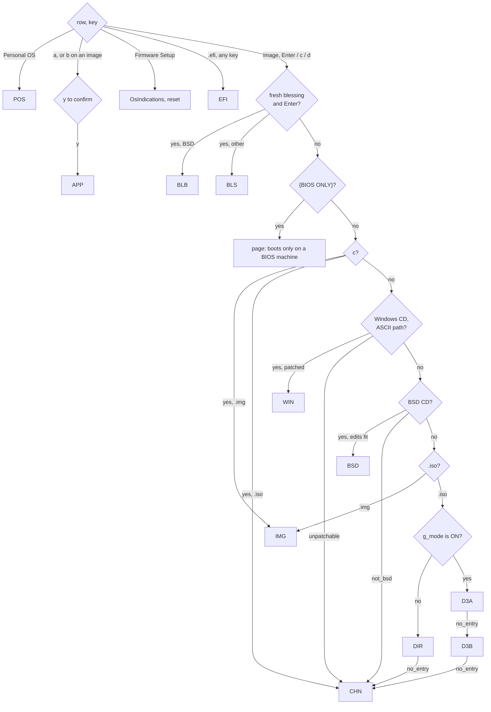

`boot_plain` (`apps/stick/efi_main.c`) runs the tests in this order.
`d` and Enter are the same on an unblessed row; `c` and `d` on a blessed row
skip the blessing. Every route starts with `target_probe`, which is a no-op
for a row the menu drew and a look inside for one it did not (the next-boot
marker's). A `{BIOS ONLY}` row (7.8) then takes no route on any key: its
page says so and the menu comes back.

A route falls through only while it has not yet committed. Each one keeps a
flag, set at the start and cleared once it has decided the medium is its own:

| flag | route | still set when |
|---|---|---|
| `unpatchable` | WIN | no UDF, no `boot.wim`, the WIM does not parse, the patch does not build; also a non-ASCII path, which skips WIN before it draws |
| `not_bsd` | BSD | no ISO9660, `/boot/defaults/loader.conf` not one extent of at least 1 KiB, no room for the directory record |
| `no_entry` | DIR, D3A | no ISO9660 or UDF, no CD boot entry; for D3A also no `.sbat` in the kernel, no `\EFI\BOOT\BOOTX64.EFI` in the ISO |
| `no_entry` | D3B | the ISO is not whole 2048-byte blocks, the entry is a loopback one, no `grub.cfg`, it is not one extent of at most 256 KiB, ours does not fit in its length |

A failure after the flag is cleared is reported and returns to the menu; it
does not fall through. `BLS` and `BLB` never fall through at all.

#### 11.2.3 Shared machinery

| piece | where | what it is |
|---|---|---|
| load ops | `loader/loadops.c`, `resolve_load_ops` | shim's `SHIM_IMAGE_LOADER` LoadImage/StartImage when shim is present, the firmware's otherwise. `table_unhooked` means shim is present but not enforcing; the chainload and `launch_image` then try the firmware's LoadImage first, since shim's own loader refuses some images the firmware accepts (pfSense's loader). `direct_boot` always uses shim's. |
| credfs | `loader/credfs.c` | a read-only Simple File System on a vendor-media device path, served from the loader's buffers. An image loaded from it by device path has a DeviceHandle to read siblings from. |
| LoadFile2 initrd | `direct/direct.c`, `initrd_publish` | the Linux initrd media GUID handle the kernel's EFI stub pulls its initrd from. |
| virtual CD | `iso/iso.c`, `iso_open` | Block I/O over the p2 file: 2048-byte blocks for an ISO, 512 for an `.img`, read-only, `VenHw` device path. `ConnectController` lets the firmware's El Torito and FAT drivers mount the boot image. |
| overlay | `iso/overlay.h`, `iso_read_blocks` | memory ranges laid over the virtual CD's reads, and an append region past the ISO's end. Each read is split at overlay boundaries. |
| extent map | `direct/direct.c`, `build_map`; `falcon-core/src/media/extmap.c` | version 2: the ISO library's install ID (off p2's `/.falcon`), p2's start LBA (its handle's HARDDRIVE node, MBR or GPT) and the block size, the ISO's size and its extents on p2. falcon-hook, winjump and falcon-vdisk find p2 from it by the record at that LBA (`media/extfind.c`) and rebuild the ISO. |
| `FalconDiscoverStatus` | `loadops.c`, `loader_discover_status_set` | one line of ASCII, volatile, boot-and-runtime, written on every boot by both UEFI loaders: how `discover_scan` read the boot partition's record, or which check stopped it and the firmware's answer there, the handle's device path as node types, and whether the read went through memory below 4 GiB (3.1). |
| `FalconIsoMap` | `loadops.c`, `loader_isomap_set` | the extent map as a volatile boot-and-runtime variable. Cleared if the boot returns to the menu, not otherwise. falcon-hook's last source, for wraps older than the map credential. |
| SHIM_LOCK hide | `iso/iso.c`, `shim_lock_hide` | the stick shim's SHIM_LOCK is uninstalled for the length of a chainload, so the ISO's GRUB finds its own shim's. Only `chainload` does this: CHN, IMG, D3B, WIN, BSD. |

Everything above is a boot-services object and is gone at
ExitBootServices, except `FalconIsoMap` and `FalconDiscoverStatus`.

#### 11.2.4 POS: the personal OS

```mermaid
sequenceDiagram
    actor U as User
    participant L as falcon-boot
    participant FC as falcon-core
    participant S as shim
    participant K as sd-stub, kernel
    participant I as initramfs (systemd)
    U->>L: Enter on Personal OS
    L->>U: masked passphrase prompt
    U->>L: passphrase (3 tries, Escape backs out)
    L->>L: borrow the AVX state; a slot of 512 MiB-passes or more: StartupAllAPs, the other cores on the lane pool (mp/)
    L->>FC: luks_unlock p3 (argon2id or PBKDF2, AES-XTS)
    L->>L: the workers released and seen back, the AVX state given back, on every core
    L->>FC: luks_dev_open, fs_mount_journal ext4 (a journal left by a hibernated OS replayed in memory, 5.4)
    FC-->>L: /uki/*.efi, else /EFI/Linux/*.efi
    L->>U: chooser (skipped for one image)
    L->>L: read the UKI into pages
    L->>L: credfs: uki.efi, uki.efi.extra.d/cryptsetup.passphrase.cred, falcon.ident.cred (p1's record as text)
    L->>S: LoadImage by credfs device path
    S-->>L: verified against db / MokList when enforcing
    L->>K: StartImage
    K->>K: sd-stub packs extra.d/*.cred into /.extra/credentials/
    K->>K: .initrd plus that cpio served over LoadFile2, kernel loaded, ExitBootServices
    K->>I: initramfs
    I->>I: falcon-credential drop-in: LoadCredential from /.extra/credentials/cryptsetup.passphrase.cred
    I->>I: systemd-cryptsetup opens p4 as cryptusb, lvm2 activates vgusb
    Note over I: root /dev/mapper/vgusb-root mounted, switch-root
```

The OS half (the drop-in, the cmdline naming p4 and root) is the archusb
repository's; Section 5 says why the drop-in exists.

Resident at handoff: credfs and sd-stub's LoadFile2, both boot-services.
The other processors are back with the firmware before the shelf is
mounted, its dispatch finished and their CR4 and XCR0 as it had them. On
failure: a wrong passphrase retries after a wait, five a boot and then
power off (5.2), any other unlock error stops; a refused
UKI tears down credfs, wipes the credential and prints the refusal evidence.

#### 11.2.5 APP: the signing appliance

```mermaid
sequenceDiagram
    actor U as User
    participant L as falcon-boot
    participant S as shim
    participant A as appliance PID 1
    participant F as Firmware
    U->>L: a, or b on a row
    L->>U: the list, y to confirm
    L->>F: FalconNextBoot = the entry, BootNext = this stick
    L->>L: unlock p3 as POS does, pick appliance*.efi
    L->>L: credfs: uki, passphrase .cred, falcon.bless.cred (the list), falcon.ident.cred (the install ID)
    L->>S: LoadImage by path (MOK-signed), StartImage
    S->>A: sd-stub, kernel, /init = falcon-boot-appliance-init
    A->>A: modules; the install ID from falcon.ident.cred (none: refuse, unlock nothing)
    A->>A: find_stick (30 s): the exFAT /.falcon and the LUKS2 token carrying it, any disk; mount p2, read the manifest
    A->>A: survey only the listed paths
    A->>A: shelf_open p3 read-only in process (core LUKS2, ext4) with the passphrase .cred
    A->>A: MOK key and cert into sealed memfds
    A->>A: falcon-boot-sign-static per ISO: /falcon/blessed/, manifest
    A->>F: reboot
    F->>L: BootNext: the stick again
    L->>L: loader_next_boot_take, next_boot_run: boot_blessed (BLS or BLB)
```

The appliance never stands on its own; it ends in a reboot into the route
it just made possible. Picked from the Personal OS chooser instead, it runs
with no list and asks. If it returns without rebooting, the loader clears the
marker and `BootNext`.

#### 11.2.6 BLS: a blessed wrap, or memtest86+

The wrap is built by `falcon-boot-sign` (`falcon-cli/src/sign`): sd-stub, the
ISO's kernel, a `.initrd` of the ISO's initrds with the falcon-hook cpio
appended (no map; the map is not known until boot), and the cmdline
`hookcmd_build` gives the ISO's CD entry, signed with the MOK. For
memtest86+ the blessed image is its own loader, signed
(`family_bless_loader`).

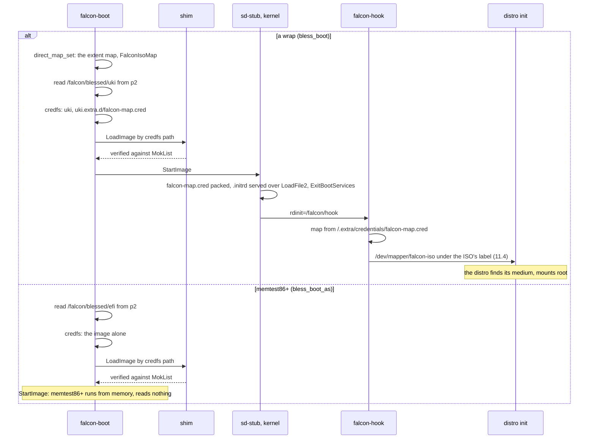

A map that fails to build is not fatal: the wrap boots, and the hook falls
back to `FalconIsoMap` or hands over unchanged. Under validation disabled
with Secure Boot on, the firmware refuses sd-stub's inner kernel load; the
loader predicts that and warns before starting a wrap. memtest86+ loads no
image of its own and gets neither the map nor the warning.

#### 11.2.7 BLB: a blessed BSD medium

The same edits and virtual CD as BSD (11.2.12), but the loader started is the
MOK-signed copy of the medium's loader from `/falcon/blessed/`.

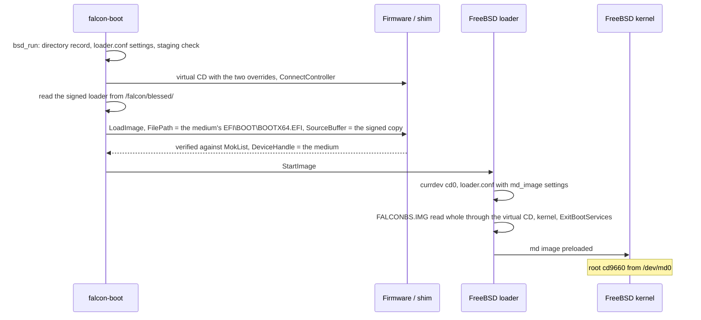

Passing both FilePath and SourceBuffer starts the signed copy with the
medium as its device; no other route does it. FreeBSD's loader does not
verify the kernel or modules.

#### 11.2.8 EFI: a bare `.efi` on p2

`boot_payload` reads the file, publishes it alone on credfs, and loads it by
path (firmware first when shim is not enforcing, else shim), then starts it.
The payload is the target; nothing follows. No extent map, no initrd, no
fallback.

#### 11.2.9 DIR: direct kernel boot

Taken when `g_mode` is not `ON`: Secure Boot off, validation disabled, setup
mode or unknown.

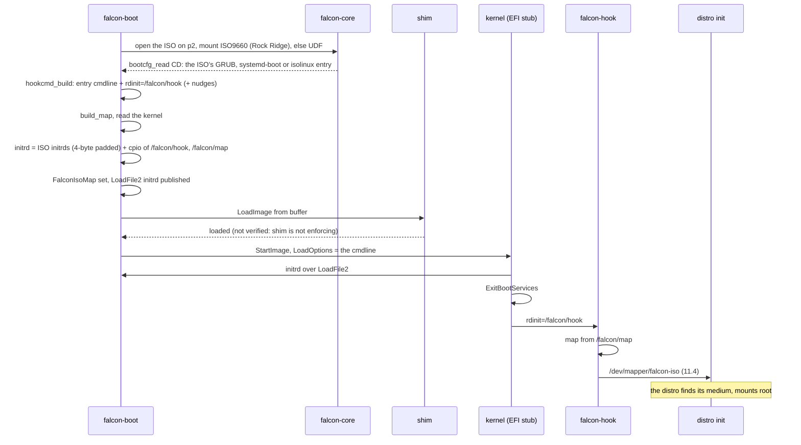

On failure after the entry is chosen (too many fragments, LoadImage refused,
out of memory): an error screen with "press c", and no automatic fallback.
If the kernel returns, the initrd is withdrawn and `FalconIsoMap` cleared.

#### 11.2.10 D3A: the ISO's own shim, then its kernel

Taken when `g_mode` is `ON` and the kernel carries `.sbat`.


The ISO's shim comes from the ISO9660/UDF tree, not from the El Torito
image; they are normally the same file.

#### 11.2.11 D3B: the ISO's own GRUB, with our grub.cfg

Taken when `g_mode` is `ON` and D3A said `no_entry`.


Our cfg is:

```
set timeout=0
set default=0
menuentry 'falcon-boot' {
    linux <kernel> <hooked cmdline>
    initrd <the entry's initrds> ($root)<iso_size/512>+<hook sectors>
}
```

Best-effort (Section 7.2): a GRUB whose embedded prefix reads a different
configuration first, or sets `$root` to a partition rather than the CD,
never sees ours.

#### 11.2.12 BSD: a BSD medium as its own memory disk

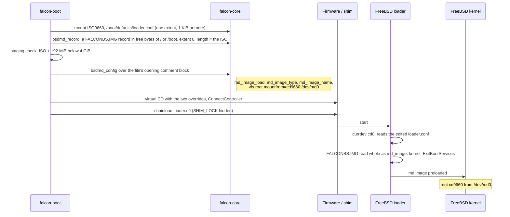

`loader.efi` is unsigned, so Secure Boot refuses this route; BLB is the
Secure Boot route. The file edited is `/boot/defaults/loader.conf`; a medium
may have no `/boot/loader.conf`.

#### 11.2.13 WIN: Windows install media

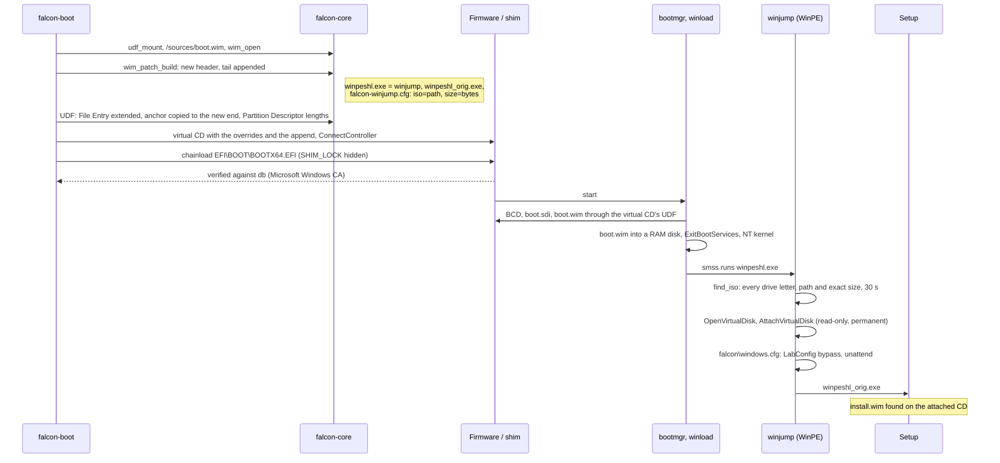

Microsoft's binaries are served byte for byte; the patched WIM is not
verified (Section 7.7). WinPE sees p2 through its own `exfat.sys`, which is
how winjump finds the file. Every winjump failure still starts the original
shell, logged to `X:\falcon-winjump.log`.

#### 11.2.14 CHN and IMG: the medium's own loader

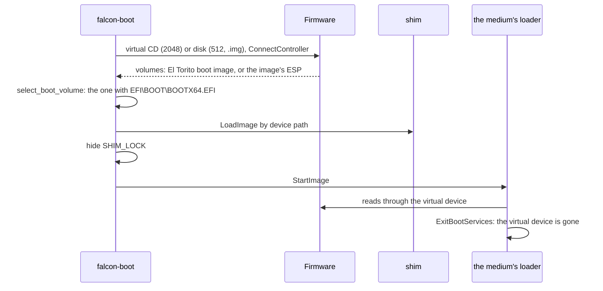

Nothing is appended and no map is set, so a Linux live initramfs looking
for its CD after ExitBootServices finds nothing (Section 6.1). The route
serves media that need nothing after load (memtest-class images, WinPE in
its RAM disk), and is the fallback when the routes above cannot read the
medium.

#### 11.2.15 Failure paths

Every route returns to the dispatcher on failure. A dialog over the last
menu says what failed and at which step, the advice, and on a Secure Boot
refusal the evidence (who signed the image, which list decided); then
"press any key to return to the menu" (7.10). A route that had handed over
first repaints the whole screen under it. Cancelling a prompt returns
without the key.

Nothing in the UEFI loader halts. It leaves only three ways: a route that
started its target, Escape at the root (back to the firmware's next boot
option), and the confirmed Firmware Setup reset. A console that stops
answering `WaitForEvent` is treated as Escape, so the menu unwinds to the
firmware rather than spinning.

### 11.3 BIOS

#### 11.3.1 The boot area

Section 3.3's layout. Stage 1 goes in the 440 bytes of boot code in LBA 0,
with stage 2's first LBA (LE32 at 0x1B2) and its length in sectors (LE16 at
0x1B6) written into its last six by the installer; the table behind is
kept. Stage 2 goes in front of the first partition: LBA 34 on a GPT disk,
LBA 1 on an MBR disk, at most 62 sectors (the build checks; an old MBR
disk's first partition at 63 leaves no more). Stage 3
goes in the `boot` partition's reserved sectors, from the sector its record
names (32 as the installers write it) to no further than the reserved count
in the FAT BPB, and the next-boot marker is the sector the record names (8).
jump's floppy keeps its own layout: stage 2 at LBA 34 and stage 3 at 98 of
the FAT12 volume, which is the `boot` volume itself (11.6).

A stage 1 whose fields are zero says `no stage 2` and reads nothing; a
half-written stage 2 fails stage 1's `BOS2` check, which says so. The rig disks are made by
`falcon-bios/tools/mk-rig-disk.sh` from files alone (`sfdisk`, `sgdisk`,
`mkfs.fat --offset`, `mkfs.exfat` on a file, and `mkstick ident` for the
reserved count and the boot record); jump's floppy, which has no table,
gets its record from `mkstick ident --write-boot-at`, which writes one at a
byte offset with the sectors given.

#### 11.3.2 Power-on to the menu

```mermaid
flowchart TD
    BIOS["BIOS<br/>LBA 0 to 0x7C00, DL = boot drive"] --> S1["Stage 1, boot.S (real mode)<br/>segments 0, SP 0x7C00, COM1 up"]
    S1 --> PL{"stage 2's LBA and length<br/>(0x1B2, 0x1B6) written?"}
    PL -- "no" --> F1["fail: reason, key, jump to FFFF:0"]
    PL -- "yes" --> EXT{"INT 13h AH=41h:<br/>the extensions?"}
    EXT -- "yes" --> RD{"AH=42h: all of stage 2<br/>to 0x7E00 in one call"}
    EXT -- "no" --> GEO1["AH=08h: sectors per track, heads"]
    GEO1 --> RC{"AH=02h: one sector a call<br/>to 0x7E00 on"}
    RD -- "3 tries, AH=00h reset between, all fail" --> F1
    RC -- "3 tries, AH=00h reset between, all fail" --> F1
    RC -- ok --> MG
    RD -- ok --> MG{"0x7E04 holds BOS2?"}
    MG -- no --> F1
    MG -- yes --> S2["Stage 2, stage2.S at 0x7E00 (real mode)"]
    S2 --> CRC{"CRC-32 of GATE_S2LEN bytes<br/>matches the one after them?"}
    CRC -- no --> FR
    CRC -- yes --> CPU{"cpu_check<br/>CPUID (the i586 floor)"}
    CPU -- no --> FR["fatal_rm: reason, key, reset"]
    CPU -- yes --> MEM{"mem_check<br/>BDA 0x413 at least 608 KiB"}
    MEM -- no --> FR
    MEM -- yes --> A20{"A20: INT 15h 2401, else port 0x92<br/>verified by wraparound"}
    A20 -- closed --> FR
    A20 -- open --> SSE{"CPUID: FXSR and SSE?"}
    SSE -- yes --> OSX["CR4 OSFXSR, OSXMMEXCPT"]
    SSE -- no --> PE
    OSX --> PE["pmode.S<br/>flat GDT, CR0.PE, paging off"]
    PE --> PM["32-bit protected mode, stage2_32, ESP 0x800000<br/>fault_install: IDT, 32 vectors"]
    PM --> BP["stage3_load, load3.c: AH=48h sector size<br/>find_boot: part_read_table on the boot drive;<br/>no table (a floppy): LBA 0 is the volume"]
    BP --> BR{"bootpart_find: the first FAT-typed partition<br/>(GPT: ESP or the falcon boot type) whose<br/>boot sector's record is role boot<br/>with a stage 3 sector (not an ESP's 0)?"}
    BR -- no --> BF
    BR -- yes --> GT["gate: 0x7E18 its first LBA,<br/>0x7E42 the record's marker sector"]
    GT --> L3["header: one sector at start + the record's<br/>stage 3 sector, to 1 MiB"]
    L3 --> H3{"BOSZ, length inside the volume's<br/>reserved sectors, memory in bounds?"}
    H3 -- no --> BF["bios_fatal: reason, key, reset"]
    H3 -- yes --> RZ["read the member to 6 MiB,<br/>inflate to 1 MiB (gz_member)"]
    RZ --> CZ{"CRC-32 and length match,<br/>BOS3 inside?"}
    CZ -- "no, first time" --> RZ
    CZ -- "no, again" --> BF
    CZ -- yes --> S3["zero its .bss<br/>call 0x100010, ESP 0x800000"]
    S3 --> BM["bios_main<br/>E820, boot disk"]
    BM --> IR["install_boot_record: the boot partition's<br/>record, from the gate: the install ID"]
    IR --> MK["marker_take: the boot partition's marker sector<br/>a marker is zeroed, read back, then parsed and dated (6.3.1)"]
    MK --> DSK["install_drives: the boot drive, then every drive<br/>the BDA counts; each one's table, MBR or GPT"]
    DSK --> REC["install_part_record per partition: a LUKS2 falcon token,<br/>or /.falcon on what the registry mounts;<br/>only the boot record's install ID counts"]
    REC --> P2["library: fs_mount (exFAT), survey_volume (.iso, .img)"]
    REC --> P3["shelf: pos_probe, LUKS2 or plaintext"]
    P2 --> SI["linux_cpu_is_64, once: {64-BIT ONLY} is drawn only without it<br/>display_init: 80x25 text, VGA memory"]
    P3 --> SI
    SI --> NB{"a marker taken?"}
    NB -- "no" --> MENU["menu"]
    NB -- "a fresh value" --> RUN["next_boot_run: :personal is POS,<br/>a path the survey found boots as Enter on its row"]
    NB -- "bad, stale, undated, or not cleared" --> NOTE["a note, a key"]
    RUN --> MENU
    NOTE --> MENU
```

The whole loader is i586 code in flat 32-bit protected mode, and one image
runs on every i586 or later processor. What a newer processor
adds is taken by asking CPUID, not by a second build: the SSE state above,
AES-NI in falcon-core's AES path, argon2id's SSE2, SSSE3 and AVX2 block
functions (the AVX state borrowed for the unlock and given back), the other
processors for its lanes (11.3.7), and long mode, which only a 64-bit kernel
needs and 11.3.6 checks for (the menu's `{64-BIT ONLY}`, 7.8, asks the
same question before a row is chosen). Paging stays off, so everything the loader
places is below 4 GiB (`ADDR_END`).

Stage 2 is linked at 0x7E00 and stays there: stage 3 uses its thunk and IDT
for the rest of the boot. Stage 3 is linked separately and shares no
symbols with it, so its head is a gate at fixed addresses:

| address | field |
|---|---|
| 0x7E00 | `jmp stage2_begin` |
| 0x7E04 | `BOS2`, what stage 1 checks |
| 0x7E08 | `jmp thunk_bios`: C calls a BIOS interrupt through here |
| 0x7E10 | `jmp boot16`: the one-way drop to real mode a chainload takes |
| 0x7E18 | the boot partition's first LBA, 64 bits (0 on a floppy), written by `load3.c` |
| 0x7E20 | the register block, 32 bytes |
| 0x7E40 | the interrupt vector |
| 0x7E41 | the boot drive |
| 0x7E42 | the boot record's marker sector, 16 bits (0 for none), written by `load3.c` |
| 0x7E44 | SI at `boot16`'s jump, 16 bits, DS 0: the partition chain's entry (12.4), 0 for every other route |
| 0x7E48 | the real-mode target of `boot16`, offset then segment |
| 0x7E4C | stage 2's length, written by the build; its CRC-32 follows the image |

`build.mk` checks every one against `nm` output.

Stage 2 checks itself before it runs past the gate. The build writes its
length into 0x7E4C and appends the CRC-32 of that many bytes (gzip's,
taken from gzip's trailer, so no other tool computes it); `stage2_begin`
recomputes it, bitwise, over what stage 1 read, and a mismatch is
`fatal_rm` with the reason. Stage 1 has no room for the check (its code is
413 of the 434 bytes it may use). A floppy can read back wrong without an
error (13.3).

#### 11.3.3 The thunk: a BIOS call from protected mode

Stage 3 runs in 32-bit protected mode and the BIOS only in real mode;
every disk read, cursor move and key goes through this round trip.

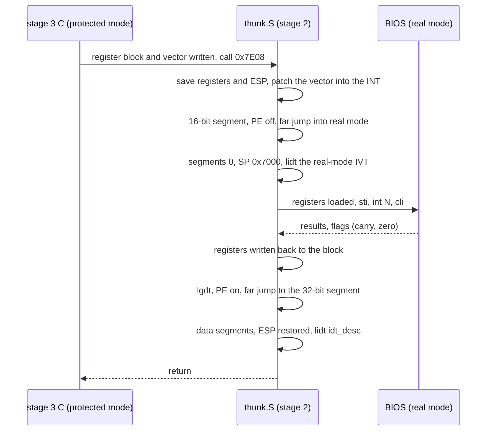

Buffers the BIOS reads into must be addressable from real mode with DS and
ES at 0, so a disk read lands in the bounce buffer at 0x90000 (32 KiB) and
is copied up; the packet is at 0x1000. The one write, clearing the
next-boot marker, goes the other way through the same buffer. Services used:
INT 13h AH=42h, AH=43h (`marker.c` only, one sector) and AH=48h, INT 1Ah
AH=02h and AH=04h (the RTC, to date the marker), INT 10h (the 80x25 text mode, cursor shape and position, and
teletype for stages 1 and 2 and `bios_fatal`), INT 16h AH=00h and AH=01h,
INT 15h E820 (on a BIOS without it, AX=E801 and AH=88h: the map is built
from their answers and the BDA's count at 0x413, `e820_synth`, host
tested), and INT 18h when Escape at the root menu hands the machine
back. Stage 3 writes the screen's cells into VGA text memory at 0xB8000
directly (falcon-bios/src/console/display.c). INT 15h AH=87h is used only by the
resident CD handler, from real mode.

#### 11.3.4 Memory map

| range | what | lifetime |
|---|---|---|
| 0x0000-0x03FF | real-mode IVT; INT 13h hooked by a chainload | permanent |
| 0x0400-0x04FF | BDA; 0x413 is conventional memory in KiB, lowered 16 by a chainload | permanent |
| 0x0600-0x07FF | the station's partition chain: the disk's LBA 0, its entry marked active, DS:SI at the entry (12.4) | handed over |
| 0x1000-0x10FF | disk packet, drive parameters, E820 slot | per call |
| below 0x7000 | real-mode stack during a thunk | per call |
| 0x3000-0x311F | the Linux handoff: the move stub at 0x3000, the handoff GDT at 0x3100 | copied at the handoff, handed to the kernel |
| 0x5000-0x53FF | the page the other processors start in for an unlock (`aptramp.S`): data, an IDT of halts, the code | while the keyslots run; the processors are sent INIT before anything else |
| a free 4 KB in the option-ROM area, chosen at run time (falcon jump) | a PC Card's attribute memory, through the bridge's memory window 0 | while `PCC.MOD` reads the CIS; closed before the handoff |
| 0x7C00-0x7DFF | stage 1; later the chainloaded boot image | stage 1 dies at the jump |
| 0x7E00-0xFDFF | stage 2 (at most 62 sectors; 25 KiB used): gate, thunk, GDT, IDT, fault reporting, the boot partition search | until the target starts |
| 0x10000-0x10FFF | Linux zero page | handed to the kernel |
| 0x20000 | Linux cmdline; or the staged El Torito boot image (up to 63 KiB) on a chainload | handed over |
| 0x90000-0x97FFF | bounce buffer | every read |
| BDA top - 16 KiB | the resident CD handler: data, runs, El Torito packet, launch stub at +0x530, INT 13h entry at +0x570, INT 15h entry at +0xA00, carved E820 map at +0xB00, overlay pool at +0x1000; never below 0x98000 | permanent after a chainload; reserved in the map it hands on |
| BDA top - 1 KiB (station) | the drive swap (`swapres.S`): the drive, the INT 13h entry at +0x10 (the Safe MBR Hook header, 11.3.8, whose smhnext slot is the previous vector, then the handler at +0x2B), 111 bytes | permanent after a chain of a disk that is not 0x80 |
| BDA top - 3 KiB (falcon jump) | the reverse thunk (`rthunk.S`): far pointers, its GDT, the saved caller, the INT 13h entry at +0x90, the INT 16h entry at +0x240 (the `USB` route's, when a module found a keyboard), the INT 15h entry at +0x300 and its carved map at +0x400 (the `USB` and `PCC` routes'), the release record at +0xB00 (`FJRS`, the vectors and BDA counts it replaced) and the keyboard entries at +0xB14; below it the virtual CD's block on `CDR`. As the keyboard block (13.6) it hooks no INT 13h: INT 16h, 15h, 18h and 19h only, DRIVE 0 | permanent after a route hands over, and as the keyboard block after `MBR` or a floppy-emulation disc while a `USB` route's keyboards are up, until station-legacy releases it for a chain to another disk (11.5.2); reserved in the map it hands on |
| 0x100000 | stage 3: 16-byte header, entry at +0x10, then its image and `.bss` (at most 0x6F0000 together) | whole loader |
| 0xB8000-0xB8F9F | VGA text memory, the 80x25 screen stage 3 draws | whole loader |
| 0x600000 | stage 2's partition list and sector buffer while it looks for the boot partition (`STAGE2_SCRATCH`), then the compressed stage 3 it inflates | until stage 3 runs |
| 0x7F0000-0x7FFFFF | stage 2's protected-mode stack, then stage 3's, ESP from 0x800000 | whole loader |
| 0xF00000-0xFFFFFF (falcon jump) | the module slots, eight of 128 KiB (`JMOD_REGION`): `ATA.MOD` at 0xF00000, `UHCI.MOD` at 0xF20000, `OHCI.MOD` at 0xF40000, `EHCI.MOD` at 0xF60000, `PCC.MOD` at 0xFA0000 | from the module's load; kept while a `USB` route's keyboards are up (13.6); permanent after a route hands over with a module or the keyboard block resident, reserved in E820, E801 and AH=88h |
| 0x1000000 | the kernel's protected-mode part (aligned up; `pref_address` for a non-relocatable kernel); one fixed below here, at 1 MB (memtest86+), is staged here instead, above its own footprint, and moved down at the handoff | handed to the kernel |
| highest fit below the kernel's `initrd_addr_max` | the initrds, placed from E820 | handed to the kernel |
| highest fit in 64 MiB-4 GiB | `heap.c`: the patched boot.wim tail | through the chainload, served by AH=87h; the appended part reserved in the map it hands on |
| 4 GiB | `ADDR_END`: paging is off, so nothing is placed above it | |

`mem_check` refuses a machine whose EBDA reaches below 0x98000 (the bounce
buffer). The fixed addresses are in
`falcon-bios/src/start/biosdefs.h`, except that floor (`stage2.S`).

#### 11.3.5 The menu and route selection

The menu is the UEFI loader's (11.2), drawn from the same layout
(`falcon-core/src/tui`): Personal OS first at the root when p3 is LUKS2,
".." first in a folder, then the survey's folders and images. Keys: up and
down, Enter, `c` (chainload), `d` (direct), Escape (up a folder, or at the
root INT 18h, which hands the machine back to the BIOS; a reset if it
returns). No Secure Boot, no shim, no blessing: five routes, dispatched in
`boot_plain`'s order as on UEFI.

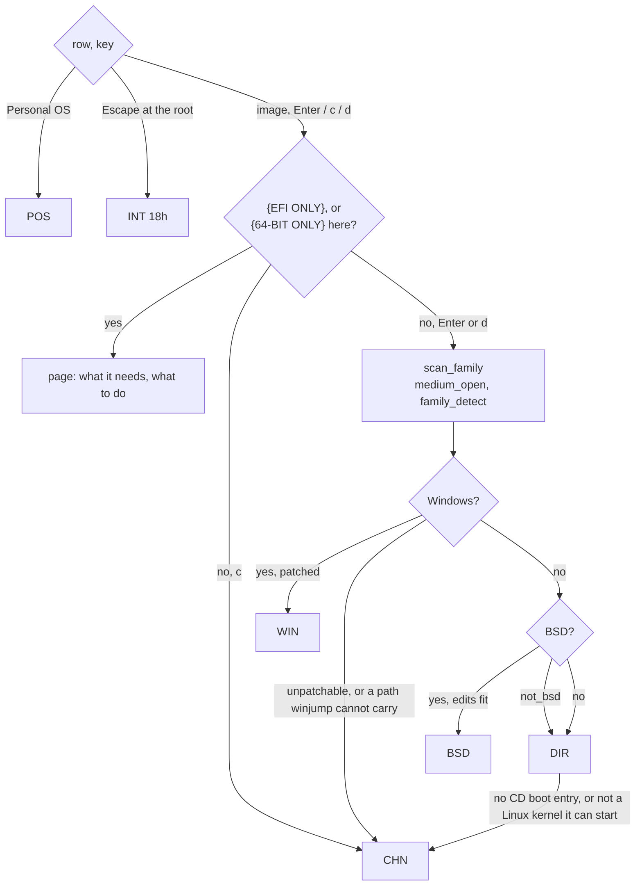

The rows carry `{EFI ONLY}` and, on a processor without long mode, `{64-BIT
ONLY}` (7.8), filled by `probe_entry` (`scan_probe`, then
`biosboot_medium`) as the menu first draws each row. `boot_plain` reads the
same answer first on every key: a tagged row takes no route, its page says
what the medium needs and the menu comes back.

Unlike the UEFI loader, a BSD medium that is not one the memory-disk route
applies to goes on to the direct boot. `DIR` goes on to `CHN`, as on the
UEFI loader, when it stops before committing because the medium is not one
it can take (`boot_result.fallthrough`): no filesystem or boot entry it can
read, a kernel that is not on the medium, or one `linux_boot` refuses before
placing anything (`linux_not_taken`). A 64-bit kernel on a processor without
long mode is not one of those (the medium's own loader would start the same
kernel).

#### 11.3.6 DIR: direct kernel boot

```mermaid
sequenceDiagram
    participant L as stage 3
    participant B as BIOS (thunk)
    participant K as kernel
    participant H as falcon-hook
    participant D as distro init
    L->>B: read the ISO on p2 through falcon-core (medium_open, bootcfg_read CD)
    L->>L: linux_probe: the kernel's width from its setup header
    L->>L: build_map (block size from AH=48h), hook cpio /falcon/hook + /falcon/map, the hook of the kernel's width
    L->>L: hookcmd_build + console=ttyS0,115200 console=tty0
    L->>L: linuxcore_geometry: boot protocol 2.12+, load address, and a 64-bit kernel needs CPUID long mode
    L->>B: kernel's protected-mode part to 16 MiB, in 64 KiB chunks (a kernel fixed below that is staged there, stage_at)
    L->>L: cmdline to 0x20000
    L->>B: initrds, hook last, 4-byte padded, at e820_place_high below initrd_addr_max
    L->>L: zero page at 0x10000: setup header, loader type 0xFF, the memory map as read (11.3.3)
    L->>L: "starting <entry>" on screen
    L->>L: screen_info from INT 10h and the BDA, after the route's last line: mode, columns, rows, cursor, VGA
    L->>K: GDT (0x10, 0x18) copied to 0x3100; a staged kernel is moved down by the stub at 0x3000; jump to code32_start, ESI = zero page (32-bit entry, either width)
    K->>H: rdinit=/falcon/hook, map from /falcon/map
    H->>D: /dev/mapper/falcon-iso (11.4)
    Note over D: the distro finds its medium, mounts root
```

The map is carried only in the initrd; a BIOS has no variable store. Nothing
is resident at handoff: the IVT and BDA are untouched. A map that cannot be
built (too many fragments) boots without the hook, and the kernel is left to
find its medium itself.

#### 11.3.7 POS: the personal OS

sd-stub cannot run under a BIOS: the loader unwraps the UKI and does
sd-stub's credential packing itself.

```mermaid
sequenceDiagram
    actor U as User
    participant L as stage 3
    participant FC as falcon-core
    participant K as kernel
    participant I as initramfs (systemd)
    U->>L: Enter on Personal OS
    alt LUKS2 shelf
        L->>U: masked passphrase (INT 16h), five a boot with a wait after each wrong one, then power off (5.2)
        L->>L: borrow the AVX state; a slot of 512 MiB-passes or more: the MADT's other cores woken by INIT and two startup IPIs into 0x5000 (mp/aptramp.S), on the lane pool
        L->>FC: luks_unlock p3
        L->>L: the workers released and halted, each sent INIT, the local APIC's SVR as found, the AVX state given back
        L->>FC: luks_dev_open, fs_mount_journal ext4 (5.4)
    else plaintext shelf
        L->>FC: fs_mount_journal straight off the partition, no prompt and no credential
    end
    FC-->>L: shelf_collect: /uki or /EFI/Linux, *.efi (at most 8)
    L->>U: chooser, shelf_label's rows (one image boots without asking)
    L->>FC: pe_parse: .linux, .initrd, .cmdline
    L->>L: cpio .extra/credentials/cryptsetup.passphrase.cred, after .initrd
    L->>K: linux_boot with the UKI's cmdline unchanged (as DIR, without the hook), and a 64-bit UKI needs long mode
    K->>I: initramfs
    I->>I: falcon-credential drop-in, systemd-cryptsetup opens p4, lvm2
    Note over I: root /dev/mapper/vgusb-root mounted, switch-root
```

The initramfs sees what sd-stub would have given it. `pmode.S` sets
CR4.OSFXSR when CPUID reports SSE, for AES-NI in `luks_unlock`: UEFI
firmware sets it, a BIOS leaves it clear, and the first SSE instruction
would fault. Without AES-NI, `luks_unlock` takes falcon-core's portable AES
path. The AVX state is off in protected mode until something turns it on:
`pos.c` borrows it around `luks_unlock` for argon2id's AVX2 block function
and gives it back (CR4.OSXSAVE clear and XCR0 at its reset value again,
every ymm register zero) before anything is loaded, so what boots next
finds the processor's state as the BIOS left it. The vector objects are
built to realign their own stack frames, since nothing in falcon-bios
promises a 16-byte stack to a function it calls and a legacy SSE operand
on a misaligned stack slot is #GP.

A keyslot worth it (`lanes_worth`) runs on the other processors too
(`mp/mp.c`). A BIOS has nothing that starts one, so falcon-bios does what
an operating system does: the processors from ACPI's MADT, found by
`power/acpicore.c`'s table walk; one worker a core, the boot processor's
excepted (`mpcore.c`, the thread bits from CPUID leaf 0Bh), as many as the
slot has lanes less one, at most 15; the local APIC, xAPIC or x2APIC as
the BIOS left it, its SVR software-enabled for the sends and put back
after; INIT, 10 ms, a startup IPI to vector 5, 200 us, another. The page
at 0x5000 takes each from real mode to the flat protected mode stage 3
runs in: the cache back on (INIT leaves CR0.CD and NW set, and an
uncached processor is no help), the boot processor's GDT, an IDT of its
own whose every gate halts (a fault on a worker stops that worker rather
than triple faulting, which some chipsets turn into a reset), the SSE
state, a 16 KiB stack from stage 3's `.bss` by a ticket, then
`mp_ap_main`: the worker's own AVX borrow, the lane pool, the return.
After the keyslots each halts in that page with interrupts off and is
sent INIT, which is the state POST left it in: a kernel brings it up
again (the rig's UKI reports every processor online), a chained DOS
never knows. A processor with no local APIC, a machine with no MADT or one
processor, or a local APIC the BIOS left disabled, runs the lanes in
turn.

#### 11.3.8 CHN: the resident virtual CD

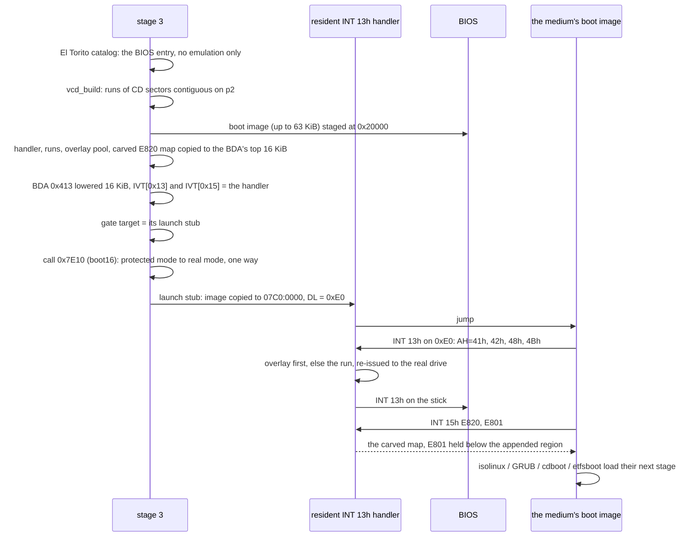

Other drives pass through to the previous handler. Writes fail. Reads past
the medium's end up to 64 sectors of padding return zeros.

Every INT 13h entry a falcon-bios resident installs (this handler's, the
virtual floppy's below, the drive swap's (12.4) and jump's reverse thunk's
(13.6)) begins with the Windows 98 DDK's `SafeMBRHook` structure: a short
jump over it, `$INT13SF`, the vendor ID `FALCON  `, the previous handler
(the block's one copy of it, which the handler chains through) and flags.
The flags stay 0, since a hook may declare itself safe only when what it
does is what Windows 98's own IDE driver provides, and a vendor
protected-mode driver is what sets the flag for one that does not. Windows
98's I/O supervisor walks the chain at startup and lists a handler whose
flag is clear, or that has no structure, as an unknown hooker in
`IOS.LOG` (`UnKnown int 13 hooker MBRINT13` for the hook it found in
place of the BIOS's); with the flag set the line is gone. The other
vectors a block hooks have no header.

What stays in use behind the handoff is hidden. The BDA's lowered count
hides the handler's 16 KiB from anything that asks for
conventional memory. The INT 15h half hides it, and the appended region the
handler serves from extended memory (Windows' tail, 11.3.9), from anything
that asks for the map: it answers E820 from a copy of the loader's map with
both ranges carved out as reserved (`e820_carve`, host tested), caps E801's
count of 64 KiB blocks above 16 MiB below the appended region, and passes
every other INT 15h call, the handler's own AH=87h included, to the BIOS.
The rig checks it with `make test-bios-probe`, a medium whose boot image
prints the map it is handed (`falcon-bios/tools/memprobe.S`).

Unlike UEFI's virtual CD, this one outlives the handoff for anything that
reads through INT 13h, bootmgr and winload included (they drop back to real
mode for each read). A protected-mode kernel that does not call the BIOS
loses it: a Linux live ISO chainloaded here has no hook and no map.

A medium whose BIOS boot image is a floppy emulation (El Torito media type 1,
2 or 3) rather than a no-emulation CD is served differently: `vcd_chainload`
hands it to `vfd_serve` (`falcon-bios/src/vfd/vfd.c`), which loads the whole
image - 2.88 MB at most - into extended memory and installs a smaller
resident (`vfdres.S`) that answers INT 13h for drive 0x00 as a memory disk,
copying each read out of the image with AH=87h. It is a flat disk, so the
geometry (`vfdcore.c`, host-tested) is only how a CHS read is named. It hooks
INT 13h alone and does not hide the image from the memory map; media that
read the floppy once as they load, memtest86+ among them, boot this way.
Haiku's 2.88M floppy boots its loader, which then wants the rest of Haiku
off the CD, not co-resident, and does not complete. Hard-disk emulation
(media type 4) is not implemented.

#### 11.3.9 WIN: Windows install media

The same patch as the UEFI route (11.2.13), computed by the same falcon-core
code; the serving differs, and so does which build of winjump goes in.
falcon-bios embeds winjump twice (x64 and i686, one source) and picks the
one matching the machine type in the boot image's own `winpeshl.exe` headers
(`wim_winpeshl`, `wim_read_head`, `pe_parse`), since a 32-bit WinPE cannot
start a 64-bit program. A 64-bit boot.wim on a
processor without long mode is refused with a sentence, as `linux.c` refuses
a 64-bit kernel. The UEFI loader embeds the x64 build only: 32-bit Windows
starts from 32-bit UEFI, which is out of scope (Section 1).

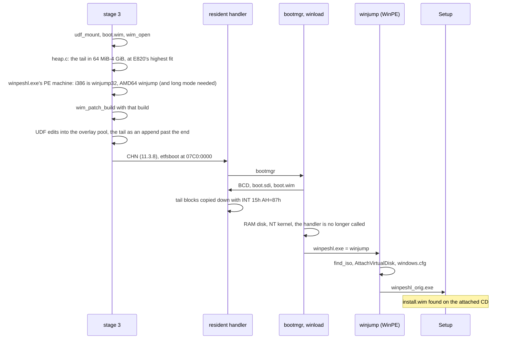

#### 11.3.10 BSD: a BSD medium as its own memory disk

The same two edits as the UEFI route (11.2.12), laid into the resident's
overlay pool. Once the medium is known to be one the route applies to, an
amd64 kernel (`/boot/kernel/kernel`, `biosboot_elf_is_64`) on a processor
without long mode is refused ("checking the processor"), as `linux_boot`
refuses a 64-bit kernel. The staging check looks for one usable E820 run below 4 GiB
holding the ISO plus 192 MiB. The settings add
`console="comconsole,vidconsole"`. FreeBSD's `cdboot` loads `/boot/loader`
through the handler, the loader reads `FALCONBS.IMG;1` whole through it (the
zero padding past the end is what lets it read the last block), and the
kernel mounts root from `/dev/md0`.

#### 11.3.11 Failure paths

No failure halts.

| where | what happens |
|---|---|
| stage 1 | reason on screen and serial, a key, `jmp FFFF:0` |
| stage 2, real mode (`fatal_rm`) | older than i586 (no CPUID), EBDA too low, A20 closed: reason, a key, reset |
| stage 2 and 3, protected mode (`bios_fatal`) | no partition with a boot record, a damaged table, stage 3 missing, malformed or past its volume's reserved sectors, or `stage 3 returned`: reason, a key, reset |
| a processor exception (`idt.S`, `fault.c`) | vector and name, EIP, error code, through `bios_fatal`; a second fault while reporting resets at once |
| a route | the screen taken back (80x25 text again if the payload changed the mode) and repainted, then a dialog: what failed, at which step, the advice, "press any key to return to the menu" (7.10) |
| the POS | no `/uki`, no images: message, secrets wiped, back to the menu; a wrong passphrase: the wait, and at the fifth the power-off of 5.2 |

A reset is port 0xCF9, then the 8042's reset line, then an empty IDT and a
fault, which triple-faults any processor. The window between entering
protected mode and `fault_install` has no IDT.

### 11.4 falcon-hook to root

Shared by DIR, D3A, D3B and BLS on UEFI and DIR on BIOS. It runs as PID 1
from `rdinit=/falcon/hook` before the distro's init, as the binary of the
kernel's width: `falcon-hook` (x86-64) everywhere a 64-bit kernel boots,
`falcon-hook32` (i686) under a 32-bit kernel, which only falcon-bios boots.
The two differ only in `falcon-hook/src/sys.c`.

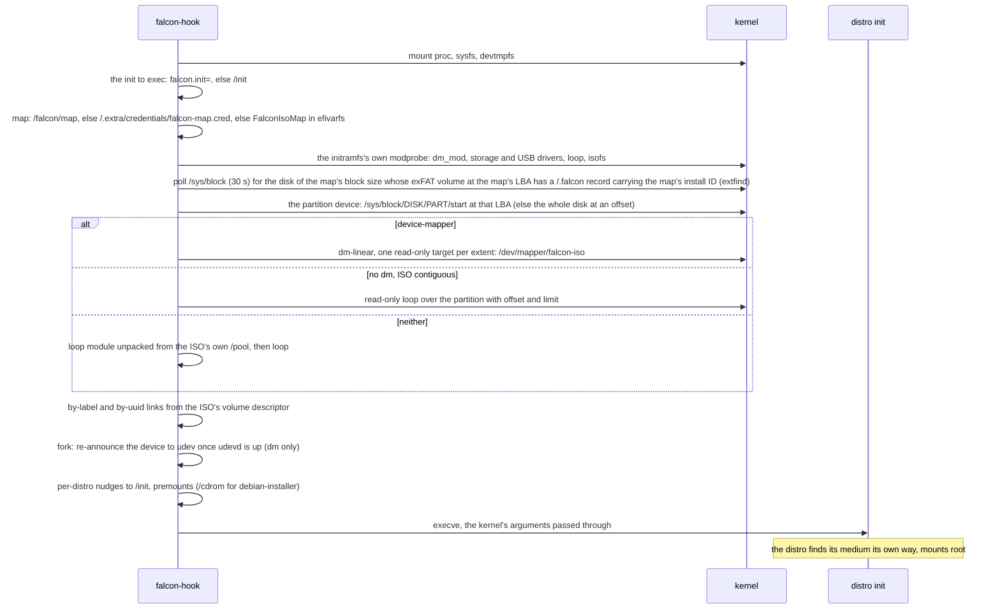

Every failure is logged to `/dev/kmsg` and the distro's init runs anyway.

How each family then finds its root on the device the hook made:

| family | mechanism |
|---|---|
| archiso | `archisolabel=`, through the by-label link |
| dracut live (Fedora, Rocky, Alma) | `root=live:CDLABEL=`, by label once udev has been told about the device |
| casper (Ubuntu and flavours) | its own scan of block devices |
| live-boot (Debian live) | `live-media=/dev/mapper/falcon-iso`, added to the cmdline, since its scan skips dm devices |
| Proxmox, antiX, MX | their `/init` patched to look at the device |
| debian-installer | the ISO premounted at `/cdrom` |
| Alpine | loop, then its own scan |

### 11.5 The stationary build

*Both diagrams are the station of Section 12, traced from its code.*

Section 12's second build of each loader (`make station`). Its POS route
is the stick's (11.2.4, 11.3.7); what is new is how it gets there and the
routes out to the machine's other systems.

#### 11.5.1 UEFI

The station of Section 12: the list of 12.3, `STATION.INI` (12.7), next
boot (12.8), and the TOTP check (12.15) with the saved event log it is
enrolled from. `apps/station/efi_main.c` finds
the rows and boots them; `media/strows.c` is the list as data (the names,
what an INI section changes or adds, the order), host-tested.

```mermaid
flowchart TD
    FW["Firmware<br/>boot entry falcon"] -- "\EFI\falcon\grubx64.efi (falcon-boot-station.efi),<br/>verified against db (12.2)" --> MAIN["efi_main (apps/station/efi_main.c)"]
    FW -- "--shim: \EFI\falcon\shimx64.efi" --> SHIM["shim<br/>verifies grubx64.efi against db / MokList"]
    SHIM --> MAIN
    MAIN --> NB["loader_next_boot_take<br/>FalconNextBoot read, then deleted"]
    NB --> DISC["discover_scan: the ESP's boot record, every Block I/O handle<br/>disks_scan: each whole disk's table (MBR or GPT)<br/>esp_connect_all: a filesystem driver on every partition"]
    DISC --> POSS["pos_scan<br/>shelves carrying the ESP's install ID, any disk (3.1)"]
    POSS --> SAVE["totp_save_log: PCRs 0-15 into FalconEvLog (12.15),<br/>with edk2's event log on a TPM 1.2 behind EFI_TCG"]
    SAVE --> INI{"\EFI\falcon\STATION.INI<br/>on the loader's ESP?"}
    INI -- "no" --> ROWS
    INI -- "parses" --> TOTP{"[totp] section? (12.15)"}
    INI -- "error, too large, unreadable" --> ERR["page: STATION.INI line n: why<br/>no default, no countdown; a key"]
    ERR --> ROWS
    TOTP -- "no" --> ROWS
    TOTP -- "yes" --> SEAL["totp_load: the TPM through EFI_TCG2 / EFI_TCG,<br/>the seed unsealed once, before anything is loaded;<br/>the code, or why not, in the menu's status box from here on"]
    SEAL --> ROWS
    ROWS["rows (12.3):<br/>Personal OS (encrypted), one row per plaintext UKI,<br/>nxt_scan: BootOrder's offered entries but BootCurrent and falcon,<br/>each ESP whose bootmgfw.efi no entry names,<br/>memtest.efi on the loader's ESP, Firmware Setup<br/>then strows_apply: the INI's sections change or add rows"]
    ROWS --> NX{"next boot named?"}
    NX -- "an entry" --> BOOT
    NX -- "nothing it names" --> NXS["page: the marker names x, and no entry has that name; a key"]
    NX -- "no" --> LIST
    NXS --> LIST
    LIST{"list, in the INI's order, Firmware Setup last<br/>first time: the default highlighted, and its countdown"}
    LIST -- "countdown ends, or Enter" --> BOOT{"the row's route"}
    LIST -- "Escape" --> OUT["return to firmware"]
    BOOT -- "Personal OS" --> PR["prompt, chooser, POS (11.2.4)"]
    BOOT -- "a UKI" --> POS["POS (11.2.4): its shelf, that file;<br/>behind the prompt when it is the encrypted shelf's"]
    BOOT -- "firmware entry" --> NXT["NXT: BootNext = Boot####, reset"]
    BOOT -- "an ESP's image" --> ESP["ESP: esp_boot, the file on its volume by device path<br/>through loadops (the firmware's loader when shim is not enforcing, 7.6)"]
    BOOT -- "memtest" --> MEM["MEM: esp_boot, \EFI\falcon\memtest.efi"]
    BOOT -- "Firmware Setup" --> FWS["OsIndications, reset"]
    PR -- "fails, Escape" --> LIST
    POS -- "fails" --> LIST
    NXT -- "BootNext refused" --> LIST
    ESP -- "refused, or it returns" --> LIST
    MEM -- "refused, or it returns" --> LIST
```

`NXT` leaves falcon entirely: the firmware boots the entry on the next
start as though falcon had not run (12.4, BitLocker). Nothing falcon did
survives the reset except that `BootNext` has been consumed. `ESP` and `MEM`
start the image as a child of this loader, through shim's loader when shim
enforces and the firmware's otherwise, as an ISO's own loader is (11.2.14);
Windows Boot Manager loads `winload.efi` through the firmware with its own
handle as the parent. The default and its countdown belong to the
first list only; a boot that comes back to the list gets neither. With a
`[totp]` section (12.15) every route out wipes the seed first (the ESP and
MEM handover, the UKI's StartImage, `BootNext`, firmware setup, the return
to firmware), and a list the user comes back to says the code is shown
again after a restart.

#### 11.5.2 BIOS

Traced from `falcon-bios/src/station/station.c` (Section 12), which `apps/station/bios_main.c` and
`apps/station-legacy/bios_main.c` both run (`station_main`); station-legacy
adds its rows, their route and the release of jump's reverse thunk at the
three places marked.

```mermaid
flowchart TD
    S12["stages 1 and 2, as 11.3.2<br/>the boot partition is the station partition"] --> BM["bios_main, station_main (station/station.c)<br/>e820_read"]
    BM --> DSK["scan_disks: the boot drive, then every drive the BDA counts (0x475)<br/>each one's table (MBR or GPT) and disk id"]
    DSK --> IR["on the boot drive: install_boot_record (the install ID),<br/>marker_take (the marker sector, cleared before it is believed)"]
    IR --> SP["read_station: the station partition mounted (FAT)<br/>/MEMTEST.BIN present? /STATION.INI parsed (stationini.c)"]
    SP --> SH["find_shelves: partitions whose LUKS2 token or /.falcon is a shelf<br/>record of the install; pos_list: a plaintext shelf's UKIs are rows<br/>(uki-&lt;stem&gt;), an encrypted shelf one row, Personal OS (encrypted)"]
    SH --> CH["find_chains: each MBR primary but the station partition whose boot<br/>sector (FAT32: and its sectors 2, 12) carries a known loader<br/>(vbr_identify): mbr-&lt;sig&gt;-p&lt;n&gt;; each other disk whose LBA 0 has<br/>boot code and an active entry: mbr-&lt;sig&gt; or gpt-&lt;8&gt;<br/>(core's media/vbr.c, which the installer shares)"]
    CH --> APP["station-legacy only (legacy_rows): jroute_init over the station<br/>partition, the rows cd, cf, usb whose driver and controller are there;<br/>station_add_own_shelf: each UKI in its /uki a row by its .osrel name"]
    APP --> MT["memtest when MEMTEST.BIN is there"]
    MT --> INI["strows_apply (media/strows.c, STROWS_BIOS):<br/>the INI's sections change, hide or add rows"]
    INI --> SI["display_init: 80x25 text, VGA memory"]
    SI --> NOTE{"install unknown, STATION.INI line refused,<br/>or a default naming nothing here?"}
    NOTE -- "yes" --> NS["the sentence, a key; no default"]
    NOTE -- "no" --> NB
    NS --> NB{"a marker taken?"}
    NB -- "a fresh value naming a row (strows_find)" --> ROW
    NB -- "uki-&lt;stem&gt; no row carries" --> ENC["the encrypted shelf: prompt,<br/>&lt;stem&gt;.efi without the chooser"]
    NB -- "bad, stale, undated, stuck,<br/>or naming nothing here" --> NN["a note, a key"]
    NB -- "no" --> LIST
    ENC --> LIST
    NN --> LIST{"menu: strows_arrange, strows_default: the default selected;<br/>tui_list_run, its countdown on the first menu only"}
    LIST -- "Escape" --> RF["INT 18h, else bios_reboot"]
    LIST -- "a row, or the countdown" --> ROW{"the row's kind"}
    ROW -- "shelf or UKI" --> POS["POS (11.3.7): pos_run_pick,<br/>a UKI row boots its file without the chooser"]
    ROW -- "memtest" --> MEM["MEM: MEMTEST.BIN through linux_boot, as jump's (11.6)"]
    ROW -- "cd, cf, usb (station-legacy)" --> JR["CDR, PCC, USB: jroute_boot, jump's routes (11.6),<br/>the drivers read off the station partition"]
    JR -- "comes back" --> FAIL
    ROW -- "partition" --> VBR["VBR (chain.c): primary, MBR disk, 512-byte sectors?<br/>LBA 0 read, the entry marked active in the copy,<br/>the boot sector read, 0x55AA, the swap's 1 KB asked for"]
    VBR -- "refused, unreadable, no 0x55AA,<br/>no memory for the swap" --> FAIL["&lt;route&gt; failed while ..., a key"]
    VBR --> FIX["vbr_fix_bpb: hidden sectors = the entry's start,<br/>the BPB's drive number = DL, in memory, said on serial"]
    FIX --> CP["LBA 0 to 0000:0600, the boot sector to 0000:7C00"]
    ROW -- "disk" --> MBR["MBR (chain.c): LBA 0, 0x55AA, the swap's 1 KB asked for;<br/>LBA 0 to 0000:7C00"]
    MBR -- "unreadable, no 0x55AA" --> FAIL
    CP --> JRL{"station-legacy only (legacy_handover, chain_before_handover):<br/>INT 13h, else INT 16h or 15h, leads to a falcon jump block (JRES_MAGIC)<br/>not serving this drive?"}
    MBR --> JRL
    JRL -- "yes" --> JRR["jres_release: from the block's release record, IVT 13h, 15h, 16h, 18h, 19h<br/>and the BDA's memory and disk counts back where nothing changed them since;<br/>its own USB route's keyboards released (jroute_kbd_release)"]
    JRL -- "no" --> SW
    JRR --> SW{"the disk not 0x80, swap not no?"}
    SW -- "yes" --> RES["swapres.S to the BDA top - 1 KB (lowmem.c),<br/>IVT 13h to it; DL 0x80"]
    SW -- "no" --> JMP
    RES --> JMP["boot16: real mode, DS = ES = SS = 0, SP 0x7000,<br/>DL, SI = 0x7BE + 16 x slot (VBR) or 0 (MBR), jmp 0000:7C00"]
    POS -- "fails" --> FAIL
    MEM -- "refused or unreadable" --> FAIL
    FAIL --> LIST
```

The drive swap is the only thing the station leaves behind, and only on a
chain of a disk that is not 0x80 (Section 12.4): 84 bytes in the kilobyte
taken off the BDA's count, the IVT's INT 13h pointing at it, and nothing
else changed. A chain of the disk that is already 0x80, and every other
route, leave the IVT, the BDA and the memory map as the BIOS left them.
MEM hands over as jump's does; POS as the stick's. On station-legacy,
CDR, USB and PCC leave what they leave under jump (11.6): the reverse
thunk and the driver's slot, and on CDR the virtual CD over them.

A station-legacy that jump's PCC or USB route started runs on top of that
route's reverse thunk, and one jump's MBR route started while USB keyboards
were up on top of the keyboard block (13.6). A VBR or MBR chain to any
other drive releases it first, after the chain's last read (`jres_release`, from the release record
jump keeps in the block): the system starts with the IVT and the BDA as the
BIOS left them, and only the driver's slot at 15-16 MB, which nothing calls
again, and a powered PC Card slot remain. Windows 2000 freezes when started
on top of the thunk. A chain to the drive the thunk serves keeps
it; that system reads its disk through it.

### 11.6 falcon jump

Section 13's boot floppy: the machine's
disks, memtest86+, a no-emulation or floppy-emulation disc in an IDE CD
drive, a falcon stick on a USB port, and a CompactFlash card in a PC Card
slot. Beside a row per disk and Memory test, the menu has a CD drive, a CF
card (PC Card) and a USB stick row, each when its module is on the floppy
and its controller in the machine (`jroute_offered`).

```mermaid
flowchart TD
    BIOS["BIOS<br/>sector 0 of the floppy to 0x7C00, DL = 0x00"] --> S1["Stage 1, boot_fd.S (real mode)<br/>BPB geometry, COM1 up"]
    S1 --> RD{"INT 13h AH=02h, STAGE2_LBA on,<br/>to the end of each track to 0x7E00<br/>3 tries, AH=00h reset between"}
    RD -- fails --> F1["fail: reason, key, jump to FFFF:0"]
    RD -- ok --> MG{"0x7E04 holds BOS2?"}
    MG -- no --> F1
    MG -- yes --> S2["Stage 2, as 11.3.2"]
    S2 --> PR{"bios_disk_probe (disk.c)<br/>AH=48h, then AH=41h"}
    PR -- "neither" --> GEO["AH=08h: the geometry, vfd_geometry_int13<br/>reads by AH=02h from here on"]
    PR -- "either" --> L3
    GEO --> L3["stage3_load: no partition table, so the floppy's own boot record:<br/>stage 3 at sector 98 (FD_STAGE3_SECTOR), no marker"]
    L3 --> BM["bios_main (apps/jump/bios_main.c)<br/>e820_read"]
    BM --> FAT["read_floppy: fs_identify, fs_mount (FAT12; sector 0 from 0x7C00)<br/>MEMTEST.BIN present? JUMP.INI parsed (jumpini.c)"]
    FAT --> PCI["jroute_init (jump/routes.c): the modules on the floppy,<br/>an IDE controller? a USB one? a CardBus bridge?<br/>class codes through 0xCF8/0xCFC; nothing loaded"]
    PCI --> DSK["scan_disks: every drive the BDA counts (0x475)<br/>whose LBA 0 ends in 0x55AA; the CD, USB and CF rows when<br/>their module is on the floppy and their controller in the machine"]
    DSK --> INI{"JUMP.INI taken?"}
    INI -- "a line it cannot take" --> REP["the line and why, a key<br/>no default"]
    INI -- "yes, or no file" --> MENU
    REP --> MENU{"menu: a disk row each, Memory test, CD, USB and CF when offered<br/>a countdown only for a default whose row is there"}
    MENU -- "a disk, or the countdown on it" --> KB{"USB keyboards up?"}
    KB -- "yes" --> KBI["jroute_kbd_install: the keyboard block (jres_install_keyboards),<br/>INT 16h for them on the first one's slot stack, no INT 13h;<br/>INT 15h: the block and 15-16 MB carved; INT 18h, 19h: a cold reset"]
    KB -- "no" --> MBR
    KBI --> MBR["MBR (mbr.c): LBA 0 to 0x7C00, DL = that drive<br/>boot16: real mode, jump 0000:7C00"]
    MENU -- "Memory test" --> MEM["MEM: the keyboards released (jroute_kbd_release);<br/>MEMTEST.BIN through linux_boot, no initrd, empty command line<br/>fixed at 1 MB: staged at 16 MB, moved down at the handoff"]
    MENU -- "Escape" --> RF["the keyboards released; INT 18h, else bios_reboot"]
    MBR -- "unreadable, no 0x55AA" --> KBR["jres_remove when the block went in; the keyboards stay up"]
    KBR --> MENU
    MEM -- "refused or unreadable" --> MENU
    MENU -- "CD drive" --> LD["jroute_boot, jmod_load: ATA.MOD read to 6 MB, inflated to JMOD_SLOT_ATA (15 MB)<br/>the map says 15-16 MB is RAM; header checked; .bss zeroed; init"]
    LD --> PB["ops.probe: the PCI IDE controllers (class 0x0101), each channel at its BARs' ports (native)<br/>or the legacy pair (compatibility); the legacy pair alone with no controller<br/>IDENTIFY PACKET DEVICE, master and slave; READ CAPACITY; the first with a disc"]
    PB --> CAT{"the catalog through ops.read (disc_read)<br/>vcd_boot_entry: its media type"}
    CAT -- "floppy emulation" --> VFD["vfd_serve over disc_read: the image to the heap above 64 MB,<br/>vfdres.S as drive 0x00; nothing of ATA.MOD stays (11.3.8);<br/>USB keyboards up: the keyboard block first, as for MBR"]
    CAT -- "hard-disk emulation, or no catalog" --> MENU
    CAT -- "no emulation" --> RT["jres_install: rthunk.S's block below the BDA's count (3 KB)<br/>INT 13h for drive 0xEF to ops.int13, stack at the slot's top;<br/>INT 16h for USB keyboards that are up; INT 18h, 19h: a cold reset"]
    RT --> PR2["bios_disk_probe(0xEF): AH=48h through the thunk, 2048-byte sectors"]
    PR2 --> VCD["vcd_chainload_drive: the catalog over 0xEF, one run,<br/>keep ranges: the thunk block and 15-16 MB (E820, E801 both halves, AH=88h)"]
    VCD --> CD["the disc's boot image at 0x7C00, DL = 0xE0 (11.3.8)"]
    CD --> RD13["its reads: 0xE0 (vcdres.S) re-issues to 0xEF,<br/>rthunk.S: saves the caller, A20 on, protected mode, ops.int13, back"]
    VCD -- "refused" --> RM["jres_remove"]
    RM --> MENU
    MENU -- "USB stick" --> LU["for EHCI.MOD, UHCI.MOD, OHCI.MOD in turn, each on the floppy with its controller on the bus:<br/>jmod_load to its slot; init: msc.c over ehci.c, uhci.c or ohci.c"]
    LU --> EN["ops.probe: every controller of that kind (up to four), taken from the BIOS, reset;<br/>each root port, and each port of up to two hubs below one, reset and enumerated:<br/>a stick: INQUIRY, READ CAPACITY; a boot keyboard: kept (hid.c), ops.int16 set<br/>EHCI hands a port whose device does not enable, or that holds a hub or a keyboard, to its companion"]
    EN --> GPT{"bootpart_find through ops.read, until one is:<br/>a partition with a boot record?<br/>the modules after it brought up all the same, for their keyboards"}
    GPT -- "no falcon stick" --> KG["the modules and their keyboards stay up (serial);<br/>stage 3 polls each module's int16 itself before every INT 16h AH=01h"]
    KG --> MENU
    GPT -- "yes" --> RU["jres_install for the next BIOS disk (BDA 0x475 + 0x80),<br/>INT 15h hooked too: the block and 15-16 MB carved;<br/>INT 16h when a module found a keyboard: each module's int16, then the BIOS's handler;<br/>INT 18h, 19h: a cold reset; what it changed kept in the block's release record"]
    RU --> FR{"BDA count + 1<br/>a boot record on the disk?<br/>(bootpart_find through ops.read, before jres_install)"}
    FR -- "yes: a falcon disk" --> MB["mbr_boot: LBA 0 through the thunk to 0x7C00,<br/>DL = that drive; the stick's falcon-bios from there (11.3)"]
    FR -- "no: a foreign MBR" --> SW["chain_disk (12.4): LBA 0 through the thunk to 0x7C00;<br/>swapres.S's 1 KB below the thunk's block, installed last:<br/>that drive and 0x80 exchanged; DL = 0x80"]
    MB -- "unreadable, no 0x55AA" --> RM2["BDA count back, jres_remove: INT 16h with the rest"]
    SW -- "unreadable, no 0x55AA,<br/>no memory for the swap" --> RM2
    RM2 --> KG
    MENU -- "CF card (PC Card)" --> LP["jmod_load: PCC.MOD to JMOD_SLOT_PCC"]
    LP --> SK["ops.probe: each CardBus bridge (class 0x0607), BAR0: socket regs (a page assigned when the BIOS left it 0), ExCA at +0x800<br/>card detect, VCC, reset, READY; memory window 0 at a free 4 KB of the option-ROM area onto attribute memory"]
    SK --> CI{"pcccore.c: the CIS: a fixed disk, CONFIG,<br/>a contiguous-I/O entry?"}
    CI -- "no" --> MENU
    CI -- "yes" --> IO["its index to the COR; I/O window 0 at the first of 0x1E0, 0x1C0, 0x1A0, 0x180 nothing answers at, the memory window closed;<br/>atadisk.c: IDENTIFY DEVICE"]
    IO --> MB2["boot_module_disk: as the USB branch, from jres_install on"]
    MB2 -- "comes back" --> PD["ops.release: every socket powered down, its windows closed"]
    PD --> MENU
```

The CD, USB and CF branches are falcon-bios's `jump/routes.c`
(`jroute_init`, `jroute_offered`, `jroute_boot`), which station-legacy
links too (12.10); `apps/jump/bios_main.c` is the menu, `JUMP.INI`, `MBR`,
`MEM` and the pages around a route.

`MEM` leaves nothing resident, and `MBR` nothing but the keyboard block
when a `USB` route left keyboards up (13.6), with the modules that answer
for them.
`CDR` leaves two: the stick's virtual CD, unchanged but for serving a whole
drive as one run, and under it the reverse thunk and `ATA.MOD`. `USB` and
`PCC` leave the reverse thunk and their module, every USB module that found
a keyboard (INT 16h reaches it until the system started from the stick
takes the controllers itself or station-legacy releases the block, 11.5.2;
`CDR` and `PCC` take the keyboards a `USB` route left up the same way),
and on a disk with no falcon record the drive swap on top of them. The floppy
is read by CHS wherever its BIOS has no extensions, SeaBIOS's included, as
on an old machine.

## 12. The station: falcon as a machine's boot loader

The station is falcon as a machine's own boot loader, UEFI and BIOS, each
rig-tested (12.11; 11.5.1 and 11.5.2 draw its routes): the list of 12.3,
`STATION.INI`, the countdown, 12.4's routes (the firmware entry and
`bootmgfw.efi` on UEFI, the partition chain, another disk's MBR and the
drive swap on BIOS), memtest and next boot. The installer (12.9) writes it
to disks of 512- and 4096-byte sectors.

Each build has one job:

| build | job | firmware |
|---|---|---|
| stick | boots media: ISOs, blessing, Windows installers | UEFI, BIOS |
| station | is the machine's boot loader, in place of GRUB, systemd-boot or the Windows MBR | UEFI, BIOS |
| station-legacy | the station, plus jump's drivers and routes (CD, CF in a PC Card slot, USB) for a machine whose BIOS cannot boot them | BIOS |
| jump | a boot floppy, for a machine falcon is not installed on (Section 14) | BIOS |

The station boots:

- **Windows, 98 to 11.** On BIOS by chaining a partition's boot sector or
  another disk's MBR (12.4); on UEFI through the firmware's own entry, or
  `bootmgfw.efi` through the shim-verified path where an entry asks (12.4).
- **Linux, as UKIs on a shelf**, found and unlocked as the personal OS is on
  a stick (Section 5), LUKS2 or plaintext, on both loaders (12.5).
- **memtest86+** (12.6).

Entries are found on their own (12.3); `STATION.INI` sets a default, a
timeout and an order, and adds, hides or relabels entries, including ones on
other disks (12.7).

### 12.1 Why a build and not an option

The stick's loader carries everything drag-and-drop needs (ISO9660, UDF
and exFAT readers, the WIM reader, the boot.wim patch, the virtual CD, the
bless flow, the boot predictions' DER, X.509 and Authenticode parsers, and
two embedded binaries), parsers Section 7.8 names as attack surface, and a
machine that boots its own systems reaches none of it. The station is a
separate link through the same shared modules, not `#ifdef`s through them,
and links only what it runs; what differs is the entry point
(`apps/station/`, `apps/station-legacy/`).

What each links, beyond the shared console, disk and loader plumbing:

| | station | station-legacy |
|---|---|---|
| UEFI | `pos/`, `nxt/`, `esp/` (bootmgfw and memtest through `loadops`), core's `media/strows.c` (the list, both loaders'), `discover/disks.c` (disks named as the INI names them), core `luks`, `fs` (ext4; an ESP is read by the firmware's own FAT driver), `part`, `media/shelf.c`, `media/stationini.c` | none: legacy is BIOS only |
| BIOS | `pos.c`, `linux.c` (UKIs, memtest), `mbr/chain.c` and `vbrcore.c` (12.4's partition chain and another disk's MBR) with core's `media/vbr.c` (what a boot sector is), `mbr/swapres.S` (the drive swap), `marker.c`, core's `media/strows.c` and `media/stationini.c` as UEFI's, `fs` (ext4 and FAT, for the station partition) and `media/cpio.c` | the station's, plus the route module shared with jump (`jump/routes.c`, 12.10), `jmod`, `jres`, `mbr.c` and `bootpart.c` (a stick or a card started from its LBA 0), the virtual CD, `vfd`, the heap and `gz` |
| leaves out | the ISO library, direct boot, Windows and BSD media, blessing, boot predictions, falcon-hook, falcon-winjump | as the station |

No boot predictions are linked, so no row carries a trust tag. The version
type is `station-release` and `station-legacy-release`; the SBAT component is
`falcon-boot-pos`, its own generation, so a revocation for a parser the
station does not link cannot stop it booting.

### 12.2 Layout

Nothing is repartitioned or resized by falcon. The installer (12.9) needs
the space it uses to be free already.

**UEFI.** The machine's ESP: the loader as `grubx64.efi`, the public cert,
memtest86+ signed with the MOK (12.6) and `STATION.INI`, all in
`\EFI\falcon\`, named by a firmware boot entry of its own. The ESP's boot
sector carries the station's `boot` record (Section 3.1) in bytes UEFI never
executes; the installer backs up the sector it changes. No extra partition.
The entry names `grubx64.efi` itself, and the firmware verifies it against
db, which must hold the cert. A station is the machine's own, and so are its
firmware keys: the cert goes into db through the platform (sbctl with the
machine's own PK and KEK, or a coreboot and edk2 machine built with its own
key as PK, KEK and db). With no shim in the chain, what the loader launches
goes through the firmware's `LoadImage`, the enforcing one (7.6,
`loader/loadops.h`). A stick is the other way round: it boots machines
whose keys are not its owner's, so it goes through shim by default
(Section 4).

**UEFI through shim** (`station install --shim <dir>`). The same, with shim
and MokManager from dir before the loader: the firmware entry names shim,
which verifies the loader against db or MokList, and the cert is enrolled
with MokManager. For a machine whose db is not its owner's. `station
status` takes `grubx64.efi` as the mark of a UEFI install, with or without
shim before it, and checks its signature against the cert beside it with
`sbverify`.

**BIOS, MBR disk.** Stage 1 in LBA 0's boot code, the table, signature and
`0x55AA` kept. Stage 2 from LBA 1, before the first partition. A **station
partition**: FAT32, hidden (type 0x1C, so no Windows from 98 to 11 gives it a
drive letter or offers to check it), holding stage 3 and the next-boot marker
in its reserved sectors and, as files, `STATION.INI`, `MEMTEST.BIN` and, on
legacy, the drivers. Where an NTFS partition fills the disk (the A21m's
Windows 2000), it is shrunk first (with ntfsresize, from DevLink recovery
or any Linux), and about 64 MB at the end becomes the station partition.

**BIOS, GPT disk.** Stage 2 in the `FALCON-BIOS` EF02 partition at LBA 34;
the station partition as on MBR, typed with a falcon type GUID of its own
(Windows then gives it no volume, Section 3.1).

**The shelf** is a partition on any of the machine's disks carrying the
station's install ID: LUKS2 with the falcon token, or plaintext ext4 with
`/.falcon`. On station-legacy the station partition may also carry a `/uki`
directory, read as a plaintext shelf, which is where DevLink recovery lives
(12.10). mkstick makes no shelf: one made with `cryptsetup luksFormat` is
argon2id at the cost cryptsetup benchmarked on the machine that made it,
and the loaders open it at that cost. `station status` shows each keyslot's
KDF and cost, and warns when an argon2id slot asks for more memory than the
machine running it has; a loader short of the memory refuses the slot with
a page giving both numbers.

### 12.3 What the menu offers without being told

The loader finds its `boot` partition (UEFI: the ESP it was started from;
BIOS: the partition stage 2 found), reads the install ID, and builds rows:

- **Linux:** every UKI on every shelf carrying that install ID, labelled
  from each UKI's `.osrel` (`media/shelf.c`), with one passphrase prompt per
  locked shelf when a row on it is chosen. What is on a locked shelf is not
  known until it is unlocked, so both loaders list a plaintext shelf's UKIs
  as rows of their own (`uki-<stem>`, booted without the chooser) and a
  LUKS2 shelf as one row, `Personal OS (encrypted)`, with no generated name,
  that prompts and then offers the chooser; a `uki-<stem>` named by next
  boot or `STATION.INI` on a locked shelf is found after the unlock.
- **Windows and other systems, UEFI:** every active, not hidden, boot-category
  firmware entry but falcon's own (`nxt/`: not BootCurrent, and not one
  described `falcon`), labelled with its description; and every ESP, on any
  disk, carrying `\EFI\Microsoft\Boot\bootmgfw.efi` that no firmware entry
  names (the entry's HARDDRIVE node and file path, matched to the disk and
  partition by `discover/disks.c`), labelled "Windows Boot Manager (disk
  gpt:1a2b3c4d, partition 1)" and booted by 12.4's `method = efi` route.
- **Windows and other systems, BIOS:** on every disk, each MBR primary
  partition whose boot sector is a known loader, labelled by what was found
  and where ("Windows (NTLDR) (disk mbr:cdcccdcc, partition 1)"); and each
  other disk whose MBR carries boot code (its first 440 bytes not all zero)
  and an active entry ("Boot code (disk mbr:1a2b3c4d)"). The loaders, by
  the file names and messages their boot code holds (core's
  `media/vbr.c`, host-tested, and the installer's reading too, so
  `STATION.INI` names the rows the loader finds, in its words), first
  match winning: `BOOTMGR` (Windows (BOOTMGR), Vista
  on), `NTLDR` (Windows (NTLDR), NT to XP), `WINBOOT SYS` (Windows 9x),
  `KERNEL  SYS` (FreeDOS), `IO      SYS` or `IBMBIO  COM` (MS-DOS), `GRUB `
  (GRUB) and `SYSLINUX`/`EXTLINUX` (SYSLINUX). FAT32 boot code runs on into
  the reserved sectors, so a FAT32 sector 0 with no match is asked again in
  its sectors 2 (Windows 98's name) and 12 (NT's). The station partition
  itself, logical partitions, extended containers, GPT partitions (Windows
  boots GPT only through UEFI) and disks whose sectors are not 512 bytes
  are never rows.
  A disk whose LBA 0 merely ends in `0x55AA` is not offered: a GPT data disk,
  a table with no active entry and a UEFI-only Windows disk all end that way
  and fail after the jump.
- **memtest86+**, when the station carries it.
- **Firmware Setup** (UEFI, where the firmware supports it).

Anything else is added in `STATION.INI`.

### 12.4 Windows

**BIOS, a partition on any disk: the boot-sector chain** (route `VBR`,
`falcon-bios/src/mbr/chain.c`). The Windows MBR's own job, done by falcon.
What the boot sector finds when it starts:

| where | what |
|---|---|
| 0000:0600-07FF | the disk's LBA 0, the chosen primary's entry marked active (0x80) and every other entry inactive, in this copy only |
| DS:SI | 0000:07BE + 16 x slot, that entry in the copy |
| 0000:7C00 | the partition's first sector, which must end in `0x55AA`, its BPB made to agree (below) |
| DL | the drive: 0x80 behind the swap, else the disk's own number |
| CS:IP | 0000:7C00, from `boot16` (11.3.2): real mode, DS = ES = SS = 0, SP 0x7000, interrupts on |

DOS's `IO.SYS`, NT's `NTLDR` and Vista's `BOOTMGR` boot sectors find
themselves through DS:SI or through their own BPB's hidden-sectors field
and drive number. Both fields are checked, the first against the entry's
start and the second against DL (where the BPB has one: FAT with extended
signature 0x28 or 0x29, and NTFS), and when they disagree they are patched
in the copy in memory, never on the disk, and said on serial; a volume
imaged from another machine, or a disk moved behind the swap, carries
stale ones. Windows 98's FAT32 boot sector reads the disk's LBA 0 for the
entry that starts at its hidden sectors and takes that entry's type byte
(0x0C by LBA, 0x0B by CHS), so the patched field and the entry, handed over
unchanged but for its status byte, are what it needs. Refused with a
sentence before anything is copied: a logical partition, an extended
container, a partition on a GPT disk, a disk whose sectors are not 512
bytes, and a table that no longer has the entry the row was built from.
Windows 98 SE reaches its desktop through this chain from the station's
own disk, and from a second disk behind the swap (`make
test-station-fixtures`); behind the swap it keeps that disk on its
real-mode mapper (MS-DOS compatibility mode), since the swap's Safe MBR
Hook flag is clear (11.3.8). The "Performance Warning" that the Master
Boot Record has been modified is what Windows 9x raises for an INT 13h
hook with no header.

**BIOS, another disk: its MBR, with a drive swap** (route `MBR`, also
`chain.c`). The disk's LBA 0 to 0000:7C00, DL as above and SI 0, but the
disk is made 0x80 first: a small resident INT 13h hook swaps the chosen
disk's number with 0x80 for every call, as a BIOS booting that disk
directly would have numbered it. DOS, Windows 9x and `NTLDR`'s `boot.ini`
(`rdisk(N)`) resolve disks by BIOS order and expect their own to be 0x80;
Windows 7 and later do not care, and an entry turns the swap off with `swap
= no`. The same swap stands behind a partition chain on a disk that is not
0x80. The rule is the drive number, not which disk the station is on: the
swap goes in whenever the chained disk is not 0x80 and the entry does not
say `swap = no`, so a station whose own disk is not 0x80 swaps for its own
partitions too.

The hook (`falcon-bios/src/mbr/swapres.S`) is 84 bytes in the 1 KB it takes
off the BDA's count, the way the virtual CD's resident does
(`mem/lowmem.c`), and is the only resident the station has. It is
installed after the last read, since from then on stage 3's own calls
would be redirected too. On every call it maps DL (the chosen disk to 0x80,
0x80 to the chosen disk, anything else through), calls the previous
handler, and returns that handler's flags with the caller's interrupt flag
and the caller's DL, except after AH=08h and AH=15h, which answer in DL
(the drive count, a sector count's low word). So AH=41h, 48h and 08h are
answered for the swapped numbers, which is what the booted system asks.
The BDA's disk count is left alone, since both disks exist either way, and
so are the fixed disk parameter tables behind INT 41h and 46h, which
nothing in scope reads for a disk INT 13h answers for. falcon jump's CF and
USB routes install the same swap, through `chain_disk`, under a disk with
no falcon record (13.6).

BIOS machines are taken to have no TPM sealing: the BIOS measured falcon's
MBR, not Windows', and nothing on BIOS can hand that back.

**UEFI: the firmware's entry by default.** Choosing a firmware entry writes
`BootNext` and resets (`nxt/`), and the firmware boots Windows Boot Manager
as though falcon had not run. BitLocker with a TPM seals to PCR 7, which
records the authorities that verified the boot; `bootmgfw.efi` started through
shim is verified under a different chain, PCR 7 differs, and Windows asks for
its recovery key. `BootNext` leaves the measured boot as Windows sealed it.

**UEFI: `bootmgfw.efi` directly, per entry.** An entry with `method = efi`
loads `\EFI\Microsoft\Boot\bootmgfw.efi` (or the file it names) by device
path through `loadops`, the shim-verified path every other launch takes: no
reset, and no firmware entry needed, which is what a disk moved in from
another machine or an NVRAM reset leaves. The route's page says, before the
load, that BitLocker will ask for the recovery key if the volume is sealed.
The image is loaded as an ISO's own loader is
(11.5.1): through shim's loader when shim enforces, through the firmware's
otherwise, because `bootmgfw.efi` loads `winload.efi` through the firmware
with its own handle as the parent.

Windows 98, ME, 2000 and XP under UEFI, and legacy under UEFI, are out of
scope: none of them has a UEFI boot path.

### 12.5 Linux

UKIs on a shelf, as Section 5 and the stick's personal OS: the shelf is
unlocked with an argon2id or pbkdf2 keyslot and the passphrase is handed to the UKI as an
sd-stub credential (5.1), or the shelf is plaintext and there is no prompt.
The BIOS loader unwraps a UKI (`.linux`, `.initrd`, `.cmdline`) and boots it
through the x86 boot protocol, never running its EFI stub, so a UKI built
around a 32-bit kernel is a BIOS row like any other. A 64-bit UKI on a
processor without long mode is refused with a sentence, as the stick refuses
one.

**DevLink recovery** is devlink-rescue's 32-bit kernel
and initrd, the image that repository builds as "classic": a RAM-only Linux
carrying the devlink agent, for an i586 to XP-era machine whose own
system will not boot, in as little as 32 MB. It is never on an encrypted
shelf: the machines it is for should not have to unlock anything. On the
stick it is an ISO in the library (devlink-rescue builds it with isolinux,
BIOS El Torito only), booted like any ISO; the UEFI loader lists it and
marks it `{BIOS ONLY}` (7.8), as it marks every ISO with no UEFI boot image
and no kernel it could start directly. On a
station it appears only on station-legacy (12.10): a machine modern enough
for the plain station boots the stick's ISO from USB, or has no use for it.

Its agent owns COM1, so the direct route recognises the medium (a family of
its own in `media/family.c`, with `owns_serial` set) and appends
`console=tty0` alone, leaving the serial console to the entry: none for
`rescue`, `ttyS1` for `serial`. Its family also routes it past blessing: a
32-bit kernel with no EFI stub has nothing to wrap.

`make test-devlink` (falcon-bios/tools/run-devlink-rig.sh) boots it off the
rig stick under SeaBIOS on an i586 with 32 MB, by the direct route and the
chainload and with both of its entries, and passes when the devlink client
reaches the agent on COM1 (and, for the serial entry, the kernel log is on
COM2); under OVMF it checks the `{BIOS ONLY}` row. The direct route boots
the first entry whose files exist, which is `rescue`; its serial case runs
on a copy whose `rescue` kernel is renamed away.

The OS keeps its UKIs up to date the way the personal OS does: the shelf
mounted at `/efi` and a hook that builds and signs each UKI with the MOK.

The UEFI station sets the boot-timing variables as the stick does (Section
5.5): at startup, and before each UKI row's `StartImage`.

### 12.6 memtest86+

BIOS: `MEMTEST.BIN` in the station partition, any build carrying the x86
boot protocol header, booted through `linux.c` as jump boots it (Section 13),
staged and moved when it is fixed at 1 MB: the row `memtest`, route
`MEM`. UEFI: memtest86+'s `.efi`, signed
with the MOK by the installer (12.9) as the POS hook signs UKIs, so it boots
in every Secure Boot state, and loaded as 12.4's `bootmgfw.efi` is, from
`\EFI\falcon\memtest.efi` on the loader's own ESP (route `MEM`). Its row
appears only when the file is there.

### 12.7 STATION.INI

On the ESP (`\EFI\falcon\STATION.INI`) or in the station partition's root.
One `[section]` per entry and `[general]` for the rest:

```
[general]
default = win2k
timeout = 5

[win2k]
disk = mbr:cdcccdcc
part = 1
label = Windows 2000

[win7]
disk = mbr:1a2b3c4d
label = Windows 7 (second disk)
swap = no

[memtest]
hide = yes
```

- A section whose `disk` and `part` match an entry the loader found (12.3)
  changes that entry (label, hide, order); one that matches nothing adds an
  entry. A section's name is how `default` and the next-boot marker name it.
- Keys: `disk` (`gpt:<DiskGUID>` or `mbr:<signature>`), `part` (a number;
  absent means the disk's own MBR), `uki` (a file on the shelf), `efi` (a
  path on an ESP), `method` (`firmware` or `efi`, UEFI Windows), `swap`,
  `label`, `hide`; `[general]` has `default`, `timeout`, `order` and
  `poweroff` (seconds with no key before the machine is powered off, 0
  never, 300 when absent; 7.9);
  `[totp]` is the UEFI station's TOTP check, which has keys of its own
  (12.15).
- Strict, as `JUMP.INI` is (Section 13.7): a key it does not know, a value it
  cannot parse, a key given twice, or a timeout with no default is an error
  naming the line, and the result is no default and no countdown, so a typo
  cannot become a different default.
- The installer writes the file with a default (the Windows or Linux it
  found) and a five-second timeout, so an unattended reboot, Windows
  Update's included, comes back to that system. With no file the menu
  waits.

One parser serves both loaders and the installer (`media/stationini.c`),
and the countdown is core's (`tui_list_run`, Section 7.10) on both
loaders: `Booting in 5 s` on the list's bottom border, and the hints saying
any key stops it. Any key stops it for good and is then taken as any key
is, so Enter on the default boots it at once. It runs on the first list only: a
boot that comes back to the list is someone at the keyboard, or a loop.

What a section matches (`media/strows.c`, host-tested, one module for both
loaders), the first rule that applies:

- `uki`: the plaintext shelf's row for that file; else a new row, which
  prompts for the encrypted shelf and boots that file from it.
- UEFI, `disk` with `method = efi`, or with `efi`: the ESP row found on that
  disk (and partition) for that path, `bootmgfw.efi` when `efi` is absent;
  else a new one, whose volume is looked for when it is chosen.
- UEFI, `disk` otherwise: the firmware entry whose HARDDRIVE node is on that
  disk (and partition); else the ESP row found there; else a new row that
  says, when chosen, that no firmware entry names the disk and `method =
  efi` would start its `bootmgfw.efi`.
- UEFI, `efi` alone: that path on the loader's own ESP, a new row unless one
  is there.
- BIOS, `disk` with `part`: the partition row found there (12.4's chain);
  else a new one, whose disk and partition are looked for when it is chosen
  (a logical one is refused then, with its sentence). `disk` alone: that
  disk's MBR row, else a new one. `swap = no` turns the drive swap off for
  the row. `efi` and `method` are UEFI's: a BIOS section with nothing else
  to go on is left out.
- none of these: the found row whose generated name is the section's name
  (`[memtest]`, `[nxt-0003]`, `[mbr-cdcccdcc-p1]`, `[pos]`).

The encrypted shelf's row, the one that prompts, is `pos`: `[pos]` with
`hide = yes` leaves a `uki` section as the only prompt on the list, and
`default = pos` counts down to the prompt itself. On BIOS, where each
encrypted shelf carrying the install ID is a row, `pos` names the first.

The matched or added row takes the section's name beside its generated one,
and its label and hide when given; `default`, `order` and next boot take
either name, without regard to case. A `default` naming no row on this
machine is no default, said once before the list; one naming a hidden row
gets no countdown. `order` puts the rows it names first, in its order, and
Firmware Setup stays last whatever it says. On an error the entries up to
it still apply.

### 12.8 Next boot

Linux asks for one boot of a given entry with `falcon-boot-mkstick next-boot
<section>`: on UEFI it sets the `FalconNextBoot` variable, on BIOS it writes
the marker sector in the station partition (Section 6.3.1). The loader
takes it as the stick does, cleared before it is believed and dated on BIOS,
and boots that entry without the menu. It is how "restart into Windows"
works from the Linux side.

The value is an entry's name, a section's or a generated one (12.7), hidden
rows included, since a row hidden from the list may still be one Linux asks
for. A UKI on the encrypted shelf has no row until the shelf is unlocked, so
`uki-<stem>` that no row carries is `<stem>.efi` there, behind the prompt:
how the personal OS asks to come back to itself. Any other value that names
nothing is said on a page before the list and boots nothing; so, on BIOS,
is a marker set more than ten minutes ago, one the clock could not date,
and one that would not clear. A boot that comes back lands on the list,
without the countdown.

### 12.9 The installer

`falcon-boot-mkstick station install | remove | status`, the stick maker's
disk I/O, backups and stage splicing reused.

- **install** takes the disk (and, on UEFI, finds its ESP), draws the install
  ID, and writes: on UEFI the files in `\EFI\falcon\`, the firmware entry and
  the ESP's record; on BIOS stage 1 into LBA 0's boot code, stage 2 before the
  first partition, the station partition in space that is already free (MBR
  0x1C or the falcon type on GPT), its record, stage 3 and the files. It
  writes a signature on any disk the station will name that has none, and
  stamps the shelf it is pointed at (the falcon token, or `/.falcon`). It
  writes `STATION.INI` from what it found (12.7).
- **Backups first.** Everything it will change is copied to a file the user
  keeps before anything is written: LBA 0 through the first partition's
  start, the station partition's first sectors, the ESP's boot sector, the
  firmware entries. LBA 0 is written last, so an interrupted install leaves
  the old boot code in place.
- **remove** restores from that file: the old boot code, the firmware entry
  removed, falcon's files deleted. The station partition itself is left for
  the user to delete.
- **Refusals.** No free space for the station partition (it says how much it
  needs); stage 2 not fitting before the first partition; a disk with a
  mounted filesystem it would write. It warns when the station partition or
  the shelf would sit past 8 GB or 128 GiB (Section 3.4).
- **status** reads the records, the stages and the INI, and says what boots.

It never resizes a filesystem; ntfsresize and resize2fs do that.

The code is `falcon-cli/src/mkstick/station.c` (the dispatch, the scan,
`remove`, `status`), `stationinst.c` (`install`) and `stationcore.c`, the
host-tested half that decides where and what (free space, the MBR entry
and its CHS, a boot sector's loader, entry names, the INI, the backup's
header). The Manual's Section 10.6 is its reference.

- **Where.** The station partition takes the highest free run that holds it,
  MiB-aligned where the run allows and 4 KiB-aligned where it does not
  (free space can end where an old disk's last cylinder did). On MBR it is
  a primary, `0x1C`, its CHS fields from the geometry the disk's own
  entries use; the entry is part of LBA 0 and so written last with stage 1.
  On GPT `sgdisk` adds it, and the `FALCON-BIOS` partition when the disk
  has none, before anything is formatted. `mkfs.fat` formats it at its
  offset of the whole disk and mtools writes its files, so nothing is
  mounted and an image needs no root.
- **Sector sizes.** Disks of 512- and 4096-byte sectors, MBR and GPT, as
  3.4 has the loaders read them: every count is the disk's own sectors (the
  free space, the alignment, stage 2 at LBA 34 on GPT and 1 on MBR, the
  record's sectors, the backup's runs), and `mkfs.fat -S` gives the station
  partition's FAT the disk's sector, which the BIOS reads its reserved
  sectors in. FAT32's 65525 clusters of at least one sector make a 4Kn
  station partition 288 MiB by default and 272 MiB at least, the arithmetic
  that makes a 4Kn ESP 260 MB. A 4Kn image is written through a loop device
  with 4096-byte sectors, and a loop device is an image: the machine's
  other disks are not scanned for it and no firmware entry is read or made.
- **Two boot records on one disk.** A GPT disk with both stations carries
  the ESP's record (stage 3 and marker 0) and the station partition's.
  The one with a stage 3 is the BIOS one, as the installer and `status`
  take it, and as stage 2's `bootpart_find` does: it passes over a boot
  record whose stage 3 sector is 0, so the ESP, first in the table, is not
  taken for the station partition.
- **What it finds** is 12.3's rule, run over every disk of the machine (a
  block device) or the image and `--also`; the firmware's entries only on
  the machine that booted. `--no-scan` limits a block device to itself, for
  a disk prepared for another machine. A disk the INI names with signature
  0 gets one; two such disks are told apart by which was read, not by the
  id they share before then.
- **The INI** has a section only for what the loader chains (a partition, a
  disk's MBR, Windows on an ESP), named by what it is, so a person edits a
  label without looking up a signature; a UKI or firmware entry is named by
  its generated name when it is the default, except a UKI on a LUKS2
  shelf: no row carries `uki-<stem>` before the shelf is unlocked, so that
  default is a `[linux]` section with `uki = <file>`, the row that prompts
  and boots that file (12.7). Nothing found is a file of one comment line,
  no default and no countdown. It is formatted with
  `stationini_format` and parsed back before it is written.
- **The backup** is one file for every disk the install touches: a header
  naming the disks and each saved run with what it is (LBA 0, stage 2's
  area, the primary and backup GPT, the station partition's first sectors,
  the ESP's boot sectors, another disk's LBA 0), then the runs. `remove`
  writes back what undoes the install and leaves what the user owns: LBA
  0's boot code but not its table, so the station partition stays listed
  until the user deletes it. `--full` writes back everything, which is the
  disk as it was.
- **The shelf** is stamped through the tools that own its format:
  `cryptsetup token` (any falcon token already there removed first) or
  `debugfs` writing `/.falcon` into the unmounted ext4, and read back with
  the loaders' code before the install goes on.

### 12.10 station-legacy

The BIOS station plus the rows jump offers: **CD drive**, **USB stick**, **CF
card (PC Card)**, each when its controller is on the PCI bus and its driver
is in the station partition. The drivers, the reverse thunk, the virtual CD
and the routes are jump's (Section 13.4-13.6), in a falcon-bios module both
link (`falcon-bios/src/jump/routes.c`); each resident's INT 13h entry
carries the Safe MBR Hook header (11.3.8). Jump keeps its floppy and its menu;
station-legacy reads the same `*.MOD` files from its station partition
instead, which `mkstick station install --bios --legacy` copies there. A
falcon stick found on USB is booted as jump boots it (its own stages, served
as the next BIOS disk); a CD as the stick's virtual CD serves it; a CF card
as the next BIOS disk through `PCC.MOD`. The ATA disk driver takes 48-bit
LBA (`hw/ata/atadisk.c`, `atacore.c`'s `ata_addressing`): LBA28 for any
transfer it reaches, 48-bit commands for one past sector 0x0FFFFFFE on a
disk whose IDENTIFY says it takes them, since an IDE disk or CF card in an
old laptop can be larger than 128 GiB.

The station itself is one module, `falcon-bios/src/station/station.c`,
which both station apps run: station-legacy's `bios_main.c` adds its rows
through a hook after the rows the station finds and before memtest and
`STATION.INI` (so a section can relabel, hide, order or default them like
any found row), and boots them itself. The rows' generated names are `cd`,
`cf` and `usb`; they are listed Windows and the other chains first, then
CD drive, CF card, USB stick (jump's order), the station partition's UKIs,
and memtest. Its version type is `station-legacy-release`; its stages 1
and 2 are every app's, and the installer's `--legacy` takes its stage 3
(`build/bin/falcon-bios-station-legacy-stage3.bin`).

DevLink recovery (12.5) is a row here and nowhere else on a station: its
kernel and initrd wrapped as a UKI by `falcon-boot-sign uki --bios-only`
(the kernel has no EFI stub, so the UKI is one only falcon-bios, which
unwraps it and never runs sd-stub, can start; `make devlink-uki` builds it
from devlink-rescue's images, empty command line, `NAME="DevLink
recovery"`), in the station partition's `/uki`, read as a plaintext shelf
(`station_add_own_shelf`) with no prompt, the row labelled by its
`.osrel` name alone.

The machine it is shaped for is the ThinkPad A21m: Windows 2000 on its only
disk, a Pentium III with no TPM, and a CD drive, USB and a PC Card slot its
BIOS cannot boot from.

### 12.11 The rig

Every cell of the station matrix has a rig case.

The UEFI station's are `make test-station-uefi`
(`falcon-efi/tools/run-station-rig.sh`), each under OVMF with Secure Boot
off and on: the station disk of `make test-station` beside a fake Windows
disk, GPT, whose ESP carries a stand-in `bootmgfw.efi` that prints the path
it was started as (`falcon-efi/tools/payload/standin.c`, signed with the
test MOK, whose cert the Secure Boot varstore also puts in db in
Microsoft's place), and a "Windows Boot Manager" firmware entry naming it.
The cases: the list (no duplicate row for the ESP the entry names) and the
Personal OS through to its credentials; the countdown booting memtest's
stand-in; a key stopping it; the firmware entry through BootNext and a
reset; `method = efi` through `loadops`; the same ESP as a row of its own
with no entry; next boot of memtest, of a UKI on the encrypted shelf (the
prompt, no list) and of nothing; the INI error page; a default naming nothing; and an unsigned `memtest.efi`, which boots
with Secure Boot off and is refused with it on.

`make test-station` makes the station disk the rigs share the way a user
does (`falcon-efi/tools/mk-test-station.sh`): an ESP, a LUKS2 shelf and a
root partition on GPT with free space after them, and `mkstick station
install --shim` putting both stations on it, through shim, since the rigs'
OVMF trusts Microsoft's keys and the test MOK is enrolled in MokList. The
one addition is shim, MokManager and the loader copied to `\EFI\BOOT\`,
since an image has no firmware entry and the rigs boot it by the
removable-media path.

`make test-station-installed` (`falcon-efi/tools/run-installed-rig.sh`)
boots stations the installer made through the `falcon` Boot0001 that
`efibootmgr` would create, nothing added by hand:

- a GPT disk with an ESP carrying the stand-in `bootmgfw.efi`, a Windows
  partition and a LUKS2 shelf, `--uefi`, with Windows's firmware entry in
  the varstore: under OVMF, Secure Boot off and on, the installer's
  `STATION.INI` counts down to Windows (its `[windows]` section matching
  the entry by disk) through BootNext; a key stops it and the Personal OS
  unlocks to the fixture UKI;
- Windows on a second disk: the station's GPT disk (an ESP, a LUKS2 shelf)
  and a GPT disk behind it whose own ESP carries the stand-in, `--uefi
  --also` that disk. With Windows's firmware entry the `[windows]` default
  boots it through BootNext; with none it is the second disk's ESP row and
  `bootmgfw.efi` is loaded from there by device path, no reset. Off and on;
- an ESP (type 0xEF) on an MBR disk, `--uefi`, falcon's entry naming it by
  the disk signature: the list, and the `[linux]` default to the prompt and
  the UKI, off and on;
- a 4Kn GPT disk, both stations, booted as NVMe with 4096-byte blocks: under
  OVMF, off and on, the `[linux]` default counts down to the prompt and the
  UKI; under SeaBIOS stage 2 takes the station partition over the ESP and
  the shelf unlocks; `status` passes and `remove --full` gives back every
  byte outside the ESP and the shelf;
- a 4Kn MBR disk, `--bios`, under SeaBIOS to the UKI.

OVMF connects only the disks QEMU's boot order lists, so every disk these
rigs attach has a bootindex; a disk without one is one the UEFI loader
never sees.

`make test-core` (`falcon-efi/tools/run-core-rig.sh`) has a station with
a falcon stick plugged in, under both firmwares: the station disk with a
`STATION.INI` booted beside a blank disk and then beside a stick of
another install with the same passphrase. The first list is the same text
both times, the same default counts down, one prompt unlocks the station's
shelf (no chooser, which the stick's shelf would bring) and nothing of the
stick's library is listed.

The BIOS station's are `make test-station-bios`
(`falcon-bios/tools/run-station-rig.sh`) and `make test-station-fixtures`
(`falcon-bios/tools/run-station-fixture-rig.sh`), under SeaBIOS, and the
A21m's disk:

- **Synthetic boot sectors** (`test-station-bios`):
  `falcon-bios/tools/rigboot.S` reports on
  serial DL, DS:SI, the 16-byte entry, its BPB's hidden sectors, the
  entry's type, which disk INT 13h answers for 0x80, for DL and for 0x81,
  and the BDA's disk count. The rig
  installs it in two rig disks' partitions and MBRs and judges own-disk
  primaries of type 0x0C (hidden sectors patched) and 0x0B, a logical
  partition refused, a second disk's partition with the swap on and off, a
  second disk's MBR, a `STATION.INI` error line, a next-boot marker over a
  default, one naming nothing here, and memtest86+.
- **Real systems** (`test-station-fixtures`): the fixture disks of
  `tools/fixtures/README.md`, checked against their recorded sha256, each
  the backing file of a qcow2 overlay grown for the station partition and
  presented by `qemu-nbd` to `mkstick station install --bios`, each boot a
  throwaway overlay on that, on the machine the fixture was verified on
  (i440fx, an i686, 128 MB, TCG). Every system twice: as the station's
  own disk, its default found and counted down to, and as a second disk
  behind the drive swap, given to the installer with `--also`. FreeDOS 1.4
  reaches `C:\>` both ways and by its own MBR behind the swap, judged from
  VGA text; Windows 98 SE reaches its desktop both ways, judged by the
  taskbar in a screendump (12.4 has what it says behind the swap). Windows
  95 OSR2's cases skip when `win95.img` is absent.
- **A copy of the A21m's disk image** (Windows 2000 SP4, MBR, NTFS at 63)
  with the station installed on it by the installer: a qcow2 overlay of the
  image, presented by `qemu-nbd` for ntfsresize, sfdisk and the installer
  (`falcon-bios/tools/mk-a21m-station.sh`), and each boot a throwaway
  overlay on that (`run-a21m-rig.sh`), so the 10 GB image is never copied
  or written. The disk is given the A21m's geometry (15 heads, 63 sectors,
  translated LARGE to the 240 heads its BPB carries); under SeaBIOS's
  default the untouched image stops at "NTLDR is missing" with its own
  MBR. The machine is QEMU's `pc` with a PIIX4 south bridge
  (`x-south-bridge=piix4-isa`), the A21m's: under the default PIIX3 the
  image's Windows 2000, set up on a PIIX4, stops 0x7B after its splash. The
  installer's shrink clears the dirty flag ntfsresize sets (`ntfsfix -d`),
  so a boot is not a CHKDSK and a reboot. The station's countdown boots its
  default through the partition chain to NTLDR, the Windows 2000 splash and
  its desktop, where the first boot opens the Found New Hardware wizard.
- **A machine whose tick count stands still** (`no-ticks`): a machine can
  reach the menu with IRQ0 never delivered (under SeaBIOS, after Windows
  2000 has reset the machine, every INT 16h is answered with interrupts off
  and IRQ0 stays pending), so the tick count at 0040:006C never moves. The
  countdown takes whichever of the ticks and the RTC's seconds (INT 1Ah)
  says more time has gone (`console/cdclock.c`, host-tested). The case
  boots the station through a floppy that masks IRQ0 first
  (`falcon-bios/tools/tickstop.S`) and expects the default to boot.
- **station-legacy on a copy of the A21m's disk** (`make
  test-station-legacy`, `falcon-bios/tools/run-legacy-rig.sh`): installed
  by `mkstick station install --bios --legacy` with DevLink recovery's UKI
  and memtest86+ through the same qcow2 overlay path
  (`A21M_DIR=build/a21m-legacy`), each boot a throwaway overlay, the PIIX4
  machine. Each case stops the countdown and takes its row with keys sent
  through the monitor, the rows' order read off serial. The cases: the
  menu with every device attached (Windows, CD drive, CF card, USB stick,
  DevLink recovery, memtest); the rig's memprobe disc in an IDE ATAPI drive
  on the secondary channel, booted and reporting its memory map; the jump
  rig's falcon stick on UHCI, OHCI and EHCI, its own stages off the drive
  the thunk serves and its library mounted; a CF card in the rig's PC Card
  bridge, 5 V and 3.3 V-only, its stage 3 off drive 0x81; DevLink recovery
  on `-cpu pentium -m 32`, the devlink client reaching its agent on COM1;
  and Windows 2000 through the partition chain to its splash and desktop,
  judged from screendumps.
- **station-legacy on a CF card** (`make test-cfstation`,
  `falcon-bios/tools/run-cfstation-rig.sh`): falcon jump's CF route boots
  the card in the rig's PC Card bridge (13.9) on the PIIX4 machine, and
  the card's station takes it from there. The internal disk is
  station-legacy installed on a stand-in for the A21m's disk
  (`falcon-bios/tools/mk-legacy-disk.sh`: MBR, a FAT32 partition at 63
  whose boot sector is `rigboot.S` tagged NTLDR, the station partition
  after it), or the A21m's image with `A21M_IMG`. The cases: the card's
  menu; its Windows (NTLDR) row, with jump's resident released before the
  chain; its own CF card row, recorded; and cards with no falcon record
  behind the drive swap (13.6): `rigboot.S` as the card's MBR, reporting DL
  0x80, the card as 0x80, two disks counted and the internal disk as 0x81;
  the FreeDOS fixture to `C:\>` with its own `FDCONFIG.SYS` (HIMEMX,
  `DOS=HIGH`); given `W98_CF`, a Windows 98 SE system card (`FORMAT
  /S`, FAT32 by LBA) answering `ver` at `C:\>`; both judged from VGA
  text; and, given `W98_IOS_CF`, a Windows 98 SE installation booted to
  its desktop, the drive swap's and the reverse thunk's Safe MBR Hook
  headers (11.3.8) read out of memory, and its `IOS.LOG` read off the
  card's overlay and quoted in the verdict.
- **The installer on images** (`make test-station-install`): an MBR disk of
  the A21m's shape with a Windows 98 second disk and a LUKS2 shelf, a GPT
  disk with an ESP, Windows and a plaintext shelf; install, status, remove,
  and `remove --full` back to the original bytes. `status` shows each list
  as the loader builds it, through `media/strows.c`, in the loaders' words.

The rigs have no case for Windows XP behind the BIOS station, Windows on a
second disk of a GPT BIOS station, or Windows 7-11 beside a station on an
MBR disk under UEFI.

### 12.12 Constraints

The constraints the station keeps:

- An unattended reboot comes back to its system: `STATION.INI` sets a
  default and a timeout, and lives on the ESP or the station partition,
  never on the sealed shelf.
- The installer uses free space only, backs up everything before writing,
  has a remove, and never resizes a filesystem (12.9).
- BIOS chains swap the chained disk to 0x80 by default (12.4).
- On UEFI, Windows boots through its firmware entry by default;
  `bootmgfw.efi` is chainloaded only per entry (12.4).
- The station is its own build, not a runtime option on the stick's loader
  (12.1).
- A disk with no record is never probed for a shelf (Section 3.1), so a
  plugged-in stick's shelf cannot stand in for a station's.
- Sticks are GPT; only stations meet MBR disks.

### 12.14 Updating a station

There are two ways, and neither reinstalls. `mkstick update` runs on Linux
beside a build and updates both halves of a station, and a stick too. The
station bundle is the BIOS half alone, carried to a machine that has only
DevLink recovery.

**mkstick update.** `mkstick update <disk>` decides what the disk is from
its records (`falcon-cli/src/mkstick/updatecore.c`, host-tested), says
what it will write and what it keeps, asks for `yes` on the terminal, and
brings each half to the loaders in `--from` (default `build/bin`):

- *a stick*: a boot record with a library and a shelf carrying its
  install ID, and no `STATION.INI`. The loader on p1, and the BIOS stages
  when LBA 0 holds falcon's stage 1.
- *a BIOS station*: a boot record naming a stage 3 sector with
  `STATION.INI` beside it, station-legacy's stage 3 and drivers when the
  partition carries any `*.MOD`. It is found by stage 2's own rule
  (`records_bios_boot`, `falcon-bios/src/disk/bootpart.c`): an ESP's UEFI
  station record carries stage 3 at 0, so on a disk with both stations
  the first boot record is the ESP's. `mkstick bios`, `next-boot` and
  `status` find it by the same rule.
- *a UEFI station*: an ESP carrying the install's record with a loader in
  `\EFI\falcon`.
- *both*: both halves. Any other disk is refused, and so is one whose
  partitions it writes are mounted.

The BIOS half is `mkstick bios`'s install called in process (12.9's
layout, every sector saved to `--backup-dir` first, LBA 0 last), then
stage 3 read back and compared. `mkstick bios` knows a `FALCON-BIOS`
reservation by its name in any slot: the installer makes it in whatever
slot is free, which on the rig's station is 4.

The UEFI half signs, and signing needs the MOK private key, which lives on
the install's shelf (7.5). When the shelf's OS has it open (its keyfile
slot, Manual 5.3), the partition has one dm-crypt holder whose dm UUID
names LUKS, and update reads the shelf's ext4 through that mapping with no
passphrase; otherwise it opens the shelf in process with core's LUKS2 and
ext4 (through the journal when its OS left it mounted, 5.4), asking for the
passphrase. Either way it reads the key and certificate into two sealed
memfds, and hands them to
`sbsign` as `/proc/self/fd/N`: the key is never a file, and is gone when
update exits. A station's shelf is the one carrying its install ID on any
disk. `--key` and `--cert` name a keypair instead, for an install whose
shelf holds none. The loader is named by shim (its next stage read out of
`\EFI\falcon\shimx64.efi` or p1's `BOOTX64.EFI`), not taken to be
`grubx64.efi`; a station without shim has `grubx64.efi`. The signed image must carry exactly one signature and
verify against the certificate; the old loader is saved, the new one
written with mtools and read back.

A pending next-boot marker is cleared, since the stages are written as
`mkstick bios` writes them. A UEFI station with `[totp]` is resealed in
the same run (12.15). `make test-core`'s `update-*` cases age a stick and
a station (a stand-in over the loader, stage 3's header zeroed), update
them and boot each under OVMF with Secure Boot and under SeaBIOS; the
refusal case checks a blank disk is left as it was.

**The station bundle.** A station in the field is updated from a
**station bundle**, one file per
falcon version (`make station-bundle`,
`build/bin/falcon-station-<version>.tar.gz`), not by reinstalling and not
by rebuilding the machine's recovery image. The bundle carries what a falcon
version changes: stage 1, stage 2, both stage 3s (the plain station's and
station-legacy's), station-legacy's drivers, memtest86+ when the build was
given one, the static i686 mkstick that does the writing, a `VERSION` and a
sha256 `MANIFEST` of all of it, and `update.sh`
(`apps/station-legacy/update.sh`).

`sh update.sh <disk>` checks the manifest, finds the station partition by
its boot record (`mkstick ident`), refuses a boot partition with no
`STATION.INI` (a falcon stick's), says what it will write and what it
keeps, asks, and then:

- rewrites the stages with the bundle's `mkstick bios` (12.9's stage
  layout, found by record, every sector it overwrites saved to a backup
  beside the bundle first, LBA 0 last), with station-legacy's stage 3 when
  the station partition carries any `*.MOD` and the plain station's
  otherwise;
- replaces the drivers and `MEMTEST.BIN` as files on the station partition
  (mtools);
- ends with `station status`.

It keeps the install ID, `STATION.INI`, `/uki` and every other partition,
and clears a pending marker, since `mkstick bios` zeroes it. Undoing it is `mkstick bios <disk> --remove --backup <that
backup>`, or the previous version's bundle.

The bundle brings its own mkstick so that the machine needs only `sh`,
`tar`, `sha256sum` and mtools, which DevLink recovery has, and so that a
falcon whose update steps change brings the tool that knows them. The
recovery image (12.5) changes only when what is around devlink does:
devlink updates itself in place. A bundle is BIOS only: the UEFI station's
loader is signed with the MOK (12.9), which a machine being updated does not
hold. A bundle is not signed: the manifest catches a damaged copy, and on a
BIOS machine, which enforces nothing, a signature would guard only the
transfer. `make test-station-bundle` (`falcon-bios/tools/run-bundle-rig.sh`)
updates an aged station-legacy on a scratch disk and boots it.

From DevLink recovery:

    devlink put falcon-station-<version>.tar.gz /tmp/ --force
    devlink exec 'cd /tmp && gunzip -c falcon-station-<version>.tar.gz |
                  tar xf - && sh station-bundle/update.sh /dev/sda --yes'

(`gunzip | tar`, since busybox's tar may be built without `-z`.) The
bundle is built in the harness container: its mkstick is static, so it
carries its libc's code, and a libc built for the build host's processor
gives a program an older machine cannot run. `make station-bundle` runs
`tools/check-floor.sh --userland` on it, which refuses SSE2 and later
outside CPUID-dispatched code. The 32-bit build defines
`_FILE_OFFSET_BITS=64`, since a 32-bit glibc's `off_t` otherwise stops at
2 GiB and a station partition can start past it. Recovery's mtools, also
32-bit, wraps an `@@offset` past 4 GiB, so on a disk `update.sh` hands
mtools the station partition's own node (checked against sysfs's start for
it) and keeps `@@offset` for image files. The rig's disk is a sparse 12 GiB
with the station partition past 4 GiB, updated through a loop device's
partition node.

### 12.15 The TOTP check

The TOTP check is the UEFI station's; falcon-bios has none. `make
test-tpm-rig` runs it under OVMF with swtpm as a TPM 2.0 and a TPM 1.2,
Secure Boot off and on.

**What it is for.** The seed of an RFC 6238 code is sealed to the PCRs of
a known-good boot; the station asks the TPM for it before the personal OS's
passphrase prompt and shows the code, and the user compares it with an
authenticator before typing. A PCR read alone proves nothing, since a
tampered firmware reports what it likes, but it cannot make the TPM release
a secret sealed to values it never measured. A label, like the boot
predictions (7.8): the station boots whatever the TPM answers.

**STATION.INI.** Enrollment writes a `[totp]` section, and the station
does nothing without one:

```
[totp]
tpm   = 2.0                    ; or 1.2
index = 0x01800fa1             ; 0x20000fa1 on 1.2
pcrs  = 0, 2, 4, 7             ; 0 to 15
key   = 000b...                ; 2.0: the SRK's name; 1.2: its modulus
label = falcon-station:desk    ; the authenticator's name for it
srkauth = sha1-zero            ; 1.2 only, when the SRK's secret is SHA-1
                               ; of 20 zero bytes rather than the bytes
```

One parser (`media/stationini.c`) for both stations and mkstick; the BIOS
station parses the section and ignores it. It is as strict as the rest of
the file: a key given twice, a key the version has no use for, or a key
that is not a key of that version (a 2.0 name is 34 bytes, SHA-256 first;
a 1.2 modulus 128 to 256) is an error naming the line.

**The unseal.** `falcon-efi/src/tcg/` is core's `tpm/` transport through
the firmware: `EFI_TCG2_PROTOCOL` SubmitCommand for 2.0, `EFI_TCG_PROTOCOL`
PassThroughToTpm for 1.2. There is no TPM driver in falcon. edk2's
SubmitCommand refuses a command or an output buffer larger than the TPM's
MaxCommandSize or MaxResponseSize, so the buffer offered is cut to what
the protocol's capability says: a ThinkPad T480's discrete TPM says 1280
bytes, under the 2048 of core's buffers, and every command failed there
until it was. On 2.0 the
read is a policy session salted by ECDH P-256 to the SRK (the persistent
0x81000001 when it is an ECC P-256 storage key, else a primary made from
the standard ECC template, the same every boot), PolicyPCR over the
enrolled PCRs, and NV_Read with AES-128-CFB response encryption and its
HMAC checked; the salt key's name must be the one in `key`, or the read is
refused as the wrong key, which is what stops an interposer handing the
station a key of its own. On 1.2 it is an encrypting transport session
(MGF1) whose secret is RSAES-OAEP-encrypted to the SRK public key in
`key`, which is also the pin, authorised with the SRK's well-known secret,
wrapping an NV_ReadValue the TPM answers only when the PCRs match
(`pcrInfoRead`). Either way the seed crosses the bus as ciphertext.

The session's randomness (the nonces, the ECDH scalar, the transport
secret) is SHA-256 over every source the machine has: `EFI_RNG_PROTOCOL`,
RDRAND, the TPM's GetRandom, the time-stamp counter and the clock. The
TPM's own bytes cross the same bus as the seed, so they are never used
alone.

**The code and its lines.** HMAC-SHA1, six digits, thirty-second steps of
the firmware clock read as UTC whatever time zone it names. The menu draws
it in a box beside the list, `TOTP: 123 456` over the enrollment's label
`(falcon-station:desk)`, and asks for it every second, so it changes at
each step with or without a countdown (the list's status box, Section
7.10). The passphrase dialog shows it again under the field (pos.c's
hook). When the TPM will not release the seed, the same places say why
instead:

- a PCR mismatch: "The TPM did not release the code:" / "firmware, its
  settings or the boot chain changed since enrollment."
- the salt key is not the pinned one: "The TPM key is not the enrolled
  one."
- the firmware offers no protocol for the version: "No TPM 2.0 found." (or
  1.2)
- a response whose HMAC fails: "The TPM's answer did not verify."
- any other refusal: "The TPM did not release the code: TPM error 0x...".

**The seed's lifetime.** Read once, before the rows are found, and kept
in `totp.c`'s static memory until another program is about to run: the
ESP and MEM routes' handover, the UKI's StartImage (pos.c's second hook),
`BootNext` and the firmware-setup reset, and the return to firmware all
wipe it first. It is read once because anything the station loads extends
PCR 4 whether it then runs or not, and a later read would be refused as a
changed boot. A menu that comes back
after a program ran says "The TOTP code is shown again after a restart."

**Enrollment.** `mkstick station totp enroll <disk> [--pcrs 0,2,4,7]
[--owner-auth-file F] [--label NAME]`, run on the station's machine from a
system the station started, over `/dev/tpmrm0` (2.0) or `/dev/tpm0` (1.2)
with the same `tpm/` code. The PCR values to seal to are not the ones the
TPM holds when Linux runs: by then the station has loaded a UKI (PCR 4)
and shim has logged the key that verified it (PCR 7). The station reads
them itself, before it loads anything, on every boot, and saves them in
the volatile variable `FalconEvLog` (`tpm/evsave.h`, `totp_save_log`):
PCRs 0 to 15, the SHA-256 bank on a TPM 2.0 (version 2 of the record), the
SHA-1 PCRs and a copy of edk2's log on a TPM 1.2 (version 1, the two logs
below). Beside it, on every boot, `FalconEvLogStatus` is one line of ASCII
saying what was saved or where the read stopped: the step (the protocol,
its capability query, the TPM's presence, a PCR read, the variable write)
and the firmware's or the TPM's answer there, so a machine whose firmware
refuses can say why without a serial console. Enrollment prints it when
there is no record. Enrollment seals to that record, checked against the firmware's
event log (securityfs): the log must hold the event that measured the
station's own image, found by the Authenticode hash of
`\EFI\falcon\grubx64.efi` in the log's bank (`tpm/evlog.c`,
`trust/authenticode.c`), which is also the proof that this system was
started by that station; without it enrollment refuses.

On a TPM 2.0 (`totpc_station20`) the log is whole when, replayed to its
end, it gives the PCRs as the TPM holds them now. A whole log, replayed up
to the station's event, must give what the station read, or enrollment
refuses rather than seal to values the station will never see. A log that
is not whole comes from a firmware that extends PCRs it does not log (the
AMD firmware TPM of an ASUS B550 board does, PCRs 0 to 7 at every boot,
after the station's menu, `falcon-cli/tests/data/b550/`): it is set aside
as evidence of what the station read, and the record stands alone. Either
way the record must be of this boot. The log is, so when it, replayed up
to the station's event, gives every PCR in the record, that settles it.
Otherwise (edk2 logs PCR 7's authority and the GPT after the station's
event, so its replay there stops short of the record) the record must
equal the TPM on PCRs 0 to 3 and 6, less any the log shows extended after
the station's event (a UKI's systemd-stub extends PCR 1). A station older
than the record saves none, and the replay alone then gives the values, as
long as the log is whole. A fresh 20-byte seed from `getrandom` is sealed (tpm2.h's
`tpm2_seed_enroll_values`, tpm12.h's), `[totp]` is written into
STATION.INI with every other line of the file left as it was (through the
mount when the ESP is mounted, mtools when it is not), and the secret is
printed once, as base32 and an `otpauth://totp/falcon-station:<name>` URI,
and as a QR code when `qrencode` is installed.

**Two logs.** coreboot with an edk2 payload and a TPM 1.2 keeps
two event logs, one per ACPI TCPA table: coreboot's, PCR 2 alone, which is
the one Linux reads, and edk2's, which holds PCRs 0 to 7's separators, the
images in PCR 4, the GPT and boot variables in PCR 5, and the authority in
PCR 7, and which only `EFI_TCG_PROTOCOL` reaches. So on every boot where
that protocol is the TPM's (a TPM 2.0 firmware's log reaches Linux whole,
and its record is the PCRs alone, `tcg_pcrs20`), the station copies edk2's
log as it stands and reads PCRs 0 to 15 after it, before it loads
anything, and saves both in the record (`tcg_evlog12`,
`loader_evlog_set`). It does this with or without `[totp]`: the boot
enrollment runs from is the one before there is one. Replayed to its end, that log is the state at the
station's menu, with nothing to stop at: edk2 logs an image's PCR 7
authority and the first GPT after its PCR 4 event, so stopping at the
station's image, as the one-log path does, would leave out the station's
own PCR 5 and 7 when no shim precedes it.

On a TPM 1.2 with that record, enrollment seals to the PCRs the station
read, after checking (`totpc_merge12`) that the saved log holds the
station's measurement in PCR 4 and that a replay gives those PCRs: the
saved log alone (one firmware log), else Linux's log and then the saved
one. coreboot's events all precede its payload, so in turn is the right
order in every PCR the two share. The live check covers the PCRs nothing
extends after the menu, 0 to 3 and 6 (a later load moves PCR 4 and 7,
ExitBootServices PCR 5), which also shows the record and Linux's log to be
of this boot. The variable is writable by root, as the files enrollment
reads are; root at enrollment already sees the seed. Without the record
(a station older than it), enrollment is the one-log replay above.

The owner authorises every NV operation (7.5's rule, one secret the user
already holds): `--owner-auth-file` is the file's bytes on 2.0, and on 1.2
exactly 20 bytes are the secret itself and anything else a passphrase whose
SHA-1 it is; with no file, the empty authorisation on 2.0 and the 20 zero
bytes on 1.2. A 1.2 TPM whose NV is not locked releases NV to anyone and
is refused. A 1.2 TPM owned with a password of zero bytes (swtpm_setup's
`--srk-well-known`) keeps SHA-1 of them as the SRK's secret; enrollment
tries both forms through a transport session and records the second as
`srkauth = sha1-zero`. Any other SRK secret is refused.

On a TPM 1.2 the station sends `TPM_ContinueSelfTest` before its read, and
tries a command the TPM answers with `TPM_RETRY`, `TPM_NEEDS_SELFTEST` or
`TPM_DOING_SELFTEST` again every 100 ms for three seconds. A firmware that
sends `TPM_Startup` alone leaves the tests that cover RSA deferred, so
EstablishTransport, the first command needing them, is refused with
`TPM_NEEDS_SELFTEST` (coreboot with edk2 does this). Linux's driver sends
the command itself, so enrollment and `check` never meet it, and so does
OVMF, so the TPM rig does not either.

`check` is the station's read run from the OS: it must end in the PCR
refusal, since the OS's PCRs are not the station's, and any other answer
names the TPM 1.2 command that refused (`tpm_dev.ord`), which the station's
own error line names too.

`reseal` is enrollment over an existing one, after a firmware, shim or
station update: the old seed cannot be read back from the OS, whose PCRs
are not the station's, so a new one is made and the authenticator's entry
replaced. `remove` deletes the index as the owner and the section.

`mkstick update` (12.14) reseals before the reboot rather than after it.
The new loader changes one event, the station's own image in PCR 4, so the
replay that predicts the station's PCRs is run with the old loader's
Authenticode digest replaced by the new one's there
(`evlog_replay_substitute`; on 1.2, `totpc_merge12_as` checks the logs as
they are and then replays them with the substitution). The certificate
is the same, so PCR 7's authority event does not move. A prediction needs
a log that gives what the station read: a whole one, or one that pins the
record, since the replay that predicts stops at the station's event, which
is as far as the pin reaches. On a firmware that extends PCRs it does not
log before the station's menu, neither holds, and the reseal is refused. A reseal that fails
leaves the loader written and says to run `reseal` from the updated
system; the station shows the warning in place of a code until it is
resealed.

**The rig.** `falcon-efi/tools/run-tpm-rig.sh`'s `totp` cases boot the
station disk four times over one swtpm state with the guest clock pinned:
the probe, started by the station, saves the event log to the ESP; mkstick
enrolls on the host against the same state (its test-only `--tpm-socket`,
`--event-log` and `--saved-log`: the probe also copies out the station's
`FalconEvLog`, which every boot must have, and a 2.0 enrollment must say it
sealed to it, checked against the whole log); the station shows the code the host computes from the
printed secret, swtpm's own log shows the seed never crossed in the clear
(on 1.2 the enrollment's plain write is the control), the menu drops the
code once the probe has run, and the prompt page shows it; then the other
OVMF build, which moves PCR 0 as a firmware update does, brings the
warning, and the station still boots its default.

## 13. falcon jump: a boot floppy

A floppy that lives in the drive of an old BIOS machine and is its boot
manager. It boots the machine's own disks by default, memtest86+ on request,
and on a key press the things such a BIOS cannot boot on its own: a CD in an
IDE drive, a falcon stick in a USB port, and a CompactFlash card in a PC
Card slot. It is a third loader app beside the stick and the station, built
from falcon-bios's modules plus the drivers this section adds. `make jump`
builds it and `make test-jump` boots every route under SeaBIOS (13.9);
Section 11.6 draws it.

### 13.1 What it boots, and what it does not

| Code | Route | Needs |
|---|---|---|
| `MBR` | a disk the BIOS already sees, its own boot code at 0x7C00 (12.4's route, `mbr.c`) | nothing loaded |
| `MEM` | memtest86+ off the floppy, through the x86 boot protocol (`linux.c`) | nothing loaded |
| `CDR` | the CD in an IDE drive, El Torito no-emulation or floppy emulation | `ATA.MOD`, resident |
| `USB` | a falcon stick in a USB port, as the next BIOS disk | a host controller module (`EHCI.MOD`, `UHCI.MOD` or `OHCI.MOD`), resident |
| `PCC` | a CompactFlash card in a PC Card slot (a CF-to-PC Card adapter), as a disk | `PCC.MOD`, resident |

Not in scope:

- **ISOs and disk images.** falcon-boot on a stick does that, reached
  through jump's `USB` route.
- **Other USB sticks.** The resident serves any mass-storage device; the
  menu offers only falcon sticks (their GPT carries falcon's partition
  identities, `part/`).
- **Hard-disk emulation CDs** (El Torito media type 4). The image can be
  hundreds of MB, so it cannot be copied into memory as a floppy image is,
  and the CD route has no resident that streams it. Refused with a
  sentence.
- **Disks the BIOS cannot see** (an add-in controller with no option ROM, a
  disk past an old BIOS's size limit). jump boots the disks INT 13h already
  has.

No route serves a disk on an IDE channel the BIOS does not boot.

### 13.2 Speed: why nothing loads until it is needed

USB enumeration is slow by specification: at least 50 ms of port reset per
port, 100 ms for a device to settle, and taking EHCI from the BIOS's SMI
handler on top.

A floppy reads at roughly 30-50 KB/s. So the core is small (screen, a PCI
class scan, the menu, the INI) and is on screen in about a second; the
default route loads nothing more. A driver is read off the floppy only
when its route is chosen, and only for a controller the PCI scan found
(class 0x0C03 prog-if 0x00/0x10/0x20 for UHCI/OHCI/EHCI, 0x0101 for IDE).
USB is enumerated only after the key that asks for it.

### 13.3 The floppy

A 1.44 MB FAT12 volume, so it mounts in Linux and its files are replaced
with `mcopy` or `cp`:

| Where | What |
|---|---|
| sector 0 | the boot sector: the BPB, then the stage 1 that reads the reserved sectors |
| reserved sectors | stage 2 (falcon-bios's, unchanged) and jump's stage 3, the core, padded so the root directory starts a track |
| `JUMP.INI` | optional, 13.7 |
| `MEMTEST.BIN` | memtest86+, any build carrying the x86 boot protocol header |
| `*.MOD` | the drivers, 13.4 |

The core goes in the reserved sectors (the BPB's reserved-sector count is
raised to cover it) rather than in a file, so the boot sector reads one
fixed range and parses no filesystem.
Everything after the core is read as files, through falcon-core's `fat.c`.

**The floppy is the layout every install has.** Stage 3 in a FAT volume's
reserved sectors is the BIOS layout of the stick and the station too
(Section 3.3). The floppy's boot sector carries a `boot` identity record at
0x1DC (Section 3.1), and stage 2 finds stage 3 by it as it does on a disk;
the floppy is a volume with no partition table in front of it. The USB
route recognises a falcon stick by its records rather than its GPT roles.

**CHS, not LBA.** A BIOS's floppy support rarely answers INT 13h AH=41h/42h,
so jump's stage 1 reads by AH=02h with the geometry from the BPB, three
tries with a reset between (a drive's motor spins up on the first). Stage 2
is the stick's; `load3.c` and `disk.c` take a CHS path when AH=41h says the
boot drive has no extensions. The arithmetic is `vfd/vfdcore.c`'s: a real
floppy's geometry is read from AH=08h (`vfd_geometry_int13`) rather than
from a media type.

On a floppy every read call waits half a revolution (about 100 ms) for its
first sector, so the calls are what cost. The boot sector reads only stage
2's real length, which the build writes into it (`FD_S2_SECTORS_OFF`), not
the 64 sectors the stick reserves. A read that ends before its track does
fills a track cache instead (`disk.c`, `TRACK_CACHE_ADDR`), so a FAT walk's
single sectors and stage 3's header cost one revolution per track rather
than one each.

Stage 1 and stage 2 log to serial only, and the screen is stage 3's, so
stage 2 puts one line on it: `falcon-boot: loading` and a spinner (the
menu's four glyphs, its dash written as code page 437's 0xC4)
turned a step for every read call that returns (`bios_disk_on_call`), a
track on a floppy and a 32 KB bounce buffer on anything AH=42h reads;
teletype, screen only, the cursor column from the BDA so it starts on a
line of its own. Stage 3 clears it with its first page, and a fatal before
then is written under it. Every BIOS medium has it. The jump rig's `s3crc`
case reads the line and the fatal off VGA text memory.

Stage 3 is on the floppy compressed: a "BOSZ" header and a gzip member
of the whole ordinary stage 3 (`falcon-bios/tools/mk-stage3z.sh`, `gzip -9
-n`), 37 KB in place of 73. Stage 2 reads it to 6 MB and inflates it to
where stage 3 always runs (`load3.c`, falcon-core's `gz/`, written from
RFCs 1951 and 1952 with no allocation and no .bss, since stage 2 has no
loader to clear one), then checks it as it checks any stage 3. The decoder
is read on every boot too, and is 4 KB of stage 2. The gzip member's CRC-32
and length cover the inflated stage 3, so a floppy that reads wrong stops
with a sentence. Every app's stage 3 is stored this way, the stick's and
the station's too (`bios_app` in `falcon-bios/build.mk` packs each one),
and it is the only form stage 2 loads; the stick's stage 3 is 197 KB to
read instead of 429 KB.

What stage 3 reads before its menu is laid out to cost one revolution.
Stage 3 needs three things off the floppy: the BPB in sector 0, the root
directory (JUMP.INI, and which of MEMTEST.BIN and the modules are there),
and JUMP.INI's cluster. Where mformat puts them by default they are three
tracks, each a seek and a revolution. Sector 0 is not read at all: the BIOS
put it at 0x7C00, and nothing writes there before a route starts, so the
floppy's read callback in `bios_main.c` answers it from memory. The build
pads the reserved sectors until the root directory starts a track (`app.mk`
formats, reads the FAT's length back, and formats again), and copies
JUMP.INI first, so its one cluster is the first after the root directory
and in the same track. The FAT itself is not read for a file of one
cluster. On the A21m, stage 1 to the menu takes 2.9 s: stage 2 0.7 s, stage
3 1.5 s, and 0.4 s from stage 3's start to its PCI scan. A JUMP.INI edited
on the floppy later may be given another cluster, and costs one more track.

The modules are stored compressed as well (13.4). None is read before a
route is chosen; stage 3 links the inflater for them, 4 KB, about 2 KB
compressed.

**Every link is checked, up to the modules.** A floppy can read back
sectors that no longer match what was written, sometimes with no error from
the drive. What each stage reads is checked before it runs: stage 2 by its
own CRC-32 (11.3.2), stage 3 and every module by their gzip members' CRC-32
and length. A stage 3 or a module that fails is read once more, from the
disk rather than the track cache; a second failure is a sentence naming the
disk. The rig flips one byte of each (`s2crc`, `s3crc`, `modcrc`) and
expects the sentence. JUMP.INI and MEMTEST.BIN are left unchecked:
JUMP.INI's parser refuses a line it cannot read, and memtest86+ is itself
the test.

`make jump` builds `build/bin/falcon-jump.img`, the whole floppy, with
mtools (no loop device, no sudo).

### 13.4 Modules

A module is a driver as a separately linked flat image, read from its file
into memory and called.

- **Fixed slots, no relocation.** Each module is linked at its own address
  in extended memory, fixed in `biosdefs.h` as the stages' addresses are.
  The core loads a module to its slot; nothing is relocated at run time.
- **A header.** Magic, an ABI version, the slot the module was linked for,
  its length, its entry point and its name. The core checks all of them
  before the jump and refuses a mismatch with a sentence ("UHCI.MOD is from
  another build"), not a fault.
- **The slots.** One region, 15-16 MB (`JMOD_REGION`), eight 128 KB slots,
  each holding a module's image, its .bss and, at its top, its stack. Just
  under the 16 MB where kernels go, above everything a falcon-bios stage 3
  occupies, and present on any machine with 16 MB; the core checks the
  E820 map says it is RAM before it loads anything there.
- **Two tables, and when each may be used.** The core calls init with a
  table of services (serial output), and the module fills in a table of
  what it offers: probe, describe a device, read, choose the device to
  serve, `int13`, the resident entry, and `int16`, the keyboard entry,
  which a USB module's probe fills in when it found a keyboard. The core
  calls `int16` itself too, directly in protected mode, while a `USB`
  route's keyboards are up and a menu waits (13.6). The
  services exist only while the core does. Once the medium's bootloader
  runs, the core is gone, so `int13`, `int16` and everything they reach use
  only the module itself: its own port I/O, its own delays (reads of port
  0x80), its own buffers. A module calls nothing in the core by symbol and
  links its own copy of the core routines it uses.
- **The set.** `ATA.MOD` (ATAPI on the IDE channels: each PCI IDE
  controller's, at the ports its BARs hold for a channel in native mode
  and the legacy pair for one in compatibility mode, or the legacy pair
  alone on a machine with no PCI IDE controller; `atacore.c`'s
  `ata_channel_list`, host-tested), `UHCI.MOD`,
  `OHCI.MOD`, `EHCI.MOD` (one host controller each, its root ports and two
  levels of hub), and `PCC.MOD` (a CardBus bridge's PC Card socket and the
  ATA disk on the card in it). A USB module is its host controller and the
  whole device stack over the small interface `usbhc.h` a controller
  offers: enumeration (`hw/usb/msc.c`), the hub levels (`hub.c`), storage
  (Bulk-Only Transport and SCSI, `msc.c`) and a boot-protocol keyboard
  (`hid.c`). One image per controller rather than a controller module and
  a separate `USB.MOD`, so there are no calls between modules and only the
  module for the controller that is there is read. The device half and the
  SCSI blocks (`hw/scsi`) are one source each; only the built images repeat
  them. A module's INT 13h answers are `hw/blk13.c`, shared by every module.
- **The hub levels.** A hub on a root port is configured, its ports
  powered, and each port with a device reset, its speed read from the
  port's status, and the device enumerated through the root port the hub
  hangs from (`hub.c`). A hub on one of its ports is walked the same way,
  a keyboard's own hub in a desk hub; a hub below that is not. The hubs run
  at full speed on UHCI or OHCI, so a low-speed device behind them needs
  only the low-speed marking on its transfers, as on a root port: no
  transaction translator and no split transactions. EHCI has no interrupt transfers
  here, and a keyboard behind a high-speed hub would need split
  transactions, so `EHCI.MOD` hands a root port that holds a hub or a
  keyboard to its companion controller (the port owner bit), and with it
  the whole tree below the port, where the UHCI or OHCI module after it
  finds them. A stick behind a hub is found the same way, at full speed.
- **The keyboard.** A HID interface of the boot subclass and keyboard
  protocol is put into the boot protocol (SET_PROTOCOL) with no idle
  reports (SET_IDLE 0), and its interrupt IN endpoint read one packet at a
  time: a single transfer descriptor on the controller's one queue head
  for three frames by its own frame counter, then taken off, so nothing is
  left on a schedule to write into memory between calls (`usbhc.h`'s
  `intr`, UHCI and OHCI only). The 8-byte report's new keys become what
  the PC keyboard would ring: US layout, scan code set 1 and the extended
  codes, Shift, Ctrl, Alt and the three locks, which are the BDA's bits at
  0x417 and so shared with a PS/2 keyboard, whose lock bits the keyboards'
  LEDs follow (SET_REPORT of the one-byte output report, sent to every
  keyboard when a poll finds 0x417's locks changed, and said on serial);
  the cursor keys ring 00h as the
  keypad's do, which is how an AH=00h caller tells an arrow. A held key
  repeats after half a second, about nine times a second, by the BIOS tick
  count. That decoding is `hidcore.c`, host-tested; `hid.c` reads the
  endpoint and writes the result into the BDA's ring and its shift flags.
- **Stored compressed.** A module goes on the floppy as a gzip member
  (`gzip -9 -n`, the build's `$(NAME).MOD.gz` under the `.MOD` name),
  about 60% of its size: 16 sectors fewer for a USB route that reads EHCI
  and UHCI. `jmodload.c` reads the file to `JMOD_GZ_STAGE` (6 MB, stage 2's
  staging area, free once stage 3 runs) and inflates it into its slot; the
  member's CRC-32 is checked before the header. A file without gzip's magic
  is refused as not a module. One that fails its check is read again, past
  the track cache (`bios_disk_forget`), before the route says so.
- **Where the code lives.** `falcon-bios/src/hw/`, one directory per driver,
  and each driver's decisions in a host-tested half beside it, as
  `vcdcore.c` is to `vcdres.S`: descriptor parsing, BOT's CBW and CSW, SCSI
  command blocks, transfer descriptor layout, and a keyboard report's keys
  and the BIOS's keyboard ring (`hidcore.c`).

### 13.5 Power-on to the menu

Section 11.6 draws power-on to every route of 13.1, traced from the code.
In outline:

```mermaid
flowchart TD
    BIOS["BIOS<br/>sector 0 of the floppy to 0x7C00, DL = 0x00"] --> S1["Stage 1, the floppy boot sector (real mode)<br/>BPB geometry, COM1 up"]
    S1 --> RD{"INT 13h AH=02h, CHS<br/>the reserved sectors to 0x7E00<br/>3 tries, AH=00h reset between"}
    RD -- fails --> F1["fail: reason, key, jump to FFFF:0"]
    RD -- ok --> S2["Stage 2, as 11.3.2<br/>CPU floor, A20, protected mode"]
    S2 --> L3["stage3_load: no extensions on DL,<br/>so the CHS path"]
    L3 --> BM["bios_main (apps/jump/bios_main.c)<br/>e820_read"]
    BM --> FAT["fat_mount on the floppy<br/>JUMP.INI, if present (13.7)"]
    FAT --> PCI["PCI class scan: what each route could use<br/>no driver loaded"]
    PCI --> DSK["the disks INT 13h already has (BDA 0x475)"]
    DSK --> MENU{"menu<br/>a countdown only if JUMP.INI sets one"}
    MENU -- "a disk" --> MBR["MBR"]
    MENU -- "Memory test" --> MEM["MEM"]
    MENU -- "CD" --> CDR["CDR: load ATA.MOD, 13.6"]
    MENU -- "USB" --> USB["USB: load EHCI.MOD, UHCI.MOD and OHCI.MOD, 13.6"]
```

`MBR` and `MEM` leave nothing behind, as the station's routes do (11.5.2).

### 13.6 The residents

`CDR`, `USB` and `PCC` hand the machine to a bootloader that reads its
medium through INT 13h, so the driver that found the medium has to stay and
answer it.

**The reverse thunk.** A resident's INT 13h entry is called in real mode,
but the driver is protected-mode C at its slot above a megabyte. The entry
is a small real-mode stub in conventional memory that saves the caller's
state, enters protected mode with jump's own GDT and interrupts off, calls
the driver, and returns to real mode and the caller, the opposite way from
stage 2's thunk. Its INT 13h entry begins with the Safe MBR Hook header
(11.3.8), flags 0. Drivers poll; nothing in them takes an interrupt.

**Memory.** The stub and its state take conventional memory the way
`vcdres.S` does (the BDA's count at 0x413 is lowered). The driver's slot and
arena are extended memory, kept out of what the next loader is told it can
use: the E820 map is carved (`e820_carve`) and E801's answer capped, as the
stick's resident does, and INT 15h AH=88h is answered too, since some of
the loaders these machines run predate E801.

**A medium that gives up.** The block also takes INT 18h and INT 19h, and
both end in a cold reset (`rthunk.S`, `jres_reset`): 0x0000 into the BDA's
reset flag at 0x472 so the BIOS runs its full POST, a line on serial, then
the reset through 0xCF9, the keyboard controller and the reset vector.
INT 18h is what a bootloader calls when it has nothing to boot (falcon's own
"returning to firmware" is one), and the BIOS answers it by starting its
next boot device without a POST, on top of everything this route left: INT
13h and 15h hooked, the BDA's count lowered, a module in 15-16 MB, on `PCC`
a slot still powered with its I/O window open. An OS started on top of that
can fault on it: Windows 2000 bugchecks (STOP 0x0A) on a real-mode vector
taken for a kernel pointer. The rig's `giveup` case boots a card whose boot
sector is INT 18h and expects the reset.

**A disk's number decides its answers.** A CF card or a stick reports
removable media, but under a hard disk's number every module answers it
as a fixed disk (`hw/blk13.c`): AH=15h is type 3 with its sector count,
AH=48h's flags carry no removable bit, and AH=08h's DL is the BDA's disk
count. A removable answer sends DOS to AH=16h for a media change before
its reads; FreeDOS took the failure as a change and lost what it had read.

**Virtual 8086 mode.** A caller in v86 mode (DOS with EMM386, the real-mode
half of Windows 9x) cannot be taken into protected mode: the CR0 write
faults to the monitor. The stub checks and fails an INT 13h call with an
error, and sends an INT 16h call to the BIOS without polling the
keyboards. DOS with a memory manager cannot read a CD or stick through
jump, nor type on a USB keyboard.

**CD.** `ATA.MOD` finds the ATAPI drive and answers raw 2048-byte reads for
it on a private drive number (0xEF) through the reverse thunk. The stick's
virtual CD (`vcd.c`, `vcdres.S`) then serves the disc as drive 0xE0, one run
over 0xEF, which gives it every CD call a bootloader makes (AH=41h, 42h, 48h,
4Bh, the launch stub) without a second CD emulator; `ATA.MOD` knows the
hardware and nothing about El Torito. The catalog's entry decides:

- no emulation (every Linux, BSD and Windows 2000-on disc): as above;
- floppy emulation (DOS and Win9x boot discs, vendor utility CDs): the
  image (2.88 MB at most) is read into extended memory through `ATA.MOD`
  directly, before anything is resident, and served as drive 0x00 by the
  stick's `vfdres.S` from there, so nothing of the module or the thunk is
  left behind. `vfd.c` takes a read callback in place of an ISO file for
  this. The image goes where `vfd.c`'s heap puts it, above 64 MB, so this
  kind of disc needs a machine with more than that;
- hard-disk emulation: refused (13.1).

**USB.** The modules for the controllers present (`EHCI.MOD`, then
`UHCI.MOD`, then `OHCI.MOD`; each finds its controllers on the PCI bus
itself, up to four of each kind, and takes them from the BIOS) enumerate
their root ports, and two hub levels, in turn (13.4). EHCI goes first
because a device that is not high speed does not enable on its port after
a reset: `EHCI.MOD` hands that port to its companion (the port owner bit),
and the UHCI or OHCI module after it finds the device there; so it does
with a port holding a hub or a keyboard. The first stick with a partition
carrying a `boot` record (`bootpart_find`, as stage 2 finds one) is
booted, and every module present is brought up all the same, the ones
after the stick's included: taking a controller ends the BIOS's own USB
keyboard on it, and taking EHCI ends it on the companions too. It becomes
the next BIOS disk after the ones the BIOS has (the BDA's count at 0x475
goes up by one). The reverse thunk answers that
drive, and since there is no virtual CD on this route, its own INT 15h half
carves the block and the module region out of the memory map (E820, E801's
two halves, AH=88h). Then the stick's LBA 0 goes to 0x7C00 with DL naming
it (`mbr.c`), and falcon-bios on the stick takes it from there. Only the
first falcon stick is booted.

**Keyboards.** When a module found a keyboard, the block hooks INT 16h too.
AH=01h and 11h poll each such module's keyboards once (`int16`, through the
same mode switch as `int13`, on the stick module's stack) and go on to the
BIOS's handler, which answers from its ring, where the poll put any key as
the keyboard interrupt would have. AH=00h and 10h poll until the BIOS's own
AH=01h or 11h says a key is waiting, with interrupts on between polls so a
PS/2 key still arrives, then go on to the BIOS's read: its own wait would
never come back to poll. Every other call goes straight through. So a USB
keyboard works from the moment the route hands over, for everything that
reads the keyboard through the BIOS: the stick's loader, a medium's
bootloader, DOS, station-legacy's menu off a stick. A system that drives
the controllers itself (Linux, Windows) resets them.

**Keyboards after a route comes back.** A `USB` route that comes back (no
falcon stick, a module refused, or a stick that will not start) takes back
the stick's INT 13h service and the block, and keeps the modules loaded
and the list of the keyboards' `int16` entries (`routes.c`; serial says
how many stayed up): the BIOS's own USB keyboard ended when the module
took the controller, and does not come back without a reset. Stage 3
then polls them itself. Every wait for a key goes through INT 16h AH=01h
(`display.c`'s `key_waiting`, and `bios_getkey`, which waits by AH=01h
rather than the BIOS's AH=00h while there are keyboards), and before each
AH=01h `bios_key_poll` calls each module's `int16` directly: stage 3 is in
protected mode with interrupts off, as the reverse thunk runs it, so there
is no mode switch. One poll per AH=01h, as the hook makes, and the AH=01h
itself goes through the thunk with interrupts on, so a PS/2 key still
arrives. The menu, its countdown and every page's key see the USB keys.
What happens to them next is the next route's:

- `CDR` and `PCC`: their `jres_install` takes the keyboards, as `USB` does.
- `MBR`, and a floppy-emulation disc on `CDR`: nothing of their own stays
  resident, so the keyboard block goes in before the handover
  (`jres_install_keyboards`): the same block with no INT 13h hook and
  DRIVE 0, INT 16h for the keyboards on the first keyboard module's slot
  stack, INT 15h carving the block and the module region, INT 18h and 19h
  to the reset. A handover that comes back removes it, and the keyboards
  stay up. `jres_release` finds the block behind INT 16h or INT 15h when
  INT 13h does not lead to one.
- `USB` again: the modules are read over the ones that are up, and the
  keyboards are found afresh.
- `MEM` and Escape release them (serial says so): memtest86+ drives the
  keyboard itself and tests the memory the modules sit in, and INT 18h
  goes back to the BIOS. Only a PS/2 keyboard answers from there.
- station-legacy's chain to a system on another disk releases them with
  any jump block that does not serve that disk (11.5.2).

**The drive number.** `boot_module_disk`, which hands over for both `USB`
and `PCC`, numbers the disk by what is on it. A disk with a partition
carrying a `boot` record (`bootpart_find`) keeps the next number, DL naming
it: falcon-bios's stages take the drive DL names. Any other disk, a foreign
MBR, goes behind the station's drive swap (12.4, `chain_disk`): its LBA 0
at 0x7C00 with DL 0x80, `swapres.S` installed last over the reverse thunk,
so INT 13h for 0x80 reaches the served disk and for 0x81 the machine's
first disk, as DOS and Windows 9x booting from it expect; the BDA's count
stays one higher. A falcon disk is never swapped: a station on it numbers
the machine's disk 0x81, and the release of jump's resident before it
chains that disk (12.10) restores INT 13h past the swap, after which 0x81
no longer exists. `USB` boots only falcon sticks, so the swap is `PCC`'s in
practice.

**CF.** `PCC.MOD` finds the CardBus bridges by class (0x0607). A bridge
whose socket registers the BIOS never placed on the bus (BAR0 reads 0: a
BIOS that does not know CardBus leaves the A21m's second socket so) is
given a 4 KB page by the probe: the highest below 0xFEC00000, where the
APICs begin, at or above 0xF0000000 and the top of RAM (`mem_top` in the
services table), that no memory BAR on the bus, sized by the probe every
BIOS makes, and no bridge window already decodes (`pcc_bar_pick`,
host-tested), written to BAR0 and read back before it is used. It brings a
16-bit card up as Linux's yenta and i82365 drivers do: card detect, VCC
through the socket control register and the ExCA power register's output
enable, reset, READY; memory window 0 onto the card's attribute memory at
a 4 KB of the option-ROM area chosen when the probe runs, open only while
the CIS is read: the first in 0xC8000-0xDFFFF that no option ROM claims (a
55 AA header at a 2 KB boundary and its size; `pcccore.c`'s
`pcc_attr_pick`) and whose bytes change when the window opens, since a
chipset shadows in segments larger than a ROM. No fixed address there is
free on every machine, because an added card's option ROM can be shadowed
at any of them.
Then the CIS parsed (`pcccore.c`) for a fixed-disk function and the
configuration entry that decodes I/O at any base, written to the
configuration option register; I/O window 0 at the first of 0x1E0, 0x1C0,
0x1A0 and 0x180 whose sixteen ports all read 0xFF, a bus nothing drives
(`pcc_io_free`): a range something answers at (a third IDE channel at
0x1E8 on some boards, the card in the socket before) is named on serial
and passed over, and a socket with no free range is powered down and
skipped. The card is then an ATA disk (`hw/ata/atadisk.c`). A card that
takes only 3.3 V is powered
by the bridge only when the socket control register and the ExCA power
register's VCC field both ask for 3.3 V. It boots as any disk does,
whatever is on it: its LBA 0 through the reverse thunk with its INT 15h
half, as `USB` does (`boot_module_disk`), a falcon card as the next BIOS
disk and any other as 0x80 behind the drive swap, so DOS or Windows 9x on
a card starts from it as C:. A route that comes back without a handover
powers every socket it brought up down and closes its windows (`release`
in the module's table).

**Shared with station-legacy.** The routes above are
`falcon-bios/src/jump/routes.c` (`BIOS_MOD_jroutes`), which jump and
station-legacy (Section 12.10) both link. Each app keeps its own menu and
pages and hands the module its own FAT volume: jump its floppy,
station-legacy its station partition. `jmod_load`'s sentences name that
volume ("the floppy", "the disk").

### 13.7 JUMP.INI

Optional. Without it there is no default and no countdown: the menu waits.
With it:

    default=hdd        ; hdd, memtest, cd, usb or cf
    timeout=5          ; seconds; any key stops the countdown

A key the file does not know, or a value it cannot parse, is a line on the
screen naming it, and the menu then waits as if there were no file.

`STATION.INI` (12.7) is written in this file's shape.

### 13.8 Processor floor

The floor is i586, for jump, the stick's loader and falcon-hook32 alike,
since DevLink recovery's machines (12.5) start at i586. Stage 2 asks for
CPUID, and `tools/check-floor.sh` refuses any linked image that carries
CMOV, FCMOV or FCOMI.

### 13.9 The rig

QEMU with SeaBIOS, the image as the floppy (`-drive if=floppy`), a
`piix3-usb-uhci`, `pci-ohci` or `usb-ehci` controller with a `usb-storage`
stick (the rig's GPT disk with the stick's stages written in), and an
`ide-cd`; `cd-native` puts the same disc on a `cmd646-ide`, a PCI IDE
controller in native mode, and judges `ATA.MOD` finding the disc at the
ports the controller's BARs hold. SeaBIOS maps every IDE-class device at
the legacy ports whatever its programming interface says, which puts a
controller that decodes its BARs over the floppy controller's 0x3F4, so
that case loads an option ROM of the rig's (`tools/natide.S`, built to
`build/natide.rom`): run by SeaBIOS after its PCI setup and before the
boot, it writes I/O BARs from 0xE000 into every class 0x0101 function
with a native bit, as a BIOS that knows native mode does. `make test-jump`
runs every route that way
(`falcon-bios/tools/run-jump-rig.sh`), each case a `JUMP.INI` default with
a one-second countdown, judged from the serial log, and one case more for
the menu itself: a five-second countdown stopped by a key sent through
QEMU's monitor, which must boot nothing until Enter, and then the row the
key moved to. `usb-hub-stick` boots the rig stick from behind a
`usb-hub`, judged as the other USB cases are. `noe820` boots the `CD`
route under a hard disk boot sector (`falcon-bios/tools/noe820.S`, booted
first) whose INT 15h filter fails E820 as a BIOS without the call does,
and `noe820-88` fails E801 through it too: judged by stage 3 saying which
call its map came from, and by the map memprobe is handed, usable memory
from 1 MB with the resident's block reserved. Five cases more type on a
`usb-kbd` (QEMU sends the
monitor's keys to the newest keyboard, and SeaBIOS's own USB keyboard ends
when jump takes the controller): Escape on the rig stick's empty menu,
which only the resident's INT 16h hook can deliver, and which the stick's
loader answers with INT 18h and the resident with its reset. `kbd` puts
the keyboard on a UHCI root port and types Caps Lock first, judged by
the LED report the resident says on serial (`kbd-leds`), `kbd-hub` behind a `usb-hub`, `kbd-hub2`
behind a `usb-hub` behind another, and `kbd-ehci` on a root port of an ICH9 EHCI with its three UHCI companions,
where it enables at high speed and `EHCI.MOD` hands it to the companion.
`kbd-legacy` boots station-legacy from the stick instead (`mkstick station
install --bios --legacy` on an image) and types Escape into its menu,
which runs on top of the resident. Two more put the keyboard on the UHCI
with no stick, so the `USB` route comes back with it up: `kbd-giveup`
types Enter on the failure page and Escape on jump's menu, judged by the
keyboards released before INT 18h; `kbd-hdd` chooses the disk row instead
(Up to the top, Enter), and the hdd case's falcon-bios starts on top of
the keyboard block and takes Escape on its menu through it, which ends in
the block's reset. SeaBIOS does nothing for jump (its one patch, below,
is for the PC Card bridge's header): the floppy boots
first, and jump reads the CD drive and the USB stick through its own
drivers. SeaBIOS does list the stick as a disk of its own before jump takes the controller, so in the
rig the stick is served one drive number higher than it would be on a BIOS
that cannot see USB, and SeaBIOS's own entry for it stops answering once
jump has the controller. The `USB` route never uses that entry. The rig
cannot show EHCI handing a full-speed stick to its companion, since QEMU's
EHCI enables such a device itself where the silicon does not.

QEMU models no PC Card bridge on x86, so the rig brings its own:
`falcon-bios/tools/qemu-pcc/falcon-pcc.c`, a device modelled on the A21m's
TI PCI-1450, one socket per instance, attached as the A21m has it: two
functions of one device (`addr=7.0,multifunction=on` and `addr=7.1`), the
card in the first and the second socket empty. Each function is a CardBus
bridge's PCI header (type 2) with the PCI-1450's IDs, class and the A21m's
subsystem, every register at the A21m's own value (its config space read
under Linux): BAR0 with the CardBus socket registers and the ExCA set at
+0x800, the capabilities pointer and secondary status, the bus numbers
(presets, the A21m's BIOS's 2-5 and 6-9 by default, `cardbus-bus` and
`subordinate-bus` to change them), the CardBus latency timer, two memory
and two I/O windows, INTA on function 0 and INTB on function 1, bridge
control, the legacy 16-bit I/O base, TI's system control, multifunction
routing, retry, card, device and diagnostic registers, and the power
management capability at 0xA0. What is writable is stored and read back;
the CardBus windows forward nothing, since there is no CardBus card. The
function's PCI interrupt is raised for a socket event its mask enables
(a forced one too, which is how yenta tests the line), for an ExCA card
status change its mask enables and ExCA routes to PCI, and for the card's
IREQ, its ATA interrupt as the PIO protocols assert it, while bridge
control routes IREQ to PCI; TI's interrupt mode registers are stored and
change nothing, and ISA routing of either interrupt is not modelled. The
card is a CompactFlash card (a CIS with the CF standard's configuration
entries and the A21m's SanDisk's manufacturer identification, the
configuration option register at 0x200, an ATA task file over a drive
image). The bridge's memory and I/O windows are
real mappings in QEMU's address spaces, moved and enabled as the ExCA
registers are written, and it powers the card only as the real bridge does
(13.6; the `cf3v` case is a 3.3 V card, and the one on a single function).
SeaBIOS sizes a CardBus bridge's bus numbers and windows as BARs, since it
tells a bridge from a device by class 0x0604 alone, and stops at the
capabilities pointer with "out of 32bit address space"; `build-qemu.sh`
builds the release's own SeaBIOS with one patch
(`falcon-bios/tools/qemu-pcc/seabios-cardbus.patch`: a type-2 header has
BAR0 only) into `build/qemu-pcc/share/`, which the rig's QEMU is given
before `/usr/share/qemu` with `-L`. `devlink-pcc`
(`falcon-bios/tools/run-devlink-rig.sh`, part of `make test-devlink`)
boots the DevLink recovery ISO's serial entry from a CD drive on that QEMU
with the model attached, and judges from the kernel log that yenta binds
both functions with the PCI interrupt it has seen delivered, that the
pcmcia core registers the card on the first socket and hands it that
interrupt, that pata_pcmcia identifies it and sd finds its partition, and
that the second socket is seen with nothing in it. With `shadow-roms=on` the
16 KB segments an option ROM touches keep the window's accesses from it,
as a chipset that shadows them does; the `cf-rom` case boots with dummy
ROMs (`-option-rom`) placed so one starts at 0xD0000, and judges the window
opened outside all of their segments. `cf-io` adds an `isa-ide` at 0x1E0
and judges the probe naming the range and serving the card at 0x1C0.
`cf-nobar` boots through `nobar.S`, a boot sector on a disk image booted
before the floppy (`-boot order=c`), which clears the bridge's BAR0 and
its memory decoding as a BIOS that does not know CardBus leaves them and
chains the floppy, and judges the probe assigning the page itself.
`build-qemu.sh` builds the QEMU release the machine runs with that one
device added and `cmd646-ide` turned on (no x86 machine type selects it),
into `build/qemu-pcc/`; the `cf` cases and `cd-native` run on it. With
`lba48=on`
the card has the 48-bit feature set (READ and WRITE SECTORS EXT, the task
file's registers as two-deep FIFOs), and the `cf48` case boots a sparse
card past 128 GiB whose boot partition starts past sector 2^28
(`mk-rig-disk.sh big`): its stage 2 reads stage 3 from there through
`PCC.MOD`, which `atadisk.c` addresses with 48-bit commands for any
transfer LBA28 cannot reach (`atacore.c`'s `ata_addressing`, host-tested),
and LBA28 everywhere else. Without them the case fails at stage 2's
partition table read. It is test equipment, GPL-2.0-or-later as QEMU is,
and not part of falcon. What the real bridge does that the model does not
is outside what the rig shows.

The machine this floppy is for is the ThinkPad A21m (its repository's
`docs/HARDWARE.md`): a PIIX4 with UHCI and the IDE optical bay, a TI
PCI-1450 CardBus bridge, and COM1 cabled to a workstation for the serial
log. Every route of 13.1 boots on it.

