# falcon-boot Design

falcon-boot (formerly airies-boot; renamed 2026-09-13 before first
real-hardware enrollment).

A single-purpose, auditable multi-boot loader for x86: 64-bit UEFI first,
with a BIOS loader alongside that runs on 32-bit processors as well. A distilled Ventoy: drag-and-drop ISO booting, plus a
first-class path for booting a personal LUKS-backed OS via a Unified Kernel
Image. Section 12 draws every route both loaders take.

Status: pre-1.0 MVP. This document is the source of truth for architecture and
scope. It is written to be read cold, months from now, by the person who has to
change it.


## 1. Scope

### In scope (MVP)

1. UEFI x64 firmware, and x86 BIOS through a separate, opt-in loader
   (`falcon-bios/`; decision 2026-09-20, below). The BIOS loader is i686
   and runs on every processor from the Pentium Pro on, booting 32-bit and
   64-bit kernels (decision 2026-09-24, item 6). No IA32 UEFI, ever (see
   Non-goals).
2. Drag-and-drop ISO booting from an exFAT partition, Ventoy-style: copy an
   `.iso` onto the stick from any OS, it appears in the menu, it boots. No
   host-side registration step. (When Secure Boot is ON, unsigned media that does
   not ship its own signed chain requires the optional `sign` bless step; see
   Section 7.)
3. Booting a personal OS: a Unified Kernel Image (UKI) sitting on a small
   LUKS2+ext4 partition, whose initramfs then unlocks the real root/home on a
   second LUKS2 partition and pivots into it.
4. Never weaken the machine's Secure Boot posture, chaining through Fedora's
   shim-x64 16.1 (dual MS-signed, 2011 + 2023 CAs; decision 2026-09-12, see
   Section 4 and docs/notes/shim-spike.md): uphold Secure Boot when it is on,
   load freely when it is off. See Section 2 for the posture and Section 7
   for the trust model and coverage matrix.
5. **Windows install media (decision 2026-09-13).** A stock Windows installer
   ISO drag-and-drops like any other and reaches a working Setup, in all three
   Secure Boot states. Promoted from an explicitly deferred non-goal to a
   required, first-class capability: "windows must work." The mechanism is
   Section 6.3 and the trust model it needs is Section 7.7. The cost is
   stated honestly in both: Windows is the one family whose support is an
   ongoing tracking commitment rather than a finished feature, because
   everything it leans on inside `boot.wim` is undocumented or
   version-dependent and Microsoft can change it in any build. That cost was
   weighed and accepted, not overlooked.
6. **BIOS (decision 2026-09-20).** Moved out of the non-goals once
   `docs/notes/bios-route.md` measured what it costs. It was set aside on
   the belief that it meant a second loader with the logic written twice.
   It does not: falcon-core is firmware-free and takes a read callback, so a
   BIOS loader supplies INT 13h where the UEFI loader supplies Block I/O and
   shares everything above it. The micro-OS considered as the alternative
   is rejected in that note (it would boot payloads outside `LoadImage`,
   the one place anything is verified). A BIOS machine has no Secure Boot,
   so on that route nothing is verified, nothing is blessed and the
   appliance has no job; Section 7's invariants are vacuous there, not
   upheld. It is opt-in for that reason: `make bios` builds it and
   `mkstick bios` installs it into the gap in front of p1, with no layout
   change (Section 12.3). Widened 2026-09-24 to machines with no 64-bit
   mode: the loader moved from long mode to i686 protected mode, asks CPUID
   for what a newer processor adds, and appends a falcon-hook of the
   kernel's width, so one image serves both (bios-route.md Section 6h). A
   second stick carries 32-bit ISOs and a 32-bit personal OS for those
   machines (docs/notes/stick32.md).
7. **A stationary build (decision 2026-09-21).** Each loader built a second
   time with only the personal-OS route and a way out to the machine's
   other systems, for installing on a machine's own disk as its boot
   loader. Chosen at compile time, so the stick's parsers are not in it at
   all. Section 13.
8. **A boot floppy, falcon jump (decision 2026-09-25).** A third BIOS
   loader, on a FAT12 floppy that stays in an old machine's drive: it boots
   the machine's disks and memtest86+, and the CD and USB sticks that
   machine's BIOS cannot boot, loading a driver off the floppy only for the
   route chosen. Section 14.

### Non-goals

Rejected, not deferred (decisions 2026-09-12; BIOS was on this list until
2026-09-20, item 6 above):

- IA32 (32-bit UEFI). Effectively extinct: it existed on the 2013-2015
  Atom tablet class and is rarer in the wild today than BIOS-only machines.
  Not worth a second UEFI loader. A 32-bit processor under a BIOS is in
  scope (item 1); what is rejected is 32-bit UEFI firmware.

Explicitly deferred, not forgotten:
- ISOs that need Ventoy's runtime driver injection to boot. The injection
  *plumbing* is built in from day one (Section 6), but the per-family
  injectors that would cover these are not. Windows sat in this bullet until
  2026-09-13 and was moved out of it on a correction, not a change of
  appetite: Windows never needed runtime injection in the first place
  (Section 6.3).
- Persistence overlays for live ISOs.
- A graphical/framebuffer menu with themes. MVP menu is text via
  Simple Text Output.


## 2. Secure Boot posture (read this first)

**Governing principle: falcon-boot must never weaken the machine's Secure Boot
posture.** It behaves according to the firmware's current Secure Boot state:

- **Secure Boot ON:** uphold it. The loader boots only payloads that verify
  against the platform trust chain (db / MOK, through shim). Anything that does
  not verify is refused, exactly as it would be if booted directly.
- **Secure Boot OFF:** there is nothing to uphold, so the loader chainloads
  whatever the user selects.

We do not implement our own signature checking, and we never disable the
platform's. The behavior above is obtained by *deferring to shim* rather than
by adding code:

- We always chainload through a shim-verified load path, and we never install
  a security-protocol override. Exactly which entry point that is (firmware
  `LoadImage` intercepted by shim's security hook, or shim's own image-loader
  protocol) is firmware/shim plumbing resolved by the step-1 spike; see
  Section 7.6. Either way, verification is shim's.
- shim already keys its verification off the firmware `SecureBoot` state: it
  enforces signatures when Secure Boot is on and allows everything when it is
  off. Because every image our loader launches goes through shim's verification
  hook, "uphold SB when on, load anything when off" falls out of the platform
  for free.

We do read the `SecureBoot` (and `SetupMode`) EFI variables ourselves, but only
for UX: to label each menu entry with its verification status and to print an
actionable message when Secure Boot blocks an unsigned selection.

This is a deliberate reversal of an earlier design that overrode verification to
force unsigned media to boot under Secure Boot. That approach reduced security
and has been removed; see Section 7 for the trust model and coverage matrix that
replace it.

The personal-OS path (UKI on LUKS, Section 5) is a separate story: it stays
fully signature-verified end to end, because we build and sign those artifacts
ourselves.


## 3. On-disk layout

GPT, four partitions:

```
p1  ESP        FAT32   ~64 MB   loader + shim + MokManager + our public cert
p2  ISOs       exFAT   bulk     the ISO library (drag-and-drop target) + injection assets
p3  UKI shelf  LUKS2 -> ext4    ~1 GB   personal-OS UKI + signing-appliance UKI + MOK private key, pbkdf2 keyslot
p4  root+home  LUKS2 -> ext4    bulk    real root and home, argon2id keyslot
```

Rationale per partition:

- **p1 ESP.** Standard. Contents in Section 4. FAT32 because firmware only
  guarantees FAT.
- **p2 exFAT.** exFAT so large ISOs (>4 GB) fit and any modern OS
  (Windows/macOS/Linux) can drop files on it. Firmware does not read exFAT, so
  we bring our own read-only exFAT driver (Section 6).
- **p3 UKI shelf, pbkdf2.** LUKS2 here uses a **pbkdf2** keyslot, not the LUKS2
  default argon2id. argon2id is memory-hard by design and brutal in a
  single-threaded EFI environment with no tuned memory allocator. pbkdf2 reduces
  the unlock to SHA-256 iteration, which is cheap. We control p3's creation
  (Section 8), so we mandate this. p3 holds the personal-OS UKI, the
  signing-appliance UKI (Section 7.5), and the MOK private key, all encrypted at
  rest under this one keyslot. Roughly 1 GB. The private key living here (under
  LUKS), never on the readable exFAT partition and never in the loader, is
  central to the key model in Section 7.5.
- **p4 root+home, argon2id.** p4 is unlocked by the *Linux* kernel inside the
  UKI's initramfs, where argon2id is fine, so it keeps the strong default. p4 is
  a separate partition from p3 purely so that EFI-land never has to understand or
  mount the real root filesystem. EFI touches p3 only. The default is tuned by
  cryptsetup on the machine that builds the stick, up to a gibibyte and four
  threads, which a 2002 laptop's initramfs cannot run; a stick for machines
  like that is made with `mkstick create --p4-kdf-memory <KiB>`, which caps
  the memory, pins the time cost at 4 and uses one thread
  (docs/notes/stick32.md).

p3 and p4 share the same passphrase (Section 5).

**A BIOS-only stick has no p1 (decision 2026-09-24).** A stick made for
machines with no UEFI at all, such as the 32-bit one of
docs/notes/stick32.md, has no use for an ESP, a shim or a MOK, and carrying
them is only surface: `mkstick create --bios-only` leaves GPT slot 1 empty,
generates no MOK, stages UKIs unsigned (falcon-bios unwraps a UKI rather
than launching it, and nothing on a BIOS machine verifies one), and installs
falcon-bios's stages in the gap as `mkstick bios` does. Slot 1 is left empty
rather than p2..p4 being renumbered, so the numbers above, the Manual's and
an installed system's crypttab stay true; the loaders find p2 and p3 by type
and name, never by number. `mkstick status` reads a stick with no
ESP-typed partition as one of these, and fails it if the stages are
missing.

**p3 encryption is the default, not a requirement (decision 2026-09-13).**
mkstick can create p3 plaintext (`--p3-plain`), for users who want the UKI
shelf simple or firmware-readable. Consequences, all of which the tooling
states at creation time rather than letting the user discover:

- No LUKS on p3 means **no on-stick private key**: the signing appliance
  (Section 7.5) cannot exist on that stick, and blessing is external-host
  only. The key model's invariant is unchanged - the private key lives
  encrypted or it does not live on the stick at all.
- The loader skips the passphrase prompt entirely and the credential
  handoff (Section 5.1) is simply not used; the initramfs prompts for p4
  itself. Still a single prompt, just later and owned by the OS.
- Integrity is unaffected: the UKI is signed and shim verifies it off a
  plaintext shelf exactly as off a decrypted one. What is given up is
  confidentiality of the UKI contents (embedded initramfs included) and
  the appliance. A legitimate trade, the user's to make.
- The p3 filesystem choice is orthogonal (see the fs_ops registry,
  Section 9); note that p3's filesystem never meets the personal OS's own
  initramfs - p3 is read by our EFI driver alone, and the initramfs
  unlocks and mounts p4 directly.

**Partition identification (decision 2026-09-13).** The loader must not treat
"any exFAT volume" as p2 or "any LUKS2 volume" as p3: on real hardware the
stick sits next to internal disks that may carry both. mkstick creates every
partition, so identification comes out of the **GPT partition entry**, not out
of the volume's contents. The install manifest additionally records each
partition's PARTUUID as a tiebreaker if two falcon sticks are ever plugged in
at once. The loader reads the entry from the GPT entry protocol (or by parsing
the GPT itself off the parent BlockIO if the firmware's PartitionInfo is
absent) and falls back to the current probe-everything behavior only when it
finds no partition it recognises at all, so the QEMU rig images keep working
whatever is stamped on them.

*Amended 2026-09-13, and the amendment is the interesting half:*

- **p2 carries the Microsoft basic data type, `EBD0A0A2-B9E5-4433-87C0-68B6B72699C7`.**
  It was originally given a falcon type GUID of its own, and that was wrong.
  Windows' `partmgr` creates no volume for a GPT partition whose type GUID it
  does not recognise: measured in WinPE 10.0.26100 against our own test image,
  `diskpart` reported the falcon-typed p2 as `Hidden : Yes` with "There is no
  volume associated with this partition", so no drive letter and no access at
  all. Setting the type to basic data made it appear instantly as exFAT with a
  letter, no driver load. Two things in this document depend on that:
  drag-and-drop from a Windows host, which Section 1's in-scope item 2 and
  this section both promise, and the Section 6.3 jump binary inside WinPE,
  which has to find the ISO on p2. Both are dead if Windows cannot see the
  partition. The measurement is recorded in `docs/notes/windows-route.md`.
- **The discriminator moves to the GPT partition NAME, `FALCON-ISO`** (the
  36-unit UTF-16 field of UEFI 5.3.3), matched exactly, case-sensitively, and
  with no terminator assumed. p2 must satisfy **both** halves: the basic data
  type and the name. The type alone is worn by every Windows data partition in
  the machine; the name alone, on a partition of some unrelated type, is far
  likelier to be a coincidence or somebody's label than it is to be ours.
- **State the weakness plainly.** A partition name is not a type GUID. It is
  user-editable from every OS's partition editor, nothing makes it unique, and
  anyone can set it on any disk they like. It is a weaker discriminator than
  what it replaces, and we take that trade because the alternative is a p2 the
  user cannot drag files onto. What keeps a wrong guess from being fatal is the
  fallback above: identification only ever *narrows* the scan, so a
  misidentified or unrecognised stick still gets the probe-everything path and
  still boots. Nothing is trusted because of a name; a name only decides where
  to look first.
- **p3 and p4 keep their unrecognised types, deliberately.** p3 keeps the
  falcon UKI-shelf GUID `9CB02E90-85F4-4AF7-9AF3-1F9D6A95FEAF` and p4 keeps the
  standard Linux LUKS type. This is the exact mirror of the p2 decision and not
  an oversight: Windows offers to **format** a basic-data partition it cannot
  read, and a LUKS volume is precisely that. The partition Windows would offer
  to format is the one holding the stick's only copy of its MOK private key.
  Their unrecognised types are what keep Windows' hands off them, so the
  asymmetry - p2 visible to Windows, p3 and p4 invisible - is the whole design.
  p1 keeps the standard ESP type, which the firmware must recognise to boot the
  stick at all. The loader never matches p4 in any case; only the initramfs
  touches it.

**The boot disk's shelf wins (decision 2026-09-21).** When the disk a loader
booted from carries a usable shelf, only that disk's shelves are
considered; another disk's are considered only when the boot disk has none.
A falcon stick in a machine with a falcon internal disk (Section 13) then
boots its own OS, and one passphrase never opens the wrong one. Section 13.3 has the rule and why it
is exclusive rather than an order.


## 4. ESP contents and the Secure Boot chain

```
p1:/EFI/BOOT/BOOTX64.EFI     Fedora shim-x64 16.1 (dual MS-signed, 2011+2023)
p1:/EFI/BOOT/mmx64.efi       MokManager, shim's enrollment UI (Fedora naming)
p1:/EFI/BOOT/grubx64.efi     OUR loader (see note on next-stage name)
p1:/falcon-boot.cer          our public cert, for first-boot enrollment
```

Shim vendor decision (2026-09-12, spike data in `docs/notes/shim-spike.md`):
Fedora's shim-x64 16.1 over the earlier SUSE assumption. Rationale: dual
MS signatures (2011 + 2023; the 2011 CA retirement will strand single-signed
shims), the smallest vendor trust surface of the classified candidates (one
Fedora CA, no vendor dbx payload), pinnable Koji package URLs, and >= 16.0
is required anyway for the SHIM_IMAGE_LOADER load path (Section 7.6).

Boot chain under Secure Boot:

1. Firmware verifies `BOOTX64.EFI` (shim) against the platform db. Passes: shim
   is MS-signed.
2. Shim installs its verification protocol and loads its next-stage binary. It
   cannot verify our loader against db, so it consults MOK. On first boot MOK is
   empty for our key, so shim launches MokManager, which prompts the user to
   enroll `falcon-boot.cer`. After enrollment and reboot, shim verifies our
   loader against MOK. Passes.
3. Our loader runs. For the ISO path it chainloads payloads without a signature
   requirement (Section 7). For the UKI path it loads only our-signed artifacts,
   which shim verifies honestly (Section 5).

**Next-stage name.** Shim's default next-stage loader filename is compiled
into the shim binary. The spike confirmed Fedora 16.1 uses `grubx64.efi`
(and openSUSE still `grub.efi` / `MokManager.efi`). The install tool
(Section 8) must still read the actual embedded default path out of the
specific shim binary being installed and name our loader to match, rather
than assuming, so a future shim swap stays a data change.


## 5. Personal OS path: UKI on LUKS, with passphrase handoff

Goal: type the passphrase once, boot into the real encrypted OS.

Flow:

1. User selects the personal-OS entry in our menu.
2. Loader prompts for the passphrase.
3. Loader unlocks **p3** (LUKS2, pbkdf2) using our in-EFI LUKS + AES-XTS stack
   (Section 6), and reads the UKI off the ext4 inside.
4. Loader synthesizes a **virtual read-only filesystem** carrying the UKI plus
   a credential file holding the passphrase (Section 5.1), then
   `LoadImage`/`StartImage` the UKI from that filesystem. The UKI is signed by
   our key, so it passes shim verification honestly (via the shim-verified
   load path, Section 7.6). Full verification applies on this path.
5. The UKI's sd-stub packs the credential into the initrd; the initramfs's
   `systemd-cryptsetup` consumes it to unlock **p4** (LUKS2, argon2id) and
   pivots into the real root. Consuming it takes one small unit override in the
   initramfs, for the reason recorded below.

p3 and p4 share the passphrase precisely so this handoff is "reuse the string
the user already typed." p4 is separate only so EFI never mounts root.

**As built (2026-09-13, the whole flow above):** discovery, prompt, unlock,
ext4 read, the shim-verified launch, and the credential handoff all work end
to end in the QEMU rig (0.22 s unlock at 100k pbkdf2 iterations; sd-stub
delivered the credential from our synthetic filesystem under Secure Boot ON
with zero initramfs modifications). Notes that survive from the build:

- The UKI is launched **by device path off the synthetic credential
  filesystem** (falcon-efi/src/loader/credfs.c). A `SourceBuffer` load survives only as a
  loudly-warned fallback when the credfs publish fails; it is still
  shim-verified but cannot deliver credentials.
- The credential is named **`cryptsetup.passphrase.cred`** (systemd strips
  the `.cred` suffix to form the credential name; `systemd-cryptsetup`
  hardcodes `cryptsetup.passphrase`). Content is raw passphrase bytes, no
  trailing newline, no NUL.
- **The "no hook needed" claim was wrong, and a real initramfs disproved it
  (2026-09-13).** Delivery was right; consumption was not. PID 1 files every
  credential arriving from sd-stub under `/run/credentials/@encrypted/`, not
  `@system`, because the ESP is untrusted and credentials delivered through it
  are expected to be `systemd-creds` blobs. The generated unit's
  `ImportCredential=cryptsetup.*` therefore tries to **decrypt** our plaintext
  passphrase, fails, and the service dies at step `CREDENTIALS` with `EINVAL`
  (status 243) - before `systemd-cryptsetup` runs at all, so not even the
  interactive fallback prompt happens. The user-visible symptom is a bare
  `Failed to start Cryptography Setup for <name>` into emergency mode.

  The fix lives entirely on the OS side, not the loader side: a
  `systemd-cryptsetup@.service` drop-in that clears `ImportCredential=` and
  names the file by path, taking the plaintext route instead.

  ```
  [Service]
  ImportCredential=
  LoadCredential=cryptsetup.passphrase:/.extra/credentials/cryptsetup.passphrase.cred
  ```

  It ships as the `falcon-credential` mkinitcpio install hook
  (the archusb repo, `install/falcon-credential`) rather than as a hand-edit, so
  `mkinitcpio -P` after a kernel or systemd update keeps it. Measured: with the
  drop-in the unlock succeeds from the credential with no prompt; without it
  the unit cannot start.

  **The same failure recurs after switch-root, and needs its own copy of the
  fix.** `/run` is one tmpfs across the pivot, so
  `/run/credentials/@encrypted/cryptsetup.passphrase` is still present when the
  real root's `systemd-cryptsetup-generator` runs, and every unit it writes from
  `/etc/crypttab` inherits the same fatal `ImportCredential=cryptsetup.*`.
  Observed on real hardware 2026-09-15: p4 unlocked from the credential exactly
  as designed, and then p3's own `cryptefi` unit - which has a keyfile and needs
  no credential at all - died at `CREDENTIALS` before opening it, leaving `/efi`
  unmounted behind a `nofail`. `install/falcon-credential.conf` is the
  real-root half.

  Both files live in the **archusb** repo
  (https://git.airies.net/vifair22/archusb), not here: they are configuration
  of the install, not code in the loader. This section says why they are
  needed; that repo is where they ship from.

  The general shape worth remembering: this credential is delivered once but
  lands somewhere two different systemd instances will read it, and the
  generator applies `ImportCredential=` to *every* crypttab entry rather than
  only the one we meant. A fix scoped to the initramfs is half a fix.

  Why the rig missed it: the fixture UKI proved delivery, name and bytes, but
  its `/init` was a shell script, not systemd - so nothing ever exercised the
  credential *import* path. Proof-by-reading of systemd 261 read the consumer
  (`systemd-cryptsetup`) and not the gatekeeper (PID 1's credential filing).
  A fixture that does not run the real consumer is not proof of consumption.
- **UKI discovery convention (settled):** the loader looks in `/uki/` first,
  then `/EFI/Linux/` (the Boot Loader Specification location, so a p3
  populated by `kernel-install` still boots), taking regular files with a
  case-insensitive `.efi` suffix, sorted by name; one match boots directly,
  several are offered in a post-unlock chooser. mkstick stages to `/uki/`.

### 5.1 The handoff mechanism

The passphrase is entered at runtime, so it cannot be baked into the UKI at
build time. We pass it from our pre-ExitBootServices loader to the initramfs
through **sd-stub's companion-credential pickup**:

- The UKI is built with `ukify` (Section 8), so its stub is systemd-stub. When
  sd-stub is loaded from a filesystem, it scans a `<uki>.efi.extra.d/`
  directory next to the image for `*.cred` files, packs them into a cpio, and
  merges that cpio into the initrd at `/.extra/credentials/`.
- The loader never writes real storage, so the credential is not staged on
  disk. The loader synthesizes a small **virtual read-only filesystem** in RAM
  (the same virtual-device machinery the ISO path already needs, Section 6)
  containing the UKI bytes read off p3 plus
  `<uki>.efi.extra.d/cryptsetup.passphrase.cred`, and
  calls `LoadImage` with that device path.
- `systemd-cryptsetup` consumes credentials (`cryptsetup.passphrase`), given
  a systemd-based initramfs and the `falcon-credential` drop-in Section 5
  describes (the stock `ImportCredential=` cannot read a plaintext
  credential). Both are build-time properties of the UKI.

Lifetime and exposure: the credential exists only in RAM (the virtual
filesystem evaporates at `ExitBootServices`; the cpio copy lives inside the
initramfs), is root-only, and stays under `/run/credentials/` across the
pivot, which is why the real root needs the drop-in too (Section 5). It never
touches persistent storage and is never world-readable. If
`LoadImage`/`StartImage` fails, the loader zeroes the credential buffer and
tears down the virtual filesystem before returning to the menu. If the boot
succeeds, the loader's copy is zeroed at `ExitBootServices` by a
notification the credential filesystem registers when it serves a secret,
after sd-stub has packed its own; the LUKS key schedule and p3's plaintext
caches are released once the UKI is read, before it starts. The BIOS loader
does the same from `linux_boot`'s last act, and also clears the BIOS
keyboard ring the passphrase was typed through (Section 12.3.7).

All three open questions of this design are now VERIFIED in the QEMU rig
(2026-09-13, systemd 261 sd-stub, shim 16.1): the `.extra.d` naming and
pickup rules behave as documented; sd-stub accepts unauthenticated `.cred`
files under Secure Boot ON (credentials are data, not code); and pickup
works from our synthetic filesystem exactly as from a real ESP. Measured
detail worth keeping: both the firmware and shim loaders size the image via
`SetPosition(max)`/`GetPosition`, never `GetInfo`, and sd-stub enumerates
`.extra.d` through directory `Read` one `EFI_FILE_INFO` record at a time -
a synthetic filesystem must implement all of that surface.

**Rejected: volatile EFI variable.** An earlier design stashed the passphrase
in a volatile (`BOOTSERVICE_ACCESS | RUNTIME_ACCESS`, not `NON_VOLATILE`) EFI
variable, with the initramfs reading it via efivarfs and then deleting it.
This does not work as specified: the UEFI spec makes volatile variables
**read-only after `ExitBootServices`** (a runtime `SetVariable` on them fails,
and deletion is a `SetVariable`), so the wipe is impossible and the passphrase
would sit in the variable store until reboot. Worse, efivarfs exposes
variables as mode-0644 files, making the secret readable by any local user for
the whole session. Do not resurrect this design.

**Fallback kept in reserve** if an sd-stub detail does not cooperate: a
dedicated random keyfile, generated at mkstick time, stored on p3, and
enrolled as an extra p4 keyslot; the loader passes the keyfile (never the
passphrase) through the volatile variable. The wipe is still impossible, but
what leaks is a revocable p4 keyslot key, not the passphrase that also opens
p3 and the MOK key. Strictly worse than the credential route; use only if the
credential route fails.


## 6. ISO path: drag-and-drop mechanism

No host-side registration. The stages:

1. **Scan.** At boot, the exFAT driver enumerates `*.iso` and `*.img` on p2.
   That listing is the menu, presented **by folder** (decision 2026-09-13,
   Ventoy tree-view style): each menu screen shows the current directory's
   subfolders and images, entering a folder descends, ".." (or ESC) goes
   up, and ESC at the root exits to firmware. The pinned entries (personal
   OS) live at the root screen. Purely presentation: the scan, the labels,
   the bless lookup and the boot paths all keep operating on full p2 paths.
   Dropping a file on from any OS is the entire "add" workflow.
2. **Present as virtual media.** On selection, register an `EFI_BLOCK_IO`
   (and `EFI_DISK_IO`) device whose reads are served from the file's bytes
   by the exFAT driver. **Two media flavors, one publisher** (decision
   2026-09-13): a `.iso` is typed as a CD-ROM (2048-byte blocks, El Torito
   parsed by firmware, below); a `.img` is typed as a disk (512-byte
   sectors), and the firmware's GPT/MBR partition path plus FAT driver
   surface its ESP - or bind FAT directly for a partition-table-less
   superfloppy image. Everything downstream (family/signature probing,
   chainload, verification, teardown) is identical for both. `.img` means
   raw bytes only: container formats (vhd/vdi/qcow2) are refused, since the
   whole mechanism is "let firmware parse what it already knows." The
   post-ExitBootServices media-finding story (6.1) applies to `.img`
   exactly as to `.iso`; memtest-class images that need no backing media
   after load are the degenerate happy case, and PassMark memtest86's
   MS-signed binary boots verified under Secure Boot with no preparation.
3. **Let firmware parse it.** `ConnectController` (recursive) on the virtual
   device. The UEFI spec mandates El Torito boot support for CD-ROM media: the
   firmware's *partition* driver recognizes the El Torito boot catalog and
   surfaces the ISO's embedded EFI System Partition image, which the
   firmware's FAT driver then mounts. No ISO9660 *filesystem* driver is
   involved or required, and **we do not write an ISO9660 reader.**
   (Superseded 2026-09-18 by Section 6.4: a Linux kernel lives in the ISO9660
   tree, and direct kernel boot needs it. The El Torito route stays how the
   ISO's own loader is chainloaded.) Fallback
   kept in pocket for ISOs with a defective El Torito entry: present the
   isohybrid as a 512-byte-sector disk instead and let the firmware's GPT/MBR
   partition path find the same embedded ESP.
4. **Chainload through the verifying `LoadImage`.** `LoadImage` the ISO's
   embedded `\EFI\BOOT\BOOTX64.EFI`, then `StartImage`. We never override or
   disable verification; the call goes through shim as usual (Section 7), so:
   - Secure Boot ON: shim verifies the payload. A distro ISO whose
     `\EFI\BOOT\BOOTX64.EFI` is its own MS-signed shim passes, and that inner
     shim verifies its kernel with its own vendor cert. An unsigned payload is
     refused; the menu entry was already marked unverified and we print why.
   - Secure Boot OFF: shim allows the load, and any ISO boots.

**Landmine, measured 2026-09-13: EDK2's UdfDxe is case-sensitive.** On the UDF
volume a firmware UDF driver publishes (Windows install media, Section 6.3),
`\EFI\BOOT\BOOTX64.EFI` returns NOT_FOUND while `\efi\boot\bootx64.efi` opens
the same file. The FAT driver folds case; the UDF driver compares byte for
byte. Any path we hand the firmware for UDF media must match the case recorded
on the volume. The El Torito ESP child is FAT and is unaffected; only the UDF
view of the same medium cares.

### 6.1 The post-ExitBootServices problem

Stages 2-5 all live in boot services. The virtual CD is a boot-services fiction:
it evaporates the instant the distro kernel calls `ExitBootServices`. The
distro's initramfs then hunts for its squashfs on a CD-ROM that no longer
exists, and drops to an emergency shell. This is the single hardest problem in
the whole project and the reason Ventoy is enormous.

**This is a Linux problem, not a universal one (correction, 2026-09-13.)**
An earlier version of this document filed Windows install media under "ISOs
that need Ventoy's runtime driver injection." That was wrong. Windows has no
post-`ExitBootServices` media problem at all: the Windows boot manager reads
`\sources\boot.wim` off our virtual CD *while still in boot services* and
materialises WinPE as a RAM disk, so by the time the virtual media evaporates
nothing is looking for it, and WinPE then re-enumerates hardware with its own
drivers and finds our exFAT p2 natively. None of the framework below applies
to Windows. Its actual problem is later and narrower; see Section 6.3.

Two handling strategies, and we build the framework for both:

- **Native find-the-ISO (the easy families).** Many distros' stock initramfs can
  locate the ISO *file* on a normal partition given the right cmdline:
  `iso-scan/filename=` (Debian/Ubuntu casper, dracut/Fedora),
  `img_loop=` / `img_dev=` (Arch archiso), `rd.live.image` and friends. For
  these we inject nothing at boot; we just supply the cmdline from a per-family
  template. In the framework this is the degenerate "empty injector" case.
- **Runtime injection (the Ventoy tax).** For families whose initramfs cannot
  find a file-backed ISO, we recreate the ISO as a block device *after*
  ExitBootServices. This means: compute the ISO file's extent map on p2 (the
  list of physical LBA ranges backing the contiguous or fragmented file),
  append a compressed cpio segment to the initrd carrying (a) that extent map,
  (b) an early hook and a small kernel helper that assembles a device-mapper
  target over p2 using those extents and exposes it where the distro expects its
  media, and then let the stock initramfs proceed.

### 6.2 Injection framework (built in MVP, injectors filled in over time)

Because runtime injection is where Ventoy's line count lives, the MVP does not
ship every injector, but it *does* ship the machinery so injectors are pure
data/scripts dropped into a registry, never core surgery:

- **Family detection.** Fingerprint the mounted ISO's ESP / directory layout
  (`/casper`, `/live`, `/arch`, `/LiveOS`, presence of specific bootloaders) to
  classify it into a family.
- **Per-family descriptor.** A registry entry per family carrying: the cmdline
  template, whether it needs injection or just a cmdline, (if injection) the
  hook payload to append, and what the family's stock initramfs can consume:
  whether it includes exFAT support (needed to `iso-scan` a file on p2) and
  device-mapper support (needed by the extent-map hook). We cannot ship kernel
  modules (they must match the running kernel), so these facts gate which
  strategy each family can use and are recorded per family, never assumed.
- **Extent-map computation.** In the exFAT driver, resolve an ISO file to its
  ordered list of physical extents on p2. Needed by any injector; also validates
  the "ISO must be resolvable to raw LBAs" assumption at add-nothing time.
- **initrd cpio append.** Load the ISO's initrd into memory, concatenate our
  cpio segment, pass the combined image to the kernel. Standard early-initramfs
  override mechanism.
- **Assets on p2.** Injection payloads (hook scripts, the helper module blobs)
  live on p2 under a reserved directory so they travel with the stick and can be
  updated without reflashing.

MVP ships: family detection, the descriptor registry, extent-map computation,
the cpio-append path, and native-cmdline injectors for the tested families
(Debian/Ubuntu, Fedora, Arch, SystemRescue, Gentoo; memtest needs no ISO
backing at all). Gentoo's live media (dracut since 2025) finds its root by the
ISO's volume label, which carries the release date, so its template uses a
third placeholder, `%LABEL%`: the bless tool reads the label from the ISO's
primary volume descriptor and refuses one with anything outside
`[A-Za-z0-9._-]` rather than escaping it into a signed cmdline. Blessed Gentoo
20260510 was booted end to end under QEMU from an exFAT disk (2026-09-18). Full runtime-injection payloads for the hard families are stubs behind the
same interface.

### 6.3 Windows install media (decision 2026-09-13)

Required capability, per Section 1. The research record, with sources and the
measurements quoted below, is `docs/notes/windows-route.md`.

Section 6.1 states the correction this whole subsection rests on: Windows is
the easy case, not the hard one. What fails on a stock Windows ISO booted from
our virtual CD is not WinPE, which comes up fine. It is Setup, afterwards,
looking for `\sources\install.wim` on media that no longer exists. The fix is
to make Windows mount the ISO **for itself**, from Windows userland, once it
is up. That is one boot-time byte patch and one user-mode executable, and no
injection framework at all.

**Mechanism (Ventoy's shape, with all preparation moved to Linux bless time).**
*Superseded 2026-09-18 by Section 6.4: the WIM patch moves into the loader and
is applied at boot. The mechanism below (the jump binary, VirtDisk, which
image to patch, the measurements) stands; where the patch is computed does
not.*

- Stock WinPE already ships every component this needs, all Microsoft-signed
  and present in *both* images of the Win11 25H2 `boot.wim` (measured):
  `virtdisk.dll`, `vhdmp.sys`, `vdrvroot.sys`, `cdrom.sys`, `udfs.sys`,
  `exfat.sys`, `winpeshl.exe`. We ship none of them and load none of them.
- Windows' inbox Win32 VirtDisk API (`OpenVirtualDisk` plus
  `AttachVirtualDisk` with `VIRTUAL_STORAGE_TYPE_DEVICE_ISO`) attaches an ISO
  *file* as a genuine CD-ROM class device (`\Device\CdRomN`), which
  `cdrom.sys` and `udfs.sys` then mount as ordinary UDF.
  `ATTACH_VIRTUAL_DISK_FLAG_READ_ONLY` is **mandatory** for an ISO
  (documented by Microsoft, not a choice we make), and
  `ATTACH_VIRTUAL_DISK_FLAG_PERMANENT_LIFETIME` is what keeps the mount alive
  after the calling process exits.
- There is no inbox CLI for this. `diskpart` handles VHD/VHDX only (measured:
  attaching a footered ISO yields a disk-class device with no partition table
  and no mountable volume), and `Mount-DiskImage` is PowerShell, which WinPE
  does not have. So we write a small native Win64 executable, on the order of
  100 lines, against `virtdisk.dll`. **The same `x86_64-w64-mingw32-gcc` that
  builds our EFI loader builds it**, and `virtdisk.h` plus `libvirtdisk.a` are
  already present in that toolchain: the Windows route adds **zero new
  toolchain dependencies**, which is a large part of why it won.
- Delivery: at bless time, in Linux userland, we patch the ISO's
  `\sources\boot.wim` to replace `\Windows\System32\winpeshl.exe` with that
  jump binary, preserving the original alongside it (e.g.
  `winpeshl_orig.exe`). At runtime the jump binary attaches the ISO read-only
  from the exFAT partition and then executes the original `winpeshl.exe`, so
  Windows Setup proceeds exactly as it would have and finds `install.wim` on a
  real, mounted CD-ROM.

**No third-party kernel driver, and the reason is not the obvious one.**
Windows kernel-mode driver trust chains to Microsoft's own hard-coded roots
and has nothing whatever to do with our MOK or the UEFI `db`. That settles
one thing permanently: we could never sign a driver ourselves, at any price
short of a Partner Center account and an attestation submission, so writing
our own `.sys` looked dead. *Superseded 2026-09-25: see "Our own driver, after
all" below. The argument is about the installed OS; the installer's WinPE does
not enforce kernel signing the same way, which reopens exactly this door.* It
does **not** settle the third-party candidates, and
the record has to be explicit so nobody re-derives the wrong reason later:
**ImDisk and Arsenal Image Mounter are both genuinely
Microsoft-attestation-signed in 2026 and would load with Secure Boot ON.**
They were rejected on other grounds entirely.

- **ImDisk:** redistributing a GPLv2 kernel blob on every stick, to solve a
  problem the inbox `vhdmp.sys` already solves, and the project is declared
  legacy by its own author.
- **Arsenal Image Mounter:** AGPLv3, and its root-enumerated PnP install walks
  into a documented WinPE 26100 PnP regression in which injected drivers land
  in `CM_PROB_REINSTALL`. Technically it has the best CD-ROM emulation of any
  candidate; that did not save it.

Held in reserve rather than rejected outright: if a rig test ever shows
`AttachVirtualDisk` unusable, the third-party pick is **ImDisk**, because its
non-PnP design makes `CreateService` plus `StartService` the entire install
and sidesteps the 26100 regression. In the event the reserve was not needed:
we wrote our own instead.

**Our own driver, after all (2026-09-25).** The signing argument above is
about the *installed* OS. The installer's WinPE is a different enforcement
regime, and that is where the driver runs:

- 32-bit WinPE, which every 32-bit Windows installer boots, enforces no
  kernel-mode code signing at all: an unsigned `.sys` loads. `falcon-vdisk`
  loads there with nothing signed.
- 64-bit WinPE enforces KMCS, but the boot configuration is ours to set as the
  ISO is served: `testsigning` in the served BCD lets a self-signed driver
  load. It is the platform opt-out of Section 7, refused under Secure Boot ON
  exactly as the rest of the model is, and it touches only the installer's
  WinPE - the OS it lays down boots with its own enforcement intact.

So `falcon-vdisk` (`falcon-vdisk/`; a native NT CD-ROM driver, built for both
widths from one source as the hook and winjump are) is the fallback for media
`AttachVirtualDisk` cannot serve: Vista and 7 (whose WinPE has no ISO support,
and no way to read the exFAT partition the ISO lives on either) and 2000/XP
(no WinPE at all). winjump loads it with `CreateService`/`StartService`, hands
it the ISO's physical-disk extents - the same extent map the Linux route
computes (Section 6.4), carried in winjump's cfg rather than an EFI variable -
and it serves those raw disk sectors as a read-only CD-ROM device that CDFS
mounts. It reads the ISO straight off the disk, so an ISO of any size is
served from where it already lies, never copied into RAM.

The read path is proven in a Windows 10 x86 WinPE (2026-09-25): the driver
loads unsigned, the mount manager gives it a drive letter, CDFS mounts it, and
`dir E:\sources` lists `install.wim` read from the disk through the driver.

The corpus then split the pre-8 case by firmware (docs/notes/windows-route.md
Section 7). On BIOS the ISO is a resident INT 13h CD that never vanishes, so
WinPE reaches winpeshl and winjump runs; four separate bugs then kept it from
serving the install source, all now fixed - the "No disk in drive A:" dialog
winjump raised probing an empty floppy, the extent map the BIOS winjump config
had never carried, UDFS declining to mount the install DVD's UDF tree until the
driver answered a size query, and the harness not recognising pre-8 Setup.
Windows 7 (x86 and x64) and Vista x86 now boot end to end; vista-sp1-x64 does
not, because its boot.wim winpeshl patch does not take.

On EFI the ISO is a firmware Block I/O CD destroyed at ExitBootServices, and
Windows 7 and Vista WinPE hang before winpeshl at "Starting Windows", waiting
on that vanished device, so loading falcon-vdisk from winpeshl is too late. The
fix is a medium Windows keeps across ExitBootServices (an EFI RAM disk), tried
in three shapes - a persistent CD, a persistent GPT+ESP disk, and a
non-persistent disk in loader memory - and OVMF's RamDiskDxe mounts none of
their filesystems: it publishes a Block I/O the firmware's CDFS, PartitionDxe
and FatDxe do not bind to. That is a firmware limit of the corpus; real firmware
may mount it, and the bench confirmed Win7 boots from a medium that stays. So
Windows 7/Vista under EFI is a real-hardware question, unvalidatable in OVMF.
Three WinPE-specific hazards were found and fixed there: CDFS's mount issues
`IOCTL_DISK_CHECK_VERIFY` (not only the CD-ROM and storage variants); a
filesystem may issue reads above `PASSIVE_LEVEL`, so the lower-disk read runs
on a dedicated servicing thread, never inline in the dispatch routine; and the
lower-disk read is `ZwReadFile` through a nonpaged bounce buffer, not a
hand-built IRP forwarding the caller's mapped MDL, which faulted in the disk
stack.

**Loader side: two new layers, and they are pure data.** The virtual-media
publisher of Section 6 stage 2 grows:

- an **override list**: (byte offset in the virtual image, length, replacement
  bytes served from a sidecar file on p2), answered from the sidecar instead
  of from the ISO;
- an **append region**: virtual sectors past the end of the ISO, backed by a
  sidecar on p2.

No WIM parsing, no UDF parsing and no Windows knowledge enters EFI-land. The
loader applies a byte map that Linux userland computed. The single
interposition point is `iso_read_blocks()` in `falcon-efi/src/iso/iso.c`, because the
entire read path is one `fs_file_read` call (Section 9).

Reusability, recorded with its consequence rather than as a selling point:
these are exactly the two layers the "overlay a modified `grub.cfg`" idea
of Section 7.2 needed. That idea was discussed and adopted on 2026-09-19
(D3b, Section 7.2), and uses both layers from memory the loader computes.

**Patch shape: size-preserving whole-file substitution (MVP choice).** Two
shapes were measured.

- **Size-preserving whole-file substitution (chosen).** wimlib repacks
  Microsoft's own `boot.wim` *smaller* than shipped (measured: `wimoptimize`
  alone -697 KB; a full LZX recompress -6.73 MB), and a WIM tolerates trailing
  zero padding (measured: padded back to the original's exact 593,121,462
  bytes, `wimverify` passes, injected payload intact). So the patched WIM is
  padded to the original's exact length and the override becomes **one
  contiguous byte-range substitution**, with no ISO 9660 or UDF metadata
  rewritten at all. `boot.wim` was verified to be a single contiguous extent
  in the real Win11 25H2 ISO, at byte offset 22,095,872. The cost is about
  570 MB of p2 per blessed Windows ISO, and space is the cheapest resource on
  the stick.
- **Delta plus UDF surgery (fallback and optimisation).** Ventoy's own
  approach: append the WIM's tail as new virtual sectors, and override the UDF
  File Entry's information length and allocation descriptors plus the
  partition descriptor's sector count. Cheaper in space, dearer in risk: UDF
  descriptors carry CRC-16 tags that must be recomputed, and the layout
  details are version-dependent. Not the MVP choice.

The size-preserving shape wins because it removes every piece of byte-level
UDF and WIM-header surgery from the critical path, which is where the risk
actually lives, and because the one assumption it does rest on - that a
patched WIM fits back in the original's footprint - has been measured on the
real media rather than argued. (The research note ranks these the other way
round. It was written before the repack-size and zero-padding measurements,
which is what settled it; the note stands as the record of the reasoning at
the time. Note that "fits and verifies" is not "boots": see the unproven list
at the end of this subsection.)

**Guard, required.** The bless tool MUST refuse when the patched WIM exceeds
the original's allocated length, with an actionable message naming both sizes,
rather than truncating it or silently switching shape. The repack margin is
real but it is Microsoft's to change in any build.

**Nothing on this path is signed, and nothing verified is touched.**
`boot.wim` is not a PE, is not Authenticode-signed, carries no integrity table
in the shipped media, and the BCD binds no hash to it. Secure Boot verifies
`bootmgfw.efi`, then `winload.efi`, then the kernel; all three stay untouched
and Microsoft-signed. Two consequences, both worth stating plainly because
they invert the intuition the rest of this document builds:

- **A Windows ISO needs no blessing to boot under Secure Boot ON.** Every
  component the platform verifies is already Microsoft-signed and already in
  `db`, so enforcement has nothing to object to. Our patch fixes
  media-finding, nothing else. (This follows from the chain, and the premise
  underneath it is no longer chain-derived: a stock Windows ISO now boots
  through our existing virtual CD to the Setup GUI in the rig, measured
  2026-09-13. See the premise-check block below.)
- **Our MOK is irrelevant to the Windows path end to end.** It is not used,
  not needed, and (research note Section 3) invisible to Windows in any case.

**Known constraint, to verify in the rig.** Win11 Setup launched from WinPE
additionally requires the WinPE-WMI and WinPE-SecureStartup optional
components present, or it falsely reports that the machine fails the minimum
hardware requirements.

**Premise check: PROVEN (measured 2026-09-13, rig scripts in
`falcon-efi/tools/win-spike/`).** The cheapest and most load-bearing assumption of the
whole route holds: a stock, **unmodified** Win11 25H2 ISO, sitting on a p2 that
carries the falcon ISO type GUID, boots through the virtual CD we **already
have**, with no loader changes, all the way to the Windows Setup GUI. Facts
worth keeping:

- **`\EFI\BOOT\BOOTX64.EFI` inside a Windows ISO's El Torito image is not
  `bootmgfw.efi`. It is `cdboot.efi`**, the stub that draws "Press any key to
  boot from CD or DVD..." and returns `EFI_TIMEOUT`
  (0x8000000000000012) if no key arrives. It draws that prompt through GOP and
  never on ConOut, so a serial log shows nothing whatever and the run looks
  like an instant silent failure. This cost a debugging session; write it
  down once. **Any headless rig test of a Windows ISO must send a keypress.**
  The same `EFI_TIMEOUT` reproduces on a real CD-ROM with no keypress, so it
  is not an artefact of our virtual device.
- OVMF does contain `UdfDxe`, it binds to our vendor-path virtual device, and
  it publishes a SimpleFileSystem for the UDF volume with the whole Windows
  tree visible (`efi/microsoft/boot/bcd` and `sources/boot.wim` both present).
  Our virtual CD's child handle tree is structurally identical to a real
  CD-ROM's: El Torito entry, FAT ESP child, UDF volume. The firmware installs
  `EFI_DISK_IO` on our handle by itself, so we need not. BlockIo revision 1
  and our `MEDIA_VENDOR_DP` node are both fine; neither PartitionDxe nor
  UdfDxe cares. (The case-sensitivity landmine that goes with this is recorded
  at the end of Section 6.)
- **Rejected: load the UDF volume's `bootmgfw.efi` directly** to skip the
  press-any-key prompt. It fails with `EFI_LOAD_ERROR` on a real CD-ROM too,
  so the route is dead for everyone and not just for us.
- UX nicety to bank, explicitly not designed here: users booting a Windows ISO
  see Microsoft's press-any-key prompt, which is normal for a DVD and mildly
  odd from a stick. Once the override layer exists it could patch the El
  Torito boot catalog to skip it. Not a blocker and not a plan.

**The next wall, now known.** Setup comes up and then cannot find
`install.wim` once the virtual CD evaporates at `ExitBootServices`. That is
exactly the failure this subsection's mechanism exists to remove, and proving
the removal is the next thing to do.

**Still unproven**, and the rig work is Section 11 step 11: that a real
`bootmgr`/`winload` boots the patched, padded and overlaid `boot.wim`; that
the jump binary's `AttachVirtualDisk` works from WinPE against a file on our
exFAT p2; which WIM image index to patch (1, 2, or both - measured: the boot
image index is 2, Setup, not 1); and Windows Setup reaching the install screen
end to end.

#### 6.3.1 Automatic on-stick preparation and the next-boot handoff (decision 2026-09-13)

*Superseded by Section 6.4: the loader patches `boot.wim` at boot. On-stick
preparation was removed on 2026-09-19 with everything that served it (the
appliance's preparation half, `falcon-boot-sign prepare`, the sidecars under
`p2:/falcon/prepared/`, the `kind=prepared` record of Section 8.1). What this
section says about preparation, batching and sidecars is the record of that
design. The `FalconNextBoot` handoff below still applies, and gains a second
user: after a bless the appliance returns and the loader boots the entry the
user picked (Section 7.5).*

Preparation is not a host errand. The user drops a Windows ISO and selects it;
the loader detects that it is unprepared, says so, and offers to prepare it.
Accepting boots the signing appliance, which patches the ISO, stages the
artifacts and reboots; on that next boot the loader boots the prepared entry
**directly, without drawing the menu**. Net cost to the user: one confirmation
and one automatic reboot, once per ISO, ever. Every later boot of that ISO is
immediate. Why this shape rather than host-only preparation is Section 8.

**The reboot is unavoidable and is not a design failure.** Windows Setup starts
as an EFI application (`bootmgfw.efi`) and needs boot services. The appliance
is Linux, running after `ExitBootServices`; there is no way back to firmware
from there except a reboot. Nobody kexecs Windows.

**Batching.** If several unprepared Windows ISOs are present, the appliance
prepares all of them in that one run. Dropping three ISOs costs one reboot,
not three.

**The next-boot handoff: a non-volatile EFI variable the loader owns.** The
UEFI loader has no write path to the stick at all (falcon-bios has exactly
one, the marker sector below, because a BIOS offers nowhere else to keep
it) - every filesystem driver in
EFI-land is read-only by design and the stick is configured from Linux
userland (Section 9) - so it can read
a marker file on p2 but can never clear one, and a one-shot that cannot be
cleared is not a one-shot. The mechanism is therefore an EFI variable, e.g.
`FalconNextBoot`, non-volatile, and its whole lifecycle belongs to the loader:

- the loader **sets** it immediately before launching the appliance for
  preparation;
- on the next boot the loader **reads** it, **deletes** it at once, then
  **validates** against the manifest (Section 8.1) that the named entry really
  is prepared, and only then boots it without a menu.

The delete is legal here because the loader runs before `ExitBootServices`;
contrast Section 5.1's rejected volatile-variable design, which needed a delete
*after* `ExitBootServices` and could not have one. If preparation failed, the
marker is already gone and the user lands on the menu with an actionable
message. This is idiomatic rather than clever: it is what the firmware's own
`BootNext` does. It stays inside the invariants too - NVRAM is not the stick,
and nothing about enforcement changes.

**The appliance never touches EFI variables.** It writes the stick, which is
its job. One component owns the marker's lifecycle, and it is the one that can
both set and clear it.

**The reboot comes back to the stick: `BootNext` (decision 2026-09-20).**
The appliance reboots with `RB_AUTOBOOT`, which follows the firmware's boot
order. A stick reached through a one-time boot pick is not in it, so the
reboot landed on the internal disk and the marker waited, unread, until the
stick next booted and then fired unasked. Before launching the appliance the
loader therefore sets `BootNext` to `BootCurrent`, the option this boot came
through, and clears it again if the appliance returns without rebooting. The
firmware deletes `BootNext` when it acts on it, so this is a one-shot of the
platform's own kind. When there is no `BootCurrent`, or the option it names is
gone (some firmware runs a boot-menu pick as a transient option), nothing is
written and the loader says the reboot will follow the boot order. The
appliance still writes no EFI variable; both are the loader's.

**Runtime access, so the booted OS can ask too (decision 2026-09-15).** The
variable carries `RUNTIME_ACCESS` alongside `NON_VOLATILE` and
`BOOTSERVICE_ACCESS`. efivarfs exposes only runtime-accessible variables, so
without it nothing in Linux can see or write this one, and the reboot chooser
in the personal OS (the archusb repo's `archusb-boot-next`) has no way to say
"next time, boot that". With it, the chooser is a one-line `efivar` write and
the loader's existing read-and-delete gives the one-shot semantics for free -
no state on the stick, and no reset service to clear a marker afterwards.

This grants nothing, and the reason is the sequence above rather than the
attribute: the bytes are untrusted on the way back in, and what they name is
**validated against the manifest before a single byte of it is acted on**. A
root process that sets this can therefore only select among entries that
already pass validation - exactly the authority UEFI's own `BootNext` hands to
root, and `BootNext` is runtime-writable by design. Root on the personal OS can
already rewrite anything on the stick it can mount; what it cannot do is forge
a signature, and this does not help it.

Stated as a constraint rather than a reassurance, because it is the kind of
thing a later change breaks by accident: **any code path that acts on this
value without validating it first is a local privilege escalation**, and it is
runtime access that makes it one. The validation is not an optimisation to
skip when the value "looks fine".

**What the marker may name, and the reserved namespace (decision
2026-09-15).** The value is a path on p2, matched against paths the scan found
and never used to index anything. Acting on it is the same dispatch the menu
performs (`bless_hit_action`), deliberately not a second policy: an entry that
would chainload from the menu chainloads here, and one that would be offered
preparation is offered it here. It previously accepted only prepared entries,
which made sense while the loader was the only writer; it is not a rule worth
keeping now that the booted OS can queue any entry the user could have picked
by hand.

One target is not a file. The personal OS is pinned into the menu rather than
found by the scan, so naming it needs a value that cannot collide with a
filename. Values beginning with **`:`** are reserved, and `:personal` is the
first of them. The colon is load-bearing rather than decorative: exFAT forbids
it in a filename, so no path the scan can build will ever land in the reserved
namespace, and a reserved value can never shadow a real entry. `@personal` was
considered and rejected for exactly that reason - a file called `@personal` is
perfectly legal, and would have become silently unbootable.

Reserved values are tested **before** the path lookup. A reserved value would
never match a path anyway, but testing afterwards would report "not on the
stick any more" for something that was never a file, which is a confusing way
to say "unrecognised". A reserved value this build does not know is refused
rather than looked up, so a marker written by a newer loader fails visibly
instead of silently doing nothing.

Reserved values are untrusted like any other. `:personal` grants nothing the
menu does not: the entry prompts for the passphrase exactly as it would if the
user had selected it by hand, so naming it skips a keypress and nothing else.

The value rules above (decode, the path match, the reserved namespace) are
`falcon-core/src/media/nextboot.c`, which both loaders link.

**On BIOS: one sector, not a variable (decision 2026-09-24).** A BIOS has no
variable store and no `BootNext`, and nothing in the BIOS specifications lets
an operating system set either. So on the BIOS route the marker is a sector
the stick carries: LBA 2047, the last sector of the gap in front of p1
(Section 12.1; `falcon-bios/src/start/biosdefs.h`, `NEXTBOOT_LBA`), written from
Linux by archusb's `archusb-boot-next` when there is no `/sys/firmware/efi`.
It is text, so a shell writes it with `printf` and `dd`:

    falcon-next-boot 1
    <the RTC's reading when it was set, decimal seconds>
    <the value, as the variable would hold it>

and zeros to the end of the sector (`media/nextboot.h` has the parse, which
refuses every byte out of place). The value is the variable's, and
everything this section says about validating it holds unchanged.

The loader takes it the way it takes the variable: read, **cleared**, then
believed (`falcon-bios/src/disk/marker.c`). Clearing is a write, and this is the
one place a loader writes the stick. It is bounded three ways: one fixed
LBA, outside every partition; only when the sector begins with the magic,
so a sector that is not a marker is never touched; and only ever to zero.
If the zero does not read back (a write-protected stick), the marker is not
acted on, because a one-shot that cannot be cleared is not a one-shot.
`marker.c` is linked into the stick's stage 3 alone: stage 2 and the
stationary build (Section 13) carry no code that can write a disk.

What `BootNext` did cannot be replaced: a reboot from Linux follows the
machine's boot order, and a stick picked from a boot menu is not in it. The
marker then waits until the stick is next booted, which could be days
later. So it is **dated**, and honoured only within ten minutes of being set
(`NEXTBOOT_WINDOW_SECONDS`). The date is the RTC's own digits read as though
they were UTC, on both sides: Linux's `/sys/class/rtc/rtc0/since_epoch` and
INT 1Ah read through `nextboot_rtc_seconds`. A BIOS machine keeps its RTC in
whatever zone the installed OS prefers, and reading one clock one way on both
sides makes the zone cancel out. What can still break it is something
rewriting the RTC between the two readings (an NTP sync that sets the
hardware clock): a correction of up to two minutes backwards is allowed
(`NEXTBOOT_SKEW_SECONDS`), since an RTC a few seconds fast reads earlier once
corrected; anything larger reads as stale or as set in the future and is
refused, which is the safe direction.

**Sidecar layout: named by the source ISO's checksum (decision 2026-09-13).**
Prepared artifacts live under the reserved directory of Section 6.2, in a
folder named by the checksum of the ISO they were computed from
(`p2:/falcon/prepared/<sha256>/`, Section 8.1), so the link between an ISO and
its artifacts is intrinsic rather than by filename. Two consequences fall out
for free:

- renaming or moving the ISO on p2 does not orphan its artifacts;
- replacing the ISO with a different build changes the checksum, so the old
  artifacts are simply not found and preparation re-runs automatically. There
  is no staleness check to write, and none to get wrong.

The cost, stated honestly and to be repeated in the Manual: roughly 570 MB of
p2 per prepared Windows ISO, which is the padded `boot.wim` of the
size-preserving patch shape above.


### 6.4 Coverage model: the loader does the runtime media work (decision 2026-09-18)

The product promise, in the user's words: **with Secure Boot off, drag, drop,
boot anything; with Secure Boot on, drag, drop, bless, boot.** Everything in
this subsection follows from holding the design to that, and the evidence
behind it is `docs/notes/ventoy-survey.md` (what Ventoy supports and how) and
`docs/notes/coverage-roadmap.md` (the plan, the alternatives and the
milestones).

**The rule that replaces the old split.** The loader does all *runtime*
media work; the signing appliance does only what needs the private key
(Section 7.5, revised the same day). Before this decision the line was "no
parsing of dropped media in the trusted binary", and it was not a principled
line: the loader already parses attacker-writable exFAT on p2, ext4 inside
LUKS, and X.509 and PKCS#7 out of every PE it predicts (Section 7.8). Media
parsers are acceptable in the loader on the terms those already meet: they
live in `falcon-core`, EFI-free, host-tested, with corruption sweeps and
fuzzing, and they only ever read.

What that puts in the loader, each a milestone in the roadmap:

- **A read-only ISO9660 (+ Rock Ridge) and UDF reader in `falcon-core`**,
  registered in the filesystem registry like exFAT and ext4. This reverses
  stage 3's "we do not write an ISO9660 reader": that was right while nothing
  needed a file out of the ISO's tree, and a Linux kernel lives there, not in
  the El Torito image the firmware publishes. The sign tool uses the same
  reader, which retires bsdtar and 7-Zip from the bless path.
- **Boot-config parsing**: the ISO's own GRUB, systemd-boot and isolinux
  configuration, to find the kernel, the initrd and the default cmdline. The
  per-family kernel table in the sign tool becomes the fallback.
- **Direct kernel boot**: the loader boots an ISO's kernel itself, through
  the same shim-verified load path as everything else (Section 7.6), from a
  buffer, with the cmdline in its load options and the initrd served over
  the `LINUX_EFI_INITRD_MEDIA_GUID` LoadFile2 protocol. Built that way rather
  than on the synthetic filesystem of Section 5.1 with `initrd=`: LoadFile2
  needs no filesystem and no path, and every kernel in the corpus is newer
  than 5.8, where the EFI stub gained it. `initrd=` on the synthetic
  filesystem stays the fallback for an older kernel if the corpus ever shows
  one. No sd-stub is involved, so this also works where UKIs cannot, with
  validation disabled (Section 7.4).
- **The generic device hook ("falcon-hook")**: a cpio segment appended to
  the distro's own initrd, which rebuilds the ISO as a block device over the
  raw partition (device-mapper linear, or loop with an offset for a
  contiguous file) carrying the ISO's own label, before the distro's init
  looks for its media. It needs no exFAT support in the target initramfs,
  which the cmdline families of Section 6.1 do. The ISO's extents are
  computed at boot, so a moved or rewritten ISO needs nothing redone. They
  reach the hook in the initrd itself (`/falcon/map`) on a direct boot, as a
  credential sd-stub packs beside a blessed wrap, or, for wraps older than
  that credential, in a volatile EFI variable (Section 12.4). It is built
  at two widths from one source, x86-64 and i686: the UEFI loader appends
  the x86-64 one, and falcon-bios whichever the kernel's setup header asks
  for (Section 12.3.6). Per-family
  cmdline templates stay the preferred route where a family has one; the
  hook is what reaches the rest, with per-family nudges learned from
  Ventoy's hooks where label matching alone is not enough.
- **Windows WIM surgery at boot**, reversing the rejection recorded in
  Section 8: the loader patches `boot.wim` as it serves it, the way Ventoy
  does, instead of the appliance preparing a sidecar. Both objections
  recorded there were weighed again and did not survive the new rule: the
  parsing objection is the one this subsection answers, and the churn
  objection (every Windows fix is a newly signed loader) is accepted as the
  price of Windows being drag-drop-boot in every Secure Boot state. The
  patched WIM is not something Secure Boot verifies and `bootmgfw.efi` stays
  Microsoft-signed, so Windows needs neither blessing nor the appliance on
  any machine whose db trusts the Microsoft CA.

What it does not change: the four invariants of Section 7, checked the way
Section 7.7 checks the patched path. The loader still never signs and holds
no key; every image still goes through the shim-verified load path, so under
Secure Boot a kernel the platform does not trust is still refused; nothing
here relaxes enforcement; the key stays on p3. Under Secure Boot the
direct-boot route boots only what verifies, which in practice is a blessed
wrap, and that is the "bless" in the promise.

**Status (2026-09-19): built, Linux, Windows and BSD.** The ISO9660/UDF reader, boot-config parsing, falcon-hook and direct
kernel boot are in, and blessed wraps carry falcon-hook too, built from the
ISO's own CD entry (the loader sets the extent variable around a blessed
boot as it does around a direct one). Measured under OVMF by the coverage
harness (`docs/coverage.md`): every Tier A Linux ISO on hand boots
unmodified with Secure Boot off (Enter boots direct; `c` chainloads the
ISO's own loader, `d` forces direct), and blessed in all three Secure Boot
states. The Tier B installers (Debian netinst, Alpine, Proxmox) boot direct
too, through the hook's fallbacks: the extent map carried in the initrd, a
loop device where the kernel has no device-mapper, a module package read out
of the ISO's own pool where the initramfs has neither, and a short table of
per-distro nudges (roadmap M4). With Secure Boot on, Enter takes the same
route through the ISO's own shim when the kernel carries SBAT metadata
(Fedora), which boots it with no blessing wherever db trusts the Microsoft
CA (`docs/notes/d3-spike.md`); other kernels go through the ISO's own
signed GRUB with our grub.cfg (D3b), and chainload only when that cannot
apply either (Section 12.2.2).

Windows (roadmap M6) boots from a stock ISO with nothing prepared. When Enter
lands on a Windows row, the loader reads `\sources\boot.wim` out of the ISO's
UDF tree, patches it in memory (`falcon-core/src/wim`), and serves the ISO
through the virtual CD with the patch laid over it (`falcon-efi/src/win`).
The patch is Ventoy's shape, so nothing of the original moves. The jump
binary, its configuration, a new boot-image metadata resource and a new
lookup table go after the WIM's end, uncompressed, and only the 208-byte
header changes in place. In the new metadata, System32's child list is a
sorted copy in which `winpeshl.exe` names the jump binary's stream and
`winpeshl_orig.exe` and `falcon-winjump.cfg` are added. On the UDF side,
boot.wim's File Entry gains an extent over blocks past the ISO's end, the
Partition Descriptors grow to cover them, and a copy of the anchor goes at
the new last block. Every one of those is an override of whole blocks, from
memory. Measured under OVMF: Windows 11 25H2 and Server 2025 reach Setup
with Secure Boot off and on (Microsoft CA), and Setup reads `install.wim` through the ISO that
winjump attached from Windows. bootmgr, winload and the kernel are served
byte for byte, so the platform verifies Microsoft's signatures as it would
from a DVD. An ISO the loader cannot patch (no boot.wim, not LZX, no
winpeshl.exe) boots as it is.

The user's Windows options live on the stick, not in the loader:
`p2:/falcon/windows.cfg`, read by winjump from the volume it found the ISO
on. `win11_bypass=1` sets the LabConfig keys Setup reads before it judges
the machine (TPM, Secure Boot, RAM, CPU, storage), and `unattend=<path>`
names an answer file relative to the stick's root, which winjump copies to
`X:\` and names in `HKLM\SYSTEM\Setup\UnattendFile`. Ventoy's BypassNRO has
no key: it has to reach the installed system's registry, which an answer
file does without a process outliving Setup. Measured on a VM with no TPM:
stock, Setup stops at the requirements screen; with both options it goes
from the product key straight to disk selection.

BSD media (roadmap M7) takes a third route, because a FreeBSD kernel loses
the virtual CD exactly as a Linux one does and has no initramfs for
falcon-hook to ride in. What it has instead is a loader that will load a file
into RAM as a memory disk and mount root from it, which needs no kernel module
and nothing per release. The file is the ISO, and the loader reads it out of
the ISO: one ISO9660 directory record is added naming a file whose extent is
LBA 0 and whose length is the whole image, and the four `md_image_*` settings
are written over the opening comment block of the medium's
`/boot/defaults/loader.conf`, padded back to the length they replaced. Both
are byte ranges served through the same override layer Windows uses, so
nothing on p2 is written and no ISO9660 length changes
(`falcon-core/src/media/bsdmd.c`, `falcon-efi/src/bsd`).

The cost is RAM, and it has a ceiling that is FreeBSD's rather than ours: the
staged image has to sit in one run below 4 GB, which is as far as the amd64
kernel's first page tables reach. The loader asks for that allocation and
gives it straight back before it serves anything, and says plainly when the
machine cannot give it. Measured under OVMF with Secure Boot off: FreeBSD
15.1 and pfSense Plus 24.06 reach their installers with their networks up;
OPNsense 25.1's 2.2 GB DVD is refused, by us before the boot rather than by
FreeBSD's loader in the middle of it (`docs/notes/bsd-route.md`).

## 7. Security model

Governing principle (Section 2): falcon-boot never weakens the machine's Secure
Boot posture, and it never holds or uses a signing secret. All control over what
is trusted rests with the user, exercised on a host they control or through the
platform's own physical-presence mechanisms. It rests neither with us (the loader
ships no way to relax enforcement) nor with an attacker (no secret is reachable
from removable media, and no enforcement change is reachable without physical
presence).

Two invariants make this concrete and must never be violated:

1. **The loader verifies; it never signs.** Verification of anything the loader
   launches is performed by shim (Section 7.1). The loader never performs a
   signing operation and never holds a private key. Signing is a private-key
   operation that happens only in Linux userland (Section 7.5).
2. **Enforcement is the platform's, never the loader's.** The loader never
   changes what is allowed to run. It reads Secure Boot state only to inform the
   user. Every relaxation of enforcement is a platform mechanism the user invokes
   with physical presence (Section 7.4).

We do not implement our own verification and we do not disable the platform's.
We launch everything through a shim-verified load path (Section 7.6); shim
enforces or permits according to the firmware `SecureBoot` state. The behavior
we want falls out of deferring to shim, not from adding code.

### 7.1 Trust chain

- **Loader integrity.** firmware -> shim -> our loader. The firmware will not run
  a tampered or substituted loader; ours must be MOK-signed. Honest and intact
  regardless of what we boot next.
- **ISO path.** The loader launches the ISO's payload with the normal verifying
  `LoadImage`:
  - Secure Boot ON -> shim verifies the payload against db / MOK / shim's vendor
    cert / SBAT. It boots only if it verifies. Unsigned payloads are refused.
  - Secure Boot OFF -> shim permits everything, the payload boots.
- **UKI path.** shim -> our loader -> our-signed UKI (personal OS and the signing
  appliance, Section 7.5), verified end to end because we build and sign them.
  Under Secure Boot ON this is enforced; the UKI must carry our signature.
  MOK-signed images are not verifiable by the firmware's own `LoadImage`
  against db alone, so this path depends on the shim-verified load path
  resolved in Section 7.6.

### 7.2 What boots, by Secure Boot state (coverage)

This is not a limit we impose; it is what Secure Boot means. An unsigned payload
does not boot under Secure Boot, whether launched by us or directly.

**Everything below about distro-signed media assumes the machine's db trusts
the Microsoft UEFI CA.** That is the overwhelmingly common case and it is what
makes "drag-and-drop just works" true, but it is an assumption about the
machine, not a property of the stick, and it does not hold on a machine whose
owner has enrolled only their own keys. Measured on real hardware
(2026-09-13): on a laptop whose db carries only the user's own certificate,
NO stock distro ISO boots, because what the firmware is asked to verify is
that distro's own MS-signed shim. shim checks db (no Microsoft CA), then MOK
(that vendor's key is not there), and refuses. Correctly.

On such a machine the coverage inverts, and usefully so: **blessing is the
only route, and it works**, because a blessed wrap is signed with the user's
own MOK and shim verifies it against MOK independently of db. The stick's own
chain (shim dual-signed with the user's db key, loader and UKIs MOK-signed)
is unaffected, which is why the loader, the menu and the p3 unlock all work
there while no unblessed ISO will start.

The exception that cannot be blessed is **Windows install media**. The
loader's patch (Section 6.4) signs nothing; the binary the firmware verifies is Microsoft's
`bootmgfw.efi`, which we neither sign nor replace. On a machine without the
Microsoft CA in db, Windows media therefore cannot boot under Secure Boot at
all, and the honest answers are to enrol the Microsoft CA or to turn Secure
Boot off for that job. The Manual must say so plainly rather than let a user
conclude the patch failed.

- **Secure Boot OFF:** (target of Section 6.4; not yet true of the build)
  every templated ISO drag-and-drops and boots. Nothing to
  uphold, nothing to sign.
- **Secure Boot ON, validation on (default):**
  - *Distro ISOs shipping their own MS-signed shim* (Ubuntu, Fedora, Debian,
    recent Arch, SystemRescue, ...): boot with no preparation, verified.
    Their `\EFI\BOOT\BOOTX64.EFI` is an MS-signed shim, so it passes db; that
    inner shim verifies its own kernel with its embedded vendor cert. Real
    end-to-end Secure Boot, still drag-and-drop. Be blunt about the limit:
    because the distro's own bootloader runs its own `grub.cfg`, we do not
    insert `iso-scan` or inject the initrd on this route, and stock ISO
    configs carry no such argument (they are written for real CD/USB media,
    which no longer exists after `ExitBootServices`). Expect this route to
    verify and launch the kernel and then usually *fail* to find its squashfs
    and drop to an emergency shell (Section 6.1). Under Secure Boot ON,
    blessing is the reliable route to a live desktop; this route is "verified
    launch, best-effort media," and the Manual must not oversell it.
    *Superseded for Enter's default 2026-09-19 (Section 6.4, D3a and D3b):*
    the loader now boots such an ISO through that same chain with our cmdline
    and falcon-hook. Where the kernel carries `.sbat`, the ISO's shim runs it
    as its second stage (D3a); otherwise the ISO is served with its
    `grub.cfg`'s bytes replaced by one of ours and the hook's archive past its
    end, and the ISO's own signed GRUB boots it (D3b). Decided 2026-09-19:
    serving our own configuration to another vendor's signed GRUB is
    acceptable. It changes what the kernel is told and what is in its
    initramfs, never what may run; GRUB's configuration is unverified by
    GRUB's own design on every distro. Measurements are in
    `docs/notes/d3-spike.md`. The route stays best-effort for an ISO whose
    GRUB reads a different configuration first.
  - *User-blessed media:* the reliable route. The bless step (Section 7.5)
    wraps the ISO's kernel, its initrds and falcon-hook in a UKI signed with
    the MOK key, with the hooked cmdline built from the ISO's own CD entry
    (Section 12.2.6), media-finding included. The `iso-scan`-style templates
    remain for an ISO whose wrap cannot carry the hook. Works for signed and
    unsigned ISOs alike. Blessing runs either on an external host the user
    controls or on the on-stick signing appliance; both keep the private key
    encrypted and out of the loader.
  - *Windows install media:* verified with **no blessing and nothing signed by
    us**, because a Windows ISO's `\EFI\BOOT\BOOTX64.EFI` is Microsoft's own
    `bootmgfw.efi` and everything downstream of it is Microsoft-signed
    (Section 6.3). The media-finding fix Windows does need is a byte patch,
    not a signature, so it sits on a different axis from this matrix entirely;
    see Section 7.7. (Follows from the chain; the rig has now booted a stock
    Windows ISO through our virtual CD to the Setup GUI, measured 2026-09-13,
    Section 6.3. What remains for step 11 is the media-finding fix, not the
    verification story.)
  - *Unsigned, unblessed media* (memtest, older/niche rescue ISOs): refused, with
    an actionable message pointing at the two doors: bless it, or use the
    permissive opt-in (Section 7.4).
  - *Bare EFI payloads* (`.efi` binaries, and `.img` images whose payload is
    one, memtest being the example): these boot as themselves, so what the
    platform verifies IS the file on p2. They are in scope for the menu and
    for blessing (decision 2026-09-13, after memtest was found unbootable on
    a machine whose db carries no Microsoft CA). An earlier comment in the
    bless tool called memtest a family that "needs no blessing"; that was
    right about cmdline and media injection, which it genuinely needs none
    of, and wrong about signatures, which Secure Boot needs regardless of how
    self-contained a payload is.

    **Blessing these MODIFIES the user's file, and the tool says so before it
    does** (decision 2026-09-13). That is a deliberate exception to the
    property the Windows patch upholds (the ISO is never written), and the
    reason is mechanical rather than philosophical: signing a PE appends a
    certificate, so the payload grows, and there is nothing beside it to put
    the signature in. For a
    `.efi` the file is signed in place; for a `.img` the payload inside its
    filesystem is. Both are the user's own media, the act is theirs to
    authorise, and the review that authorises it names the file and states
    plainly that it will be written to. Anything quieter would be worse: a
    silent in-place modification is exactly the thing Section 7.7 exists to
    prevent.
- **Secure Boot ON, validation off (user opt-in, Section 7.4):** shim permits
  everything, so every ISO drag-and-drops with nothing signed, on that machine.

**Windows should be the only path that covers all three states above**,
including the validation-off state, where no UKI can boot at all - not ours,
not a blessed wrap (Section 7.4's limitation, measured). Windows is unaffected
because it goes through the firmware's own `LoadImage` to an MS-signed
`bootmgfw`, which `db` accepts in every state; there is no MOK-signed image
anywhere in its chain to be refused. So in the one state where blessing and
the personal OS are both unavailable, Windows keeps working. Derived from the
chain and from the measured shim behaviour behind 7.4, not yet observed
directly; it is on step 11's list.

The only combination that cannot exist is "drag-and-drop an arbitrary *unsigned*
ISO with reliable media-finding *and* keep Secure Boot validation on," because
that requires either our signature on the kernel (blessing) or the distro doing
its own media-finding. Everything else has a clean home above.

### 7.3 Discipline (what must stay true)

- No mechanism that relaxes signature enforcement exists anywhere in the loader.
  If one is ever proposed, it is a design regression: it would place an
  enforcement change inside a trusted, MOK-signed binary reachable without
  physical presence, which is exactly the class of thing SBAT revocation exists
  to remove, and it would move control off the user.
- The loader never signs and never holds a private key (Section 7.5).
- The loader reads `SecureBoot` / `SetupMode` / `MokSBState` only to drive UX
  (per-entry verification labels, actionable messages, a state banner), never to
  change what is allowed to run. Enforcement is shim's job. The same holds for
  `db`, `dbx`, `MokListRT`, `MokListXRT` and `SbatLevelRT`, which it reads to
  predict refusals (Section 7.8): a prediction is a label, never an input to a
  boot path.
- The Manual documents each Secure Boot state, how to bless media, and how to use
  the platform opt-out.

### 7.4 User opt-out and permissive mode

A user who wants the classic "boot anything" experience can have it, through
mechanisms the platform already provides. We do not build any of them; we inherit
them for free by deferring to shim, and we make them discoverable.

Two sanctioned mechanisms, both gated by physical presence:

- **Firmware Secure Boot off.** The user disables Secure Boot in firmware setup.
  shim then permits everything; the loader boots any ISO.
- **shim `MokSBState` (`mokutil --disable-validation`).** Confirmed at the
  MokManager screen with a one-time password and physical presence on the next
  boot. This tells shim to stop validating even while firmware Secure Boot stays
  on. After that, the loader boots any ISO, with nothing signed. This is the
  frictionless classic-mode opt-in: one deliberate action, no per-ISO signing.

Why this is a platform opt-out and not an enforcement mechanism we own: the
relaxation is performed by shim, the platform's own maintained component, only
after a human confirms it at the MokManager screen. No attacker without physical
presence can trigger it, and our loader is unchanged either way. This is the line
between a platform opt-out (physical-presence gated, sanctioned) and a relaxation
baked into a signed binary (reachable without physical presence, the thing we
refuse to build).

Properties the user should know, and the Manual must state:

- `MokSBState` is stored in that machine's firmware NVRAM. It is **per-machine**,
  does not travel with the stick, and must be set on each machine where the user
  wants permissive mode. A stick cannot carry "disable everyone's Secure Boot."
- With validation off, that machine runs *all* unsigned EFI code, not only ours.
  It is a machine-level choice, and the loader shows a clear banner when it
  detects the state so it is never a surprise.
- **The opt-out is for the ISO path; it turns UKIs off.** Measured 2026-09-13
  (notes Section 11): with Secure Boot on and validation disabled, a UKI
  cannot boot - ours, a blessed wrap, or anyone else's. sd-stub loads its
  inner kernel through `gBS->LoadImage`, and in this state shim installs its
  loader protocol but does not hook the boot-services table (Section 7.6), so
  that call is the firmware's own `LoadImage`, which refuses everything not
  in db - the unsigned inner kernel and MOK-signed images alike. Blessing and
  the opt-out are therefore **alternatives, not a stack**: choosing the
  opt-out disables blessing (and the personal OS) on that machine until
  validation is re-enabled. This is an upstream shim/sd-stub interaction, not
  ours to fix (Section 7.3); the loader detects the state before the slow
  image read, warns, and attaches actionable advice when the started image
  fails (falcon-efi/src/loader/loadops.c). **Windows media is the exception that keeps
  working in this state** (Section 7.2): its chain is `db`-signed end to end
  and contains no UKI, so the opt-out costs it nothing.

What we build here is UX only: detect `SecureBoot` / `MokSBState`, show the
current mode, and when an unsigned selection is refused under enforcement, guide
the user to the two doors (bless, or opt in via the platform). The host tool can
run `mokutil --disable-validation` for the user; whether the loader itself can
request the MokManager prompt by setting the shim request variable is a
convenience to verify, with the host-tool path as the certain fallback.

We ship no in-loader enforcement toggle. Rejected for the reasons in 7.3.

Measured detail (Fedora shim 16.1 under OVMF secboot, 2026-09-13) that the
loader's sb module depends on: the variable the loader reads is
`MokSBStateRT`, not `MokSBState`. `MokSBState` (shim lock GUID, one byte,
`NON_VOLATILE|BOOTSERVICE_ACCESS`) is the *request* MokManager writes; shim
deletes and ignores any copy that carries `RUNTIME_ACCESS`, because the
running OS could have written that one. Only after shim decides to honor
the request does it publish the volatile `MokSBStateRT` mirror
(`BOOTSERVICE_ACCESS|RUNTIME_ACCESS`). The mirror is therefore the only
honest signal: reporting the request would announce permissive mode on a
machine where shim had just refused it. Rig note: the varstore injection
in falcon-efi/tools/mk-test-mok.sh writes `MokSBState` with attribute mask 0x3; a
0x7 copy produces a varstore that looks permissive to a human and boots
fully enforcing.

**Getting to firmware setup (decision 2026-09-15).** Both sanctioned opt-outs
above end at a screen the loader cannot draw, and until now the loader could
only name it. The root menu therefore carries a **Reboot to firmware setup**
row: it sets `OsIndications` bit 0,
`EFI_OS_INDICATIONS_BOOT_TO_FW_UI`, and resets. The firmware clears the bit
itself, exactly as it clears `BootNext`.

This is not a third opt-out and it is not a relaxation. It changes no
enforcement state, reads no policy and decides nothing: it delivers the user to
the firmware's own UI, where the decision is made by a person standing at the
machine - which is what "gated by physical presence" above already required.
What it removes is not a security step but a guessing game, namely which key
this vendor wants held at power-on, which differs on every machine a roaming
stick visits.

It earns its place because of one specific dead end. With validation disabled
and Secure Boot still on, a UKI cannot boot at all
(`load_ops_inner_load_blocked`, Section 7.6), and the advice the loader prints
tells the user to go to firmware setup - advice they previously had no way to
act on from where they were standing.

Three constraints, because this row reboots the machine:

- **Drawn only when the firmware advertises the capability** in
  `OsIndicationsSupported`. A row that reboots into nothing is worse than no
  row.
- **Last on the root screen.** The menu opens with the first row selected, so
  the top is where a mistimed Enter lands, and this is the one row where that
  matters. Being the rarest thing anyone came for puts it at the bottom anyway.
- **Confirmed**, with the reason on screen, and read-modify-write on
  `OsIndications` so a pending capsule-update request from somebody else is not
  silently dropped.

Verified under OVMF 2026-09-15: the row appears, `n` returns to the menu, `y`
resets and the firmware comes up on its setup entry.

### 7.5 Key model and signing

The whole model rests on an asymmetry:

- The **public cert** travels on the stick (p1) and is what gets enrolled in MOK
  and what shim uses to verify. Public; leaking it does nothing.
- The **private key** stays encrypted on p3 under LUKS. It is never on the
  readable exFAT partition, and it is never in the loader.

**Why the loader never signs.** Signing an ISO's kernel is a private-key
operation, so it requires the private key wherever it runs. Loader integrity
(which Secure Boot provides) is code integrity, not key confidentiality: a
verified, untampered loader still cannot safely hold a signing key, because the
threat is not a tampered loader but offline reading of the key from removable
media, and a key inside the loader would make the loader a passphrase-gated
signing oracle. Both are rejected. The private key stays where a private key
belongs: encrypted at rest, used only in an authenticated Linux userland.

**Where signing happens.** Two userland routes, both keeping the key encrypted at
rest and out of the loader:

1. **External host** the user controls, running the `sign` tool (Section 8). The
   key can additionally sit behind a passphrase or a hardware token there. Right
   for a portable signed toolkit built and maintained from a home machine.
2. **On-stick signing appliance.** A minimal UKI (our static PID 1, sbsign and
   the portable `sign` tool; the first design had busybox and cryptsetup), built and signed by us so it boots under full
   Secure Boot, with no network and no purpose beyond signing. It is a boot entry
   in the loader menu. On selection it:
   - boots (our-signed UKI, passes Secure Boot),
   - unlocks p3 with the passphrase and reads the MOK private key,
   - lists the pending unsigned ISOs (grouped by folder, matching the
     loader's menu) and requires **per-ISO selection followed by a batch
     review**: ISOs are marked (individually as the normal case; a bulk
     mark exists as a convenience), the marked set is then shown as a
     review that names every path, and a typed "yes" over that review
     releases the batch. The review-plus-yes is the binding "I vouch for
     these" act of the trust model: nothing is ever pre-marked, every path
     about to be signed is on screen at the moment of confirmation, and
     that is what stops a dropped-in malicious ISO from being blessed
     silently (UX decision 2026-09-13: select-then-sign replaces the
     original ask-as-you-go loop),
   - for each selected ISO, extracts the kernel, wraps and signs it as a
     minimal UKI with the derived `iso-scan` cmdline embedded, and stages it
     plus its manifest record per Section 8.1,
   - for a Windows ISO, *prepared* rather than signed it (the patch of
     Section 6.3, no key involved) until 2026-09-19, when preparation was
     removed because Section 6.4 moved the patch into the loader; the
     appliance now reports Windows media and leaves it alone,
   - reboots to the loader.

   The appliance makes the stick self-hosting for signing: a portable signed
   toolkit can be extended from the stick itself, with no external box. Because
   the appliance is network-less and single-purpose, the window in which the key
   is decrypted is small and hardened, smaller than booting a full OS to sign.

The `sign` logic is identical in both routes; build it as a portable static
binary that runs both on a host and inside the appliance initramfs, so there is
one implementation.

**Residuals** (acceptable for a personal toolkit, stated for honesty):

- Blessing requires a reboot cycle (drop, sign, reboot, boot). The appliance
  makes the signing leg fast, and the permissive opt-in (7.4) covers the "boot it
  right now without signing" case - for the ISO path only; the opt-out and
  blessing are alternatives, not a stack (see 7.4).
- Concentration: the key on p3 shares the passphrase with the OS. A passphrase
  compromise yields the OS and the key together, but an attacker who has the
  passphrase already controls the OS, so the key is not the weakest link. A
  second passphrase or a hardware token for the key is normal host hygiene the
  user can add; it is not something the loader manages.
- On the bless path the kernel is our-signed, but the initrd it loads from p2
  is not signature-verified (Linux does not verify initrds; virtually every
  distro's normal boot has the same property). An attacker with write access
  to the stick can swap the initrd and get code execution in that boot. This
  matches the status quo of ordinary distro boots; stated for honesty.

**The appliance's role, revised (decision 2026-09-18).** With Section 6.4 the
loader does all runtime media work, and the appliance keeps only what needs
the private key. The flow above changes in three ways:

- **Consent moves to the loader's menu.** The user blesses one ISO from its
  row (a key on a `{NOT BLESSED}` row, Section 7.8) or presses one key to
  bless everything new, and confirms there. The loader, which has to unlock
  p3 anyway to load the appliance, sets `FalconNextBoot` to the entry the
  user picked and boots the appliance with the passphrase and the list of
  paths as credentials on the synthetic filesystem of Section 5.1
  (`falcon.bless.cred`, format in `falcon-core/src/manifest/blesslist.h`).
  The appliance signs exactly that list and reboots, and the loader boots the
  entry the user picked. One reboot, no second UI. The marker stays the
  loader's to set and clear, as Section 6.3.1 has it, so the
  appliance never writes an EFI variable. Built 2026-09-18: `b` on a row
  blesses that image, `a` blesses everything new, and
  `falcon-appliance/tools/run-bless-chain.sh` proves the round trip under
  Secure Boot. Without a list the appliance is the interactive one above. The
  list never touches disk, so nothing written to p2 can add to it; it is as
  trustworthy as the loader, which is the trust anchor already. This reverses
  Section 6.3.1's "the appliance receives no instruction from the loader",
  which was right while the loader had no bless UI. The appliance still
  refuses a path that is not a file on p2 and prints each one as it signs.
- **Windows preparation and the p2 survey leave it.** Both were runtime media
  work; the loader already knows every file on p2 and which rows need a
  blessing. Preparation left on 2026-09-19; the survey remains for the
  interactive appliance, which only blesses.
- **Its userland collapses to our code plus `sbsign`.** The MOK key is read
  out of p3 with `falcon-core`'s own LUKS2 and ext4 code, the code the loader
  unlocks p3 with, into a memory-only file handed to `sbsign` as
  `/proc/self/fd/N`, so the key never reaches a filesystem, not even tmpfs;
  that retires cryptsetup and dm-crypt (done 2026-09-19,
  `falcon-appliance/src/shelf.c`). ISOs are read with `falcon-core`'s ISO9660/UDF
  reader, retiring bsdtar, 7-Zip and libstdc++; Windows leaving retires
  wimlib. PID 1 and the sign tool become one static binary. What remains is
  the kernel, that binary, `sbsign` and its libcrypto, and the exFAT and vfat
  modules to write p2.

### 7.6 Load-path plumbing (verified by the shim spike, 2026-09-12/13)

The firmware's native `LoadImage` verifies against db/dbx only; it knows
nothing about MOK. Our loader itself is verified *by shim*, so it is fine
regardless; but our UKIs and blessed kernels are MOK-signed images loaded *by
us*, and they pass a `LoadImage`-style load only if shim provides the
verification. The branches below were the candidate mechanisms; the spike
(full data in `docs/notes/shim-spike.md`, measured on Fedora shim 15.8 and
16.1, openSUSE 16.1, Debian 16.1) settled which ones exist:

- **Branch A: shim hooks the Security/Security2 architectural protocols**
  (`OVERRIDE_SECURITY_POLICY`, a shim compile-time option). **Measured: no
  current distro shim compiles this in** (confirmed by disassembly xref count
  and a runtime probe on all four binaries). Dead in practice.
- **Branch B: shim's image-loader protocol** (`SHIM_IMAGE_LOADER`, first
  ships in shim **16.0**, not 15.7 as this section previously guessed). Shim
  installs a `LoadImage`/`StartImage`-alike that verifies against
  db + MOK + SBAT and performs the PE loading itself. **Measured: present
  and working on Fedora/openSUSE/Debian 16.1; MOK-signed images load, unsigned
  images are refused with `EFI_SECURITY_VIOLATION`, everything loads with SB
  off.** This is the chosen branch.
- **The mechanism the branches missed, found by the spike:** under Secure
  Boot, shim >= 16.0 also **patches `gBS->LoadImage`/`StartImage` in the
  system table in place** (`hook_system_services`); the patched pointers are
  identical to the protocol's. So on shim 16.x a plain `gBS->LoadImage` IS
  the MOK-verifying path, and with SB off the pointers are the firmware's
  own. On 15.8 the hook merely forwards to firmware (MOK never consulted),
  which is why the minimum shim version we ship is 16.0.

**Protocol presence and the table hook are independent** (measured
2026-09-13, notes Section 11; this section previously read as though they
arrive together, which is true in only two of the three states).
`install_shim_protocols()` runs unconditionally; `hook_system_services()`
runs only under `secure_mode()`, which `MokSBState` turns off. So with
Secure Boot on and validation disabled, `SHIM_IMAGE_LOADER` is present and
permits everything while `gBS->LoadImage` is the firmware's and refuses
everything not in db - the state behind the 7.4 UKI limitation. The loader's
`resolve_load_ops()` records this as `table_unhooked` and derives "an image
we launch cannot load its own inner PE" from it AND Secure Boot being on
(the table is equally unhooked with SB off, and nothing is wrong there).
Detection reads the live table, not `MokSBStateRT`: it detects the mechanism
that breaks, not one cause of it.

**An ISO payload is loaded by the firmware when shim is not enforcing**
(decided 2026-09-19, traced on VMware ESXi 8.0U3). An image shim's loader
created is not an image to the firmware, and a payload that loads and
connects a UEFI driver of its own hits that: ESXi's loader loads VMware's
ISO9660 driver and connects it to the CD, and the firmware's `LoadImage`
refused a parent it had not loaded (`EFI_INVALID_PARAMETER`) while its
`ConnectController` faulted inside DxeCore on a shim-loaded driver. So
`falcon-efi/src/iso/iso.c` loads the payload with `gBS->LoadImage` when
`resolve_load_ops()` reports `table_unhooked`, which is shim saying it is not
enforcing. Nothing about what may run changes: in that state neither loader
verifies what the other would refuse. The one asymmetry is Secure Boot on
with `MokSBState` off, where the firmware still enforces db; that refusal is
answered by loading through shim's loader as before, which is the user's
platform opt-out honoured rather than overridden. Everything else in the
loader (blessed wraps, the personal OS, the appliance) keeps shim's loader
in every state, because those are MOK-signed images that need it.

**Pairing rule** (measured, notes Section 11.4): the three members of a
resolved load path - `LoadImage`, `StartImage`, `UnloadImage` - must come
from one source and be used as a set. shim's `shim_start_image()` and
`shim_unload_image()` forward handles they do not recognise through saved
firmware pointers that are populated only under `secure_mode()`; in every
non-enforcing state they are NULL and the forward is a call through zero
(a measured #GP, machine down). Mixing `gBS` and `SHIM_IMAGE_LOADER`
members is therefore a crash, not a style problem; falcon-efi/src/loader/loadops.c
resolves once and hands out the set.
- **Branch C (last resort, still unbuilt, requires amending this document):**
  `shim_lock->Verify` plus our own PE loader. Not needed.
- **Branch D: vendor choice is free.** Any MS-signed shim passes db on any
  machine; choose by feature, not sentiment.

Loader shape settled by the spike: locate `SHIM_IMAGE_LOADER` at startup and
prefer it; fall back to `gBS->LoadImage` (which shim has patched under SB on
16.x, and which is the firmware's honest loader otherwise). The invariants
are untouched either way: verification is shim's, enforcement is the
platform's, and the loader neither relaxes nor signs. The phrase "verifying
`LoadImage`" elsewhere in this document means this load path.

Two operational facts from the spike that gate other sections: our loader
binary MUST carry a `.sbat` section or shim 16.x refuses it with the same
`EFI_SECURITY_VIOLATION` a bad signature gives (Section 9 has the build
mechanics); and images loaded *through* the hook are exempt from that
section requirement (measured both ways), so blessed bare kernels are not
SBAT-blocked. Still unverified: real MokManager enrollment on hardware, a
signed bzImage end to end, and `StartImage` semantics of the protocol;
procedures are in `docs/notes/shim-spike.md` Section 9.

Note the ISO path does not depend on any of this: a distro ISO's inner shim
is MS-signed and passes db through the firmware's own `LoadImage` natively.

### 7.7 Two kinds of modification: signed media and media patched at boot

falcon-boot makes **two** kinds of modification to media the user did not
produce. They are peers, and that is why this is a section of the security
model rather than a paragraph buried in the ISO path:

- **Signed media (blessing, Section 7.5).** We sign a vendor's kernel with the
  user's MOK and boot that signed wrap instead of the vendor's own chain.
- **Media patched at boot (Section 6.4).** The loader serves altered bytes of
  a vendor's image for one boot, so that the vendor's own chain can find its
  media: a user-mode executable inside Windows' `boot.wim`, a Linux ISO's
  `grub.cfg` and an extra initrd for its own signed GRUB (D3b), or a BSD
  medium's own loader configuration and one directory record, so that its
  loader mounts the medium out of RAM. No signature is involved anywhere.

A blessed BSD medium is both at once, and is the one case where the signature
covers less than a Linux blessing does. What is signed is the medium's own
`loader.efi`, because a UKI wraps a kernel and an initramfs and a FreeBSD
medium has neither; that loader then reads a kernel and modules off the
medium, which nothing verifies. That is FreeBSD's own design rather than
something this adds, and the medium is still served patched, so both halves of
this section apply to it. It is named here rather than left to be inferred.

Neither changes what the platform will enforce. They differ in what they
leave behind, which is what decides how each is authorised (below).

**The four invariants hold on the patched path, checked one at a time**,
because a new capability is exactly the moment that check is worth writing
down rather than assuming:

1. *The loader verifies; it never signs.* The patched path performs no
   signing operation at all and needs no private key.
2. *Enforcement is the platform's, never the loader's.* Untouched.
   `bootmgfw.efi`, or the ISO's shim, is launched through the same verifying
   load path as any other ISO payload and passes `db` on its own Microsoft
   signature; everything after it is verified by the vendor's own chain.
3. *No mechanism that relaxes signature enforcement exists in the loader.* The
   override and append layers serve bytes. They cannot make an image verify
   that would not otherwise have verified, and they are not reachable by
   anything but a menu entry the user selected. (Ventoy's own
   `VTOY_SECURE_BOOT_POLICY` bypass, which is a real enforcement relaxation,
   is rejected here as it is everywhere else in this document; we never need
   it for Windows.)
4. *The private MOK key stays encrypted on p3 and never travels.* The
   patched path never reads it and does not care that it exists (Section 8).

**The honest asymmetry, stated loudly on purpose.** A signature is *visible*:
the platform sees it, refuses it when it is wrong, and anyone can inspect the
signed wrap after the fact. A byte patch is visible to nothing. It is not
verified, not recorded in any chain, and the WinPE it produces is
indistinguishable from an unpatched one from the inside. That invisibility is
exactly why the technique works and exactly why it has to be documented here
and in the Manual rather than discovered years from now by someone reading a
hex dump.

**The mitigating property, and it is a real one.** The user's ISO file on p2
is **never modified**. It stays byte-identical to what the vendor published
and stays SHA-256 verifiable against the vendor's published hash, which
matters most for precisely the family whose users are most likely to be
checking. The patch exists only in the bytes the loader serves for that one
boot, computed in memory by the loader (Section 6.4), and is inert on any
machine that boots the same ISO some other way.

**Authorisation follows what is left behind (decided 2026-09-19).** Signing
keeps the review-and-yes of Section 7.5 (nothing pre-marked, every path on
screen, a typed "yes"), because a blessing lasts and extends trust: the wrap
boots under Secure Boot on every machine that trusts the user's MOK, from then
on. A patch made at boot needs no consent step beyond selecting the entry. It
lasts one boot, is written nowhere, extends no trust, and leaves the ISO
byte-identical; the platform verifies the same vendor-signed binaries it would
from a DVD. A confirmation on every such boot would be friction without
protection. Until 2026-09-19 the Windows patch went through the signing gate,
because the appliance computed it offline and wrote it to the stick.

### 7.8 Boot predictions (decided 2026-09-17)

**The problem, measured.** On a Dell Latitude 5411 whose PK, KEK and db are
the user's own sbctl keys and carry no Microsoft certificate, the menu
labelled kubuntu, memtest and both Windows ISOs `signed`. All four were true
and all four were refused. The label reported that a certificate table was
present, which was the rule until now: the words described what was found
on the medium and deliberately stopped short of a verdict. On a machine that
trusts Microsoft that rule is harmless, because "signed" and "boots" nearly
coincide. On a machine that does not, the label answers the wrong question
and the user finds out by selecting every entry in turn. Section 7.2 already
recorded the machine class; the menu had nothing to say about it.

**The decision.** Each entry carries a *prediction* of whether the platform
will accept it on this machine, computed from the same inputs shim uses:
the image's certificate table, `db`, `dbx`, `MokListRT`, `MokListXRT` and
`SbatLevelRT`. An entry predicted to be refused is drawn in yellow with a
one-word reason. Nothing else changes: every entry stays selectable, and
selecting one hands it to the shim-verified load path exactly as before.

**Why this does not cross Section 7.3.** The prediction is a label. It is
computed from public variables any OS can read, it is never consulted by
any boot path, and a wrong prediction in either direction changes only what
the screen says before shim answers. Structurally: the verdict type lives
in the label builder and the details screen, and no function in `iso`,
`bless`, `pos` or `loader` takes it as a parameter. A future change that
passes a verdict into a boot path, or greys an entry out, or skips the
confirm for a predicted refusal, is the Section 7.3 regression and is
rejected here in advance. Greying out in particular was considered and
rejected: it is the loader deciding what may run, and it would hide the
platform's own refusal message, which is the most authoritative answer the
user can get.

**It is a prediction, not verification, and says so.** The loader performs
no RSA or ECDSA operation and does not compare the signed Authenticode
digest against the image. It matches certificates structurally (below). The
consequences, all accepted:

- A tampered image whose certificate table is intact predicts "boots" and is
  then refused by shim. The refusal message covers it.
- Only the first stage is predicted: the file the loader hands to
  `LoadImage`. Kubuntu's shim trusting Canonical's grub, or an unblessed
  Arch ISO's systemd-boot loading an unsigned kernel through the firmware's
  own `LoadImage`, is out of reach. "Boots" means "the first file will
  load", and the Manual says so.
- **Yellow only on a positive finding.** Anything the loader cannot parse,
  cannot read, or does not recognise produces no verdict and the entry keeps
  its normal colour. A false yellow teaches the user to ignore yellow; a
  missed prediction costs one refusal message, which is the status quo.

#### Machine state: the banner

The banner's state segment names what the machine trusts, so a row's reason
can be read against it without opening firmware setup:

    falcon-boot 0.1.0  SB: on  trusts: MOK, MS UEFI CA, +1

The wording follows the other states' labels (`SB: off`, `SB: setup mode`).
When the title and this segment do not both fit, the title gives way: the
state is what the user needs, and a clipped version string loses nothing.

- `MOK`: the certificate on this stick's p1 (`falcon-boot.cer`) is present
  in `MokListRT`, compared byte for byte. Named once, as `MOK`, because that
  is the word the Manual and the enrollment flow use.
- `MS UEFI CA`: the Microsoft Corporation UEFI CA 2011 or the Microsoft UEFI
  CA 2023 is in `db`. This is the third-party CA: distro shims, memtest,
  vendor tools. It is what Dell's "Enable Microsoft UEFI CA" toggle adds.
- `MS Windows`: the Microsoft Windows Production PCA 2011 or the Windows
  UEFI CA 2023 is in `db`. Separate from the above because they are
  separate certificates with separate owners' toggles, and the machine that
  prompted this section is the case where a user might hold one and not the
  other.
- `+N`: certificates in `db` or `MokListRT` the loader does not recognise,
  counted, not named. The user's own db key is one of these, as is shim's
  vendor certificate (shim mirrors it into `MokListRT`, which is why
  `mokutil --list-enrolled` shows `fedoraca` on a machine that never
  enrolled it).

Recognition is by SHA-256 of the certificate's DER, against constants for
the four Microsoft certificates. Names are for display; matching (below)
never uses the recognised name. The 2011/2023 split is deliberately absent
from the banner: it matters only when one generation is revoked, and then
the entry says `{REVOKED}`.

`trusts: ?` when db could not be read (below), because the list would be a
guess. Secure Boot off, setup mode, or unknown: the segment is the existing
`sb_mode_label` text and no trust list is shown, because nothing is
enforced and no entry gets a verdict. Validation disabled (`MokSBStateRT`):
the existing shouted label, unchanged, for the same reason plus the one
exception below.

#### Entry rows

    Kubuntu 26.04                [MS UEFI CA]
    Windows 11 25H2              [MS Windows]   {UNTRUSTED}
    Shell.efi                    [unsigned]     {NOT BLESSED}
    Arch 2026.01                 [blessed]

The bracket says who signed the first stage; the braces say why it is
predicted to be refused and appear only then. The two tags sit in aligned
columns and the name is what gets truncated when a row is short, for the
reason the old suffix builder gave: a truncated name is still
recognisable, a truncated tag misstates what was found. The family name
("Ubuntu install media") leaves the row; the ISO boot result screen
already reports it, the file name carries it for every family we detect,
and the column is worth more to the signer. The tags are separate fields
of the row rather than text appended to the label, so the label stays the
entry's path on p2 (which retired the old "suffix clipped the path" case).

Bracket vocabulary: `[blessed]`, `[blessed, stale]`, `[unsigned]`, `[MS UEFI
CA]`, `[MS Windows]`, `[MOK]` for a MOK-signed first stage that is not a
bless (the personal OS, the appliance), `[?]` for an entry past
`PROBE_LIMIT`, and otherwise the CN of the topmost certificate in the
signer's chain, cut to 16 columns. (`[not prepared]`, a media-finding fact
about Windows rather than a signature fact, left with preparation on
2026-09-19.) Yellow is reserved for "shim will refuse the
first stage" so that it always answers one question.

Reasons, exhaustive:

| Reason | When | What the user does |
|---|---|---|
| `{UNTRUSTED}` | signed, and no signature chains to `db` or `MokListRT` | enrol the CA, or bless (not Windows) |
| `{NOT BLESSED}` | no certificate table, no bless record | bless it, or the 7.4 opt-out |
| `{BLESS STALE}` | the bless record is stale (8.1), so the ordinary path runs, and it predicts refused | re-bless |
| `{REVOKED}` | a signer certificate or the image hash is in `dbx` or `MokListXRT`, or an SBAT generation is below `SbatLevelRT` | newer media |
| `{VALIDATION OFF}` | a UKI entry (personal OS, fresh bless, appliance) with validation disabled (Section 7.4) | re-enable validation |

Colours: an unselected predicted row is `EFI_YELLOW` on black. The selection
bar is black on light gray, and yellow on light gray is unreadable, so a
selected predicted row is black on `EFI_BROWN` (which firmware renders as
dark yellow): the bar itself changes colour rather than the text on it.

The evidence goes on the screen shown when the platform refuses an entry,
which is where the question gets asked (there is no per-entry details
screen): one line per certificate-table entry, `signer <- anchor (list)`,
where the anchor is what the chain reached or, when nothing reached it,
the known CA in it or the issuer it ends at, plus the list or SBAT entry
that revoked it. Nothing is shown for an entry the prediction said nothing
about.

**Stores that could not be read.** db absent or unreadable, or MokListRT
unreadable (absent just means nothing is enrolled), sets the stores
incomplete. Incomplete stores never predict `{UNTRUSTED}` or `{NOT
BLESSED}`: "nothing we could read trusts this" is not "nothing trusts
this". `OK` and `REVOKED` are positive findings and still stand. dbx,
MokListXRT and SbatLevelRT only ever add a refusal, so failing to read one
costs a possible `{REVOKED}` and makes nothing else uncertain.

#### Verdict rules

Evaluated once per entry at menu build, only when the mode is Secure Boot
on with validation on, except the `{VALIDATION OFF}` rule which applies only
in that mode:

1. The image evaluated is the first stage: the ISO's `\EFI\BOOT\BOOTX64.EFI`
   (already read by the survey), a bare payload itself, or for a fresh bless
   the wrap UKI. For the wrap only the PE headers and the certificate table
   are read, a few KiB at the end of a ~250 MB file.
2. The personal OS gets no signer evaluation: its UKI is on p3, which is not
   unlocked until the entry is selected. It needs none. The loader is
   MOK-signed and is running under Secure Boot with validation on, so the
   MOK is enrolled, and the MOK is what signs the UKI. Only the
   `{VALIDATION OFF}` rule applies to it.
3. `{REVOKED}` if any top-level signature's chain contains a certificate
   present in `dbx` or `MokListXRT`, or the image's Authenticode SHA-256 is
   present in either as a hash entry, or any component in the image's
   `.sbat` section carries a generation below the same component's line in
   `SbatLevelRT`. Revocation is checked first because it wins in the
   platform too: EDK2 and shim both reject on a `dbx` hit before consulting
   `db`.
4. Trusted if any top-level signature's chain reaches an anchor in `db` or
   `MokListRT`, or the image's Authenticode hash is present in either as a
   hash entry. Any one passing signature suffices, as in EDK2 and shim.
5. Otherwise `{UNTRUSTED}` if a certificate table exists, `{NOT BLESSED}`
   (or `{BLESS STALE}`) if it does not.
6. A missing `.sbat` section is not a finding. Whether shim refuses it
   depends on which list verified the image (Section 9's SBAT notes), and a
   rule the loader cannot state exactly is a false yellow waiting to happen.

The Authenticode hash is computed only for images up to 32 MiB. First
stages are shims, systemd-boot, grub and bootmgr, all well under it; the
cap exists so a 250 MB UKI never costs a full read to check a hash `dbx`
will not contain.

#### Certificate matching

"Chains to an anchor" is structural, and the rule is fixed here so that it
is the same in the parser, the tests and the Manual:

- Only top-level `WIN_CERTIFICATE` entries of type `WIN_CERT_TYPE_PKCS_SIGNED_DATA`
  count. Nested signatures (the `1.3.6.1.4.1.311.2.4.1` unauthenticated
  attribute) are ignored, because neither EDK2 nor shim honours them.
- Per entry: find the signer certificate in the SignedData certificate set
  by the SignerInfo's issuer and serial. Walk upward through the set by
  issuer name, at most 8 steps, stopping at a self-issued certificate or a
  missing issuer.
- A certificate `C` in that walk reaches anchor `A` if `A`'s DER equals
  `C`'s. The top of the walk (the certificate whose issuer the signature does
  not include) may also reach `A` by name: `A`'s subject equals `C`'s issuer
  byte for byte AND, where `C` has an Authority Key Identifier and `A` has a
  Subject Key Identifier, the two are equal. A certificate lower in the walk
  is judged through its included issuer instead, never by name.
- **A self-issued certificate reaches only an anchor that IS it.** This rule
  was added after measuring the Dell (2026-09-17): sbctl's certificates carry
  no extensions at all, so there is no key identifier to disambiguate them,
  every one is named `CN=Database Key`, and that db holds two distinct ones.
  Without the rule, anything signed by any sbctl key would read as trusted on
  every sbctl machine. (The design previously leaned on key identifiers for
  this; they do not exist on the certificates that need them.)
- The accepted residual, pinned by the corruption sweep: a forged
  certificate whose subject was altered but whose issuer still names an
  identifier-less anchor matches by name and predicts "boots". Telling it
  apart from a certificate that anchor really issued needs the signature
  check the loader does not do; shim refuses it at load.
- `db` and `MokListRT` entries are `EFI_SIGNATURE_LIST`s. `EFI_CERT_X509_GUID`
  entries are anchors, `EFI_CERT_SHA256_GUID` entries are image hashes, and
  every other type is skipped, not an error. `dbx` and `MokListXRT` are read
  the same way.

#### The parser is attack surface

Every ISO dropped on p2 feeds its certificate table to this code, inside a
MOK-signed binary, before anything is verified. It is held to the ext4 and
LUKS standard: EFI-free over a buffer, a DER walker with explicit length
checks at every level, a nesting cap, no allocation (it returns offsets into
the caller's buffer), and a cmocka suite built on real fixtures (the stick's
shim, a distro shim, a Windows `bootmgfw.efi`, sbctl and Microsoft
certificates, the secboot OVMF varstore's `db`) plus a corruption sweep in
the pattern of `test_ext4_corruption_sweep`. A malformed table produces no
verdict, never a crash and never a yellow row.

Rejected alternatives:

- **Machine modes instead of per-entry verdicts** ("SB on with the MS CA and
  our MOK", and so on). The question is per image, and "the MS CA" is two
  certificates with two generations; the mode list either misses cases or
  becomes the certificate list. The banner carries the machine facts,
  rows carry the answer.
- **Verifying signatures in the loader.** It would make the prediction
  exact for tampered images and nothing else, at the cost of RSA in
  EFI-land, and it is one step from the loader holding an opinion it might
  one day act on. Shim is the verifier.
- **Greying out or hiding predicted refusals.** Above.


## 8. Host tooling (userland, C)

EFI-land stays freestanding and lean. The device-configuration tooling is
ordinary Linux userland C and is allowed to shell out to system tools rather
than reimplementing cryptography or filesystem creation:

- `falcon-boot-mkstick` (or subcommands): partition (GPT), format p1 FAT32 and
  p2 exFAT (`mkfs.fat`, `mkfs.exfat`), and create p3/p4 via `cryptsetup
  luksFormat` with the correct KDF per partition (`--pbkdf pbkdf2` on p3,
  argon2id default on p4), then `mkfs.ext4` inside each. On p3, pin
  `--pbkdf-force-iterations` to a value budgeted for our in-EFI PBKDF2
  implementation: cryptsetup's host-side benchmark would pick around 2M
  iterations, which is seconds of unlock time in unoptimized freestanding C.
  **Measured and decided (2026-09-13): mkstick pins `--pbkdf-force-iterations
  200000`.** The in-EFI implementation completes the whole unlock-to-mount at
  100k iterations in 0.22 s under OVMF/KVM, so 200k lands near half a second
  with margin for slower firmware clocks, while cryptsetup's 2M default would
  cost 3-6 s per unlock. Revisit only if real-hardware timing disagrees.
- Install shim + MokManager + our loader + cert onto p1, naming our loader to
  match the shim's embedded next-stage path (Section 4).
- Generate the MOK keypair; keep the private key encrypted on p3 (Section 7.5),
  export the public cert to p1 for enrollment.
- Sign our loader, the personal-OS UKI, and the signing-appliance UKI with the
  MOK key via `sbsign`.
- Build/stage the personal-OS UKI (via `ukify` or equivalent) with our initramfs
  handoff hook (Section 5.1) baked in, and build the signing-appliance UKI
  (Section 7.5): a minimal initramfs of our static PID 1, sbsign and the
  portable `sign` tool.
- `falcon-boot sign <iso>`: the bless step (Section 7.5). Extracts the ISO's
  kernel and wraps it, per Section 8.1, into a minimal signed UKI with its
  initrds and falcon-hook, whose embedded cmdline is the ISO's own CD entry
  plus the hook's arguments; the ISO stays on p2 for the hook to map. Built as a **portable static
  binary** so the identical implementation runs both on an external host and
  inside the on-stick signing appliance. Not needed when Secure Boot is off,
  and not needed for ISOs that already ship their own MS-signed shim and
  find their own media.

**Bless now covers two operations (decision 2026-09-13).** `falcon-boot sign`
*signs* Linux media and *patches* Windows media (Sections 6.3 and 7.7). One
command, one confirmation gate, one manifest, two outputs. Consequences that
land on this section:

*The bullets below on wimlib and on-stick preparation are superseded: Section
6.4 moved the patch into the loader, and preparation was removed on
2026-09-19. wimlib is now needed only to build the WIM test fixture
(`falcon-core/tools/mk-test-wim.sh`).*

- **wimlib becomes a host-tooling dependency** (`app-arch/wimlib` on Gentoo),
  joining `cryptsetup`, `sbsign` and `mkfs.*` on the intended
  vendoring line described at the end of Section 8.1. The tool shells out to
  it; we no more reimplement LZX and solid WIM resources than we reimplement
  Authenticode.
- **The Windows path needs no private key**, so it works on a `--p3-plain`
  stick (Section 3), where signing cannot. The only thing it asks of the stick
  is space on p2. One caveat that follows from Section 3 rather than from the
  Windows path: a `--p3-plain` stick has no signing appliance at all, so the
  on-stick preparation of the next bullet does not exist there and preparation
  is host-only on that stick.
- **On the stick, automatically (decision 2026-09-13, reversing an earlier
  "host-only for MVP" entry in this section).** Windows ISO preparation runs in
  the signing appliance, on the stick, without the user going to find a Linux
  box. **The appliance therefore carries wimlib.** The flow and the next-boot
  handoff are Section 6.3.1.

  The reason is the drag-and-drop contract of Section 1, in-scope item 2, which
  is this project's flagship promise. Requiring a separate Linux host with
  wimlib installed for every Windows ISO breaks that promise far more severely
  than blessing does. Blessing breaks drag-and-drop only under Secure Boot ON,
  and only because of a platform constraint we did not create; Windows
  preparation would break it *always*, Secure Boot OFF included, for a
  media-finding problem that Ventoy solves with no per-ISO step at all. Being
  strictly worse than the thing we are distilling, on the flagship use case, by
  choice, is not acceptable.

  The measured costs are what make this affordable, and they now support the
  design rather than a deferred option: 23-106 MB peak RSS, roughly 1.2 GB of
  scratch space, and seconds of CPU for a full repack.

- **Reversed 2026-09-18 (Section 6.4); kept for the record: rejected, do the
  WIM surgery at boot time, in the loader, the way Ventoy
  does** (decompress the WIM metadata, parse the `SYSTEM` registry hive to find
  the configured PE shell, rebuild the resource, recompute the SHA-1 hashes,
  all inside the bootloader). Estimated at 2500-3500 lines of new freestanding
  code including an LZX decompressor, a UDF reader and SHA-1. Rejected on two
  grounds, and both belong in the record:

  1. *It puts the volatile, Microsoft-tracking logic inside the trust anchor.*
     Windows internals are precisely the part of this route that rots (see the
     tracking-commitment bullet below). In that design every Windows
     compatibility fix ships as a newly signed loader, with MOK re-signing and
     an SBAT generation question attached. In the chosen design the same fix is
     an appliance or host-tool update, and the trust anchor never moves.
  2. *It parses attacker-controlled data pre-boot inside a trusted binary.* A
     dropped ISO is untrusted input, and this design would parse it inside a
     Secure-Boot-trusted, MOK-signed binary with no ASLR, no NX guarantees and
     no process isolation. A memory-safety bug in an LZX decompressor or a UDF
     reader there is pre-boot code execution in a trusted context, which is
     exactly the class of defect SBAT revocation exists to clean up after
     (Section 7.3). In the chosen design the identical parsing happens in Linux
     userland, after the trust boundary, where the same bug is a crashed tool.
     This is a security argument consistent with the existing invariants, not a
     matter of taste.

  It remains available later as a **pure optimisation**, not as a rethink: if
  Windows ISOs ever land often enough that the one-time prepare-and-reboot
  grates, the bless-side logic will by then be written and tested, so moving it
  into EFI-land is a port of known-good code rather than a research project.
  The two objections above do not expire, and would have to be re-weighed
  against a convenience gain that is one reboot per ISO.
- **Windows support is an ongoing tracking commitment**, and this is the real
  price of the Section 1 decision. The `winpeshl.exe` replacement, which WIM
  image index is the boot image (measured: 2, Setup, not 1), the UDF layout
  details, and WinPE's component requirements are all undocumented or
  version-dependent, and Microsoft can change any of them in any Windows
  build. Linux families are not like this: their cmdline templates are stable
  and a new release usually needs nothing. Ventoy's history is largely a
  record of chasing exactly this, and we should expect the same shape of
  maintenance, at a much smaller scale.

### 8.1 Blessed artifacts and the manifest (decided 2026-09-13)

The bless output is always a **signed UKI wrap** (sd-stub + kernel +
embedded `.cmdline` + **embedded `.initrd` by default**, `.sbat` inherited
from the stub), never a bare signed bzImage. Embedding the ISO's initramfs
costs p2 space (~100-250 MB per blessed ISO) but makes the entire blessed
boot chain signed, which closes the unsigned-initrd residual of Section 7.5
for blessed media outright; space is the cheapest resource on the stick.
`--no-initrd` produces the kernel+cmdline-only wrap for space-constrained
sticks, reopening that residual for the ISO's initrd read from p2 at boot
(delivery mechanism for that thinner shape - likely sd-stub companion
pickup via the Section 5.1 machinery - is an unspiked question; do not
build it without verifying sd-stub's actual companion-initrd support).
Two more reasons the wrap is a UKI, one forced and one earned:

- Forced: the shim load path may enforce SBAT on everything it loads, and
  raw bzImages carry no `.sbat` (Section 7.6 spike).
- Earned: p2 is writable, unverified exFAT, so anything not covered by a
  signature is attacker-editable with stick access. Embedding the cmdline in
  the signed wrap means tampering with p2 cannot inject kernel arguments
  into a blessed boot; the kernel + cmdline verify or the boot refuses.
  (The initrd read off p2 remains unverified; that residual is recorded in
  Section 7.5 and matches ordinary distro boots.)

On-stick layout, under the reserved directory of Section 6.2:

```
p2:/falcon/blessed/<name>.uki      signed UKI wraps, one per blessed ISO
p2:/falcon/blessed/manifest        the manifest, plain ASCII text
```

Manifest format: line-based records, `#` comments, one block per authorised
ISO, keys before the next `iso=` belong to the current block:

```
iso=Linux/archlinux-2026.01.01-x86_64.iso   # path relative to p2 root
size=1538670592                              # byte size at bless time
sha256=<hex>                                 # ISO hash at bless time
uki=archlinux-2026.01.01-x86_64.uki          # file under /falcon/blessed/
family=arch                                  # registry id (Section 6.2)
```

A record needs `iso=`, `size=` and `uki=`. A `kind=` key, if present, must
say `blessed`; any other value drops the record, since a kind nobody knows is
a record nobody should act on.

**Retired: prepared records (removed 2026-09-19).** From 2026-09-13 to
2026-09-19 a second kind existed for Windows media prepared on the stick
(Section 6.3.1): `kind=prepared`, no `uki=`, and `splice=<iso_off>:<len>:<name>`
lines naming a patched `boot.wim` under `p2:/falcon/prepared/<sha256>/`. The
loader patches Windows media itself now (Section 6.4). A stick an older
appliance wrote may still carry such a record, so the parser skips any block
with `kind=prepared` or a `splice=` line whole, as it skips a malformed one,
and the records around it parse unchanged: the stick's blessed ISOs keep
booting blessed and the Windows ISO boots as if it had no record. The next
bless rewrites the file without it. The sidecar folders are inert and may be
deleted by hand.

Unknown keys stay ignored, as they always have, so a later version may add
one without invalidating today's files.

Loader behavior: a menu entry whose path matches a manifest record *and*
whose current file size equals `size=` is labeled blessed and boots the
named UKI (served to LoadImage through the synthetic-filesystem machinery
of Section 5.1, since exFAT has no firmware device path; shim verifies as
always). A size mismatch means the ISO changed after blessing: the entry is
labeled stale-blessed and boots as if unblessed. The `sha256=` field is
authoritative for the *bless tool* (re-bless detection and appliance
listing); the loader deliberately checks only the size, because hashing a
multi-GB ISO at menu time is not a boot loader's job, and the security of
the boot does not rest on the manifest at all: everything the manifest can
influence is either signed (the UKI) or already-unverified data an attacker
could edit directly (the manifest itself, the initrd). Corrupt or absent
manifest degrades to "nothing is blessed," never to an error.

Shelling out to `cryptsetup`, `sbsign`, `mkfs.*`, `bsdtar`, `wimlib` and
`7z` is the intended vendoring line: reimplementing argon2id, Authenticode PE
signing, ext4 creation, WIM compression or a UDF reader in-repo would be
madness for a config tool that runs on a full Linux box. The `sign` tool
shells out to `sbsign`; it never reimplements signing, in either the host or
appliance route.

**`ukify` left that line (decision 2026-09-18).** The UKI wrap is built by the
sign tool itself (`falcon-cli/src/sign/uki.c`). Two things moved it:

- *The appliance is not a full Linux box.* ukify runs after p3 is unlocked,
  inside the window the appliance exists to keep small, and it is a Python
  program: it brought an interpreter and its standard library into that
  window, about 33 MB of the 60 MB initramfs, for one job.
- *The job is small.* Wrapping a kernel is appending sections to sd-stub and
  updating a handful of header fields, a few hundred lines against the
  `falcon-core/src/pe` reader the loader already uses. None of the items on
  the line above are like that.

The builder's contract is byte-identity with ukify 261 for the same inputs:
the same section order and alignment, the same `.sbat` merge (stub, then
kernel, then the `uki` generation line), the same NX_COMPAT rule and the same
whitespace collapse of the cmdline. `falcon-cli/tools/cmp-ukify.sh` checks it
over real kernels and is the check to repeat when systemd moves. One output
difference is deliberate: a blessed wrap's `.osrel` is now a fixed "falcon-boot
blessed media" rather than ukify's default of the building host's own
os-release, so a wrap no longer depends on where it was blessed. `falcon-boot-sign
uki` offers the same builder for images the tool does not bless; the
appliance's own UKI is built with it. Test fixtures under `falcon-efi/tools`
still call ukify, which is a development dependency only.

Two of those are Windows-driven and differ in how hard a requirement they
are (both measured 2026-09-13):

- **`wimlib`** (`app-arch/wimlib`) was required to prepare Windows media:
  it rewrote `boot.wim`. Preparation was removed on 2026-09-19 (Section
  6.4), and wimlib now only builds the WIM test fixture.
- **`7z`** is a **soft** dependency of the bless tool, and the reason is
  worth stating because it is not obvious. `bsdtar` reads ISO 9660 and Rock
  Ridge but not UDF, and Microsoft builds install media with `oscdimg -u1`,
  whose ISO 9660 namespace is a stub `README.TXT` while every real file
  lives only in UDF. `xorriso` was checked and is no better. So the tool
  lists both namespaces and takes their union, tagging each entry with the
  reader that produced it so Linux media keeps the exact bsdtar path it has
  always used. Without `7z` the tool still blesses Linux media normally and
  says plainly what it cannot see, rather than misreporting Windows media as
  an unknown family.


## 9. EFI application internals

- **Language/ABI:** freestanding C11, MS x64 ABI, built to PE32+ directly with
  `x86_64-w64-mingw32-gcc`. No gnu-efi, no EDK2. We carry our own minimal UEFI
  headers (the protocols and GUIDs we actually use) under
  `falcon-efi/src/efi/`. This avoids gnu-efi's ELF-then-objcopy dance and its
  `uefi_call_wrapper` cruft, which exist to solve problems mingw solved.
- **Build:** Makefile-based. Full strict warning set per repo C standard, adapted
  for freestanding (`-ffreestanding -fno-stack-protector` where the environment
  forces it, `-mno-red-zone`, `-fshort-wchar`). Build variants under `build/`.
- **SBAT:** shim refuses second-stage binaries without a valid `.sbat`
  section (confirmed empirically on 16.1; the refusal is the same opaque
  `EFI_SECURITY_VIOLATION` a bad signature gives). Our loader carries one.
  Build mechanics, measured: a `__attribute__((section(".sbat")))` const
  array in the mingw build works; `objcopy --add-section` post-link does
  NOT produce a section shim accepts. Decide our SBAT component name and
  generation policy once and record them here; bumping the generation is
  the revocation lever. UKIs get `.sbat` from sd-stub for free (the wrap
  merges it, Section 8.1);
  images loaded through shim's hook (blessed kernels) are exempt from the
  requirement.
- **Crypto in EFI:** LUKS2 unlock needs pbkdf2 and AES-XTS-512 sector
  decryption. AES-NI intrinsics for XTS, with a portable C fallback selected
  by CPUID at runtime. Keep the primitives small and self-contained; this is
  the one place in EFI-land where we write crypto, and it is deliberately
  the minimum: SHA-256 and SHA-512, HMAC and PBKDF2 parameterized over both,
  AES-XTS decrypt. SHA-512 earns its ~150 lines because a LUKS2 header names
  its hash in four independent places and `cryptsetup --hash sha512` (which
  the user's own p4 header used for its digest) switches all four; a loader
  that cannot hash cannot unlock, and the parameterization costs less than
  the support burden of a "sha256-only" constraint on mkstick.
- **Filesystem drivers in EFI:** read-only, always; the stick is configured
  from Linux userland, never written by the loader. Drivers sit behind a
  common vtable (decision 2026-09-13): `fs_ops {name, probe, mount,
  dir_open_root, dir_open, dir_next, file_open, file_read, extents}` over
  the shared byte-read callback, registered in a static table (one adapter
  file per driver, `fs_<driver>.c`, and a table a build picks:
  `fs_reg_all.c`, or `fs_reg_ext4.c` for the stationary build, Section
  13.1). `extents` is
  an **optional capability**: the injection framework needs file-to-LBA
  resolution on p2, and a driver that cannot provide it (btrfs CoW and
  compression can make "the file's raw LBAs" not exist) still serves the
  menu and boot paths, with the degradation surfaced honestly rather than
  failed weirdly. Consumers select a driver through the registry (role GUID
  hint first, probe order second), never by naming a driver directly, so a
  new filesystem is one driver plus one registry row.
  **Sanctioned driver targets** (write on demand, not ahead of it): exFAT
  and ext4 (implemented), FAT32, xfs, btrfs. Per-target caveats recorded
  now: FAT32 on p2 cannot hold >4 GB ISOs; btrfs likely ships without
  `extents`. A new driver's checklist: EFI-free over the byte-read
  callback, host-testable, constrained feature set matched to what its
  mkfs actually emits (the ext4 driver's approach), cmocka suite with a
  fixture image, and zero warnings under the repo flag set.
- **Device discovery (decision 2026-09-13):** ONE pass, one inventory,
  every consumer reads it. A `discover` module enumerates the Block I/O
  handles once at startup and classifies each: media present, role by GPT
  type GUID (Section 3), LUKS2 magic, filesystem identification through
  the fs_ops registry. The ISO scan, the personal-OS scan, and the
  blessed-boot path all consume the same inventory rows rather than
  running their own enumeration loops, so a device cannot be discovered
  for one purpose and missed for another; classification is eager (cheap
  per-handle reads), mounting stays lazy per consumer. Re-scan is the
  same single entry point run again.
- **Apps, components and modules.** The loaders are apps, one directory
  each under `apps/`: `stick` (this loader) and `station` (Section 13). An
  app is its entry points and an `app.mk` listing the modules it links; what
  it does not list, it cannot run. The modules live in components, each with
  its own `src/`: `falcon-core` (the EFI-free libraries every other component
  links), `falcon-efi` (this loader's modules), `falcon-bios` (the BIOS
  loader's), `falcon-cli` (the host tools, Section 8), `falcon-appliance` (the
  signing appliance, Section 7.5), `falcon-hook` (Section 6.4),
  `falcon-winjump` and `falcon-vdisk` (Section 6.3). One non-recursive
  Makefile builds them all; CLAUDE.md has the directory-by-directory map. The loader's modules, named by directory, with
  the core modules they lean on:
  - `console` - text menu over Simple Text Output/Input. Lists ISOs, the personal-OS
    entry, and the signing-appliance entry (Section 7.5); shows per-entry
    verification labels and the Secure Boot state banner.
  - `fs` (core) - the driver registry above and its read-only drivers: `exfat.c`
    (file read + directory enumeration + extent map) and `ext4.c` (p3 only;
    constrained mkfs feature set at install).
  - `luks` (core) - LUKS2 header parse, pbkdf2, AES-XTS decrypt. Unlocks p3 only; the
    module reads the UKI bytes off p3 and never exposes the p3 private key (that
    file is read by the signing appliance in userland, not by the loader).
  - `iso` - virtual BlockIO/DiskIO over an exFAT-backed image file; family
    detect; injection framework; and the override/append layer of Section 6.3.
    That layer is one interposition in `iso_read_blocks()` (falcon-efi/src/iso/iso.c),
    which is the only place the whole read path touches the backing file: an
    ordered list of (offset, length, sidecar source) substitutions, plus an
    append region of virtual sectors past the end of the file. Pure data, and
    deliberately so - no format knowledge, no WIM or UDF parsing, no Windows
    knowledge in EFI-land. The byte map is computed by the bless tool on
    Linux and read from a sidecar on p2.
  - `secboot` - `sb.c` reads `SecureBoot` / `SetupMode` / `MokSBState` for UX
    only (per-entry verification labels, refusal messages, state banner). No
    enforcement logic and no signing; enforcement is shim's, signing is
    userland's (Section 7). `trustefi.c` reads the five variables the boot
    predictions (Section 7.8) judge against, once at startup.
  - `trust` (core) - the boot predictions themselves, EFI-free: the PE
    certificate table walk, the DER/PKCS#7 reader, `EFI_SIGNATURE_LIST` and
    `SbatLevelRT` parsing, and the pure verdict function over them. Their
    output is read by the menu's label builder and the refusal screen and by
    nothing else.
  - `loader` - shim-verified load glue (Section 7.6; never relaxes
    verification and never signs, see Section 7), cmdline construction, and
    the virtual credential-filesystem handoff (Section 5.1). It also owns the
    whole lifecycle of the `FalconNextBoot` variable (Section 6.3.1): the only
    place in the loader that writes an EFI variable, and the only one that
    deletes it.


## 10. Test rig

- QEMU + OVMF. Both plain (`/usr/share/edk2/OvmfX64/OVMF_CODE.fd`) and Secure
  Boot (`OVMF_CODE.secboot.fd`) builds are present on this machine. The
  shipped `OVMF_VARS.secboot.fd` is already fully enrolled (MS 2011+2023
  db/KEK, Red Hat PK, populated dbx), so the SB rig needs no key setup
  beyond MOK; `virt-fw-vars` can inject `MokList` into a varstore copy to
  test MOK verification without the interactive MokManager UI (procedure in
  `docs/notes/shim-spike.md`). Both OVMF builds are release builds: the
  `-debugcon` log stays empty, do not chase that.
- Buildable disk image with the four-partition layout, populated by the host
  tool, booted under QEMU with a writable copy of OVMF_VARS for MOK enrollment
  testing.
- Real hardware last, for the shim/MokManager enrollment flow, which is the
  least QEMU-friendly step.


## 11. MVP build order

MEASURED ON REAL HARDWARE (2026-09-20), UEFI, each with Secure Boot on and
off: the personal OS end to end (p3 unlock, the UKI launched, p4 unlocked
from the credential with no second prompt), a blessed Linux ISO, and a stock
Windows ISO through the boot.wim patch. The bless flow ran from the menu
unattended (`b`/`a`, the appliance signs, `BootNext` returns to the stick,
the ISO boots; Section 6.3.1). On a second machine whose db trusts
Microsoft, with Secure Boot on and the ISOs unblessed: D3a booted Fedora
Workstation 44, and D3b booted Kubuntu 26.04 (its kernel carries no `.sbat`).

MEASURED ON REAL HARDWARE (2026-09-23), BIOS through CSM: falcon-bios stages
1 to 3 reached the menu on an ASUS VivoBook 14 (8th-gen Intel), booting a
protective MBR with no active flag (`docs/notes/bios-route.md` Section 6f).
The same day, on an ASUS TP410UAR through CSM, the personal OS booted end to
end over BIOS: p3 unlocked, the UKI unwrapped, p4 unlocked from the
credential with no second prompt. Still unmeasured on hardware: the other
four BIOS routes (a direct Linux ISO, an ISO's own loader through the
virtual CD, BSD, Windows).

I686 IN THE RIG (2026-09-24): falcon-bios is i686 in 32-bit protected mode
and promotes at run time (docs/notes/bios-route.md Section 6h). On SeaBIOS
with a Pentium III (the harness's `bios32` column) Alpine x86 and Arch Linux
32 boot direct with the i686 falcon-hook; on the host CPU Arch x86_64,
Windows 11 and the personal OS still pass. The 32-bit stick
(docs/notes/stick32.md), booted read-only on the same Pentium III: its Arch
Linux 32 personal OS end to end with the credential handoff, and its ISOs.
On hardware (2026-09-24), a Windows 7 era machine in BIOS mode booted the
32-bit stick to its personal OS. Unmeasured on hardware: a processor
without a 64-bit mode, and the 32-bit stick's ISOs.

A BLESSED ISO BOOTS ON REAL HARDWARE (2026-09-13): on that same laptop, the
on-stick appliance blessed the Arch ISO and it booted all the way into the
live environment under Secure Boot, on a machine that trusts nothing from
Microsoft. That is the bless pipeline end to end outside the rig - appliance
survey, MOK signing of the UKI wrap, shim verifying it against the enrolled
MOK, and the iso-scan cmdline finding the medium after ExitBootServices.
Windows preparation also completed on the same run. The appliance needed
three hardware fixes to get there, all of them things the rig cannot test:
USB storage modules, a console it can actually read, and a wait for the bus
to enumerate.

Step 10 (real hardware) is PARTLY DONE, measured 2026-09-13 on the user's
laptop, whose db carries only their own certificate and no Microsoft CA:
firmware verified the shim (dual-signed with that db key, see Section 4),
shim launched MokManager unprompted, enrolling `falcon-boot.cer` from the ESP
worked, the loader ran MOK-verified, the menu drew, and **p3 unlocked** - our
own LUKS2 header parse, PBKDF2-HMAC-SHA256 and AES-XTS decrypt running on
real firmware rather than OVMF. No ISO booted, which is correct and is the
db-has-no-Microsoft-CA case now recorded in Section 7.2. Still unmeasured on
hardware: a blessed wrap booting, the personal OS end to end (p4 was an empty
container at the time), and the Windows path.

Status (2026-09-13): steps 1-6 are DONE and proven in the QEMU rig, including
the Secure Boot ON halves (shim plumbing spike results in Section 7.6 and
docs/notes/shim-spike.md; personal-OS unlock, shim-verified UKI launch, and
the sd-stub credential handoff in Sections 5/5.1). Partition identification
per Section 3 is implemented (falcon GPT type GUIDs, probe-everything
fallback for unstamped rigs). Step 4's injectors are the framework plus
native-cmdline descriptors, per the plan; nothing consumes the cmdline
templates until the bless path lands. Steps 7 and 8 are also
done: the falcon-boot-mkstick and falcon-boot-sign host tools exist (a
mkstick-created stick boots Secure Boot ON end to end with its own generated
MOK), the loader-side blessed-boot path consumes the Section 8.1 manifest
(fresh boots the signed wrap, stale degrades to the ordinary path, labels in
the menu), .img files boot as the second virtual-media flavor (real memtest86
verified under SB ON), and the on-stick signing appliance blesses ISOs in
QEMU end to end (unlock p3 read-only, per-ISO confirm, sign, manifest,
reboot, idempotent second run). Step 9 (permissive-mode
UX) is done: the MokSBState opt-in is proven in the rig (unsigned media
boots with SB nominally on, banner and notice unmissable, refusals carry
both doors consistently). Remaining: step 10 (real hardware / UAT), step 11
(Windows install media, new 2026-09-13, Section 6.3; its premise check is
done - a stock Win11 ISO reaches the Setup GUI on our existing virtual CD -
and the rest of the step is open), Manual.md, and the
falcon-boot rename during polish. The earlier "Windows injectors" entry here
was struck: Windows needs no injector, for the reason in Section 6.1.

1. OVMF hello-world: mingw PE loader that prints and reads a key. Proves
   toolchain + test rig. Then the **shim plumbing spike**, which gates several
   designs (Sections 5.1, 7.6, 8, 9):
   - classify the shim binary we intend to ship: version, Security2 hook
     present, image-loader protocol present (GUID/strings inspection first,
     it is cheap and static);
   - under OVMF secboot, attempt to load a throwaway MOK-signed binary and
     pick the Section 7.6 branch;
   - check whether the chosen path enforces SBAT on a raw signed bzImage
     (decides the bless tool's output format, Section 8);
   - verify sd-stub `.cred` pickup rules and that pickup works from a
     synthetic filesystem (Section 5.1);
   - confirm for the record that volatile EFI variables are read-only after
     `ExitBootServices` (Section 5.1's rejection rationale).
2. Text menu + read-only exFAT: enumerate `*.iso` on p2 and list them.
3. ISO boot: virtual BlockIO + ConnectController + verifying `LoadImage` of the
   embedded bootloader (never relaxes verification). Prove one family end to end
   first with Secure Boot OFF (Arch is a good first target: archiso finds its
   media natively). Then prove the Secure Boot ON case boots a shim-carrying
   distro ISO (e.g. Fedora) and refuses an unsigned one with a clear message.
4. SB-state UX (`sb` module) + injection framework: family detection, descriptor
   registry, extent map, cpio-append. Native-cmdline injectors for the tested
   families; per-entry verification labels; Secure Boot state banner.
5. UKI path: read-only ext4 + LUKS2/pbkdf2/AES-XTS unlock of p3 + LoadImage the
   personal-OS UKI.
6. Passphrase handoff: virtual credential filesystem synthesized by the
   loader, sd-stub `.cred` pickup, `systemd-cryptsetup` consumes the credential
   via the `falcon-credential` drop-in, p4 unlock (Section 5.1).
7. Host tooling: `mkstick`, MOK keygen (private key onto p3, cert onto p1), shim
   install with correct next-stage naming, signing our loader/UKIs, and the
   portable `falcon-boot sign` tool for blessing media.
8. Signing appliance: minimal signing-appliance UKI (our static PID 1, sbsign
   and the portable `sign` tool), as a loader menu entry; unlock p3, per-ISO
   confirm, sign, stage manifest, reboot (Section 7.5).
9. Permissive-mode UX: detect `MokSBState`, banner, and guidance to the platform
   opt-out (Section 7.4).
10. Real-hardware shim/MOK enrollment.
11. Windows install media (Section 6.3; scope decision 2026-09-13, research
    record in `docs/notes/windows-route.md`). It is last in the list but it
    does not depend on step 10 and can run in parallel with it. The internal
    order is chosen so that any failure is attributable to one change:
    - **DONE (2026-09-13).** Boot a stock, **unmodified** Windows ISO on the
      virtual CD we already have and confirm it reaches WinPE and only then
      fails looking for `install.wim`. It does: a Win11 25H2 ISO reaches the
      Setup GUI with no loader changes, and the failure that follows is
      exactly `install.wim` going missing with the virtual CD. Measured detail,
      including the `cdboot.efi` press-any-key trap that makes a headless run
      look like a silent failure, is in Section 6.3;
    - write the mingw jump binary and run it **by hand** from the WinPE
      command prompt (Shift+F10) against the ISO on p2, before touching a
      single WIM byte. This de-risks the entire route for an afternoon's work.
      The failure to watch for is `OpenVirtualDisk` returning
      `ERROR_VIRTDISK_PROVIDER_NOT_FOUND`, which is the code Ventoy itself
      treats as "not supported";
    - the wimlib patch plus zero-pad of `boot.wim`, tested first by rebuilding
      an ISO around the patched file, and only then through the override
      layer;
    - the loader's override/append layer (Section 9) and its sidecar format;
    - the bless tool's Windows path: family detection, the patch, the sidecar
      folder named by the ISO checksum (Section 6.3.1), the manifest record
      decision (Section 8.1), and the guard that refuses an over-length
      patched WIM;
    - the automatic preparation flow of Section 6.3.1: wimlib in the appliance
      initramfs, batching of several unprepared ISOs in one run, and the
      `FalconNextBoot` variable the loader sets, then reads, deletes and
      validates against the manifest before booting an entry menu-less.

    Proven so far: the premise (first bullet), and with it that our virtual
    CD's handle tree is structurally what firmware expects of a real CD-ROM,
    UDF volume included (Section 6.3).

    Open items carried into this step, none of them yet proven: whether a real
    `bootmgr`/`winload` boots the patched, padded and overlaid `boot.wim`;
    whether `AttachVirtualDisk` works from WinPE against a file on our exFAT
    p2; which WIM image index to patch (1, 2, or both; the boot image is
    index 2); whether Win11 Setup needs the WinPE-WMI and WinPE-SecureStartup
    optional components present to stop falsely reporting a hardware-
    requirements failure; whether a Windows ISO behaves the same under Secure
    Boot ON as the chain in Section 7.2 says it must; and Windows Setup
    reaching the install screen end to end.
12. Boot predictions (Section 7.8, decided 2026-09-17). IMPLEMENTED
    2026-09-17, everything below the last bullet: falcon-core/src/trust
    (der, x509, authenticode, siglist, trust, probe) and the variable reads in
    falcon-efi/src/secboot/trustefi.c, over a new falcon-core/src/pe that
    osrel and the ISO survey now share. 28 new tests including a byte-flip
    sweep under ASan, the Authenticode hash checked against sbsign's digest
    for every fixture, and a real Fedora shim against the real Microsoft
    certificates. In the rig, every tag was confirmed against what shim then
    did, under both a Microsoft db and a db holding one sbctl-shaped key. The
    same code, run on the host against the Dell's own variables and every
    boot file on the stick, gives exactly the manual analysis that prompted
    the section. Internal order, each piece testable before the next exists:
    - `EFI_SIGNATURE_LIST` and `SbatLevelRT` parsers, tested against the
      secboot OVMF varstore and the variables dumped from real machines;
    - the DER/PKCS#7 reader and PE certificate-table walk, tested against the
      fixture binaries named in 7.8, then the corruption sweep;
    - the pure verdict function, table-tested over (image, stores) pairs that
      reproduce the Dell's db: the stick's shim trusted, kubuntu and Windows
      untrusted, `Shell.efi` not blessed, the blessed Arch wrap trusted;
    - the firmware half: read the five variables once, next to `sb_state_read`;
    - the banner trust list, then the row tags, colours and details screen;
    - real hardware: the Dell (no Microsoft CA) and the Lenovo must each show
      the prediction that matches what actually boots.
13. Coverage (Section 6.4, decided 2026-09-18). Milestones, their exit
    criteria and the alternatives if a path does not scale are in
    `docs/notes/coverage-roadmap.md`; in order:
    - M0: the ISO corpus, the QEMU harness and the generated scorecard;
    - the ISO9660/UDF reader in `falcon-core`, used first by the sign tool;
    - M1: falcon-hook and the extent variable;
    - M2: direct kernel boot and boot-config parsing (SB off drag-and-drop);
    - M3: bless from the menu, the slimmed appliance, wraps carrying
      falcon-hook (SB on drag-drop-bless-boot);
    - M4: family breadth, driven by the scorecard;
    - Windows WIM surgery in the loader, and winjump parity (Win11 bypass,
      unattend, WinPE shells);
    - M5: spikes for key-less Secure Boot on MS-signed distros.


## 12. Boot flows

Every route both loaders take, the stationary build's (12.5) and falcon
jump's (12.6) included,
from power-on to the point where the booted
system stands on its own: Linux has found its medium and mounted root,
Windows Setup has found its install source, FreeBSD has mounted root from
its memory disk. Where a route never gets there through us, the diagram says
where it stops and why.

Traced from the code (2026-09-21, at `0c00a62`), not from the notes. The
notes in `docs/notes/` record how each route was reached and stay the
history; where they and this section disagree, this section is the design.
A change to a route changes its diagram in the same commit.

The three-letter names are the route codes the loaders draw on screen
(Manual Section 1). Diagrams name functions so a reader can land in the code;
line numbers are left out because they would be stale within a week.

### 12.1 The stick, as the loaders see it

| region | holds | read by |
|---|---|---|
| LBA 0, bytes 0-439 | BIOS stage 1 (`falcon-bios/src/start/boot.S`) | a BIOS |
| LBA 0, bytes 440-511 | disk signature, protective MBR entry, `0x55AA` | everything; `mkstick bios` keeps them |
| LBA 1-33 | GPT header and 128-entry array | both loaders, falcon-hook, the appliance |
| LBA 34-97 | BIOS stage 2, 64 sectors | stage 1 |
| LBA 98-1121 | BIOS stage 3, at most 1024 sectors; its header gives the length | stage 2 (`load3.c`) |
| LBA 1122-2046 | unused; inside the `FALCON-BIOS` EF02 partition (LBA 34-2047) when `mkstick bios --reserve` made one | |
| LBA 2047 | the BIOS next-boot marker when one is pending, zero otherwise (Section 6.3.1) | falcon-bios, which clears it; written by archusb |
| p1 `FALCON-ESP` | FAT32 ESP: shim as `EFI\BOOT\BOOTX64.EFI`, MokManager, falcon-boot as `grubx64.efi`, `falcon-boot.cer`; absent on a BIOS-only stick (Section 3) | UEFI firmware, shim |
| p2 `FALCON-ISO` | exFAT: the media, `falcon/blessed/`, the manifest, `falcon/windows.cfg` | both loaders, falcon-hook (as raw extents), winjump, the appliance |
| p3 | LUKS2 + ext4: UKIs in `/uki`, the MOK key pair | both loaders, the appliance |
| p4 | LUKS2: the personal OS's LVM (root, home) | the personal OS's initramfs |

The BIOS stages live in the gap a GPT leaves between its entry array and the
first 2048-aligned partition, so installing them changes no partition
(Section 12.3.1). p2 is identified by the Microsoft basic-data type plus the
GPT name `FALCON-ISO`, p3 by the falcon shelf type GUID
(`falcon-core/src/part/part.c`, `part_match_role`); p1 and p4 have no role
either loader needs.

### 12.2 UEFI

#### 12.2.1 Power-on to the menu

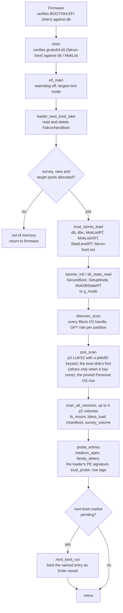

`g_mode` is what every later decision reads. It is `ON` only when SecureBoot
is 1 and MokSBStateRT is not; validation disabled, setup mode and unreadable
variables are all treated as not enforcing. The survey runs on falcon-core
alone (`media/medium.c` over the p2 file): nothing is published to the
firmware to build the menu.

The only failure before the menu is the pool allocation. A missing p2 or p3
gives a shorter menu, not an error.

#### 12.2.2 The menu and route selection

Rows are the Personal OS (first, when p3 qualifies), the survey's folders and
images, and Firmware Setup (last, when the firmware supports booting to its
UI). Keys: up and down, Enter, `c` (chainload), `d` (direct), `b` (bless this
row), `a` (bless everything new), Escape (up a folder; at the root, exit to
the firmware).

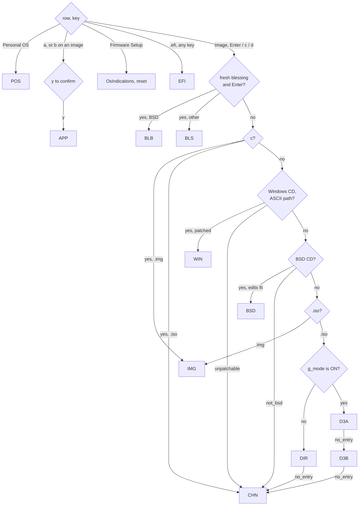

`boot_plain` (`apps/stick/efi_main.c`) runs the tests in this order.
`d` and Enter are the same on an unblessed row; `c` and `d` on a blessed row
skip the blessing.

A route falls through only while it has not yet committed. Each one keeps a
flag, set at the start and cleared once it has decided the medium is its own:

| flag | route | still set when |
|---|---|---|
| `unpatchable` | WIN | no UDF, no `boot.wim`, the WIM does not parse, the patch does not build; also a non-ASCII path, which skips WIN before it draws |
| `not_bsd` | BSD | no ISO9660, `/boot/defaults/loader.conf` not one extent of at least 1 KiB, no room for the directory record |
| `no_entry` | DIR, D3A | no ISO9660 or UDF, no CD boot entry; for D3A also no `.sbat` in the kernel, no `\EFI\BOOT\BOOTX64.EFI` in the ISO |
| `no_entry` | D3B | the ISO is not whole 2048-byte blocks, the entry is a loopback one, no `grub.cfg`, it is not one extent of at most 256 KiB, ours does not fit in its length |

A failure after the flag is cleared is reported and returns to the menu; it
does not fall through. `BLS` and `BLB` never fall through at all.

#### 12.2.3 Shared machinery

| piece | where | what it is |
|---|---|---|
| load ops | `loader/loadops.c`, `resolve_load_ops` | shim's `SHIM_IMAGE_LOADER` LoadImage/StartImage when shim is present, the firmware's otherwise. `table_unhooked` means shim is present but not enforcing; the chainload and `launch_image` then try the firmware's LoadImage first, since shim's own loader refuses some images the firmware accepts (pfSense's loader). `direct_boot` always uses shim's. |
| credfs | `loader/credfs.c` | a read-only Simple File System on a vendor-media device path, served from the loader's buffers. Lets an image be loaded by device path (so it has a DeviceHandle to read siblings from) without a real volume. |
| LoadFile2 initrd | `direct/direct.c`, `initrd_publish` | the Linux initrd media GUID handle the kernel's EFI stub pulls its initrd from. |
| virtual CD | `iso/iso.c`, `iso_open` | Block I/O over the p2 file: 2048-byte blocks for an ISO, 512 for an `.img`, read-only, `VenHw` device path. `ConnectController` lets the firmware's El Torito and FAT drivers mount the boot image. |
| overlay | `iso/overlay.h`, `iso_read_blocks` | memory ranges laid over the virtual CD's reads, and an append region past the ISO's end. Each read is split at overlay boundaries. |
| extent map | `direct/direct.c`, `build_map`; `falcon-core/src/media/extmap.c` | p2's partition GUID and start LBA, the block size, the ISO's size and its extents on p2. falcon-hook rebuilds the ISO from it. |
| `FalconIsoMap` | `loadops.c`, `loader_isomap_set` | the extent map as a volatile boot-and-runtime variable. Cleared if the boot returns to the menu, not otherwise. falcon-hook's last source, for wraps older than the map credential. |
| SHIM_LOCK hide | `iso/iso.c`, `shim_lock_hide` | the stick shim's SHIM_LOCK is uninstalled for the length of a chainload, so the ISO's GRUB finds its own shim's. Only `chainload` does this: CHN, IMG, D3B, WIN, BSD. |

Everything above is a boot-services object and is gone at
ExitBootServices, except `FalconIsoMap`.

#### 12.2.4 POS: the personal OS

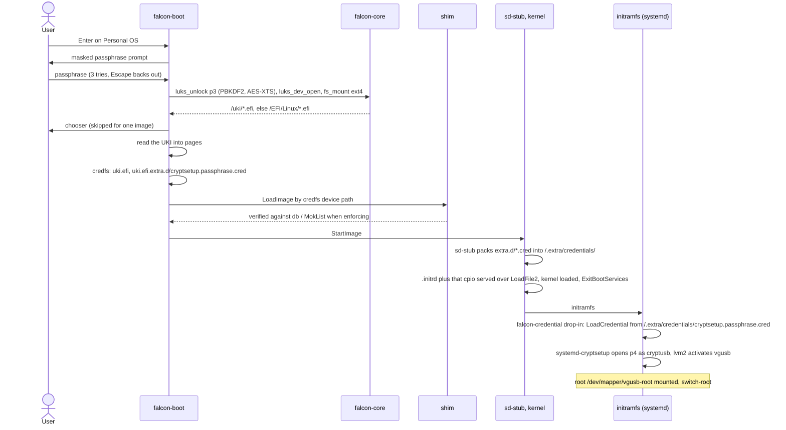

The OS half (the drop-in, the cmdline naming p4 and root) is the archusb
repository's; Section 5 says why the drop-in exists.

Resident at handoff: credfs and sd-stub's LoadFile2, both boot-services. On
failure: a wrong passphrase retries, any other unlock error stops; a refused
UKI tears down credfs, wipes the credential and prints the refusal evidence.

#### 12.2.5 APP: the signing appliance

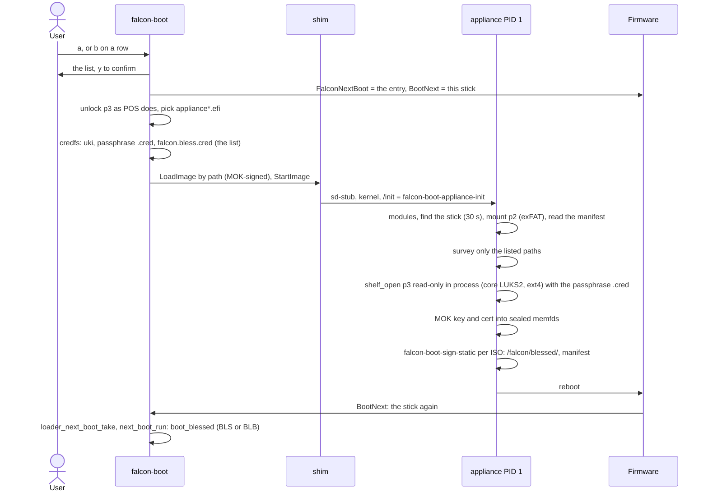

The appliance never stands on its own; it ends in a reboot into the route
it just made possible. Picked from the Personal OS chooser instead, it runs
with no list and asks. If it returns without rebooting, the loader clears the
marker and `BootNext`.

#### 12.2.6 BLS: a blessed wrap

The wrap is built by `falcon-boot-sign` (`falcon-cli/src/sign`): sd-stub, the
ISO's kernel, a `.initrd` of the ISO's initrds with the falcon-hook cpio
appended (no map; the map is not known until boot), and the cmdline
`hookcmd_build` gives the ISO's CD entry, signed with the MOK.

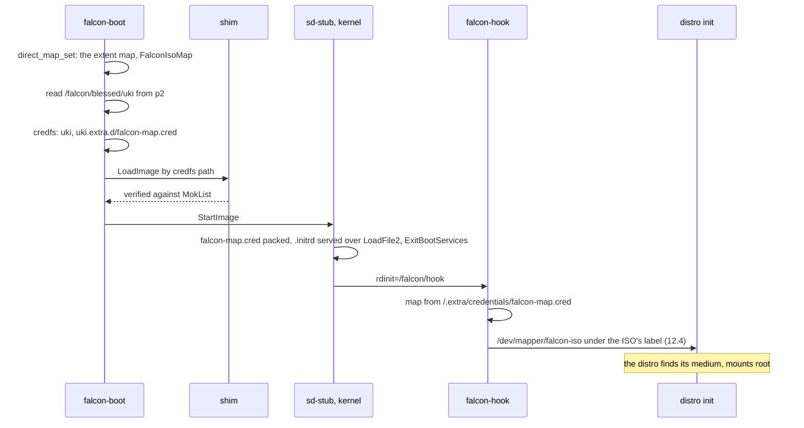

A map that fails to build is not fatal: the wrap boots, and the hook falls
back to `FalconIsoMap` or hands over unchanged. Under validation disabled
with Secure Boot on, the firmware refuses sd-stub's inner kernel load; the
loader predicts that and warns before starting.

#### 12.2.7 BLB: a blessed BSD medium

The same edits and virtual CD as BSD (12.2.12), but the loader started is the
MOK-signed copy of the medium's loader from `/falcon/blessed/`.

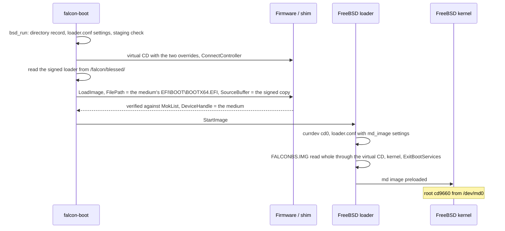

Passing both FilePath and SourceBuffer is what makes the signed copy start
with the medium as its device. No other route does it. The kernel and
modules are FreeBSD's loader's to verify, and it does not.

#### 12.2.8 EFI: a bare `.efi` on p2

`boot_payload` reads the file, publishes it alone on credfs, and loads it by
path (firmware first when shim is not enforcing, else shim), then starts it.
The payload is the target; nothing follows. No extent map, no initrd, no
fallback.

#### 12.2.9 DIR: direct kernel boot

Taken when `g_mode` is not `ON`: Secure Boot off, validation disabled, setup
mode or unknown.

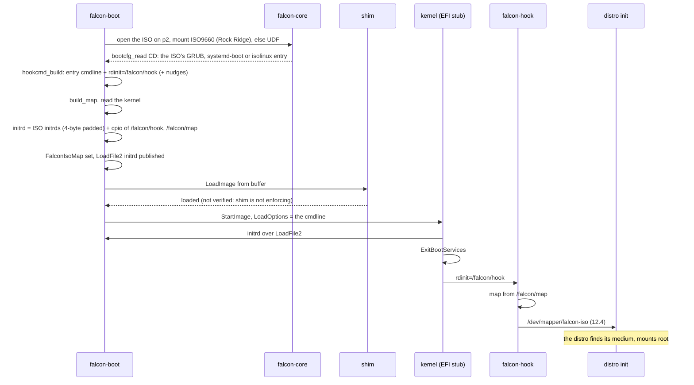

On failure after the entry is chosen (too many fragments, LoadImage refused,
out of memory): an error screen with "press c", and no automatic fallback.
If the kernel returns, the initrd is withdrawn and `FalconIsoMap` cleared.

#### 12.2.10 D3A: the ISO's own shim, then its kernel

Taken when `g_mode` is `ON` and the kernel carries `.sbat`.

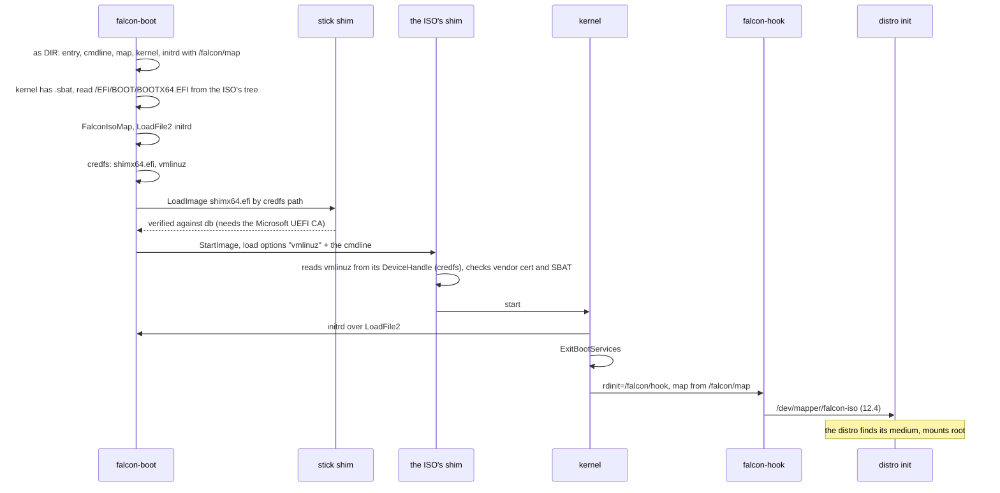

The ISO's shim comes from the ISO9660/UDF tree, not from the El Torito
image; they are normally the same file. Whether shim strips the leading
`vmlinuz` before the kernel sees the options is unmeasured
(`docs/notes/d3-spike.md`).

#### 12.2.11 D3B: the ISO's own GRUB, with our grub.cfg

Taken when `g_mode` is `ON` and D3A said `no_entry`.

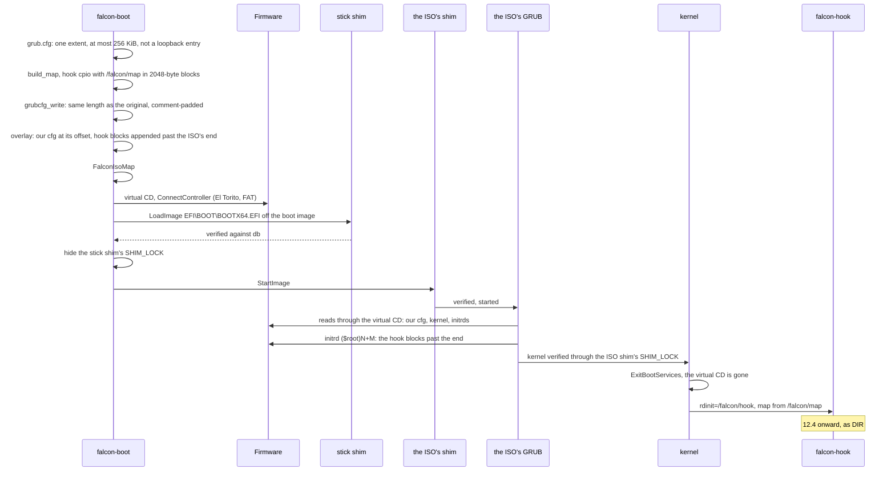

Our cfg is:

```
set timeout=0
set default=0
menuentry 'falcon-boot' {
    linux <kernel> <hooked cmdline>
    initrd <the entry's initrds> ($root)<iso_size/512>+<hook sectors>
}
```

Best-effort by design (Section 7.2): a GRUB whose embedded prefix reads a
different configuration first, or sets `$root` to a partition rather than
the CD, never sees ours.

#### 12.2.12 BSD: a BSD medium as its own memory disk

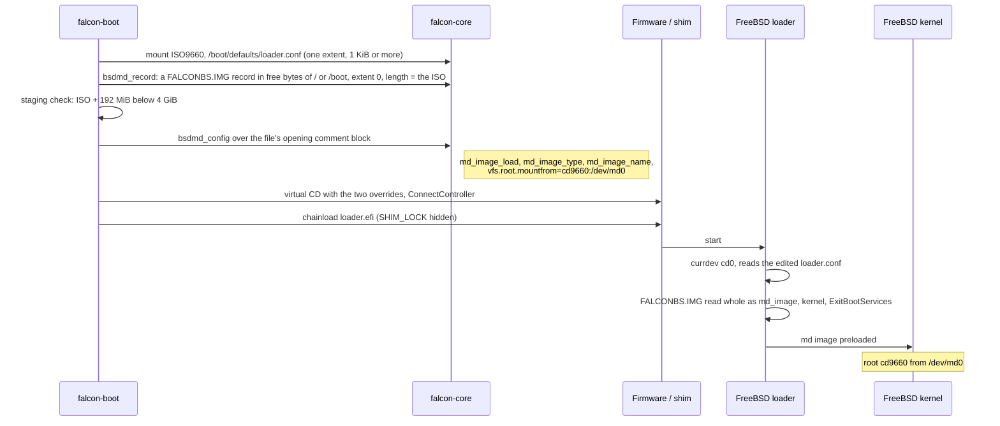

`loader.efi` is unsigned, so this route is refused under Secure Boot; BLB is
the Secure Boot route. The file edited is `/boot/defaults/loader.conf`, not
`/boot/loader.conf`, which a medium may not have.

#### 12.2.13 WIN: Windows install media

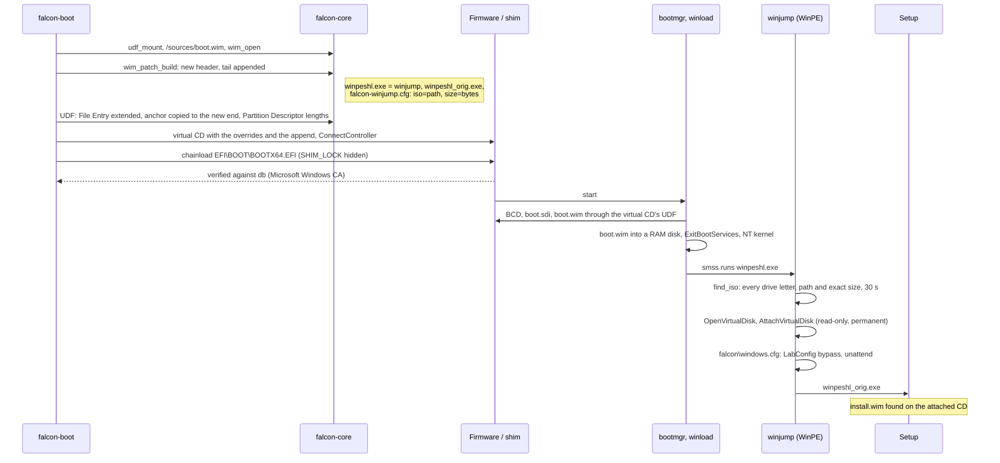

Microsoft's binaries are served byte for byte and verified by the platform;
the patched WIM is not something Secure Boot verifies (Section 7.7). WinPE
sees p2 through its own `exfat.sys`, which is how winjump finds the file.
Every winjump failure still starts the original shell, logged to
`X:\falcon-winjump.log`.

#### 12.2.14 CHN and IMG: the medium's own loader

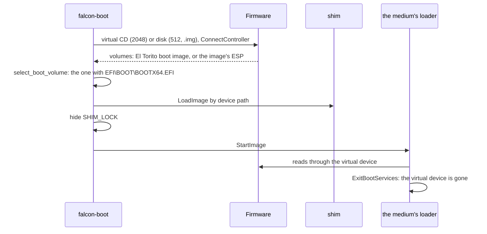

This route never makes a Linux live medium stand on its own: nothing is
appended and nothing carries a map, so an initramfs looking for its CD after
ExitBootServices finds nothing (Section 6.1). It exists for media that need
nothing after load (memtest-class images, WinPE in its RAM disk) and as the
fallback when the routes above cannot read the medium.

#### 12.2.15 Failure paths

Every route returns to the dispatcher on failure. The screen says what
failed and at which step, the advice, and on a Secure Boot refusal the
evidence (who signed the image, which list decided); then "press any key to
return to the menu". Cancelling a prompt returns without the key.

Nothing in the UEFI loader halts. It leaves only three ways: a route that
started its target, Escape at the root (back to the firmware's next boot
option), and the confirmed Firmware Setup reset. A console that stops
answering `WaitForEvent` is treated as Escape, so the menu unwinds to the
firmware rather than spinning.

### 12.3 BIOS

#### 12.3.1 The boot area

Stage 1 goes in the 440 bytes of boot code in LBA 0; the partition table
behind it is kept. Stages 2 and 3 go in LBA 34-1121 (12.1). `mkstick bios`
(`falcon-cli/src/mkstick/bios.c`) backs up LBA 0 and the gap first, checks
the gap is free, zeroes it, writes stage 2 and stage 3, and writes LBA 0
last, so an interrupted install leaves the old LBA 0 in place. A falcon
stage 1 in front of a half-written stage 2 fails its `BOS2` check and says
so rather than running it.

#### 12.3.2 Power-on to the menu

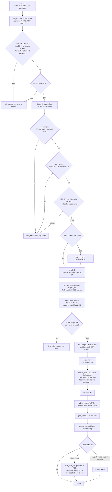

The whole loader is i686 code in flat 32-bit protected mode, and one image
runs on every processor from the Pentium Pro on. What a newer processor
adds is taken by asking CPUID, not by a second build: the SSE state above,
AES-NI in falcon-core's AES path, and long mode, which only a 64-bit kernel
needs and 12.3.6 checks for. Paging stays off, so everything the loader
places is below 4 GiB (`ADDR_END`). docs/notes/bios-route.md Section 6h has
why this replaced long mode.

Stage 2 is linked at 0x7E00 and stays there: the thunk and the IDT in it are
used by stage 3 for the rest of the boot. Its head is a gate at fixed
addresses, because stage 3 is linked separately and shares no symbols with
it:

| address | field |
|---|---|
| 0x7E00 | `jmp stage2_begin` |
| 0x7E04 | `BOS2`, what stage 1 checks |
| 0x7E08 | `jmp thunk_bios`: C calls a BIOS interrupt through here |
| 0x7E10 | `jmp boot16`: the one-way drop to real mode a chainload takes |
| 0x7E20 | the register block, 32 bytes |
| 0x7E40 | the interrupt vector |
| 0x7E41 | the boot drive |
| 0x7E48 | the real-mode target of `boot16`, offset then segment |

`build.mk` checks every one against `nm` output.

#### 12.3.3 The thunk: a BIOS call from protected mode

Stage 3 runs in 32-bit protected mode, and the BIOS runs only in real mode.
Every disk read, every cursor move and every key goes through this round
trip.

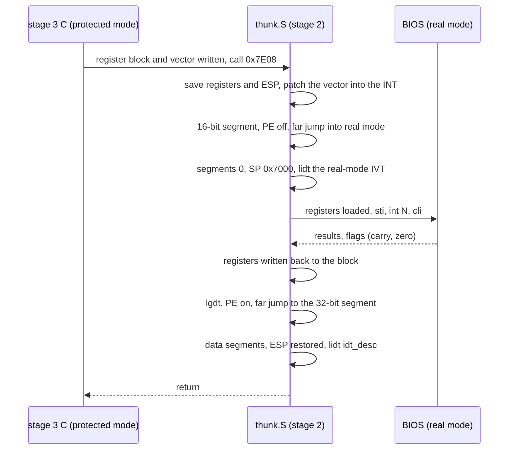

Buffers the BIOS reads into must be addressable from real mode with DS and
ES at 0, so a disk read lands in the bounce buffer at 0x90000 (32 KiB) and
is copied up; the packet is at 0x1000. The one write, clearing the
next-boot marker, goes the other way through the same buffer. Services used:
INT 13h AH=42h, AH=43h (`marker.c` only, one sector) and AH=48h, INT 1Ah
AH=02h and AH=04h (the RTC, to date the marker), INT 10h (the 80x25 text mode, cursor shape and position, and
teletype for stages 1 and 2 and `bios_fatal`), INT 16h AH=00h and AH=01h,
INT 15h E820, and INT 18h when Escape at the root menu hands the machine
back. Stage 3 writes the screen's cells into VGA text memory at 0xB8000
directly (falcon-bios/src/console/screen.c). INT 15h AH=87h is used only by the
resident CD handler, from real mode.

#### 12.3.4 Memory map

| range | what | lifetime |
|---|---|---|
| 0x0000-0x03FF | real-mode IVT; INT 13h hooked by a chainload | permanent |
| 0x0400-0x04FF | BDA; 0x413 is conventional memory in KiB, lowered 16 by a chainload | permanent |
| 0x1000-0x10FF | disk packet, drive parameters, E820 slot | per call |
| below 0x7000 | real-mode stack during a thunk | per call |
| 0x3000-0x311F | the Linux handoff: the move stub at 0x3000, the handoff GDT at 0x3100 | copied at the handoff, handed to the kernel |
| 0x7000-0x7BFF | stage 2's protected-mode stack | until stage 3 |
| 0x7C00-0x7DFF | stage 1; later the chainloaded boot image | stage 1 dies at the jump |
| 0x7E00-0xFDFF | stage 2 (64 sectors; 8 KiB used): gate, thunk, GDT, IDT, fault reporting | until the target starts |
| 0x10000-0x10FFF | Linux zero page | handed to the kernel |
| 0x20000 | Linux cmdline; or the staged El Torito boot image (up to 63 KiB) on a chainload | handed over |
| 0x90000-0x97FFF | bounce buffer | every read |
| BDA top - 16 KiB | the resident CD handler: data, runs, El Torito packet, launch stub at +0x530, INT 13h entry at +0x570, INT 15h entry at +0xA00, carved E820 map at +0xB00, overlay pool at +0x1000; never below 0x98000 | permanent after a chainload; reserved in the map it hands on |
| BDA top - 3 KiB (falcon jump) | the reverse thunk (`rthunk.S`): far pointers, its GDT, the saved caller, the INT 13h entry at +0x90, the INT 15h entry at +0x300 and its carved map at +0x400 (the `USB` route's); below it the virtual CD's block on `CDR` | permanent after `CDR` hands over; reserved in the map it hands on |
| 0x100000 | stage 3: 16-byte header, entry at +0x10, then its image and `.bss` (at most 0x6F0000 together) | whole loader |
| 0xB8000-0xB8F9F | VGA text memory, the 80x25 screen stage 3 draws | whole loader |
| 0x7F0000-0x7FFFFF | stage 3 stack, ESP from 0x800000 | whole loader |
| 0xF00000-0xFFFFFF (falcon jump) | the module slots, eight of 128 KiB (`JMOD_REGION`): `ATA.MOD` at 0xF00000, `UHCI.MOD` at 0xF20000 | from the module's load; permanent after `CDR` hands over, reserved in E820, E801 and AH=88h |
| 0x1000000 | the kernel's protected-mode part (aligned up; `pref_address` for a non-relocatable kernel); one fixed below here, at 1 MB (memtest86+), is staged here instead, above its own footprint, and moved down at the handoff | handed to the kernel |
| highest fit below the kernel's `initrd_addr_max` | the initrds, placed from E820 | handed to the kernel |
| highest fit in 64 MiB-4 GiB | `heap.c`: the patched boot.wim tail | through the chainload, served by AH=87h; the appended part reserved in the map it hands on |
| 4 GiB | `ADDR_END`: paging is off, so nothing is placed above it | |

`mem_check` refuses a machine whose EBDA reaches below 0x98000, because the
bounce buffer is there. The fixed addresses are in
`falcon-bios/src/start/biosdefs.h`, except that floor (`stage2.S`).

#### 12.3.5 The menu and route selection

The menu is the UEFI loader's (12.2), drawn from the same layout
(`falcon-core/src/tui`): Personal OS first at the root when p3 is LUKS2,
".." first in a folder, then the survey's folders and images. Keys: up and
down, Enter, `c` (chainload), `d` (direct), Escape (up a folder, or at the
root INT 18h, which hands the machine back to the BIOS; a reset if it
returns). There is no Secure Boot, no shim and no blessing, so five routes,
dispatched in `boot_plain`'s order as on UEFI.

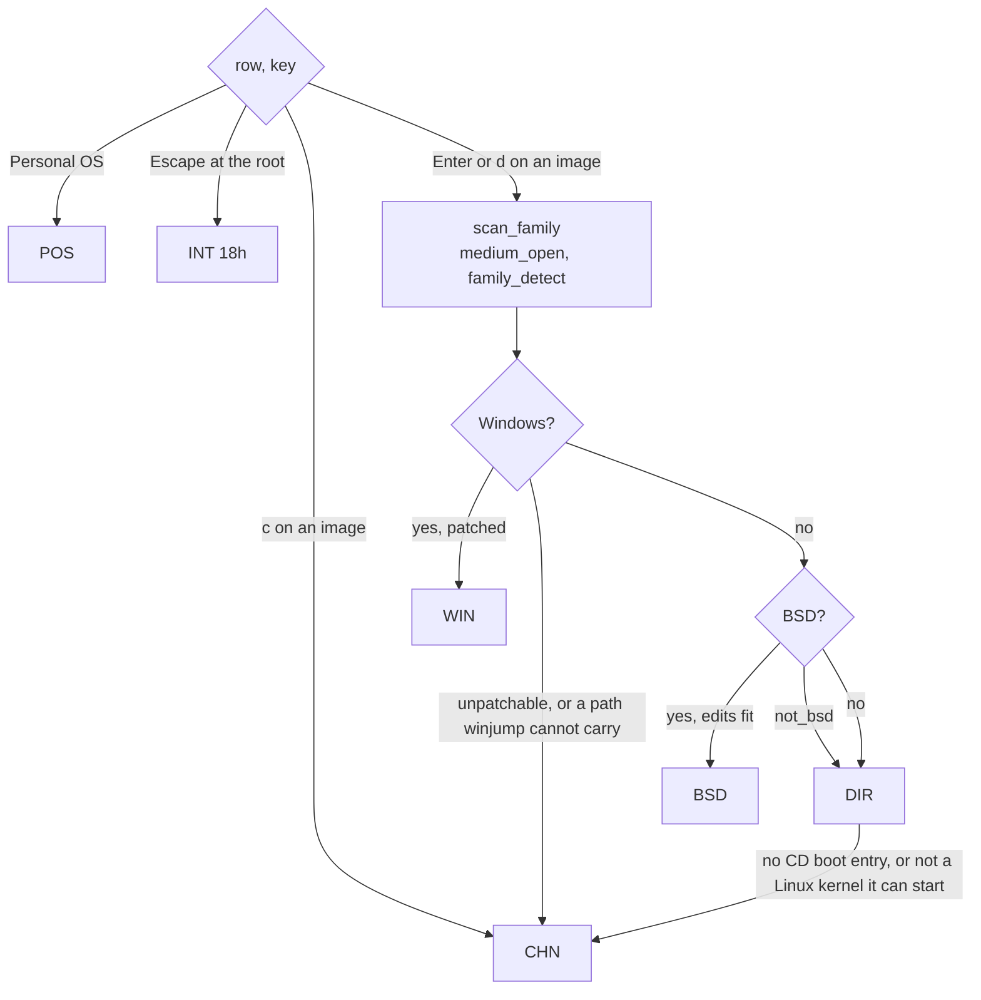

Unlike the UEFI loader, a BSD medium that is not one the memory-disk route
applies to goes on to the direct boot. `DIR` goes on to `CHN`, as on the
UEFI loader, when it stops before committing because the medium is not one
it can take (`boot_result.fallthrough`): no filesystem or boot entry it can
read, a kernel that is not on the medium, or one `linux_boot` refuses before
placing anything (`linux_not_taken`). A 64-bit kernel on a processor without
long mode is not one of those: the medium's own loader would start the same
kernel.

#### 12.3.6 DIR: direct kernel boot

```mermaid
sequenceDiagram
    participant L as stage 3
    participant B as BIOS (thunk)
    participant K as kernel
    participant H as falcon-hook
    participant D as distro init
    L->>B: read the ISO on p2 through falcon-core (medium_open, bootcfg_read CD)
    L->>L: linux_probe: the kernel's width from its setup header
    L->>L: build_map (block size from AH=48h), hook cpio /falcon/hook + /falcon/map, the hook of the kernel's width
    L->>L: hookcmd_build + console=ttyS0,115200 console=tty0
    L->>L: linuxcore_geometry: boot protocol 2.12+, load address, and a 64-bit kernel needs CPUID long mode
    L->>B: kernel's protected-mode part to 16 MiB, in 64 KiB chunks (a kernel fixed below that is staged there, stage_at)
    L->>L: cmdline to 0x20000
    L->>B: initrds, hook last, 4-byte padded, at e820_place_high below initrd_addr_max
    L->>L: zero page at 0x10000: setup header, loader type 0xFF, E820 as the BIOS gave it
    L->>L: "starting <entry>" on screen
    L->>L: screen_info from INT 10h and the BDA, after the route's last line: mode, columns, rows, cursor, VGA
    L->>K: GDT (0x10, 0x18) copied to 0x3100; a staged kernel is moved down by the stub at 0x3000; jump to code32_start, ESI = zero page (32-bit entry, either width)
    K->>H: rdinit=/falcon/hook, map from /falcon/map
    H->>D: /dev/mapper/falcon-iso (12.4)
    Note over D: the distro finds its medium, mounts root
```

The map is carried only in the initrd; a BIOS has no variable store. Nothing
is resident at handoff: the IVT and BDA are untouched. A map that cannot be
built (too many fragments) boots without the hook, and the kernel is left to
find its medium itself.

#### 12.3.7 POS: the personal OS

A UKI is a PE image for UEFI's sd-stub, which cannot run under a BIOS. The
loader unwraps it instead and does sd-stub's credential packing itself.

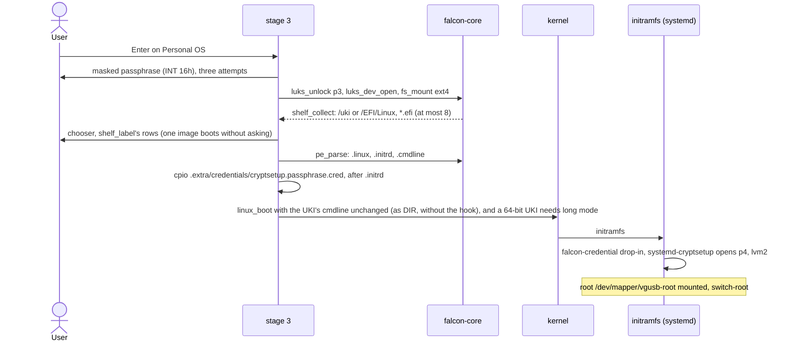

The initramfs sees exactly what sd-stub would have given it. AES-NI in
`luks_unlock` is why `pmode.S` sets CR4.OSFXSR when CPUID reports SSE: UEFI
firmware sets it, a BIOS leaves it clear, and the first SSE instruction
would fault. A processor without AES-NI unlocks on falcon-core's portable
AES path, slower and otherwise the same.

#### 12.3.8 CHN: the resident virtual CD

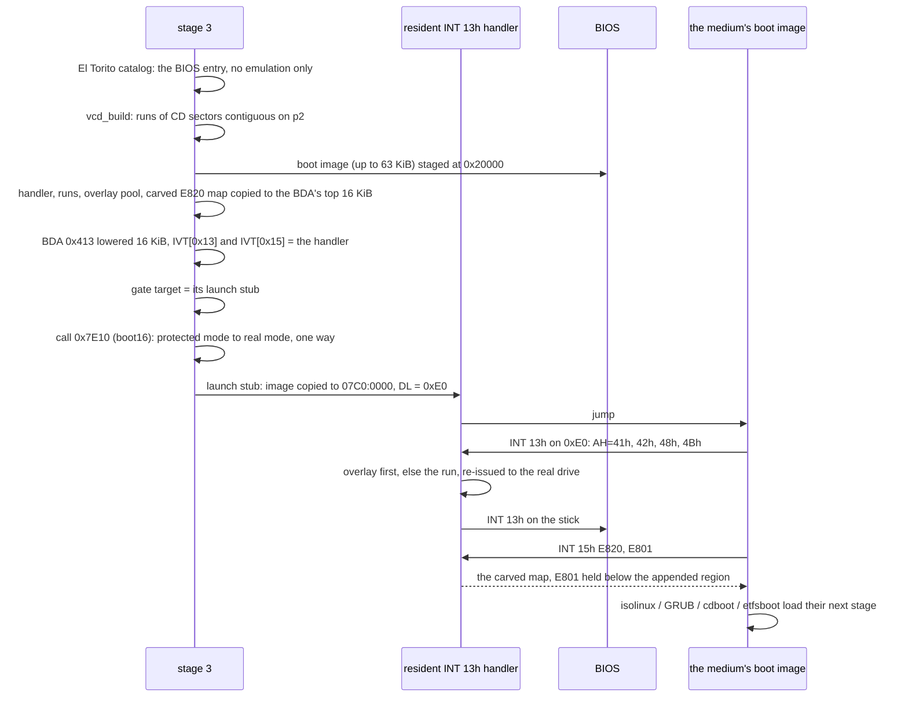

Other drives pass through to the previous handler. Writes fail. Reads past
the medium's end up to 64 sectors of padding return zeros.

What stays in use behind the handoff is hidden from what comes next. The
BDA's lowered count hides the handler's 16 KiB from anything that asks for
conventional memory. The INT 15h half hides it, and the appended region the
handler serves from extended memory (Windows' tail, 12.3.9), from anything
that asks for the map: it answers E820 from a copy of the BIOS's map with
both ranges carved out as reserved (`e820_carve`, host tested), caps E801's
count of 64 KiB blocks above 16 MiB below the appended region, and passes
every other INT 15h call, the handler's own AH=87h included, to the BIOS.
The rig checks it with `make test-bios-probe`, a medium whose boot image
prints the map it is handed (`falcon-bios/tools/memprobe.S`).

Unlike UEFI's virtual CD, this one outlives the handoff: anything that keeps
reading through INT 13h keeps working, including bootmgr and winload, which
drop back to real mode for each read. A protected-mode kernel that does not
call the BIOS loses it, so a Linux live ISO chainloaded here has no hook and
no map and finds its medium only if its initramfs can do so unaided.

A medium whose BIOS boot image is a floppy emulation (El Torito media type 1,
2 or 3) rather than a no-emulation CD is served differently: `vcd_chainload`
hands it to `vfd_serve` (`falcon-bios/src/vfd/vfd.c`), which loads the whole
image - 2.88 MB at most - into extended memory and installs a smaller
resident (`vfdres.S`) that answers INT 13h for drive 0x00 as a memory disk,
copying each read out of the image with AH=87h. It is a flat disk, so the
geometry (`vfdcore.c`, host-tested) is only how a CHS read is named. It hooks
INT 13h alone and does not hide the image from the memory map, which is sound
for media that read the floppy once as they load: memtest86+ boots this way.
Haiku's 2.88M floppy boots its loader but then wants the rest of Haiku off
the CD, which is not co-resident, so it does not complete. Hard-disk
emulation (media type 4) is not implemented; no corpus medium needs it.

#### 12.3.9 WIN: Windows install media

The same patch as the UEFI route (12.2.13), computed by the same falcon-core
code; only the serving differs, and which build of winjump goes in. The jump
binary replaces `winpeshl.exe`, and a 32-bit WinPE cannot start a 64-bit
program, so falcon-bios embeds winjump twice (x64 and i686, one source) and
reads the machine type out of the boot image's own `winpeshl.exe` headers
(`wim_winpeshl`, `wim_read_head`, `pe_parse`). A 64-bit boot.wim on a
processor without long mode is refused with a sentence, as `linux.c` refuses
a 64-bit kernel. The UEFI loader embeds the x64 build only: 32-bit Windows
starts from 32-bit UEFI, which is out of scope (Section 1).


#### 12.3.10 BSD: a BSD medium as its own memory disk

The same two edits as the UEFI route (12.2.12), laid into the resident's
overlay pool. The staging check looks for one usable E820 run below 4 GiB
holding the ISO plus 192 MiB. The settings add
`console="comconsole,vidconsole"`. FreeBSD's `cdboot` loads `/boot/loader`
through the handler, the loader reads `FALCONBS.IMG;1` whole through it (the
zero padding past the end is what lets it read the last block), and the
kernel mounts root from `/dev/md0`.

#### 12.3.11 Failure paths

No failure halts, because on a machine with no serial cable a halt is a
hang.

| where | what happens |
|---|---|
| stage 1 | reason on screen and serial, a key, `jmp FFFF:0` |
| stage 2, real mode (`fatal_rm`) | older than i686 (no CMOV), EBDA too low, A20 closed: reason, a key, reset |
| stage 2 and 3, protected mode (`bios_fatal`) | stage 3 missing or malformed, or `stage 3 returned`: reason, a key, reset |
| a processor exception (`idt.S`, `fault.c`) | vector and name, EIP, error code, through `bios_fatal`; a second fault while reporting resets at once |
| a route | message, "press any key to return to the menu" |
| the POS | wrong passphrase, no `/uki`, no images: message, secrets wiped, back to the menu |

A reset is port 0xCF9, then the 8042's reset line, then an empty IDT and a
fault, which triple-faults any processor. The window between entering
protected mode and `fault_install` has no IDT.

### 12.4 falcon-hook to root

Shared by DIR, D3A, D3B and BLS on UEFI and DIR on BIOS. It runs as PID 1
from `rdinit=/falcon/hook` before the distro's init, as the binary of the
kernel's width: `falcon-hook` (x86-64) everywhere a 64-bit kernel boots,
`falcon-hook32` (i686) under a 32-bit kernel, which only falcon-bios boots.
The two differ only in `falcon-hook/src/sys.c`.

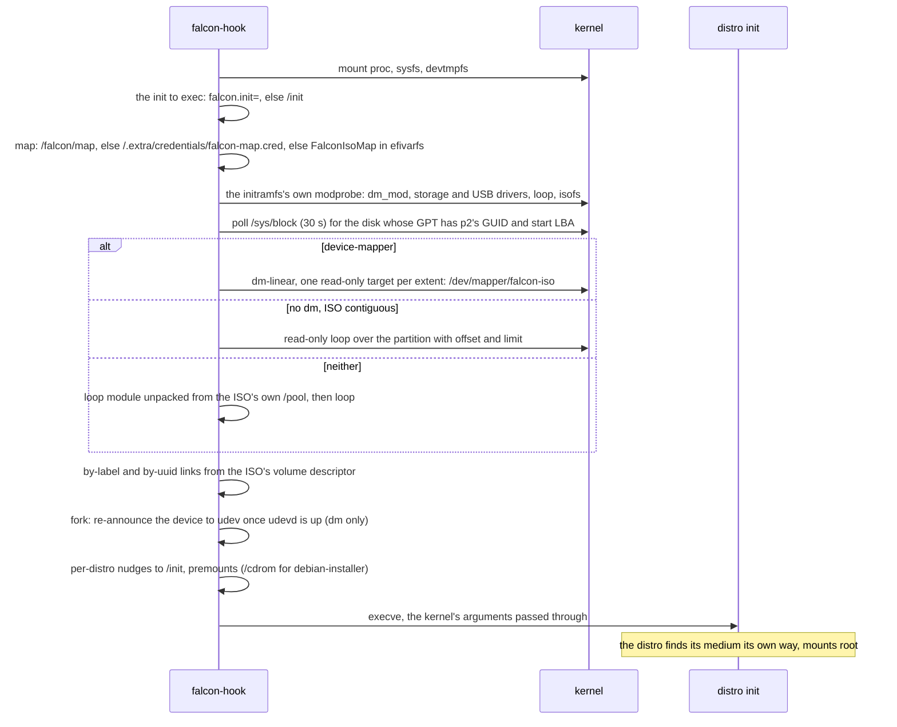

Every failure is logged to `/dev/kmsg` and the distro's init runs anyway.

How each family then finds its root on the device the hook made:

| family | mechanism |
|---|---|
| archiso | `archisolabel=`, through the by-label link |
| dracut live (Fedora, Rocky, Alma) | `root=live:CDLABEL=`, by label once udev has been told about the device |
| casper (Ubuntu and flavours) | its own scan of block devices |
| live-boot (Debian live) | `live-media=/dev/mapper/falcon-iso`, added to the cmdline, since its scan skips dm devices |
| Proxmox, antiX, MX | their `/init` patched to look at the device |
| debian-installer | the ISO premounted at `/cdrom` |
| Alpine | loop, then its own scan |

### 12.5 The stationary build

Section 13's second build of each loader. Its POS route is the stick's
(12.2.4, 12.3.7); what is new is how it gets there and the routes out to
the machine's other systems. The UEFI build exists and 12.5.1 is traced
from its code; the BIOS build is not built yet (Section 13's status), so
12.5.2 is its design.

#### 12.5.1 UEFI

```mermaid
flowchart TD
    FW["Firmware<br/>boot entry for \EFI\falcon\shimx64.efi"] --> SHIM["shim<br/>verifies grubx64.efi (falcon-boot-station.efi) against db / MokList"]
    SHIM --> MAIN["efi_main (apps/station/efi_main.c)"]
    MAIN --> DISC["discover_scan"]
    DISC --> POSS["pos_scan<br/>only the boot disk's shelf, if it has one (13.3)"]
    POSS --> OTH["nxt_scan<br/>BootOrder's offered entries but BootCurrent"]
    OTH --> SH{"shelf found?"}
    SH -- yes --> PR["passphrase prompt<br/>Escape to the list"]
    SH -- no --> LIST
    PR -- "unlocked" --> POS["POS (12.2.4)"]
    PR -- "Escape, or 3 wrong" --> LIST{"list"}
    POS -- "fails" --> LIST
    LIST -- "Personal OS" --> PR
    LIST -- "firmware entry" --> NXT["NXT: BootNext = Boot####, reset"]
    NXT -- "BootNext refused" --> LIST
    LIST -- "Firmware Setup" --> FWS["OsIndications, reset"]
    LIST -- "Escape" --> OUT["return to firmware"]
```

`NXT` leaves falcon entirely: the firmware boots the entry on the next
start as though falcon had not run, and for a Windows sealed with BitLocker
that is the point (13.4). Nothing falcon did survives the reset except that
`BootNext` has been consumed. The `ESP` route of 13.4 is not built yet and
is not drawn.

#### 12.5.2 BIOS

```mermaid
flowchart TD
    S12["stages 1 and 2, as 12.3.2"] --> BM["bios_main (apps/station/bios_main.c)<br/>e820_read"]
    BM --> DSK["scan_disks: every drive the BDA counts (0x475)<br/>its GPT, and whether LBA 0 ends in 0x55AA"]
    DSK --> P3["pick_shelf: the boot disk's shelf if pos_probe opens it,<br/>else the first other disk's that does"]
    P3 --> SH{"shelf found?"}
    SH -- yes --> PR["passphrase prompt (INT 16h)<br/>Escape to the list"]
    SH -- no --> LIST
    PR -- "unlocked" --> POS["POS (12.3.7)"]
    PR -- "Escape, or 3 wrong" --> LIST{"list"}
    POS -- "fails" --> LIST
    LIST -- "Personal OS" --> PR
    LIST -- "Escape" --> RF["INT 18h, else bios_reboot"]
    LIST -- "a disk" --> MBR["MBR (mbr.c): LBA 0 to 0x7C00, DL = that drive<br/>boot16: real mode, jump 0000:7C00"]
    MBR -- "unreadable, no 0x55AA" --> LIST
    MBR --> WIN["the disk's own MBR code<br/>active partition's boot sector, bootmgr"]
```

Nothing is resident at either handoff: no INT 13h or INT 15h hook exists in
this build, so the other disk's boot code finds the IVT, the BDA and the
memory map as the BIOS left them. A disk row is every drive but the boot
drive whose LBA 0 carries the boot signature.


### 12.6 falcon jump

Section 14's boot floppy, as built at Section 14.11 step 4: the machine's
disks, memtest86+, a no-emulation or floppy-emulation disc in an IDE CD
drive, and a falcon stick on a UHCI root port. `USB` joins
the menu as a row when step 4 lands.

```mermaid
flowchart TD
    BIOS["BIOS<br/>sector 0 of the floppy to 0x7C00, DL = 0x00"] --> S1["Stage 1, boot_fd.S (real mode)<br/>BPB geometry, COM1 up"]
    S1 --> RD{"INT 13h AH=02h, STAGE2_LBA on,<br/>to the end of each track to 0x7E00<br/>3 tries, AH=00h reset between"}
    RD -- fails --> F1["fail: reason, key, jump to FFFF:0"]
    RD -- ok --> MG{"0x7E04 holds BOS2?"}
    MG -- no --> F1
    MG -- yes --> S2["Stage 2, as 12.3.2"]
    S2 --> PR{"bios_disk_probe (disk.c)<br/>AH=48h, then AH=41h"}
    PR -- "neither" --> GEO["AH=08h: the geometry, vfd_geometry_int13<br/>reads by AH=02h from here on"]
    PR -- "either" --> L3
    GEO --> L3["stage3_load: header at STAGE3_LBA, then the image"]
    L3 --> BM["bios_main (apps/jump/bios_main.c)<br/>e820_read"]
    BM --> FAT["read_floppy: fs_identify, fs_mount (FAT12)<br/>MEMTEST.BIN present? JUMP.INI parsed (jumpini.c)"]
    FAT --> DSK["scan_disks: every drive the BDA counts (0x475)<br/>whose LBA 0 ends in 0x55AA; the CD row when ATA.MOD is on the floppy"]
    DSK --> INI{"JUMP.INI taken?"}
    INI -- "a line it cannot take" --> REP["the line and why, a key<br/>no default"]
    INI -- "yes, or no file" --> MENU
    REP --> MENU{"menu: a disk row each, Memory test<br/>a countdown only for a default whose row is there"}
    MENU -- "a disk, or the countdown on it" --> MBR["MBR (mbr.c): LBA 0 to 0x7C00, DL = that drive<br/>boot16: real mode, jump 0000:7C00"]
    MENU -- "Memory test" --> MEM["MEM: MEMTEST.BIN through linux_boot<br/>no initrd, empty command line<br/>fixed at 1 MB: staged at 16 MB, moved down at the handoff"]
    MENU -- "Escape" --> RF["INT 18h, else bios_reboot"]
    MBR -- "unreadable, no 0x55AA" --> MENU
    MEM -- "refused or unreadable" --> MENU
    MENU -- "CD drive" --> LD["jmod_load: ATA.MOD to JMOD_SLOT_ATA (15 MB)<br/>E820 says 15-16 MB is RAM; header checked; .bss zeroed; init"]
    LD --> PB["ops.probe: IDENTIFY PACKET DEVICE on 0x1F0 and 0x170,<br/>master and slave; READ CAPACITY; the first with a disc"]
    PB --> CAT{"the catalog through ops.read (disc_read)<br/>vcd_boot_entry: its media type"}
    CAT -- "floppy emulation" --> VFD["vfd_serve over disc_read: the image to the heap above 64 MB,<br/>vfdres.S as drive 0x00; nothing of the module stays (12.3.8)"]
    CAT -- "hard-disk emulation, or no catalog" --> MENU
    CAT -- "no emulation" --> RT["jres_install: rthunk.S's block below the BDA's count (1 KB)<br/>INT 13h for drive 0xEF to ops.int13, stack at the slot's top"]
    RT --> PR2["bios_disk_probe(0xEF): AH=48h through the thunk, 2048-byte sectors"]
    PR2 --> VCD["vcd_chainload_drive: the catalog over 0xEF, one run,<br/>keep ranges: the thunk block and 15-16 MB (E820, E801 both halves, AH=88h)"]
    VCD --> CD["the disc's boot image at 0x7C00, DL = 0xE0 (12.3.8)"]
    CD --> RD13["its reads: 0xE0 (vcdres.S) re-issues to 0xEF,<br/>rthunk.S: saves the caller, A20 on, protected mode, ops.int13, back"]
    VCD -- "refused" --> RM["jres_remove"]
    RM --> MENU
    MENU -- "USB stick" --> LU["jmod_load: UHCI.MOD to JMOD_SLOT_UHCI<br/>init: msc.c over uhci.c"]
    LU --> EN["ops.probe: the first UHCI on the PCI bus, legacy support off, reset;<br/>each root port reset, enumerated, INQUIRY, READ CAPACITY"]
    EN --> GPT{"gpt_parse through ops.read:<br/>an ISO library or a shelf?"}
    GPT -- "no falcon stick" --> MENU
    GPT -- "yes" --> RU["jres_install for the next BIOS disk (BDA 0x475 + 0x80),<br/>INT 15h hooked too: the block and 15-16 MB carved"]
    RU --> MB["BDA count + 1; mbr_boot: LBA 0 through the thunk to 0x7C00,<br/>DL = that drive; the stick's falcon-bios from there (12.3)"]
    MB -- "unreadable, no 0x55AA" --> RM2["BDA count back, jres_remove"]
    RM2 --> MENU
```

`MBR` and `MEM` leave nothing resident, as the station's routes do (12.5.2).
`CDR` leaves two: the stick's virtual CD, unchanged but for serving a whole
drive as one run, and under it the reverse thunk and `ATA.MOD`. The floppy
is read by CHS wherever its BIOS has no extensions, SeaBIOS's included, so
the rig exercises the same path an old machine takes.

## 13. The stationary build (decided 2026-09-21)

Status (2026-09-24): both builds exist and are rig-proven (`make station`):
`falcon-boot-station.efi` with POS, NXT and Firmware Setup, and
`falcon-bios-station-stage3.bin` with POS and MBR. The boot-disk rule (13.3) is
in both stick loaders too. `make test-station` builds a disk by following
the Manual's hand procedure (Manual Section 2); the personal OS boots off it
with its credential under OVMF with Secure Boot on and under SeaBIOS. Not
built yet: the ESP chainload (13.4, after NXT is measured on hardware).
Section 12.5 draws what exists.

A falcon loader installed on a machine's internal disk, as that machine's
boot loader, rather than on a stick. It boots the personal OS off a shelf on
the same disk, and hands the machine to whatever else is installed on it:
typically a second internal disk carrying an ordinary Windows install. It is
a second build of each loader, chosen at compile time, not a mode of the
stick's.

### 13.1 Why a build and not an option

The stick's loader carries everything drag-and-drop needs: ISO9660, UDF and
exFAT readers, the WIM reader and LZX decompressor, the boot.wim patch, the
virtual CD and its overlay, the bless flow, the boot predictions (a DER,
X.509 and Authenticode parser), and two embedded binaries (falcon-winjump
and falcon-hook). Section 7.8 already names the parsers as attack surface. A
machine that only ever boots its own OS reaches none of it, and a runtime
switch that hid the menu would still ship all of it, reachable by anything
that can put bytes in front of the loader.

So the stationary build links less, and what it does not link it cannot
run. That is the argument for it, more than the size: the answer to "what
can this loader do" is its source list, and that list is short enough to
read.

It is a separate link, not `#ifdef`s through the shared code. `pos` on both
loaders is already self-contained (UEFI `pos_scan`/`pos_boot`, BIOS
`pos_probe`/`pos_run`); what differs is the entry point, which is a second,
small file per loader beside the stick's (`apps/station/` beside `apps/stick/`). No module the two builds
share changes shape between them.

| | stick build | stationary build |
|---|---|---|
| UEFI image | `falcon-boot.efi` | `falcon-boot-station.efi` |
| UEFI entry | `apps/stick/efi_main.c` | `apps/station/efi_main.c` |
| UEFI links | everything in Section 9 | `apps/station/efi_sbat.c`, `loader/`, `console/`, `discover/`, `sb.c`, `pos/`, `nxt/` (13.4); core's `crypto`, `luks`, `fs` (ext4 only), `part`, `tui`, `media/shelf.c` (the chooser's rows), `lib` |
| UEFI leaves out | | `iso/`, `direct/`, `bsd/`, `win/`, `bless/`, `trustefi.c`, `trust/`, the rest of `media/` (the survey included), `wim/`, `manifest/`, the exFAT, FAT, ISO9660 and UDF drivers, falcon-winjump, falcon-hook |
| BIOS stage 3 | `apps/stick/bios_main.c`, `falcon-bios-stage3.bin` | `apps/station/bios_main.c`, `falcon-bios-station-stage3.bin` (80 KB against 288 KB) |
| BIOS links | everything in `falcon-bios/` | `pos.c`, `linux.c`, `linuxcore.c`, `e820.c`, `screen.c`, `prompt.c`, `console.c`, `disk.c`, `mbr.c` (13.4); core as UEFI, plus `media/cpio.c` for the credential |
| BIOS leaves out | | `vcd.c`, `vcdres.S`, `scan.c`, `win.c`, `bsd.c`, `heap.c`: nothing is ever resident, and neither falcon-hook blob is linked, since only `scan.c` appends one; `marker.c`, so nothing in it writes a disk |
| stages 1 and 2 | | unchanged, the same binaries |
| version type | `release` | `station-release`, so a screen photo says which build it is |
| SBAT component | `falcon-boot` | `falcon-boot-pos`, its own generation: a revocation for a parser this build does not link must not stop it booting |

`make station` builds both, and `all` builds neither, as with `make bios`.

No boot predictions (Section 7.8) are linked, so no row carries a trust
tag and the key line has no legend; a UKI shim refuses is reported with
shim's status, without naming the signer. The chooser lists every UKI the
shelf holds, an appliance image included, which a hand install does not
put there.

Its filesystem registry is ext4 alone (`CORE_FS_EXT4`: `fs_reg_ext4.c`
names one driver, and each driver's adapter is its own file), so the
exFAT, FAT, ISO9660 and UDF parsers are not linked and `discover_scan`'s
identification pass probes every device for ext4 and nothing else. With
that, UEFI is 123 KB and BIOS stage 3 80 KB.

The BIOS build is i686, as the stick's falcon-bios is (Section 12.3,
bios-route.md 6h), so the same image serves a 32-bit machine: its POS boots
a kernel of either width through `linux.c`, which refuses a 64-bit one on a
processor without long mode once it is chosen, as on the stick.

### 13.2 Layout

```
p1  ESP        FAT32    the machine's ESP; falcon in \EFI\falcon\
p2  UKI shelf  LUKS2 -> ext4    UKIs in /uki, the MOK key pair, pbkdf2 keyslot
p3  root+home  LUKS2 -> LVM     the OS's own, opened by its initramfs
```

The stick's layout without its ISO library. Nothing in either loader
matches a partition by number: the shelf is found by the falcon shelf type
GUID (Section 3), so it is the shelf here at p2 exactly as it is at p3 on a
stick, and the root is never matched at all. The layout needs no change to
identification. The shelf keeps its pbkdf2 keyslot for Section 3's reason,
and the root's argon2id slot is the OS's business.

p1 is the machine's ordinary ESP: shim, MokManager, the loader as
`grubx64.efi` and the public cert in `\EFI\falcon\` (shim loads its next
stage from its own directory), named by a firmware boot entry of its own.
Not `\EFI\BOOT\BOOTX64.EFI`: the removable-media path is the firmware's
fallback, and a stationary loader is a named entry like any other OS's.

For BIOS the stages go where they go on a stick, stage 1 in LBA 0's boot
code and stages 2 and 3 in LBA 34-1121, which a GPT with a 128-entry array
and its first partition at 2048 leaves free. That gap is claimed as a BIOS
boot partition (type `21686148-6449-6E6F-744E-656564454649`, named
`FALCON-BIOS`, LBA 34-2047), as `mkstick bios` claims it on a stick, so no
partitioning tool later puts a partition over the stages.

**Installed by hand, for now.** There is no `mkstick` mode for this: the
disk is the machine's, and a tool that partitions it is a tool that can
destroy an OS the user meant to keep. The Manual carries the procedure
(partition types, the shelf's GUID, the ESP's files and boot entry, the BIOS
stages written at `biosdefs.h`'s LBAs, with `falcon-bios-station-stage3.bin`
as stage 3, MOK enrollment). Kernel updates are
the OS's: the shelf mounted at `/efi` and a hook that builds and signs the
UKI with the MOK key on it, as the personal OS on the stick already does.

The MOK private key lives on the stationary shelf, under LUKS: invariant 4
is kept on the same terms as on a stick.

### 13.3 The boot disk's shelf wins

A machine with a stationary install and a falcon stick plugged in has two
shelves, and both are the personal OS of somebody's. The rule, for **both
builds**: when the disk the loader was booted from carries a usable shelf
(a LUKS2 volume with a pbkdf2 keyslot, or a plaintext one with a UKI on
it), only that disk's shelves are considered; the others are considered
only when the boot disk has none. The stick's loader boots the stick's OS, the internal
disk's boots the machine's.

Exclusive rather than first-in-order, because `pos` tries one passphrase
against every candidate shelf (`unlock_any`, Section 5): with an order, the
passphrase for the machine, mistyped into the stick's, would boot the other
OS without a word. Exclusive, one passphrase has one meaning.

- UEFI: `discover_scan` marks each row `boot_disk` when it and the
  loader's own `LoadedImage->DeviceHandle` are partitions of one disk: the
  device paths in front of their HARDDRIVE nodes are byte-identical
  (`part_same_disk`, `partefi.c`). `pos_scan` then takes the boot disk's
  rows, and the others only when those gave it nothing. A handle whose path
  cannot be compared is not on the boot disk. Measured in the rig
  (2026-09-24): two falcon disks with different passphrases, each booted
  first in turn, accept only their own; the loader before the rule opened
  the second disk's shelf with the second disk's passphrase.
- BIOS: the stick build's `claim_roles` asks the boot disk first (fix
  `b007efb`) and takes a shelf only when `pos_probe` opens it; the
  stationary build's `pick_shelf` is the same rule over every disk the BDA
  counts.

The rig and any stick nobody stamped still get Section 3's probe-everything
fallback, unchanged: the rule narrows only when roles were identified.

### 13.4 The other operating systems

The screen offers the machine's other systems, on the assumption the
motivating case makes: a second internal disk with an ordinary install,
typically Windows, whose boot loader is not on falcon's ESP. The loader
starts them and does not look inside them.

**UEFI: `NXT`, the firmware's own entry through `BootNext`.** Every active,
not hidden, boot-category (`LOAD_OPTION_CATEGORY_BOOT`) entry in
`BootOrder` except `BootCurrent` (falcon's own) is a row, labelled with its
description. Choosing one writes `BootNext` and resets, and the firmware
boots it as if falcon had never run. The write is the one Section 6.3.1
already makes to return to the stick (`loader_boot_next_self`), in the same
class and with the same attributes.

Not a chainload, and BitLocker is why. BitLocker with a TPM on a Secure Boot
machine seals to PCR 7, which records the authorities that verified the
boot. bootmgfw started through shim is verified under a different chain than
bootmgfw started by the firmware, PCR 7 differs, and Windows asks for its
recovery key. `BootNext` leaves the measured boot exactly what Windows
sealed against. It also costs nothing extra to generalize: another distro,
a vendor recovery partition and a network boot entry are rows by the same
code.

The load-option parse (attributes, description, file path length, taken
out of a variable's bytes) is host-tested, in the pattern of `blesscore.c`:
`nxt/nxtcore.c`, with `nxt/nxt.c` its firmware half. The BootNext write is
`loadops.c`'s `loader_boot_next_set`, the one `loader_boot_next_self` now
makes too. Measured in the rig (2026-09-24): the row for a second disk's
firmware entry set BootNext, and after the reset the firmware started that
disk's `BOOTX64.EFI`.

**UEFI: `ESP`, a chainload, when there is no entry (not built yet).** Other disks' ESPs
carrying `\EFI\Microsoft\Boot\bootmgfw.efi` and no firmware entry naming it
(a disk moved in, an NVRAM reset on firmware that does not regenerate
entries) get a row, and it is loaded by device path through `loadops`, the
shim-verified path, like any other launch. The row says so, since this is
the route BitLocker will object to.

**BIOS: `MBR`, the other disk's LBA 0 (`mbr.c`).** Every BIOS disk (the BDA's count
at 0x475) other than the boot disk whose LBA 0 ends in `0x55AA` is a row.
Measured in the rig (2026-09-24): chaining drive 0x81, a falcon-bios stick,
started its own stages, which reported booting from 0x81.
Choosing one reads that sector to 0x7C00, sets DL to that drive, and drops
to real mode through `boot16`, the one-way exit CHN already takes. With no
resident in this build the IVT is as the BIOS left it. Windows 7 and later
boot from 0x81 as they are. If one is measured that insists on 0x80, the
answer is a drive swap in a small resident INT 13h hook (GRUB's
`drivemap`), added then; it is not built ahead of the need.

BIOS machines are taken to be in the standard configuration, with no TPM
sealing: the BIOS measured falcon's MBR into PCR 4, not Windows', and
nothing on BIOS can hand that back.

### 13.5 The screen

It opens at the passphrase prompt for the boot disk's shelf, with Escape to
the list. There is no menu first, because the machine's own OS is what it
is for; and no default and no timeout, because booting the personal OS needs
a person at the keyboard anyway.

- **The prompt.** Three tries, as Section 5. More than one UKI on the shelf
  is a chooser after the unlock, as it is on a stick.
- **The list.** The personal OS, the other systems (13.4), Firmware Setup
  where the firmware supports it (UEFI). Escape leaves to the firmware (on
  BIOS, INT 18h). Every failure
  lands here after its message and a key.
- **No shelf.** Straight to the list.

An unattended reboot, Windows Update's included, stops at the prompt. That
was weighed and accepted (13.6).

### 13.6 Considered and rejected

- **A runtime option on the stick's loader.** It hides the code without
  removing it (13.1).
- **Chainloading bootmgfw by default.** BitLocker recovery on every boot of
  a sealed Windows (13.4). Kept only as the fallback for a disk the firmware
  has no entry for.
- **A config file for a default and a timeout.** On the shelf it cannot
  work: the shelf is sealed until the passphrase is typed, and a default
  matters exactly when nobody is there to type it. (LUKS2 as used here also
  gives confidentiality, not integrity: AES-XTS with no dm-integrity lets a
  modified ciphertext through as scrambled plaintext.) On the ESP it can
  only choose among routes already allowed, so it is harmless, but it
  answers a need nobody has on a machine whose main OS needs a person at
  the keyboard. Remembering the last choice in an EFI variable was
  rejected with it, and on BIOS it would have meant the loader writing to a
  disk.
- **An `mkstick install` mode.** Deferred, not rejected. A tool that lays
  out a machine's disk has to be trusted with a disk it did not create; the
  hand procedure comes first, and a tool may follow it once the procedure
  has been done on a few machines.
- **A drive swap for BIOS chains by default.** Built when a Windows is
  measured that needs it (13.4), not before.

## 14. falcon jump: a boot floppy (decided 2026-09-25)

Status (2026-09-26): steps 1 to 4 of 14.11 are built and rig-proven under
SeaBIOS (`make jump`): the floppy, its CHS boot sector, `MBR`, `MEM` and
`JUMP.INI`; the module format, the reverse thunk, `ATA.MOD` and `CDR`, which
boots the Arch Linux ISO from an IDE CD to its login prompt, and a
floppy-emulation disc; `UHCI.MOD` and `USB`, which boots a falcon stick's
own falcon-bios off a UHCI port. Section 12.6 draws it. Steps 5 onward are
the design below.

A floppy that lives in the drive of an old BIOS machine and is its boot
manager. It boots the machine's own disks by default, memtest86+ on request,
and on a key press the two things such a BIOS cannot boot on its own: a CD
in an IDE drive, and a falcon stick in a USB port. It is a third loader app
beside the stick and the station, built from falcon-bios's modules plus the
drivers this section adds.

Section 7's invariants are untouched: jump holds no key and signs nothing,
and a BIOS has no enforcement for it to relax.

### 14.1 What it boots, and what it does not

| Code | Route | Needs |
|---|---|---|
| `MBR` | a disk the BIOS already sees, its own boot code at 0x7C00 (13.4's route, `mbr.c`) | nothing loaded |
| `MEM` | memtest86+ off the floppy, through the x86 boot protocol (`linux.c`) | nothing loaded |
| `CDR` | the CD in an IDE drive, El Torito no-emulation or floppy emulation | `ATA.MOD`, resident |
| `USB` | a falcon stick in a USB port, as drive 0x80 | a host controller module and `USB.MOD`, resident |
| `PCC` | a CF card in a PC Card ATA adapter, as a disk (after the MVP) | a socket module and `ATA.MOD`, resident |

Not in scope, and why:

- **ISOs and disk images.** falcon-boot on a stick does that, and jump's
  `USB` route is how an old machine gets to it. A second implementation
  in jump would be two places to fix every ISO bug.
- **Other USB sticks.** The resident serves any mass-storage device; the
  menu offers only falcon sticks (their GPT carries falcon's partition
  identities, `part/`). Widened when a need turns up, not before.
- **Hard-disk emulation CDs** (El Torito media type 4). The image can be
  hundreds of MB, so it cannot be copied into memory as a floppy image is,
  and streaming it needs a resident the MVP's CD route does not. They are
  rare. Refused with a sentence.
- **Disks the BIOS cannot see** (an add-in controller with no option ROM, a
  disk past an old BIOS's size limit). The MVP boots the disks INT 13h
  already has; `ATA.MOD` serving them is the same resident as `PCC`, and
  comes with it.
- **USB keyboards.** PS/2 only. Taking a USB controller from the BIOS ends
  its legacy keyboard emulation, on EHCI for the companion controllers too,
  so a USB keyboard would need a HID driver in jump to keep working.

### 14.2 Speed: why nothing loads until it is needed

The tool this replaces (Plop) enumerates every controller and device at
every boot, and USB enumeration is slow by specification: at least 50 ms of
port reset per port, 100 ms for a device to settle, and taking EHCI from
the BIOS's SMI handler on top. Paid at every boot, it is the delay.

A floppy reads at roughly 30-50 KB/s. So the core is small (screen, a PCI
class scan, the menu, the INI) and is on screen in about a second; the
default route loads nothing more at all. A driver is read off the floppy
only when its route is chosen, and only for a controller the PCI scan found
(class 0x0C03 prog-if 0x00/0x10/0x20 for UHCI/OHCI/EHCI, 0x0101 for IDE).
USB is enumerated only after the key that asks for it.

### 14.3 The floppy

A 1.44 MB FAT12 volume, so it mounts in Linux and its files are replaced
with `mcopy` or `cp`:

| Where | What |
|---|---|
| sector 0 | the boot sector: the BPB, then the stage 1 that reads the reserved sectors |
| reserved sectors | stage 2 (falcon-bios's, unchanged) and jump's stage 3, the core |
| `JUMP.INI` | optional, 14.7 |
| `MEMTEST.BIN` | memtest86+, any build carrying the x86 boot protocol header |
| `*.MOD` | the drivers, 14.4 |

The core goes in the reserved sectors (the BPB's reserved-sector count is
raised to cover it) rather than in a file, so the boot sector reads one
fixed range and parses no filesystem. FAT12 in 512 bytes of assembly is
possible (DOS does it), and is the kind of decision
docs/notes/bios-route.md Section 5.3 keeps out of assembly. Everything
after the core is read as files, through falcon-core's `fat.c`.

**CHS, not LBA.** A BIOS's floppy support rarely answers INT 13h AH=41h/42h,
so jump's stage 1 reads by AH=02h with the geometry from the BPB, three
tries with a reset between (a drive's motor spins up on the first). Stage 2
is the stick's; what changes in shared code is that `load3.c` and `disk.c`
gain a CHS path, taken when AH=41h says the boot drive has no extensions.
That is the one change jump makes outside its own files. The arithmetic is
`vfd/vfdcore.c`'s, which already had it for the emulated floppy: a real
floppy's geometry is the same shape, read from AH=08h
(`vfd_geometry_int13`) rather than from a media type.

`make jump` builds `build/bin/falcon-jump.img`, the whole floppy, with
mtools (no loop device, no sudo).

### 14.4 Modules

A module is a driver as a separately linked flat image, read from its file
into memory and called.

- **Fixed slots, no relocation.** Each module is linked at its own address
  in extended memory, fixed in `biosdefs.h` as the stages' addresses are.
  The core loads a module to its slot; nothing is relocated at run time.
- **A header.** Magic, an ABI version, the slot the module was linked for,
  its length, its entry point and its name. The core checks all of them
  before the jump and refuses a mismatch with a sentence ("UHCI.MOD is from
  another build"), not a fault.
- **The slots.** One region, 15-16 MB (`JMOD_REGION`), eight 128 KB slots,
  each holding a module's image, its .bss and, at its top, its stack. Just
  under the 16 MB where kernels go, above everything a falcon-bios stage 3
  occupies, and present on any machine with 16 MB; the core checks the
  E820 map says it is RAM before it loads anything there.
- **Two tables, and when each may be used.** The core calls init with a
  table of services (serial output), and the module fills in a table of
  what it offers: probe, describe a device, read, choose the device to
  serve, and `int13`, the resident entry. The services exist only while the
  core does. Once the medium's bootloader runs, the core is gone, so
  `int13` and everything it reaches use only the module itself: its own
  port I/O, its own delays (reads of port 0x80), its own buffers. A module
  calls nothing in the core by symbol and links its own copy of the core
  routines it uses.
- **The set.** `ATA.MOD` (ATAPI on the legacy IDE channels), `UHCI.MOD`,
  `OHCI.MOD`, `EHCI.MOD` (one host controller each, root ports only in the
  MVP). Later, a PC Card socket module. A USB module is its host controller
  and the whole storage stack (enumeration, Bulk-Only Transport, SCSI:
  `hw/usb/msc.c` over the small interface `usbhc.h` a controller offers),
  one image per controller rather than a controller module and a separate
  `USB.MOD`: that keeps the module interface to one storage table with no
  calls between modules, and only the module for the controller that is
  there is read. The storage half and the SCSI blocks (`hw/scsi`) are one
  source each; only the built images repeat them. A module's INT 13h
  answers are `hw/blk13.c`, shared by every module.
- **Where the code lives.** `falcon-bios/src/hw/`, one directory per driver,
  and each driver's decisions in a host-tested half beside it, as
  `vcdcore.c` is to `vcdres.S`: descriptor parsing, BOT's CBW and CSW, SCSI
  command blocks, transfer descriptor layout. A driver that is wrong about
  hardware fails silently on a real machine, which is the reason for the
  split.

### 14.5 Power-on to the menu

Section 12.6 draws what step 1 built, traced from the code. The design for
the whole menu, the later routes included:

```mermaid
flowchart TD
    BIOS["BIOS<br/>sector 0 of the floppy to 0x7C00, DL = 0x00"] --> S1["Stage 1, the floppy boot sector (real mode)<br/>BPB geometry, COM1 up"]
    S1 --> RD{"INT 13h AH=02h, CHS<br/>the reserved sectors to 0x7E00<br/>3 tries, AH=00h reset between"}
    RD -- fails --> F1["fail: reason, key, jump to FFFF:0"]
    RD -- ok --> S2["Stage 2, as 12.3.2<br/>CPU floor, A20, protected mode"]
    S2 --> L3["stage3_load: no extensions on DL,<br/>so the CHS path"]
    L3 --> BM["bios_main (apps/jump/bios_main.c)<br/>e820_read"]
    BM --> FAT["fat_mount on the floppy<br/>JUMP.INI, if present (14.7)"]
    FAT --> PCI["PCI class scan: what each route could use<br/>no driver loaded"]
    PCI --> DSK["the disks INT 13h already has (BDA 0x475)"]
    DSK --> MENU{"menu<br/>a countdown only if JUMP.INI sets one"}
    MENU -- "a disk" --> MBR["MBR"]
    MENU -- "Memory test" --> MEM["MEM"]
    MENU -- "CD" --> CDR["CDR: load ATA.MOD, 14.6"]
    MENU -- "USB" --> USB["USB: load the host controller modules and USB.MOD, 14.6"]
```

`MBR` and `MEM` leave nothing behind, as the station's routes do (12.5.2).

### 14.6 The residents

`CDR` and `USB` hand the machine to a bootloader that reads its medium
through INT 13h, so the driver that found the medium has to stay and answer
it. That is the one hard part of jump.

**The reverse thunk.** A resident's INT 13h entry is called in real mode,
but the driver is protected-mode C at its slot above a megabyte. The entry
is a small real-mode stub in conventional memory that saves the caller's
state, enters protected mode with jump's own GDT and interrupts off, calls
the driver, and returns to real mode and the caller, the opposite way from
stage 2's thunk. Drivers poll; nothing in them takes an interrupt.

**Memory.** The stub and its state take conventional memory the way
`vcdres.S` does (the BDA's count at 0x413 is lowered). The driver's slot and
arena are extended memory, kept out of what the next loader is told it can
use: the E820 map is carved (`e820_carve`) and E801's answer capped, as the
stick's resident already does, and INT 15h AH=88h is answered too, since
some of the loaders these machines run predate E801.

**Virtual 8086 mode.** A caller in v86 mode (DOS with EMM386, the real-mode
half of Windows 9x) cannot be taken into protected mode: the CR0 write
faults to the monitor. The stub checks and fails the call with an error
rather than trying. DOS with a memory manager cannot read a CD or stick
through jump; booting one without it can.

**CD.** `ATA.MOD` finds the ATAPI drive and answers raw 2048-byte reads for
it on a private drive number (0xEF) through the reverse thunk. The stick's
virtual CD (`vcd.c`, `vcdres.S`) then serves the disc as drive 0xE0, one run
over 0xEF, which gives it every CD call a bootloader makes (AH=41h, 42h, 48h,
4Bh, the launch stub) without a second CD emulator; `ATA.MOD` knows the
hardware and nothing about El Torito. The catalog's entry decides:

- no emulation (every Linux, BSD and Windows 2000-on disc): as above;
- floppy emulation (DOS and Win9x boot discs, vendor utility CDs): the
  image (2.88 MB at most) is read into extended memory through `ATA.MOD`
  directly, before anything is resident, and served as drive 0x00 by the
  stick's `vfdres.S` from there, so nothing of the module or the thunk is
  left behind. `vfd.c` takes a read callback in place of an ISO file for
  this. The image goes where `vfd.c`'s heap puts it, above 64 MB, so this
  kind of disc needs a machine with more than that;
- hard-disk emulation: refused (14.1).

**USB.** The module for the controller present (`UHCI.MOD` first; it finds
its controller on the PCI bus itself and takes it from the BIOS) enumerates
the root ports, and the first stick whose GPT is a falcon stick's (an ISO
library or a shelf, `gpt_has_role`) is booted. It becomes the next BIOS disk
after the ones the BIOS has (the BDA's count at 0x475 goes up by one), not
0x80 with the BIOS's disks moved up: falcon-bios never assumes 0x80, and a
drive swap is added when something on a stick is measured to need one, as
the station decides for its chains (13.4). The reverse thunk answers that
drive, and since there is no virtual CD on this route, its own INT 15h half
carves the block and the module region out of the memory map (E820, E801's
two halves, AH=88h). Then the stick's LBA 0 goes to 0x7C00 with DL naming
it (`mbr.c`), and falcon-bios on the stick takes it from there. A second
stick, or a stick behind a hub, is a later change.

### 14.7 JUMP.INI

Optional. Without it there is no default and no countdown: the menu waits.
With it:

    default=hdd        ; hdd, memtest, cd or usb
    timeout=5          ; seconds; any key stops the countdown

A key the file does not know, or a value it cannot parse, is a line on the
screen naming it, and the menu then waits as if there were no file: a typo
must not become a different default silently.

This is the second reversal of "no config file, no default, no timeout"
(13.6), and the reasons differ. The station's default would boot a system
that needs a person at the keyboard anyway, and its config would sit where
it cannot be read. Jump's default boots the machine's own disk, which is
what a floppy that stays in the drive should do when nobody is there, and
the file sits on a volume anyone can edit.

### 14.8 Processor floor

The MVP is i686, the floor stage 2 already enforces. Nothing in jump's own
code assumes more than a Pentium (no CMOV in its assembly, no SSE), so a 586
build is a compiler flag and stage 2's check, taken when a machine needs it.
Few machines are older than a Pentium and have a CD drive or USB.

### 14.9 The rig

QEMU with SeaBIOS, the image as the floppy (`-drive if=floppy`), a
`piix3-usb-uhci`, `pci-ohci` or `usb-ehci` controller with a `usb-storage`
stick (the rig's GPT disk with the stick's stages written in), and an
`ide-cd`. Neither needs a change to SeaBIOS: the floppy boots first, and
jump reads the CD drive and the USB stick through its own drivers, never
through the BIOS, so SeaBIOS's support cannot stand in for them. SeaBIOS
does list the stick as a disk of its own before jump takes the controller,
so in the rig the stick is served one drive number higher than it would be
on a BIOS that cannot see USB, and SeaBIOS's own entry for it stops
answering once jump has the controller. The `USB` route never uses that
entry.

The first machine is the ThinkPad A21m (its repository's
`docs/HARDWARE.md`): a PIIX4 with UHCI and the IDE optical bay, a TI
PCI-1450 CardBus bridge for `PCC` later, and COM1 cabled to a workstation
for the serial log.

### 14.10 Considered and rejected

- **Enumerating everything at boot**, Plop's model. It is the delay (14.2).
- **One image with every driver.** Every boot, the default one included,
  would read drivers it does not use off a floppy.
- **Position-independent modules and a relocator in the core.** More code
  to write and test, and to reach at every boot, for a handful of drivers
  fixed slots serve.
- **Resident drivers in conventional memory.** Every loader respects the
  BDA's count, but its top moves with the EBDA, so a driver there needs a
  run-time address, and so relocation; and 640 KB is what DOS-era loaders
  are short of. Extended memory with the map carved costs one more INT 15h
  answer.
- **FAT12 in the boot sector.** The reserved sectors do the same job with no
  filesystem code in assembly (14.3).
- **ISOs and images in jump.** falcon-boot does it, one `USB` route away.
- **A fixed default at build time.** The point of the floppy is that it is
  set per machine, and rebuilding an image to change a timeout is not that.

### 14.11 Build order

1. The floppy image, its boot sector, the CHS path in `load3.c` and
   `disk.c`, and the core: the menu, `JUMP.INI`, `MBR` and `MEM`. It boots a
   machine's disks and memtest, and is the first thing tried on the A21m.
2. The module format and loader, `ATA.MOD`, the reverse thunk, and `CDR`
   with no-emulation discs.
3. Floppy-emulation discs: `vfd.c` over a read callback.
4. `UHCI.MOD`, and `USB` to a falcon stick. To be proven on the A21m.
5. `OHCI.MOD` and `EHCI.MOD`, over the same `msc.c`.
6. After the MVP: `PCC`, then disks the BIOS cannot see.
