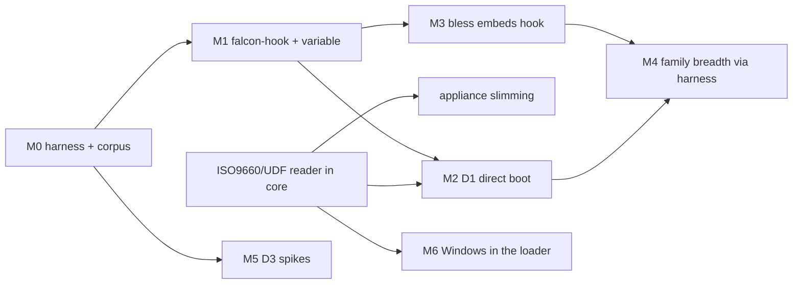

# Coverage roadmap (2026-09-18)

Goal: boot what Ventoy boots, without giving up what makes falcon-boot worth
using over it (verified boot kept intact, no enforcement relaxed in the
loader, a coverage matrix that is tested rather than reported).

The product promise: **Secure Boot off, drag, drop, boot anything. Secure
Boot on, drag, drop, bless, boot.** The architecture that follows from it is
decided in `docs/DESIGN.md` Section 6.4 and the appliance revision in Section
7.5 (both 2026-09-18); this file is the plan, the alternatives and the
milestones. The evidence base is `docs/notes/ventoy-survey.md`.

## Status (2026-09-19, after M0-M6)

M0 through M6 are built; the breadth work of M4 and M6's parity items go on.
The table in
Section 1 is the starting point this plan was written against; what the
harness measures now is `docs/coverage.md`:

| Media | SB off | SB on, db has MS CA | SB on, own keys only |
|---|---|---|---|
| Tier A Linux (13 ISOs on hand), drop | boots, direct | chainloads, media lost | refused |
| Tier A Linux, blessed | boots | boots | boots |
| Tier B installers (Debian netinst, Alpine, Proxmox) | boots, direct | media lost | refused / media lost |
| Fedora, drop | boots, direct | boots, through its own shim | refused |
| Windows install, unprepared | boots, patched in the loader | same | refused |

- **M0**: corpus manifest, harness (serial, DHCP, and the media a direct
  boot reads after the kernel starts), scorecard. The exit's premise did not
  hold: before this work only Arch and Gentoo passed blessed. Debian live
  failed in its initramfs and casper could never pass, because Ubuntu 26.04's
  initramfs has no exFAT driver to find the ISO file with. Both pass now,
  through the hook.
- **M1**: falcon-hook and `FalconIsoMap` (own GUID, versioned layout). Exit
  met in the rig and then by the loader.
- **M2**: direct kernel boot, with boot-config parsing for GRUB (including
  for loops and menuentry arguments, for Manjaro), systemd-boot and
  isolinux. Exit met: all 13 Tier A Linux ISOs on hand pass with Secure Boot
  off and no preparation. Kali is not on hand: its live ISO is distributed
  by torrent only.
- **M3**: every wrap embeds falcon-hook with the CD entry's cmdline, which
  is what fixed blessed casper; blessing from the menu is in (`b` on a row,
  `a` for everything new, one confirmation, the list handed to the appliance
  as a credential, one reboot back into the chosen entry;
  `falcon-appliance/tools/run-bless-chain.sh`). The bless-time dm/loop check
  is deferred: it needs the sign tool to decompress every initramfs format,
  and no corpus distro lacks dm-mod. It comes back when the harness shows one
  that does. The exit's "dropping a new ISO to a booted live desktop" leg is
  hardware work.
- **M5**: D3a is built and measured (`docs/notes/d3-spike.md`): the ISO's
  own shim, with the kernel as its second stage, boots Fedora with Secure
  Boot on and no blessing where db trusts the Microsoft CA. Every other
  corpus kernel lacks the `.sbat` section shim demands of what it loads, so
  the loader checks first. D3b reaches most of the rest: the ISO's own
  signed GRUB with a grub.cfg of ours served in place of its own, and
  falcon-hook's archive as a blocklist initrd past the ISO's end. Merged
  2026-09-19 after the DESIGN 7.2 discussion; with Secure Boot on (MS CA)
  it turned Debian live and netinst, Ubuntu, Kubuntu, Mint, openSUSE and
  Proxmox from FAIL to PASS with no blessing.
- **M6**: the loader patches a Windows ISO's boot.wim as it serves it
  (DESIGN 6.4 has the shape). Windows 11 25H2 and Server 2025 reach Setup
  with Secure Boot off and on (Microsoft CA), and Setup reads its install source through
  the ISO winjump attaches from Windows. The harness judges that directly:
  once Setup's screen is up it opens Setup's console and copies
  `\sources\install.*` to nul, which reads the stick only if Windows has
  the ISO. winjump now links static: WinPE has no `libssp-0.dll`, and the
  missing import killed it before its first log line. Parity: the Win11
  requirement bypass and an unattend file are options in
  `p2:/falcon/windows.cfg` (DESIGN 6.4), proven on a VM with no TPM.
  WinPE media is patched too (a boot.wim behind bootmgr classifies as
  Windows): Macrium Reflect 8's rescue disc passes, and winjump attaches its
  ISO. Still open: a PE whose shell comes from `SYSTEM\Setup\CmdLine`
  rather than winpeshl.exe (Hiren's is one, but its bootmgr faults under
  this OVMF even as a bare CD). ESXi 7.0U3l and 8.0U3 (user-supplied) boot
  with Secure Boot off after two fixes traced on 8.0U3 (DESIGN 7.6): the
  virtual CD's device path root is a hardware vendor node, and an ISO
  payload is loaded by the firmware when shim is not enforcing, so a
  payload that loads a driver of its own has firmware images to work with.
  With Secure Boot on they still fail: shim has hooked the table by then,
  every image in ESXi's chain is shim-made, and the firmware's
  ConnectController faults on one. Only bypassing shim's hook would fix
  that, which the invariants rule out.
- **M4 breadth (2026-09-19)**: the corpus grew to 31 ISOs (Kali by
  torrent, and twelve more families: Hiren's PE, GParted, CachyOS, MX,
  Pop!_OS, Rocky, Alma, Void, NixOS, Leap 16 Agama, TrueNAS, FreeBSD).
  Secure Boot off, drop: Tier A 21/21, Tier B 9/9. MX needed two fixes in
  the hook (depmod when the initramfs ships no modules.dep, and a nudge for
  antiX's USB/CD-only scan). The Tier C misses: Hiren's bootmgr page-faults
  on firmware that write-protects loader pages, as a bare CD with no
  falcon-boot in the chain (which is why it is Tier C); FreeBSD's loader and
  kernel run since the ESXi fixes (DESIGN 7.6) and it stops at mountroot
  with no cd9660 device, which is Section 6.1's media problem on a system
  falcon-hook cannot serve: the hook is a Linux initramfs mechanism. The
  BSD-based firewall installers (pfSense, OPNsense) would measure the same
  gap. Blessed Alpine and Kali pass in all three states now that
  the loader hands a wrap its map as a credential.
- **M4**: the three Tier B installers boot direct with Secure Boot off, each
  through a different gap the hook now closes. Alpine's kernel has no
  efivarfs and no dm-mod: a direct boot now carries the extent map in the
  initrd (`/falcon/map`), and the hook falls back to a read-only loop device
  when the ISO is one contiguous run. Proxmox scans only
  `/sys/block/{hd,sr,scd,sd,nvme}*`: a nudge adds `dm*` to that glob in its
  `/init` (the table in `falcon-hook/src/hookcore.c`). The Debian installer
  has neither dm-mod nor loop: the hook reads
  `loop-modules-<release>-di_*.udeb` out of the ISO's own pool, unpacks it
  with the installer's `udpkg`, loads loop, and mounts the ISO at `/cdrom`,
  which `cdrom-detect` accepts as found. The exit's 90% is of a Tier B of
  three; widening Tier B is the next step, and blessed Alpine still needs a
  map that does not come through efivarfs.

## 1. Where we actually are

| Media | SB off | SB on, db has MS CA | SB on, own keys only |
|---|---|---|---|
| Linux, blessed (6 families) | boots | boots | boots |
| Linux, not blessed | kernel starts, media lost | kernel starts (MS-signed distros), media lost | refused |
| Windows install, prepared | boots | boots | refused (bootmgr is MS-signed) |
| Bare EFI payloads, memtest | boots | boots if MS-signed, else bless | bless |
| BSD (FreeBSD, OPNsense, pfSense) | boots to its installer, the ISO loaded as a memory disk (M7); refused above what the loader can stage below 4 GB | blessed: the medium's own loader signed with the MOK, where shim will parse it | same |
| Everything else (ESXi, WinPE, IMG distros, ChromeOS) | untested | untested | refused unless blessed |

Two things in that table matter more than the rest:

- **With Secure Boot off, an unblessed Linux ISO does not boot today.** The
  loader chainloads the ISO's own GRUB, which passes the stock cmdline, and
  the kernel loses its media at `ExitBootServices` (DESIGN 6.1). DESIGN 7.2's
  "SB off: every templated ISO boots" describes a path that is not built:
  nothing in the loader boots an ISO's kernel directly or appends a cpio.
- **Every Linux boot goes through one per-ISO act (bless) and one per-family
  row (a cmdline template).** Both are human work that grows with the ISO
  count. That is the scaling problem this roadmap is about.

## 2. What "coverage" has to mean

Ventoy's "1300+ tested" is a list of user reports. Ours should be a number a
machine produced.

- **Corpus.** A pinned list of ISOs (URL + SHA-256): distrowatch's top 50,
  every family in the survey, the Windows editions, the common rescue and
  hypervisor media. About 150 images, 300-400 GB; lives on the Unraid box,
  not the stick.
- **Harness.** For each ISO x each boot state (SB off, SB on with MS CA, SB on
  own keys) x each route (drag-and-drop, prepared, blessed): build a rig stick,
  boot under OVMF, and decide pass/fail from the serial console. Linux passes
  when the live system reaches userland (`console=ttyS0` appended, markers
  such as systemd's "Reached target" or a login prompt); Windows when Setup's
  first screen is up (screenshot + a known-pixel check, already done by hand
  on 2026-09-13).
- **Scorecard.** A generated `docs/coverage.md` per release: rows are ISOs,
  columns are state x route, cells are PASS / FAIL / REFUSED-BY-DESIGN. A
  regression is a cell that went red. The headline is Secure Boot off and
  Secure Boot on where db trusts the Microsoft CA; Secure Boot on with only
  the owner's keys is reported beside them without a target (decided
  2026-09-19). Media signed only by Microsoft cannot boot on such a machine
  at all (DESIGN 7.2), and the population that enrolls a MOK but refuses
  Microsoft's CA is small, so one number across both machines would measure
  that choice rather than this loader.

Targets, stated so they can be failed:

| Tier | What | Target |
|---|---|---|
| A | distrowatch top 30, current Windows 10/11/Server, the top 10 CURRENT rescue/utility ISOs | 100% SB off, 95% SB on where db trusts the Microsoft CA (bless allowed) |
| B | every Linux family in the Ventoy survey | 90% SB off |
| C | long tail, BSD, hypervisors, IMG distros | tracked, no target |

## 3. The walls, and the path through each

### W1. The media vanishes after ExitBootServices (Linux)

This is where Ventoy's code lives. Three strategies, in the order they scale.

**L1: cmdline families (what we have).** A registry row per family telling
the stock initramfs to find the ISO file itself (`iso-scan/filename=`,
`findiso=`, `img_loop=`, `from=`, ...). Clean: no code of ours runs in the
target. Limits, measured by the survey:

- about 25 families have such an option; the long tail and every installer
  (Debian d-i, Proxmox, Alpine, most of Anaconda's variants) do not;
- every one needs the initramfs to mount **exFAT**, which RHEL-family kernels
  and others do not carry. This is a per-ISO precondition we do not check.

L1 stays as the preferred route where it works. It will not reach Tier B.

**L2: a generic device hook ("falcon-hook"), the scalable core.** Recreate
the ISO as a block device before the distro's init looks for its media, and
let the distro find it the way it finds a real CD. Mechanism:

1. A small static binary plus a shell stub in a cpio segment appended to the
   distro's own initrd.
2. The ISO's extents on the stick. **Delivered by the loader at boot in a
   volatile EFI variable**, not baked in: the loader already computes the
   extent map to serve the virtual CD, the variable survives the ISO being
   moved or rewritten, and it needs no re-bless. The hook reads it from
   efivarfs.
3. A device-mapper linear target (or, for a contiguous file, a loop device
   with an offset) over the **raw partition**, not over a mounted exFAT. This
   removes the exFAT dependency entirely; it needs `dm-mod` or `loop`, which
   live initramfs carry because they use them for their own squashfs and
   overlay.
4. The device carries the ISO's own ISO9660 label and UUID, so udev's
   `by-label` / `by-uuid` links appear. Most initramfs find their media by
   label or by scanning block devices (dracut `CDLABEL=`, casper, live-boot,
   archiso `archisolabel=`), so for them the hook needs **no per-distro code
   at all**. That is Ventoy's `hook/default` route, and it is the one that
   scales.
5. For the rest, a per-family "nudge": the minimum edit that points the
   distro's init at the device. This is where Ventoy's 58 hook directories
   are knowledge we can learn from (below).

Where the hook runs is a delivery question (W2), not a hook question: inside
a signed blessed wrap under Secure Boot, appended by the loader otherwise.

**L3: take Ventoy's per-distro knowledge.** Two ways, not exclusive:

- *Port it.* Read each Ventoy hook, write the equivalent nudge for
  falcon-hook, prove it in the harness. Slow, clean, and ours.
- *Run it.* Build `ventoy.cpio` from Ventoy's source and supply the
  environment its hooks expect (the `ventoy_os_param` block, a
  `/dev/mapper/ventoy`). Fast coverage, maintained upstream. Costs:
  - GPLv3. Settled 2026-09-18: falcon-boot is GPL-3.0-or-later, so this
    is no longer a blocker.
  - Ventoy's "replace" mode copies its device over `/dev/sdX2`, which on our
    stick is p2, and its hooks assume Ventoy's disk layout. It would need an
    adaptation layer, and it would be signed into every blessed wrap, so we
    would be vouching for code we did not write.

  Recommendation: port, and use Ventoy's hooks as the specification and the
  test oracle ("Ventoy boots it, the harness shows we do not, read its hook").

**Side benefit.** If the variable falcon-hook reads is laid out as Ventoy's
`VentoyOsParam` (GUID 77772020-...), the ISOs that ship "Ventoy compatible"
support find themselves on our stick with no work from us.

### W2. Getting a kernel to run with our cmdline and our initrd

Under each Secure Boot state there is a different answer.

**D1: direct kernel boot from the loader (SB off, and SB on with validation
off).** The loader reads the kernel and initrd out of the ISO, appends the
falcon-hook cpio, and `LoadImage`s the kernel through the shim-verified path
with the family cmdline:

- publish kernel + combined initrd on the existing synthetic filesystem
  (`falcon-efi/src/loader/credfs.c`) and pass `initrd=` in LoadOptions, which
  every EFI-stub kernel understands; or install the
  `LINUX_EFI_INITRD_MEDIA_GUID` LoadFile2 protocol (kernels 5.8+);
- works where UKIs cannot: with validation off, sd-stub's `gBS->LoadImage`
  fails (DESIGN 7.4), but our loader's shim-protocol load does not involve
  sd-stub;
- this is the **true drag-and-drop route**: no bless, no key, no appliance
  reboot, for everyone who runs with Secure Boot off, which is most Ventoy
  users.

It needs **an ISO9660 + Rock Ridge reader** (and UDF, for Windows) in
`falcon-core`, because Linux kernels live in the ISO9660 tree and firmware
only publishes the El Torito FAT image. Decided (DESIGN 6.4): same class of
code as the exFAT and ext4 drivers the loader already runs over
attacker-writable media, held to the same host tests and corruption sweeps.

- *Fallback if the reader proves unworkable:* **prepared Linux media.** The
  appliance extracts kernel + initrd to a sidecar on p2 (no signing, no key)
  and the loader boots the sidecar. Keeps parsing in userland at the cost of
  a prepare-and-reboot per ISO, which breaks the promise; a fallback only.

**D2: blessing (SB on, any db).** What we have: a signed UKI whose initrd is
the distro's plus falcon-hook, with the cmdline embedded. The only route on a
machine with only its owner's keys, and the reliable one everywhere. Changes:

- embed falcon-hook in every wrap, so blessing stops depending on the family
  having a cmdline option;
- check at bless time that what the hook needs (`dm-mod` or `loop`) is in the
  initramfs or the kernel, and refuse with the reason otherwise;
- **bless from the menu** (decided, DESIGN 7.5): a key on a `{NOT BLESSED}`
  row blesses that ISO, one key blesses everything new; the loader confirms,
  hands the appliance the list, and boots the chosen entry when it returns.

**D3: key-less Secure Boot for MS-signed distros (spikes).** On a machine
whose db has the Microsoft CA, a stock Ubuntu/Fedora/Debian/openSUSE ISO
carries an MS-signed shim that trusts its own vendor's kernel. If we can get
that chain to run our cmdline and initrd, those distros boot verified with no
blessing at all. Two candidates, each a spike before any design:

- *D3a, shim second-stage arguments.* `LoadImage` the ISO's own shim with
  LoadOptions naming its kernel as the second stage and carrying our cmdline;
  the kernel is verified by the ISO's shim against its vendor cert; our
  initrd arrives through LoadFile2. Unknowns: whether shim passes the rest of
  LoadOptions through, and whether it accepts a kernel with no `.sbat`.
- *D3b, the `grub.cfg` overlay DESIGN 7.2 parked.* Offline, the appliance
  writes a modified `grub.cfg` (cmdline plus an initrd line for falcon-hook)
  and the loader serves it through the byte-range overlay built for Windows
  (DESIGN 6.3). Config files are unverified under Secure Boot anyway, but this
  is injecting into another vendor's trust chain, which DESIGN asked to
  discuss first. Needs ISO9660/Joliet/UDF directory-record rewriting, done
  offline in userland.

If both spikes fail, D2 covers these distros; D3 is a convenience, not a gap.

### W3. Per-family knowledge does not scale

Answered by L2: most families need zero rows once the device carries the
right label. What is left:

- **Detection** by fingerprint in `falcon-core/src/media/family.c`, which
  only needs a row when a family needs a nudge or a cmdline;
- **kernel/initrd locations**: instead of a per-family table, parse the ISO's
  own boot configuration (GRUB `linux`/`initrd` lines, `loader/entries`,
  isolinux `KERNEL`/`APPEND`) to find the kernel, initrd and default cmdline.
  In userland for bless and prepare; in the loader only if the ISO9660
  decision above goes that way. This is also how Ventoy finds kernels, and it
  retires the kernel table in `falcon-cli/src/sign/isoprobe.c` to a fallback.

### W4. Not Linux

| Shape | Path | Size | Priority |
|---|---|---|---|
| Windows install (10/11/Server) | WIM surgery moves into the loader (decided, DESIGN 6.4): LZX/XPRESS decompression of the metadata resource, the rebuilt resource served through the overlay, UDF records redirected; then Win11 LabConfig/BypassNRO and unattend in winjump | L | Tier A |
| WinPE rescue (Hiren's, Strelec, DLC) | the same loader patch, choosing the shell from `SYSTEM\Setup\CmdLine` in the WIM's hive, several WIMs per ISO | M on top | Tier A |
| VMware ESXi | test as a plain chainload; mboot loads everything into RAM | S | Tier B |
| memtest, `.efi`, bare payloads | done | - | - |
| Proxmox, TrueNAS SCALE, Alpine, XCP-ng installers | L2 falcon-hook with a nudge each; XCP-ng also needs Xen multiboot2, which a UKI cannot express | M each, XCP-ng L | Tier B |
| IMG distros (LibreELEC, Batocera, OpenWrt), ChromeOS Flex | `.img` is already served as a disk; they need L2 against a disk image instead of an ISO | M-L | Tier C |
| FreeBSD family | per-release GEOM module or md-root trick, and an unsigned `loader.efi` to bless | L | Tier C |
| NetBSD, OpenBSD, illumos | Ventoy does not either | - | out |

## 4. When the primary path does not scale, the fallback

| Wall | Primary | Falls back to | Switch when |
|---|---|---|---|
| Media finding | L2 label-matching device hook | L3 per-family nudges ported from Ventoy | harness shows a family FAIL with L2 alone |
| exFAT in initramfs | not needed (raw-partition dm/loop) | L1 cmdline where dm/loop are also missing | a family has neither |
| Kernel location | parse the ISO's own boot config | per-family table (today's) | a config is too dynamic to parse |
| Drag-and-drop, SB off | D1 direct boot, ISO9660 reader in core | prepared Linux media (sidecar) | the reader proves unworkable |
| Windows | WIM surgery in the loader | today's appliance preparation (built, proven) | a Windows build the loader cannot patch |
| Verified boot, MS-signed distros | D3a shim second stage | D3b grub.cfg overlay, then D2 bless | spike fails |
| Verified boot, anything | D2 bless with falcon-hook | nothing; SB off or the platform opt-out | - |
| Hook knowledge | port Ventoy's hooks | run Ventoy's cpio behind an adapter (GPLv3) | port rate cannot keep up with the corpus |

## 5. Phases

- **M0, measure (first, because everything else is judged by it).** Corpus
  manifest, QEMU harness, scorecard generator, run against today's build.
  Exit: a scorecard exists and today's six families show PASS blessed.
- **M1, falcon-hook.** The loader publishes the extent variable; the hook
  builds the device from it with the ISO's label; runs from a hand-built
  initrd in the rig. Exit: an unmodified Debian live and Fedora live ISO find
  their media through the hook alone, no cmdline row.
- **M2, drag-and-drop with SB off.** ISO9660 reader in `falcon-core` (or the
  sidecar alternative), direct kernel boot via credfs, boot-config parsing
  for the kernel and cmdline. Exit: Tier A Linux PASS under SB off with no
  preparation of any kind.
- **M3, bless at scale, smooth enough that permissive is not missed.** Wraps
  embed falcon-hook; bless-time dm/loop check; the loader menu blesses one ISO
  from its `{NOT BLESSED}` row or everything new with one key, confirms, and
  returns to the ISO the user picked. The irreducible cost is one reboot the
  first time an ISO is touched (signing needs userland, invariant 1); every
  boot after is instant. Exit: Tier A Linux PASS under SB on, own keys only,
  and dropping a new ISO to a booted live desktop is one confirmation and one
  automatic reboot.
- **M4, breadth.** Harness-driven: take the red cells, read Ventoy's hook,
  write the nudge, re-run. Exit: Tier B at 90% SB off.
- **M5, D3 spikes.** Two days each, write-up in `docs/notes/`, design only if
  one works. Independent of M1-M4.
- **M7, BSD first class (decided 2026-09-19).** A FreeBSD ISO's loader and
  kernel already run; what is missing is the medium after ExitBootServices,
  which falcon-hook cannot give a system with no Linux initramfs. The route
  is the ISO as a memory disk, and part 1 is **built and measured**
  (`docs/notes/bsd-route.md`): the medium is served with one ISO9660
  directory record added so it contains itself as a file, the four
  `md_image_*` settings written over its `/boot/defaults/loader.conf`, and a
  memory guard that asks the firmware for the allocation FreeBSD's loader is
  about to want. No second device and no Lua patch: the design that needed
  both was dropped the same day, because `md_image_name` would have had to
  name a device index nothing can predict. FreeBSD 15.1 PASSes through the
  harness and pfSense Plus 24.06 reaches its installer; OPNsense 25.1's
  2.2 GB DVD exceeds what FreeBSD's loader can stage below 4 GB and is
  refused by the guard. Ventoy's per-version GEOM module stays the fallback
  for images that large. **Part 2, blessing for BSD, is built and measured**:
  the sign tool signs the ISO's own `loader.efi` with the user's MOK, since a
  UKI wrap has no Linux kernel to wrap here, and the loader starts that
  signed copy with the medium published beside it and named to the platform
  as the medium's own loader, which is what lets FreeBSD work out its device
  (`docs/notes/bsd-route.md`). Exit, measured through the harness rather
  than asserted: **met for FreeBSD**, which PASSes unblessed with Secure Boot
  off and blessed in all three states. **Partly met for pfSense**, which
  PASSes both routes with Secure Boot off and cannot boot with it on at all:
  shim refuses its `loader.efi` with `EFI_UNSUPPORTED` over a zero-length
  section, before any signature is considered, so blessing cannot help.
  **Not met for OPNsense**, whose 2.2 GB DVD exceeds what FreeBSD's loader
  can stage below 4 GB; the guard refuses it in 5 seconds in every state.
- **M6, Windows in the loader.** WIM surgery at boot (needs the UDF reader),
  then winjump parity (Win11 bypass, unattend) and WinPE shells, ESXi test.
  Appliance preparation stays until this passes the scorecard (it passed;
  preparation was removed 2026-09-19).

## 6. The appliance under this model

Decided 2026-09-18 (DESIGN 7.5). It keeps only what needs the private key:

- **Consent in the loader.** Bless one ISO from its row, or everything new
  with one key; the loader confirms, unlocks p3, and boots the appliance with
  the passphrase and the path list as credentials. The appliance signs that
  list with no UI of its own, sets `FalconNextBoot`, reboots, and the loader
  boots the entry the user picked.
- **No media work.** Windows preparation and the p2 survey leave it.
  Preparation was removed on 2026-09-19: the appliance, the sign tool's
  `prepare`, the sidecars and the `kind=prepared` record are gone, and the
  manifest parser skips an old prepared record. The survey stays for the
  interactive appliance, which only blesses and reports Windows media as
  booting as it is.
- **Userland: our one static binary plus `sbsign`.** The key is read from
  p3 with `falcon-core`'s LUKS2 + ext4 into a memfd passed to sbsign as
  `/dev/fd/N`; ISOs are read with `falcon-core`'s ISO9660/UDF reader. Gone:
  cryptsetup, dm-crypt, bsdtar, 7-Zip, libstdc++, wimlib, the separate init.
  Left: kernel, the binary, sbsign + libcrypto, exFAT and vfat modules;
  about 20 MB, 6-8 MB with a custom kernel (not planned: Arch's kernel boots
  on any laptop and costs nothing to maintain).

Order of the appliance work, each shippable on its own:

1. key read via `falcon-core` LUKS2/ext4 + memfd (drops cryptsetup). Done
   2026-09-19 (`falcon-appliance/src/shelf.c`): the initramfs is 15 MB raw,
   4.8 MB compressed;
2. sign tool on the `falcon-core` ISO9660 reader (drops bsdtar; 7-Zip goes
   with the UDF reader);
3. bless-from-menu: the loader UI, the credential list, the non-interactive
   appliance, the return via `FalconNextBoot`;
4. Windows preparation removed once the loader's WIM patch passes the
   scorecard (drops wimlib and winjump from the image). Done 2026-09-19,
   after M6; 7-Zip and its libstdc++ left the image with it (19 MB raw,
   6.2 MB compressed).

## 7. Still open

1. **The extent variable's layout.** Settled 2026-09-18: our own,
   `FalconIsoMap` under its own GUID, versioned (`FLCNXT01`, layout in
   `falcon-core/src/media/extmap.h`), not Ventoy's `VentoyOsParam`. A
   "Ventoy compatible" ISO finds its media through the hook's device and
   label like any other.
2. **Licence.** Settled 2026-09-18: GPL-3.0-or-later (`LICENSE`), which
   is compatible with learning from Ventoy's GPLv3 hooks or reusing them.
3. **The `grub.cfg` overlay** (D3b): decided 2026-09-19, built and merged.
4. **Where the corpus and harness live**: settled 2026-09-19, on
   `binhost-builder` (i9-10900, 20 threads, 62 GB, bare metal with
   `/dev/kvm`), in the container `tools/coverage/Dockerfile` defines and
   `tools/coverage/harness.sh` runs. The corpus is at `/srv/falcon/corpus`,
   all 36 rows verified against `corpus.tsv` after the copy rather than
   trusting the stamp files rsync brought with them. The box is already a
   registered GitLab runner, so the same image is what a corpus pipeline
   stage would use.

   Moving it found three things that had been true only on the laptop: the
   root Makefile takes `CMOCKA_LIBS` from `pkg-config` and degrades to an
   empty variable rather than an error, the `xxd` embed step does the same,
   and `mk-test-trust.sh` ended with an unguarded `ls` that failed the target
   on any machine without the rig's OVMF varstore. A harness that runs in one
   place is a harness whose dependencies are unknown.

5. **Which toolchain the analysis gate answers to**: settled 2026-09-20, the
   harness container on binhost-builder, which pins cppcheck 2.17, clang-tidy
   LLVM 19 and gcc 14. `docs/notes/analyze-baseline.txt` Section 0 says so and
   `docs/notes/analyze.md` says how to run it. The baseline was regenerated
   there and the gate passes: 44 entries, all in `src/`.

   Fixing it turned up a trap worth not repeating. `tools/analyze.sh` keeps
   test sources out of the gate by matching the substring `/src/` in an
   absolute path, and the harness used to mount the tree at `/src`, so every
   path matched. The gate linted the whole test suite and reported 403
   findings, 357 of them in `tests/` and 131 of them clang parse errors
   rather than findings. The mount is `/work` now.

6. **How many cases to run at once.** Settled by measurement rather than
   preference: keep `--jobs` low. At 10 a Kali blessed case panicked in the
   guest with "Attempted to kill init", then passed when run on its own and
   passed in a different Secure Boot state off the same stick. Disk
   contention starves a guest into a failure that reads exactly like a
   product bug, and one flaky cell costs more to chase than the whole run
   saves. `run-corpus.sh` says so at the option.

## 8. Enforcement-off (permissive) mode: build on demand, not scheduled

Discussed and set aside 2026-09-18. An install-time mode where the loader,
after shim verifies it, installs its own EFI Security2 override and chainloads
downstream regardless of signature, the way Ventoy does. It would be a
deliberate, MOK-bound exception to invariants 2 and 3, gated by physical
presence: the mode is baked into the signed loader, switching it regenerates
the MOK so the user re-enrolls at MokManager, and unlike Ventoy it would not
lie to the OS about MokSBState or dbx.

Not scheduled, because smooth blessing (M3) removes the friction case and
firmware Secure Boot off serves the coverage escape hatch. Its unique
territory is narrow: a user who wants to boot unsigned media, cannot or will
not disable Secure Boot in firmware (BitLocker/TPM PCR stability, a BIOS that
hides or locks the toggle), and will enroll a MOK. Real, but small.

It stays a decision on the shelf rather than a plan because it is loader-local
and changes no on-disk format, so it can be added whenever a user actually
asks with no rework. If built: an mkstick `--permissive` flag, the mode bound
to the MOK identity, DESIGN 7.4 rewritten to make it a first-class mode, and
one spike on whether the override must persist past StartImage for the
personal-OS UKI's inner LoadImage to succeed (DESIGN 7.4's UKI limitation).

## 9. BIOS mode: costed on demand, not scheduled

Scoped 2026-09-19, written up in `docs/notes/bios-route.md`. A BIOS-capable
falcon-boot had been given up on because it was believed to mean two
codebases. It does not: falcon-core's 18,675 lines are EFI-free already, and
the read callback plus the `fs_ops` vtable are the per-platform boundary the
idea was reaching for, already drawn and already proven by the host tests,
the CLI tools and the appliance. What a BIOS build adds is roughly 5,300
lines in a new `falcon-bios/`, of which 700 to 800 are assembly, plus about
1,050 lines touched elsewhere.

What it cannot add is any of Section 7's security model. BIOS has no Secure
Boot, no shim and no Authenticode, so `secboot/`, `bless/`, the trust column
and the appliance are absent rather than ported, and the personal OS boots
unverified. It is a different, smaller product sharing a core library.

Not scheduled, for the reason the reach is thin: BIOS-only machines are
pre-2012 and CSM is gone from new firmware, and nobody has asked. Unlike
Section 8 it is not purely loader-local, because BIOS boot from a GPT stick
needs a BIOS boot partition, which is a breaking layout change and a remake
of every existing stick. The two risks that would decide it are the resident
`INT 13h` hook (a spike, not an estimate) and the fact that assembly sits
outside `-fanalyzer`, cppcheck, clang-tidy and the coverage gate, in a
repository that has none today.
